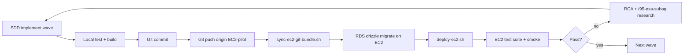

# EC2 Pilot Bug Hunt Fixes Implementation Plan

> **For agentic workers:** REQUIRED SUB-SKILL: Use superpowers:subagent-driven-development (recommended). Model: **composer-2.5** (not fast). Style: **/caveman ultra** in subagent comms. Research: **/95-exa-subag** when stuck.

**Goal:** Real `apps/mail` frontend works against `apps/server-pilot` on EC2 without corrupting prod RDS; code live on EC2 + migrations on RDS; fully verified before user wakes.

**Architecture:** Priority waves — (1) wire compatibility, (2) prod safety, (3) mail correctness, (4) privacy/UX, (5) ops, (6) real ingest readiness + transport handoff. Fake/real share same interfaces via `MAIL_TRANSPORT_MODE=fixture|real`.

**Tech Stack:** Node 22, Hono, tRPC v11, Drizzle, vitest, nginx, PM2, IndexedDB, AWS EC2/RDS/S3/SSM/Secrets Manager.

## Global Constraints

- Branch: `EC2-pilot`. **Push after every commit.** Remote push OK.
- **In scope:** [`apps/server-pilot/`](apps/server-pilot/), targeted [`apps/mail/`](apps/mail/) (cache/polling/auth UX only).
- **Out of scope:** [`apps/server/`](apps/server/) (Workers), AI chat (`trpc.ai.*` — intentional 404), Tier 5 backlog unless prod hits it.
- Prod EC2 + RDS **is** the test rig. Tasks 5–7 before any prod DB scripts.
- Security hardening from [`2026-07-01-ec2-pilot-security-hardening.md`](docs/superpowers/plans/2026-07-01-ec2-pilot-security-hardening.md) must not regress.
- **Cache policy (locked — Task 11):** `PERSIST_MAX_AGE=Infinity`, `QUERY_GC_TIME=Infinity`, list `staleTime=60s`, session `expiresIn` + `cookieCache.maxAge` = 400 days, `updateAge` = 7 days. Post-2017 Chrome/Edge/Firefox/Safari safe.

| Resource | ID |
|----------|-----|
| EC2 | `i-008f737974a9ba9b3` (af-south-1) |
| RDS | `nava-zero-mail-pilot` (Postgres 16) |
| S3 | `nava-zero-mail-845242190536-af-south-1` |
| Repo on EC2 | `/home/ubuntu/repos/zero` |
| Deploy script | [`apps/server-pilot/deploy/deploy-ec2.sh`](apps/server-pilot/deploy/deploy-ec2.sh) |
| Sync script | [`apps/server-pilot/deploy/sync-ec2-git-bundle.sh`](apps/server-pilot/deploy/sync-ec2-git-bundle.sh) |

---

## Commit strategy (7 commits, not 19)

One commit per **wave** — each is independently reviewable, bisect-friendly, and deployable. Subagents implement tasks within a wave; **one commit at wave end** (not per task).

| # | Commits | Tasks bundled | Message |
|---|---------|---------------|---------|
| 1 | Wire | 1–4 | `fix: tRPC POST queries + FE wire contract alignment` |
| 2 | Prod safety | 5–7 | `fix: soft delete bin + seed-prod and benchmark guards` |
| 3 | Mail core | 8–10 | `fix: threading date headers and keyset pagination` |
| 4 | Privacy | 11–12 | `fix: IDB leak session TTL and NO_MAILBOX handling` |
| 5 | Actions + ops | 13–14 | `fix: thread actions and ops traps bundle` |
| 6 | Ingest | 16–17 | `fix: RealPop3Client rewrite and ingest durability` |
| 7 | Transport | 19 | `feat: MAIL_TRANSPORT_MODE fixture|real + IT handoff runbook` |

**Task 18** is verification only — no code commit unless fixes needed; final **`docs: bug-fix EC2 gate complete`** amends ledger only (can squash into commit 7 push or stand alone).

**Why 7 not 19:** Tasks 1–4 are one atomic "app works" unit; splitting creates broken intermediate states. Same for ingest (16+17) and transport (19). Matches how security hardening shipped (~12 tasks, ~13 commits with gate doc).

---

## Autonomous execution protocol (mandatory)

User asleep. **Do not stop for human input** unless blocked by missing AWS creds or IT-only secrets. Full permission for EC2/RDS/SSM/S3.

### Loop (repeat until all gates green)



### 1. Implement (SDD)

- Fresh **composer-2.5** subagent per task within wave; two-stage review (spec + quality) between tasks.
- Read task detail from this plan + [`.cursor/plans/ec2_pilot_bug_fixes_e1d227d9.plan.md`](file:///c:/Users/gamin/.cursor/plans/ec2_pilot_bug_fixes_e1d227d9.plan.md) (Tasks 1–19 full steps/code).
- TDD: failing test → implement → pass.

### 2. Local gate (before each commit)

```bash
pnpm --filter @zero/server test
pnpm --filter @zero/mail test
pnpm --filter @zero/server build
pnpm --filter @zero/mail build
```

Expected: all runnable tests pass; builds green. DB tests skip locally unless `TEST_DB_AVAILABLE`.

### 3. Commit + push (after each wave)

```bash
git add <wave files>
git commit -m "$(cat <<'EOF'
fix: <wave message from table above>

EOF
)"
git push origin EC2-pilot
```

### 4. EC2 sync + RDS migrate + deploy

From laptop (after push):

```bash
bash apps/server-pilot/deploy/sync-ec2-git-bundle.sh
```

SSM on EC2 (via existing wrapper or `aws ssm send-command`):

```bash
cd /home/ubuntu/repos/zero
source apps/server-pilot/.env.production  # or /home/ubuntu/.env.production
pnpm --filter @zero/server db:migrate
bash apps/server-pilot/deploy/deploy-ec2.sh
```

**Migrations touch prod RDS** — expected; `trashed_at` + quarantine unique index are forward-only.

### 5. EC2 verification (after each deploy; full matrix on final deploy)

**Always:**

```bash
curl -fsS http://127.0.0.1:8788/health
pm2 status   # http + worker; worker not errored when POP3 unset
```

**After wave 1 (wire):** POST tRPC `mail.listThreads` returns 200 (not 405). Run [`load-50-users.ts`](apps/server-pilot/scripts/load-50-users.ts) — assert 200s.

**After wave 3 (mail core):** targeted ingest/thread tests on EC2:

```bash
cd /home/ubuntu/repos/zero/apps/server-pilot
export NODE_ENV=test
pnpm exec vitest run tests/thread-join.test.ts tests/list-pagination.test.ts tests/ingest-store.test.ts
```

**Final gate (Task 18 — full):**

| Check | Command / action | Pass criteria |
|-------|------------------|---------------|
| Server tests | `pnpm --filter @zero/server test` on EC2 | 0 fail (skips OK) |
| Mail tests | `pnpm --filter @zero/mail test` on EC2 | green |
| Builds | already in deploy-ec2.sh | green |
| Health | `curl /health` | `{"ok":true}` |
| Fixture ingest | worker one cycle, `MAIL_TRANSPORT_MODE=fixture` | rows in RDS, PM2 logs `transport.mode=fixture`, no TCP to mail server |
| UI smoke | curl/tRPC sequence or browser MCP if available | login → inbox → thread → settings → delete → undo |
| Load gate | `tsx scripts/load-50-users.ts` | all probes 200 |
| Benchmark guard | `tsx scripts/ingest-benchmark.ts` without flag | exits refused on prod |
| Nginx body | upload ~2MB attachment test | not 413 |
| Transport | PM2 logs | `fixture` mode, FakeSmtp ring buffer bounded |

**SSM stdout caveat:** strip non-ASCII before Windows JSON parse (`tr -d '\200-\377'` or EC2-side sed).

### 6. RCA on failure (mandatory before retry)

1. Capture: failing command, exit code, pm2 logs (`pm2 logs http --lines 50 --nostream`), nginx error log if 413/502.
2. Reproduce locally if possible.
3. **/95-exa-subag** — search error + library version until 95% confident in root cause.
4. Fix minimal diff; re-run local gate → commit → push → sync → deploy → verify.
5. **Do not skip gates** or mark complete with failing tests.

### 7. Progress tracking

- Update [`.superpowers/sdd/progress.md`](.superpowers/sdd/progress.md) after each wave.
- Final: update [`progress-ledger.md`](docs/superpowers/plans/handoff-reports/progress-ledger.md) with commit SHAs + EC2 gate results.
- Save plan copy to [`docs/superpowers/plans/2026-07-02-ec2-pilot-bug-fixes.md`](docs/superpowers/plans/2026-07-02-ec2-pilot-bug-fixes.md) on execute start.

### 8. Checkpoint deploys

- **Minimum:** deploy after waves 1, 3, 7 + final gate.
- **If wave 1 EC2 smoke fails:** stop wave 2 until wire fixed (app-dead priority).

---

## Task summary (detail in cursor plan file)

Full TDD steps, code snippets, and file paths: Tasks 1–19 unchanged from draft — see linked cursor plan. Summary:

| Task | One-liner |
|------|-----------|
| 1 | `allowMethodOverride: true` + load script 200 asserts |
| 2–4 | Wire contract: ids/folders/send/get/drafts/settings/user |
| 5 | `trashedAt` migration + bin/undo soft delete |
| 6 | seed-prod secret-first, `--rotate` gate, transaction |
| 7 | ingest-benchmark `--allow-prod` guard |
| 8–9 | Thread join + references normalize + Date header |
| 10 | SQL keyset pagination mail + drafts |
| 11 | IDB persist gate + Infinity TTL + 400d session + IDB degrade |
| 12 | `NO_MAILBOX` not `FORBIDDEN` |
| 13 | markAsUnread / toggleImportant / snooze filter |
| 14 | nginx 35m, pm2 worker idle, env quoting, FakeSmtp ring, setDefault, SIGTERM |
| 16 | RealPop3Client byte queue + auth + socket tests |
| 17 | Quarantine idempotency, poison cap, stable S3 keys, worker hardening |
| 19 | `MAIL_TRANSPORT_MODE` + RealSmtp + `activate-real-mail.sh` + runbook |
| 18 | **Autonomous verification gate** (section above) |

---

### Task 18: Autonomous EC2/RDS verification gate (expanded)

**Files:**
- Modify: [`docs/superpowers/plans/handoff-reports/progress-ledger.md`](docs/superpowers/plans/handoff-reports/progress-ledger.md)
- Create: [`docs/superpowers/plans/handoff-reports/2026-07-02-bug-fix-gate-report.md`](docs/superpowers/plans/handoff-reports/2026-07-02-bug-fix-gate-report.md)

- [ ] **Step 1:** Run full local gate (both packages test + build)
- [ ] **Step 2:** Push all 7 commits; final `git push origin EC2-pilot`
- [ ] **Step 3:** `sync-ec2-git-bundle.sh` → EC2 at latest SHA
- [ ] **Step 4:** EC2 `pnpm --filter @zero/server db:migrate` — verify `trashed_at` + quarantine index on RDS via psql
- [ ] **Step 5:** `deploy-ec2.sh` — health + pm2 + nginx reload
- [ ] **Step 6:** EC2 full test suite (`NODE_ENV=test`, sourced `.env.production`)
- [ ] **Step 7:** `load-50-users.ts` — 200 on list/get
- [ ] **Step 8:** Fixture worker cycle — bounded FakePop3, idempotent UIDLs, no benchmark pollution
- [ ] **Step 9:** Manual/tRPC smoke — login, inbox, thread, reply, settings save, delete+undo, pagination page 2
- [ ] **Step 10:** Negative checks — benchmark refused; signup still 403; `ingest-benchmark` no `--allow-prod` exits 1
- [ ] **Step 11:** Write gate report + ledger; commit `docs: bug-fix EC2 gate complete`; push
- [ ] **Step 12:** If any step fails → RCA protocol → fix → re-run from failed step (do not declare done)

**Real POP3/SMTP:** stays `MAIL_TRANSPORT_MODE=fixture` until user pastes IT creds. Code ready; ops flip documented in Task 19 runbook.

---

## Self-review

- **Spec coverage:** Tier 0–4 bugs → Tasks 1–19. Tier 5 backlog excluded (documented in cursor plan).
- **Autonomous deploy/test:** Added protocol + expanded Task 18.
- **Commit strategy:** 7 waves + optional docs commit.
- **Placeholder scan:** None in new sections; task detail references existing draft.

---

## Execution handoff

**User approved (`lgtm`) + autonomous overnight run authorized.**

**Execution mode:** Subagent-Driven Development, composer-2.5, 7 commits, push each wave, deploy + verify on EC2/RDS, RCA loop until green.

**On confirm:** Copy plan to `docs/superpowers/plans/2026-07-02-ec2-pilot-bug-fixes.md` and begin Wave 1 (Tasks 1–4).
