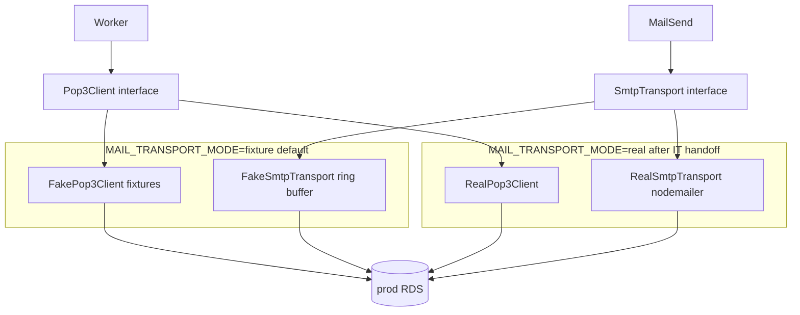

# EC2 Pilot Bug Hunt Fixes Implementation Plan

> **For agentic workers:** REQUIRED SUB-SKILL: Use superpowers:subagent-driven-development (recommended) or superpowers:executing-plans to implement this plan task-by-task. Steps use checkbox (`- [ ]`) syntax for tracking.

**Goal:** Make the real `apps/mail` frontend work against `apps/server-pilot` on EC2 without silently corrupting prod RDS data.

**Architecture:** Fix in priority waves — (1) **wire compatibility** (one-line tRPC fix + align pilot router inputs/outputs to the frontend wire format, using legacy `apps/server/src/trpc/routes/*` as read-only reference — do **not** modify `apps/server`), (2) **prod safety** (soft-delete, seed/benchmark guards), (3) **mail correctness** (thread join, dates, SQL pagination), (4) **privacy/UX** (IDB scope gate, zero-mailbox handling), (5) **ops** (nginx, pm2, env quoting, FakeSmtp cap, graceful shutdown), (6) **real ingest readiness** (RealPop3Client rewrite + ingest durability so code is production-ready before IT turns on Exchange POP3 — VPN/transport rules remain ops, not code).

**Tech Stack:** Node 22, Hono, tRPC v11, Drizzle, vitest, nginx, PM2, IndexedDB persister (`apps/mail`).

## Global Constraints

- Branch: `EC2-pilot`. Push to remote OK.
- **In scope:** `apps/server-pilot/`**, targeted `apps/mail/**` (cache/polling only).
- **Out of scope:** `apps/server/**` (Cloudflare Workers), AI chat (`trpc.ai.*` — pilot has no `ai` router; FE AI compose/webSearch will 404 — intentional), Intercom boot (P3 unless you use it). **In scope but ops-gated:** Exchange transport rules, VPN reachability, production TLS cert — code must be ready; IT still flips the switch.
- Prod EC2 + RDS is the test rig — Tasks 5–7 must ship before any further prod DB scripts.
- **Pilot scope (production, narrowed):** Centurion hotel, **3 mailboxes**, ~**1,000 inbound/day** cap (not full 15k). Same EC2/RDS/S3 — real infra, fixture transport until IT handoff.
- **Transport phases:** `MAIL_TRANSPORT_MODE=fixture` (default) runs fake POP3/SMTP mirrors on prod for autonomous deploy gates; `MAIL_TRANSPORT_MODE=real` flips to Exchange POP3/SMTP when IT provides creds — **one env flip + redeploy**, no code fork.
- Security hardening from `[docs/superpowers/plans/2026-07-01-ec2-pilot-security-hardening.md](docs/superpowers/plans/2026-07-01-ec2-pilot-security-hardening.md)` stays; do not regress.
- **Cache policy (locked — Task 11):**

| Layer | Setting | Value | Notes |
|-------|---------|-------|-------|
| IndexedDB persist | `PERSIST_MAX_AGE` | `Infinity` | Never discard hydrated cache on age |
| In-memory | `QUERY_GC_TIME` | `Infinity` | No TanStack age-based eviction |
| Inbox freshness | `staleTime` (listThreads) | **60s** (unchanged) | Instant IDB paint + background refetch for new mail |
| Session DB | `expiresIn` | **400 days** | Chrome hard-caps cookie Max-Age at 400d |
| Session cookie cache | `cookieCache.maxAge` | **400 days** | Same cap; skips DB on routine requests |
| Session sliding | `updateAge` | **7 days** | Active user extends another 400d each week |

- **Browser minimum (pilot workstations — post-2017):** Chrome **58+** / Edge **79+** (Chromium) / Firefox **51+** / Safari **15+**. IndexedDB + Promises required. **Not supported:** IE11, legacy Edge (pre-Chromium), WebViews without IDB. Post-2017 OS with auto-updating Chrome/Edge = **safe**. Optional: IDB-missing → skip persist, network-only (Task 11 Step 7).

---

## File map


| Wave           | Create                                                                                                                                                         | Modify                                                                                                                                                                                                                                                                                                                                                    |
| -------------- | -------------------------------------------------------------------------------------------------------------------------------------------------------------- | --------------------------------------------------------------------------------------------------------------------------------------------------------------------------------------------------------------------------------------------------------------------------------------------------------------------------------------------------------- |
| T0 wire        | `[apps/server-pilot/src/trpc/wire-compat.ts](apps/server-pilot/src/trpc/wire-compat.ts)` (shared mappers)                                                      | `[main.ts](apps/server-pilot/src/main.ts)`, `[mail.ts](apps/server-pilot/src/trpc/routes/mail.ts)`, `[drafts.ts](apps/server-pilot/src/trpc/routes/drafts.ts)`, `[settings.ts](apps/server-pilot/src/trpc/routes/settings.ts)`, `[user.ts](apps/server-pilot/src/trpc/routes/user.ts)`, `[load-50-users.ts](apps/server-pilot/scripts/load-50-users.ts)`  |
| T1 prod safety | migration `trashed_at`, `[tests/trash-soft-delete.test.ts](apps/server-pilot/tests/trash-soft-delete.test.ts)`                                                 | `[schema/mail.ts](apps/server-pilot/src/db/schema/mail.ts)`, `[mail.ts](apps/server-pilot/src/trpc/routes/mail.ts)`, `[seed-prod.ts](apps/server-pilot/scripts/seed-prod.ts)`, `[seed.ts](apps/server-pilot/src/db/seed.ts)`, `[ingest-benchmark.ts](apps/server-pilot/scripts/ingest-benchmark.ts)`                                                      |
| T2 mail core   | `[tests/thread-join.test.ts](apps/server-pilot/tests/thread-join.test.ts)`, `[tests/list-pagination.test.ts](apps/server-pilot/tests/list-pagination.test.ts)` | `[store.ts](apps/server-pilot/src/mail/ingest/store.ts)`, `[parse-message.ts](apps/server-pilot/src/mail/ingest/parse-message.ts)`, `[mail.ts](apps/server-pilot/src/trpc/routes/mail.ts)`, `[drafts.ts](apps/server-pilot/src/trpc/routes/drafts.ts)`                                                                                                    |
| T2 privacy     | [`cache-ttl.ts`](apps/mail/lib/mail/cache-ttl.ts) | [`query-provider.tsx`](apps/mail/providers/query-provider.tsx), [`nav-user.tsx`](apps/mail/components/ui/nav-user.tsx), [`auth.ts`](apps/server-pilot/src/lib/auth.ts), [`context.ts`](apps/server-pilot/src/trpc/context.ts), [`trpc.ts`](apps/server-pilot/src/trpc/trpc.ts) |
| T3 ops         | —                                                                                                                                                              | `[nginx.conf](apps/server-pilot/deploy/nginx.conf)`, `[pm2.config.cjs](apps/server-pilot/deploy/pm2.config.cjs)`, `[write-ec2-env.sh](apps/server-pilot/deploy/write-ec2-env.sh)`, `[smtp.ts](apps/server-pilot/src/mail/send/smtp.ts)`, `[connections.ts](apps/server-pilot/src/trpc/routes/connections.ts)`, `[main.ts](apps/server-pilot/src/main.ts)` |
| T4 ingest      | `[tests/pop3-client-socket.test.ts](apps/server-pilot/tests/pop3-client-socket.test.ts)`, migration quarantine unique index, `[deploy/it-handoff-runbook.md](apps/server-pilot/deploy/it-handoff-runbook.md)`, `[scripts/activate-real-mail.sh](apps/server-pilot/scripts/activate-real-mail.sh)` | `[pop3-client.ts](apps/server-pilot/src/mail/ingest/pop3-client.ts)`, `[worker.ts](apps/server-pilot/src/mail/ingest/worker.ts)`, `[store.ts](apps/server-pilot/src/mail/ingest/store.ts)`, `[s3.ts](apps/server-pilot/src/mail/storage/s3.ts)`, `[smtp.ts](apps/server-pilot/src/mail/send/smtp.ts)`, `[env.ts](apps/server-pilot/src/env.ts)`, `[write-ec2-env.sh](apps/server-pilot/deploy/write-ec2-env.sh)` |




**Key rule:** Fake and real share the **same interfaces** (`Pop3Client`, `SmtpTransport`) and the **same downstream path** (S3 → PG tx → DELE / SMTP accept → message row). EC2 deploy gates exercise fixture mode on prod RDS. IT handoff = set secrets + `MAIL_TRANSPORT_MODE=real` + redeploy via [`activate-real-mail.sh`](apps/server-pilot/scripts/activate-real-mail.sh).

---

### Task 1: tRPC POST query fix + load gate

**Files:**

- Modify: `[apps/server-pilot/src/main.ts:67-77](apps/server-pilot/src/main.ts)`
- Modify: `[apps/server-pilot/scripts/load-50-users.ts](apps/server-pilot/scripts/load-50-users.ts)`
- Test: extend deploy/load tests

**Interfaces:**

- Produces: queries/mutations both accept POST from FE

- [ ] **Step 1: Write failing test** — assert `fetchRequestHandler` config includes `allowMethodOverride: true` (or integration test POST `mail.listThreads` returns 200 not 405)
- [ ] **Step 2: Run test** — expect FAIL
- [ ] **Step 3: Implement**

```typescript
// main.ts — inside fetchRequestHandler({...})
allowMethodOverride: true,
```

- [ ] **Step 4: Fix load script** — require `res.status === 200` for list/get probes, not just `fiveXx === 0`

- [ ] **Step 5: Commit** — `fix: allow tRPC POST queries from frontend`

---

### Task 2: Contract alignment — bulk mutations + folders

**Files:**

- Modify: `[apps/server-pilot/src/trpc/routes/mail.ts](apps/server-pilot/src/trpc/routes/mail.ts)`
- Test: `[apps/server-pilot/tests/mail-wire-contract.test.ts](apps/server-pilot/tests/mail-wire-contract.test.ts)` (new)

**Wire format (from FE):**

- Bulk inputs use `{ ids: string[] }` not `threadIds`
- Snooze: `{ ids, wakeAt: Date }` not `{ threadIds, snoozedUntil }`
- `modifyLabels`: `{ threadId: string[], addLabels/removeLabels }`
- Folders: accept `draft`, `archive`, `bin`, `spam` (map internally)

- [ ] **Step 1: Failing tests** — golden payloads copied from `[use-optimistic-actions.ts](apps/mail/hooks/use-optimistic-actions.ts)` parse without zod error
- [ ] **Step 2: Implement input schemas** — accept FE keys via `.transform()` or dual-field union; normalize to internal names

```typescript
const bulkIds = z.object({
  ids: z.array(z.string()),
}).transform(({ ids }) => ({ threadIds: ids }));
```

- [ ] **Step 3: Extend `FOLDER_VALUES`** — add `draft`, `archive`, `bin`, `spam`; map `draft` → empty (drafts router), `archive` → `isArchived`, `bin` → `trashedAt IS NOT NULL` (after Task 4), `spam` → label id `SPAM` in `labelIds`

- [ ] **Step 4: Run tests + commit**

---

### Task 3: Contract alignment — mail.send + mail.get

**Files:**

- Modify: `[apps/server-pilot/src/trpc/routes/mail.ts](apps/server-pilot/src/trpc/routes/mail.ts)`
- Create: `[apps/server-pilot/src/trpc/wire-compat.ts](apps/server-pilot/src/trpc/wire-compat.ts)`

**Wire format:**

- Send: `to: {email,name}[]`, `message` (body), `attachments`, `fromEmail: "Name <addr>"`, optional `draftId`
- Get: return `ParsedMessage[]` ascending — fields `sender`, `decodedBody`, `receivedOn`, `unread`, `attachments` metadata

- [ ] **Step 1: Failing tests** — send payload from `[create-email.tsx:107-116](apps/mail/components/create/create-email.tsx)` passes; get output matches shape FE reads in `[use-threads.ts:235-257](apps/mail/hooks/use-threads.ts)`
- [ ] **Step 2: Implement `parseFromEmail(display: string)`** — extract bare email before spoof check
- [ ] **Step 3: Map send input** — `message` → html/text, coerce recipient objects → strings for SMTP
- [ ] **Step 4: Implement `toParsedMessage(row)`** — order `orderBy(asc(message.receivedAt))`; join attachment metadata
- [ ] **Step 5: Consume `draftId`** — on successful send, mark draft `isSent=true` / set `sentMessageId`
- [ ] **Step 6: Commit**

---

### Task 4: Contract alignment — drafts + settings + user

**Files:**

- Modify: `[drafts.ts](apps/server-pilot/src/trpc/routes/drafts.ts)`, `[settings.ts](apps/server-pilot/src/trpc/routes/settings.ts)`, `[user.ts](apps/server-pilot/src/trpc/routes/user.ts)`

- [ ] **Step 1: drafts.create** — accept string `to` (comma-split), `body`/`message`, optional client `id`; upsert on `id`
- [ ] **Step 2: settings.save** — input `userSettingsSchema.partial()` bare; return `{ success: true }`
- [ ] **Step 3: user.getIntercomToken** — return `null` (bare) not `{ token: null }`
- [ ] **Step 4: Tests + commit**

---

### Task 5: Soft delete / bin (replaces hard DELETE)

**Files:**

- Create: drizzle migration adding `trashed_at timestamptz` to `mail_thread`
- Modify: `[schema/mail.ts](apps/server-pilot/src/db/schema/mail.ts)`, `[mail.ts](apps/server-pilot/src/trpc/routes/mail.ts)`

**Default assumption (HITL):** real trash column — matches UI undo/bin. Change to `isArchived`-only if you prefer cheaper model.

- [ ] **Step 1: Migration + schema**

- [ ] **Step 2: `bulkDelete`/`delete`** — set `trashedAt = now()`, clear on undo via unsnooze-style restore endpoint or reuse `modifyLabels` TRASH pattern

- [ ] **Step 3: Inbox filter** — exclude `trashedAt IS NOT NULL`; bin folder filters `trashedAt IS NOT NULL`

- [ ] **Step 4: Hard delete only from bin "delete forever"** — keep existing DELETE for explicit permanent path

- [ ] **Step 5: Tests + commit**

---

### Task 6: seed-prod password safety

**Files:**

- Modify: `[scripts/seed-prod.ts](apps/server-pilot/scripts/seed-prod.ts)`, `[src/db/seed.ts](apps/server-pilot/src/db/seed.ts)`

- [ ] **Step 1: Test** — mock AWS failure after DB write should not happen (passwords only rotated when `--rotate` or account missing)
- [ ] **Step 2: Reorder** — `create-secret` if missing, then `put-secret-value`, then DB seed
- [ ] **Step 3: Gate rotation** — `seedAll(db, { rotatePasswords: flags.rotate })`; default false when account exists
- [ ] **Step 4: Wrap user+account upsert in transaction** (fixes D15)
- [ ] **Step 5: Commit**

---

### Task 7: ingest-benchmark prod guard

**Files:**

- Modify: `[scripts/ingest-benchmark.ts](apps/server-pilot/scripts/ingest-benchmark.ts)`

- [ ] **Step 1: Refuse** when `DATABASE_URL` matches pilot prod host OR transport id is pilot ingest mailbox unless `--allow-prod`
- [ ] **Step 2: Optional `--cleanup`** flag deletes benchmark rows by subject prefix
- [ ] **Step 3: Commit**

---

### Task 8: Threading fix (A1 + A10 + A13 + A9)

**Files:**

- Modify: `[store.ts](apps/server-pilot/src/mail/ingest/store.ts)`, `[parse-message.ts](apps/server-pilot/src/mail/ingest/parse-message.ts)`
- Create: `[tests/fixtures/reply-in-thread.eml](apps/server-pilot/tests/fixtures/reply-in-thread.eml)`

- [ ] **Step 1: stripAngles on references entries**
- [ ] **Step 2: `resolveThreadId`** — lookup `message.messageIdHeader IN (inReplyTo, ...references)` for transport; fallback own messageId; fallback `no-message-id-${uidl}`
- [ ] **Step 3: On thread reuse** — `UPDATE mail_thread SET latest_message_at, snippet, is_read=false, updated_at`
- [ ] **Step 4: Move thread resolve inside message transaction** (D9)
- [ ] **Step 5: Reply fixture test — second message joins first thread**
- [ ] **Step 6: Commit**

---

### Task 9: Date header parsing (A2)

**Files:**

- Modify: `[parse-message.ts:214-215](apps/server-pilot/src/mail/ingest/parse-message.ts)`

```typescript
const dateVal = headers.get('date');
const receivedAt =
  dateVal instanceof Date ? dateVal :
  typeof dateVal === 'string' ? parseDate(dateVal) : null;
```

- [ ] **Step 1: Test asserts `receivedAt` from fixture ≠ ingest time**

- [ ] **Step 2: Implement + commit**

---

### Task 10: SQL keyset pagination (B2 + B12 + B14)

**Files:**

- Modify: `[mail.ts](apps/server-pilot/src/trpc/routes/mail.ts)`, `[drafts.ts](apps/server-pilot/src/trpc/routes/drafts.ts)`

- [ ] **Step 1: Failing test** — 55 threads, page 2 returns rows
- [ ] **Step 2: Cursor in WHERE** — `(latestMessageAt, id) < (cursorTs, cursorId)` with `NULLS LAST`
- [ ] **Step 3: Push `q` ILIKE + labelIds jsonb into SQL before LIMIT**
- [ ] **Step 4: drafts.list** — same keyset on `(updatedAt, id)`
- [ ] **Step 5: Commit**

---

### Task 11: IDB leak fixes + long cache TTL (E1 + E2 + E5 + C8)

**Files:**

- Modify: [`query-provider.tsx`](apps/mail/providers/query-provider.tsx), [`nav-user.tsx`](apps/mail/components/ui/nav-user.tsx)
- Modify: [`auth.ts`](apps/server-pilot/src/lib/auth.ts)
- Create: [`apps/mail/lib/mail/cache-ttl.ts`](apps/mail/lib/mail/cache-ttl.ts) (shared constants)

**Security fixes (must ship first):**

- [ ] **Step 1: Gate persist** — `persistQueryClient` only when `scope.userId && scope.activeTransportId`
- [ ] **Step 2: FORBIDDEN path** — call `runLogoutCleanup` before redirect
- [ ] **Step 3: Logout** — `await toast.promise(p, opts).unwrap()` before `window.location.href`
- [ ] **Step 4: Bump `CACHE_BURST_KEY`** + one-time delete legacy `zero-query-cache-default`

**Long cache TTL (user decision — research-backed):**

- [ ] **Step 5: IndexedDB persist — effectively forever**

```typescript
// apps/mail/lib/mail/cache-ttl.ts
/** TanStack persist: never discard hydrated cache on age alone. */
export const PERSIST_MAX_AGE = Infinity;
/** In-memory gc: disable age-based eviction (TanStack supports Infinity). */
export const QUERY_GC_TIME = Infinity;
```

```typescript
// query-provider.tsx — defaultOptions.queries.gcTime + persistOptions.maxAge
gcTime: QUERY_GC_TIME,
// ...
persistOptions={{ maxAge: PERSIST_MAX_AGE, buster: CACHE_BURST_KEY, ... }}
```

- **Do not** set inbox `staleTime: Infinity` — keep list at 60s so new mail still refetches in background; IDB gives instant paint, network gives freshness.

- [ ] **Step 6: Session login — 400-day sliding (Chrome max)**

```typescript
// auth.ts — seconds, not ms
const SESSION_TTL_SEC = 60 * 60 * 24 * 400; // Chrome caps Set-Cookie at 400 days
session: {
  cookieCache: { enabled: true, maxAge: SESSION_TTL_SEC },
  expiresIn: SESSION_TTL_SEC,
  updateAge: 60 * 60 * 24 * 7, // active user extends another 400d each week
},
```

- [ ] **Step 7: IDB graceful degrade** — if `typeof indexedDB === 'undefined'`, skip persist (restore returns undefined); app works network-only

```typescript
// createIDBPersister — wrap set/get in try/catch; log once, never throw
```

- [ ] **Step 8: Tests** — persist gate; `cache-ttl.ts` constants; auth TTL test; optional IDB-missing mock
- [ ] **Step 9: Commit**

**Browser compatibility (post-2017):** Chrome 58 shipped Mar 2017 (IDB 2.0 baseline). Any hotel PC from 2017+ on current Chrome/Edge passes. idb-keyval v6 needs Promises (Chrome 32+, 2014). Risk only on frozen ancient browsers or IE — out of pilot scope.

**Caveats (not TTL):** User clears site data → IDB gone. Disk-full → Chrome may LRU-evict IDB. Shared workstation → logout still required (Task 11 security steps).

**Note:** Full E3/E6 fix (scope as React state) remains optional follow-up.

---

### Task 12: Zero-mailbox handling (C4)

**Files:**

- Modify: `[context.ts](apps/server-pilot/src/trpc/context.ts)`, `[trpc.ts](apps/server-pilot/src/trpc/trpc.ts)`

- [ ] **Step 1: Replace `MailboxForbiddenError` for zero-access signup case** with empty transport list response on `connections.list`; dedicated error code `NO_MAILBOX` (not message `FORBIDDEN`) for mailbox procedures
- [ ] **Step 2: FE** — only auto-signOut on literal `FORBIDDEN`, show "No mailbox assigned" for `NO_MAILBOX`
- [ ] **Step 3: Tests + commit**

---

### Task 13: Thread actions completeness (B9–B11)

**Files:**

- Modify: `[mail.ts](apps/server-pilot/src/trpc/routes/mail.ts)`

- [ ] **markAsUnread** — also `UPDATE message SET is_read=false`
- [ ] **toggleImportant** — treat `'IMPORTANT'` as literal in `labelIds` jsonb (match `labels.list` synthetic id)
- [ ] **snooze inbox filter** — `and(or(isNull(snoozedUntil), lte(snoozedUntil, now())))`; lazy-clear expired snooze on list
- [ ] **Tests + commit**

---

### Task 14: Ops traps (Tier 3 bundle)

**Files:**

- `[deploy/nginx.conf](apps/server-pilot/deploy/nginx.conf)` — `client_max_body_size 35m;`
- `[deploy/pm2.config.cjs](apps/server-pilot/deploy/pm2.config.cjs)` — worker `autorestart: false` OR idle sleep loop in worker when POP3 unset
- `[deploy/write-ec2-env.sh](apps/server-pilot/deploy/write-ec2-env.sh)` — quote all values `'...'`
- `[src/mail/send/smtp.ts](apps/server-pilot/src/mail/send/smtp.ts)` — ring buffer max 100; respect `MAIL_TRANSPORT_MODE` (see Task 19)
- `[src/trpc/routes/connections.ts](apps/server-pilot/src/trpc/routes/connections.ts)` + migration `mailbox_access.is_default boolean` — persist `setDefault`
- `[src/main.ts](apps/server-pilot/src/main.ts)` — SIGTERM → `server.close()` → `closeDb()`

- [ ] **Implement each with deploy-config test assertions**
- [ ] **Commit as `fix: ops traps nginx pm2 env smtp shutdown`**

---

### Task 16: RealPop3Client rewrite (A3–A6, A17)

**Files:**
- Modify: [`apps/server-pilot/src/mail/ingest/pop3-client.ts`](apps/server-pilot/src/mail/ingest/pop3-client.ts)
- Modify: [`apps/server-pilot/src/env.ts`](apps/server-pilot/src/env.ts), [`apps/server-pilot/deploy/write-ec2-env.sh`](apps/server-pilot/deploy/write-ec2-env.sh)
- Create: [`apps/server-pilot/tests/pop3-client-socket.test.ts`](apps/server-pilot/tests/pop3-client-socket.test.ts)

**Interfaces:**
- Produces: `RealPop3Client` with instance-level byte buffer, working auth, timeouts, UIDL cache per session

- [ ] **Step 1: Socket-mock failing tests** — simulate chunked TCP: multi-line UIDL split across reads, RETR body + `.` terminator, bytes dropped between `readLine` calls must not hang

```typescript
// pop3-client-socket.test.ts — fake net.Socket pushing chunks
it('multiline UIDL survives split chunks', async () => { /* ... */ });
it('RETR raw body is byte-identical (latin-1 fixture)', async () => { /* ... */ });
```

- [ ] **Step 2: Instance line queue** — persistent `'data'` listener appends to `this.byteBuf`; `readLine()` splits on `\r\n` at byte level (no UTF-8 decode until line is complete for control responses; RETR body stays raw `Buffer[]`)

- [ ] **Step 3: RETR reassembly** — accumulate `Buffer[]`, join with `\r\n`, dot-unstuff at byte level; remove `TextDecoder` from raw MIME path (fixes A4)

- [ ] **Step 4: Auth wiring** — resolve `POP3_PASSWORD` from env or `POP3_SECRET_ARN` via Secrets Manager in `connect()`; fail fast if missing when `kind === 'real'` (fixes A5). Add vars to `env.ts` + `write-ec2-env.sh` (quoted)

- [ ] **Step 5: Socket lifecycle** — `sock.setTimeout(60_000)`, persistent `error`/`close` handlers, reject in-flight ops on close (fixes A6)

- [ ] **Step 6: UIDL cache** — after `listUidl()`, cache `Map<uidl, msgNum>` for session; `retr`/`dele` use cache instead of re-listing (fixes A17)

- [ ] **Step 7: Run tests + commit** — `fix: rewrite RealPop3Client with byte-safe line queue`

---

### Task 17: Ingest durability (A7, A8, A11, A12, D3, A14, A15)

**Files:**
- Modify: [`store.ts`](apps/server-pilot/src/mail/ingest/store.ts), [`worker.ts`](apps/server-pilot/src/mail/ingest/worker.ts), [`s3.ts`](apps/server-pilot/src/mail/storage/s3.ts)
- Create: drizzle migration — unique index on `mail_ingest_quarantine(ingest_mailbox_id, pop3_uidl)`
- Test: extend [`tests/pop3-worker.test.ts`](apps/server-pilot/tests/pop3-worker.test.ts), [`tests/ingest-store.test.ts`](apps/server-pilot/tests/ingest-store.test.ts)

**Note:** D9 (thread outside tx) ships in Task 8.

- [ ] **Step 1: Stable raw-mime S3 key** — `rawMimeKey({ ingestMailboxId, pop3Uidl })` deterministic; retries overwrite same object (fixes A12)

- [ ] **Step 2: Dedupe query direction** — add `eq(message.direction, 'inbound')` to UIDL dup-check so partial unique index is used (fixes D3)

- [ ] **Step 3: Quarantine idempotency** — dup-check `mail_ingest_quarantine` before insert; unique index migration; move message UIDL dup-check before routing when possible (fixes A7)

- [ ] **Step 4: Poison-message cap** — track per-UIDL failure count (in-memory map or quarantine row); after N failures quarantine as `parse_failure` + DELE (fixes A8)

- [ ] **Step 5: Quarantine archival** — before DELE on quarantined path, copy raw MIME from `raw-mime/*` to `quarantine-archive/*` (non-expiring prefix); store S3 key on quarantine row (fixes A11)

- [ ] **Step 6: Worker hardening** — fix `isMain` to `import.meta.url === pathToFileURL(process.argv[1]).href` (A14); abortable sleep + per-run stop flag instead of module-level `stopping` (A15)

- [ ] **Step 7: Tests** — quarantine redelivery is idempotent; poison UIDL quarantined after max retries; dedupe uses index (explain in test name)

- [ ] **Step 8: Commit** — `fix: ingest durability quarantine poison s3 keys`

---

### Task 19: Transport mode + Real SMTP + IT handoff (fixture ↔ real flip)

**Why:** FakeSmtp/FakePop3 fine for pre-pilot testing. Pilot **is** prod (3 mailboxes, 1k/day) — fakes must mirror real adapters exactly so EC2 autonomous gates validate the same code path IT will use. When you drop SMTP/POP3 details, agent runs handoff script — no rewrite.

**Files:**
- Modify: [`env.ts`](apps/server-pilot/src/env.ts), [`smtp.ts`](apps/server-pilot/src/mail/send/smtp.ts), [`pop3-client.ts`](apps/server-pilot/src/mail/ingest/pop3-client.ts), [`worker.ts`](apps/server-pilot/src/mail/ingest/worker.ts), [`write-ec2-env.sh`](apps/server-pilot/deploy/write-ec2-env.sh)
- Create: [`deploy/it-handoff-runbook.md`](apps/server-pilot/deploy/it-handoff-runbook.md), [`scripts/activate-real-mail.sh`](apps/server-pilot/scripts/activate-real-mail.sh), [`tests/transport-mode.test.ts`](apps/server-pilot/tests/transport-mode.test.ts)

**Env contract:**

| Var | fixture (default) | real |
|-----|-------------------|------|
| `MAIL_TRANSPORT_MODE` | `fixture` | `real` |
| POP3 | `FakePop3Client` + fixture dir on worker | `RealPop3Client` + `POP3_HOST/PORT/USER/SECRET_ARN` |
| SMTP | `FakeSmtpTransport` (ring buffer) | `RealSmtpTransport` + `SMTP_HOST/PORT/USER/SECRET_ARN` |
| `POP3_MAX_MESSAGES_PER_CYCLE` | `50` (pilot 1k/day @ 30s poll) | same until scale-up |

- [ ] **Step 1: Add `MAIL_TRANSPORT_MODE` to env** — `fixture | real`, default `fixture`. Factory: `createPop3Client(env)` returns Fake when fixture **even if** POP3_HOST set (prevents accidental real connect during testing)

- [ ] **Step 2: Implement `RealSmtpTransport.send`** — use `nodemailer` (or native SMTP) with same `OutboundMailPayload` → `SmtpSendResult` contract; resolve password from `SMTP_SECRET_ARN` or env; today stub throws — replace (fixes latent send blocker)

- [ ] **Step 3: Unify factories** — `createSmtpTransport(env)` reads `MAIL_TRANSPORT_MODE`; remove scattered `SMTP_ENABLE_REAL` checks in favor of mode + host presence

- [ ] **Step 4: Fake mirrors real** — FakePop3 runs full worker cycle (UIDL→RETR→store→DELE); FakeSmtp returns realistic Message-ID format; both log `transport.mode=fixture` at startup

- [ ] **Step 5: IT handoff runbook** — [`it-handoff-runbook.md`](apps/server-pilot/deploy/it-handoff-runbook.md) checklist:
  1. IT provides: POP3 host/port/user, SMTP relay, VPN profile, transport rules (BCC `nava@`, stamp `X-Zero-Mailbox` last)
  2. Agent stores secrets in Secrets Manager (`nava-zero-mail-pilot/pop3`, `/smtp`)
  3. Run `activate-real-mail.sh` — validates VPN reachability (`vpn-route-check.sh`), POP3 auth smoke, SMTP EHLO, sets `MAIL_TRANSPORT_MODE=real`, redeploys, runs one real ingest cycle with `--max-messages 1`
  4. Rollback: set mode back to `fixture`

- [ ] **Step 6: `activate-real-mail.sh`** — parameterized script agent runs autonomously when user pastes IT details; writes quoted `.env.production` keys; never logs passwords

- [ ] **Step 7: Tests** — mode=fixture never opens TCP; mode=real requires host+secret; factory parity test (same interface methods)

- [ ] **Step 8: Commit** — `feat: MAIL_TRANSPORT_MODE fixture|real + IT handoff runbook`

**User handoff phrase (for future):** *"Here are the POP3/SMTP/mail server details"* + paste → agent reads runbook, runs `activate-real-mail.sh`, verifies, reports green/red.

---

### Task 18: Manual smoke + EC2 gate

- [ ] Run `pnpm --filter @zero/server-pilot test` + `pnpm --filter @zero/mail test`

- [ ] Deploy EC2 with `MAIL_TRANSPORT_MODE=fixture`; gate: login → inbox 200 → thread → reply → settings → delete → undo

- [ ] **Fixture ingest on prod RDS:** worker runs one FakePop3 cycle post-deploy (not ingest-benchmark pollution — bounded fixture set, idempotent UIDLs)

- [ ] **Transport log check:** PM2 logs show `transport.mode=fixture`; no TCP to mail server

- [ ] Update [`progress-ledger.md`](docs/superpowers/plans/handoff-reports/progress-ledger.md)

---

## Tier 5 backlog (not in this plan — fix opportunistically)

| ID | Bug | One-liner |
|----|-----|-----------|
| B15 | `unsend` stale thread metadata | Ghost empty threads after unsend |
| B16 | Bulk mutations non-atomic | Partial update then NOT_FOUND mid-batch |
| B17 | `toggleStar` per-row flip | Bulk star semantics differ from old server |
| B18 | `mail.get` attachments `[]` | PDF indicator missing in thread view |
| B19 | `desc()` NULLS FIRST | Latent sort bug on null timestamps |
| B20 | `labels.create/update` errors | Wrong CONFLICT/500 mapping |
| C6 | `RealS3Storage` stream drain | Latent 0-byte upload if stream caller |
| C8 | Cookie cache 30d | Session revoke invisible to client 30 days |
| C9 | `getSessionUser` swallows errors | RDS blip → UNAUTHORIZED not 500 |
| C11 | `settings.save` race | Concurrent first save → PK violation |
| C12 | `connections.delete` stale header | Active mailbox deleted → sign-out loop |
| D6 | btree index on settings jsonb | Long customPrompt → save fails |
| D10 | `rds-smoke.sh` needs `pg` | Fallback broken without psql/pg |
| D11 | deploy nvm lex sort | `v9` beats `v22` |
| D12 | health check one probe | Flaky deploy green |
| D13 | SSM poll spin forever | Script hang |
| D16 | seed-contract global count | Breaks when real user added |
| D17 | package-contract bypasses exports | Broken export map ships |
| E3 | QueryClient recreated on scope change | Cache wipe flicker |
| E4 | Unstable hash prefix | 2–3 duplicate fetch waves cold load |
| E6 | QueryProvider clobbers scope | Transport header stuck pending |
| E7 | Account switch persister | Latent until connection UI on |
| E8 | Legacy IDB bucket orphan | Pre-migration cache never deleted |
| A16 | Unparseable From → `''` | Blank sender |
| A18 | Ingest test gaps | P1s hidden by missing assertions |

**Pull into scope if hit in prod:** C8, D6, B18 (attachments in thread view).

---

## Self-review

- **Spec coverage:** Tier 0–3 → Tasks 1–14. Tier 4 → Tasks 16–17. Transport handoff → Task 19. Tier 5 backlog expanded below, opportunistic.
- **Placeholder scan:** None — each task has files and code sketches.
- **Scope:** No `apps/server` edits. AI chat untouched. Legacy server read-only for wire reference.

**Plan saved to:** `docs/superpowers/plans/2026-07-02-ec2-pilot-bug-fixes.md` (on execute)