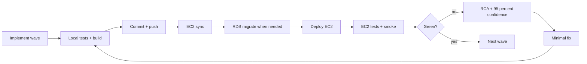

# EC2 Pilot Post-Audit Tier 5 Implementation Plan

> **For agentic workers:** REQUIRED SUB-SKILL: Use superpowers:subagent-driven-development (recommended) or superpowers:executing-plans to implement this plan task-by-task. Steps use checkbox (`- [ ]`) syntax for tracking.

**Goal:** Merge the promoted Tier 5 backlog with the 2026-07-03 fix-verification audit, fix the newly introduced live regressions first, then finish remaining Tier 5 and pre-real-mail gates with autonomous EC2/RDS verification.

**Architecture:** Treat this as a post-audit stabilization pass, not a fresh feature build. Ship one atomic commit per risk group: live regressions, mail router semantics, settings/connections/data safety, ingest/storage durability, stored-XSS hard gate, frontend cache stability, deploy/final docs. After every code commit: local gate -> commit -> push -> EC2 sync/deploy -> EC2 tests/smoke -> RCA loop until green.

**Tech Stack:** TypeScript, Better Auth, tRPC v11, Drizzle/Postgres, React/TanStack Query, Vitest, sanitize-html, AWS EC2/RDS/S3/SSM/Secrets Manager.

**Origin:** `docs/superpowers/plans/2026-07-03-ec2-pilot-tier5-implementation.md`, `docs/production-readiness/2026-07-03-ec2-pilot-fix-verification-audit.md`, `docs/superpowers/plans/2026-07-02-ec2-pilot-bug-hunt.md`, Better Auth session docs.

## Global Constraints

- Branch: `EC2-pilot`. Push after every wave commit.
- No app code edits outside `apps/server-pilot/` and targeted `apps/mail/` cache/rendering/connection surfaces.
- No edits to legacy `apps/server/`.
- **Session decision:** keep Better Auth DB session `expiresIn = 400d` and `updateAge = 7d`, but change signed cookie cache to **1 hour**. This should not force staff to log in hourly; it makes server re-check the DB hourly and bounds revocation delay.
- `PERSIST_MAX_AGE = Infinity` and `QUERY_GC_TIME = Infinity` remain accepted UX tradeoffs unless tests prove stale cross-user data.
- Real POP3/SMTP code now exists in current HEAD; do not re-plan it as missing. Still treat real Exchange activation as gated by security/rendering, worker durability, relay behavior, and live smoke.
- Prod EC2 + RDS is the integration rig. Local green alone is insufficient.
- Do not bulk-add untracked `.tmp-research/`, `.claude/`, or local Cursor skill/config directories.

| Resource | ID |
|---|---|
| EC2 | `i-008f737974a9ba9b3` (`af-south-1`) |
| RDS | `nava-zero-mail-pilot` (Postgres 16) |
| S3 | `nava-zero-mail-845242190536-af-south-1` |
| Repo on EC2 | `/home/ubuntu/repos/zero` |
| Deploy | `apps/server-pilot/deploy/deploy-ec2.sh` |
| Sync | `apps/server-pilot/deploy/sync-ec2-git-bundle.sh` |
| SSM wrapper | `apps/server-pilot/deploy/ssm-run-command.sh` |

---

## Current-State Audit Result

| Claim from other LLM | Current verdict | Why / evidence | Plan action |
|---|---|---|---|
| Session revocation dead for 400d | **Valid, live P1** | `apps/server-pilot/src/lib/auth.ts` sets `cookieCache.maxAge = SESSION_TTL_SEC` where `SESSION_TTL_SEC = 400d`; test asserts 400d. Better Auth docs say cookie cache skips DB until `maxAge`. | Fix first. New cache max age: **3600s**. Keep 400d DB session. |
| Draft bodies vanish on reload | **Valid, live P1** | `drafts.create` stores body in `htmlBody`; `drafts.get/list` read `textBody`; FE uses `draft.content`. | Fix first. Store/read one canonical content value and regression-test reopen draft. |
| Zero-mailbox users get HTTP 500 | **Valid, live P2** | `new TRPCError({ code: 'NO_MAILBOX' as 'FORBIDDEN' })` is still runtime code `NO_MAILBOX`, not valid tRPC code. | Fix first. Use valid `FORBIDDEN` code, keep message `NO_MAILBOX`. |
| `seed-prod` drops other users' secrets | **Valid, live P2 ops** | `putPilotSecret(credentialsToWrite)` replaces the whole secret JSON with only new/rotated users. | Merge existing secret JSON before put. |
| `bulkDelete` can hard-delete before undo | **Valid P3, reachable** | Second/retried call on trashed row deletes permanently. FE uses same mutation for delete actions. | Make bulk delete idempotent soft-delete by default; require explicit permanent path. |
| Stored-XSS gate before real mail | **Valid latent P1** | Server sanitizer exists but `mail.get` returns raw `htmlBody` as `processedHtml`/`decodedBody`; FE demo fallback strips only `<script>` and writes to shadow DOM `innerHTML`; `FORCE_FRONTEND_ONLY_DEMO=true`. | Hard gate before real mail. Sanitize serving path and replace unsafe fallback/rendering. |
| Sanitizer allows `<style>`/inline `style` tracking | **Valid latent P2** | `sanitize-email-html.ts` allows `style` tag and `style` attrs. | Remove style tag/attrs from mail sanitizer unless specific safe CSS transform exists. |
| Real POP3/SMTP never built | **Stale** | Current HEAD has `98aad701` and `1a3e0d98`; `RealPop3Client`, `MAIL_TRANSPORT_MODE`, and `RealSmtpTransport` now exist. | Do not rebuild. Smoke-test only before real activation. |
| Poison-message quarantine dead code | **Valid in runtime loop** | `ingestOnce` accepts `failureCounts`, but `runWorker` calls it without a shared map each cycle. Existing test pre-seeds the map and misses runtime persistence. | Share retry counter across worker loop or persist attempts; add runtime loop test. |
| Size limit runs after buffering | **Valid latent P2** | POP3 `RETR` returns full `Buffer`; worker uploads raw MIME to S3 before `parseRawMessage` checks `raw.length`. | Add pre-store size gate after RETR and before raw S3 PUT; document remaining POP3 buffering limit. |
| RealS3 stream drain | **Valid Tier 5 P2** | `byteLength()` drains `Readable`, then `PutObject` sends original exhausted stream. | Buffer once and send buffer. |
| Settings JSONB index/save race | **Valid Tier 5 P2/P3** | `user_settings_settings_idx` still exists; `settings.save` still select-then-insert. | Drop index and switch save to upsert. |
| Delete active mailbox loop | **Valid Tier 5 P3** | `connections.delete` deletes access and returns only `{ deleted: true }`; FE can keep stale active transport. | Return/promote next default and update FE scope. |
| FE cache scope flicker/clobber | **Valid Tier 5 P1/P2** | `QueryProvider` still rebuilds QueryClient by `scopeKey` and writes scope; `MailCacheScopeSync` also writes scope. | Stable QueryClient + single scope writer. |
| D10-D13 deploy script reliability | **Valid Tier 5 P3** | `rds-smoke.sh` requires missing `pg`; deploy NVM sort is lexicographic; health is one probe; SSM can poll forever. | Fix before relying on autonomous deploy loop. |

---

## Commit Strategy

| # | Commit message | Scope | EC2/RDS gate |
|---|---|---|---|
| 1 | `fix: close post-audit live regressions` | Auth 1h cookie cache, draft body persistence, valid NO_MAILBOX tRPC code, seed-prod secret merge, idempotent bulk delete | Local server/mail tests, deploy, auth/drafts/no-mailbox targeted tests |
| 2 | `fix: finish tier5 mail and label semantics` | B15-B20, B18 attachment regression, B19 null sort, label conflict mapping, bulk semantics | Deploy, mail router + label tests on EC2 |
| 3 | `fix: harden settings connections and schema` | C9, C11, C12, D6, setDefault transaction, seed-contract D16 | RDS migration, deploy, settings/connections tests |
| 4 | `fix: harden s3 and ingest durability` | C6, A16, poison retry counter, pre-store size gate, attachment retry orphan reduction, worker restart policy | Deploy, ingest/store/worker/S3 tests |
| 5 | `fix: gate inbound html rendering before real mail` | Server-side sanitize on `mail.get`/ingest or returned `processedHtml`, stricter sanitizer config, FE non-demo fallback, sandboxed iframe or equivalent safe renderer | Deploy, sanitizer tests, browser/mail-content tests |
| 6 | `fix: stabilize mailbox query cache scope` | E3, E4, E6, E7, E8, D17 package export contract | Deploy, mail tests, cache/account-switch tests |
| 7 | `fix: deploy scripts and final post-audit gate` | D10-D13, PM2 worker restart guard, final plan/table/gate reports | Deploy twice, full EC2/RDS gate, docs commit |

**Why this structure:** New live regressions go first because branch is already committed/deployed. Stored-XSS is separated from cache and deploy work because it is the hard security gate before real mail. Tests ship with the commit they prove; no standalone test-only commit.

---

## Autonomous Execution Protocol

- Capture evidence before changing code: failed command, exit code, server logs, worker logs, nginx logs, migration output, relevant EC2 env.
- Research current framework/library behavior when failure depends on Better Auth, tRPC, Drizzle, sanitize-html, TanStack Query, AWS SDK, PM2, SSM, or nginx.
- Continue RCA -> fix -> local gate -> commit -> push -> deploy -> verify until wave is green or blocked by missing AWS/IT secret.
- Never mark code complete without EC2 verification.

---

## Implementation Units

### U1. Post-Audit Live Regression Hotfix

**Goal:** Remove currently committed regressions that can hurt live pilot users before any lower-priority Tier 5 polish.

**Files:**
- Modify: `apps/server-pilot/src/lib/auth.ts`
- Modify: `apps/server-pilot/tests/auth-session-ttl.test.ts`
- Modify: `apps/server-pilot/src/trpc/routes/drafts.ts`
- Test: `apps/server-pilot/tests/mail-wire-contract.test.ts` or new `apps/server-pilot/tests/drafts-contract.test.ts`
- Modify: `apps/server-pilot/src/trpc/trpc.ts`
- Test: `apps/server-pilot/tests/auth-context.test.ts`
- Modify: `apps/server-pilot/scripts/seed-prod.ts`
- Test: new `apps/server-pilot/tests/seed-prod-secret.test.ts`
- Modify: `apps/server-pilot/src/trpc/routes/mail.ts`
- Test: `apps/server-pilot/tests/mail-thread-actions.test.ts`

**Approach:**
- Add a separate `SESSION_COOKIE_CACHE_MAX_AGE_SEC = 60 * 60`; use it only for `session.cookieCache.maxAge`.
- Keep `SESSION_TTL_SEC = 400d` and `SESSION_UPDATE_AGE_SEC = 7d`.
- Update auth TTL test so it distinguishes DB session lifetime from signed cookie cache lifetime.
- Make draft create/get/list use the same content column. Prefer preserving rich content by writing both `textBody`/`htmlBody` from the draft body or reading `textBody ?? htmlBody`, but the wire field `content` must reopen non-empty.
- Change no-mailbox helper to valid tRPC code (`FORBIDDEN`) with message `NO_MAILBOX` for FE matching.
- Read existing Secrets Manager JSON before `put-secret-value`, merge changed pilot credentials into it, and preserve unknown users.
- Make `bulkDelete` soft-delete idempotently by default. Permanent deletion must require an explicit bin/permanent route or input flag that current optimistic retries cannot trigger by accident.

**Test scenarios:**
- Auth config exports/asserts `SESSION_TTL_SEC = 400d`, `SESSION_UPDATE_AGE_SEC = 7d`, and `SESSION_COOKIE_CACHE_MAX_AGE_SEC = 3600`.
- Draft created with `message: "
Hello
"` returns non-empty `content` from `drafts.get` and `body`/`content` from `drafts.list`.
- User with no mailbox access receives tRPC `FORBIDDEN` with message `NO_MAILBOX`, not internal server error.
- Seeding one new user preserves unrelated existing secret entries.
- Calling `bulkDelete` twice on the same thread leaves it trashed, not hard-deleted.

**Verification:** Local tests pass, then EC2 deploy. On EC2 run auth/drafts/no-mailbox/mail action tests and confirm `/health` plus PM2 status.

- [ ] Write failing tests for all five regressions.
- [ ] Implement minimal fixes.
- [ ] Run local test/build gate.
- [ ] Commit + push.
- [ ] EC2 sync/deploy/verify.
- [ ] RCA loop until green.

---

### U2. Tier 5 Mail Router and Label Semantics

**Goal:** Finish mail/label Tier 5 behavior that remains open after the earlier bug-fix waves.

**Files:**
- Modify: `apps/server-pilot/src/trpc/routes/mail.ts`
- Modify: `apps/server-pilot/src/trpc/routes/labels.ts`
- Test: `apps/server-pilot/tests/mail-thread-actions.test.ts`
- Test: `apps/server-pilot/tests/mail-router-isolation.test.ts`
- Test: new `apps/server-pilot/tests/mail-get-attachments.test.ts`
- Test: new or extended `apps/server-pilot/tests/labels-contract.test.ts`

**Approach:**
- B15: after `unsend`, recompute thread latest message metadata or delete empty thread.
- B16: make bulk mutations prefilter visible IDs and return actual updated count; no partial mutation followed by `NOT_FOUND`.
- B17: `toggleStar` bulk semantics should compute one target state and set all visible threads uniformly.
- B18: preserve current attachment join and add regression coverage.
- B19: align nullable timestamp ordering with cursor semantics (`NULLS LAST` or NOT NULL invariant).
- B20: map only Postgres unique violation `23505` to `CONFLICT`; rethrow other failures; handle duplicate rename in `labels.update`.

**Test scenarios:**
- Unsend last outbound message removes thread; unsend earlier message updates latest metadata.
- Bulk mutation with one foreign/missing ID updates only visible IDs and returns actual count without partial failure surprise.
- Mixed starred/unstarred bulk toggle ends in one uniform state.
- `mail.get` includes attachment metadata for a seeded message.
- Null `latestMessageAt` does not pin a thread to top or vanish from page 2.
- Duplicate label create and duplicate label rename both return `CONFLICT`; non-unique DB error is not mislabeled.

**Verification:** Local server tests, deploy, targeted mail/label tests on EC2.

- [ ] Add tests.
- [ ] Implement mail router fixes.
- [ ] Implement labels error mapping.
- [ ] Run local gate.
- [ ] Commit + push.
- [ ] EC2 sync/deploy/verify.

---

### U3. Settings, Connections, and Schema Safety

**Goal:** Close data-loss and user-session edge cases around settings saves and mailbox management.

**Files:**
- Modify: `apps/server-pilot/src/trpc/routes/settings.ts`
- Modify: `apps/server-pilot/src/db/schema/app.ts`
- Create: `apps/server-pilot/drizzle/0004_drop_user_settings_settings_idx.sql`
- Modify: `apps/server-pilot/src/trpc/trpc.ts`
- Modify: `apps/server-pilot/src/trpc/routes/connections.ts`
- Modify: `apps/mail/app/(routes)/settings/connections/page.tsx`
- Modify: `apps/mail/lib/mail/mail-cache-scope.ts`
- Test: new `apps/server-pilot/tests/settings-save.test.ts`
- Test: new `apps/server-pilot/tests/connections-delete.test.ts`
- Test: `apps/server-pilot/tests/seed-contract.test.ts`
- Test: `apps/mail/tests/disconnect-connection.test.ts`

**Approach:**
- C11: replace select-then-insert settings save with upsert on `userId`.
- D6: drop `user_settings_settings_idx`; remove it from schema metadata.
- C9: make `getSessionUser` rethrow unexpected auth/session DB errors instead of converting every error into unauthenticated.
- C12: deleting active/default mailbox promotes next available mailbox and returns `nextDefaultId`; FE updates cache scope and default before invalidation.
- SetDefault: wrap the two updates in a transaction.
- D16: seed-contract asserts required pilot users, not global credential-account count.

**Test scenarios:**
- Two first-time settings saves for same user are idempotent/upserted.
- Long `customPrompt` save succeeds after index removal.
- Simulated auth DB failure returns 500-class behavior, not `UNAUTHORIZED`.
- Delete active mailbox with another mailbox available switches active transport and avoids sign-out loop.
- Delete last mailbox remains rejected.
- `setDefault` cannot leave a user with no default on partial failure.

**Verification:** Apply migration on EC2/RDS, deploy, run settings/connections tests and a basic mailbox switch smoke.

- [ ] Add migration and tests.
- [ ] Implement settings/trpc/connections changes.
- [ ] Run local gate.
- [ ] Commit + push.
- [ ] EC2 sync -> RDS migrate -> deploy -> verify.

---

### U4. S3 and Ingest Durability

**Goal:** Fix latent real-ingest corruption and infinite retry risks before real mail is enabled.

**Files:**
- Modify: `apps/server-pilot/src/storage/s3.ts`
- Modify: `apps/server-pilot/src/mail/ingest/parse-message.ts`
- Modify: `apps/server-pilot/src/mail/ingest/store.ts`
- Modify: `apps/server-pilot/src/mail/ingest/worker.ts`
- Modify: `apps/server-pilot/deploy/pm2.config.cjs`
- Test: new `apps/server-pilot/tests/s3-stream.test.ts`
- Test: `apps/server-pilot/tests/ingest-store.test.ts`
- Test: `apps/server-pilot/tests/pop3-worker.test.ts`

**Approach:**
- C6: `RealS3Storage.putObject` converts streams to a buffer once and uses that buffer for both byte count and S3 body.
- A16: preserve a raw `From` header fallback when parsed address extraction fails.
- Poison retry: keep one `failureCounts` map across worker loop cycles or persist counts so poison UIDLs eventually quarantine in runtime, not only in tests.
- Size gate: reject/quarantine oversized raw MIME before raw S3 PUT. Note remaining POP3 protocol buffering separately.
- Retry orphans: reduce fresh attachment-key orphaning by deterministic keying where possible or cleanup on persist failure.
- PM2: replace `autorestart:false` with bounded restart policy (`min_uptime`, `max_restarts`) so real ingest does not die silently.

**Test scenarios:**
- Readable stream uploaded via RealS3 path stores expected bytes, not zero bytes.
- Weird/unparseable From header stores a non-empty fallback.
- Worker loop reaches poison quarantine across cycles without injecting a pre-seeded map.
- Oversized message does not write raw MIME to normal raw prefix before quarantine decision.
- Worker PM2 config restarts boundedly rather than never.

**Verification:** Local ingest/worker tests, deploy, one fixture worker cycle on EC2, PM2 worker status/log check.

- [ ] Add tests.
- [ ] Implement S3/ingest/worker fixes.
- [ ] Run local gate.
- [ ] Commit + push.
- [ ] EC2 sync/deploy/verify.

---

### U5. Stored-XSS Hard Gate Before Real Mail

**Goal:** Ensure inbound HTML cannot execute script/event/CSS tracking payloads when real mail is enabled.

**Files:**
- Modify: `apps/server-pilot/src/mail/sanitize-email-html.ts`
- Modify: `apps/server-pilot/src/trpc/wire-compat.ts`
- Modify: `apps/server-pilot/src/trpc/routes/mail.ts`
- Modify: `apps/server-pilot/src/mail/ingest/store.ts` or document serving-time sanitize if chosen
- Modify: `apps/mail/lib/demo/runtime.ts`
- Modify: `apps/mail/lib/mail/resolve-mail-html.ts`
- Modify: `apps/mail/lib/mail/resolve-mail-display-html.ts`
- Modify: `apps/mail/components/mail/mail-content.tsx`
- Test: `apps/server-pilot/tests/sanitize-email-html.test.ts`
- Test: new `apps/server-pilot/tests/mail-html-sanitize.test.ts`
- Test: `apps/mail/tests/mail-content-fallback.test.ts`
- Test: new `apps/mail/tests/mail-content-rendering.test.ts`

**Approach:**
- Sanitize HTML on the path returned by `mail.get` (`processedHtml` and `decodedBody`) or sanitize at ingest and prove `mail.get` never returns raw executable HTML.
- Remove `<style>` and inline `style` allowance from `sanitizeEmailHtml` unless a safe CSS sanitizer is introduced.
- Flip forced frontend-only demo behavior for production builds, or gate it so server-backed pilot cannot enter unsafe fallback.
- Replace client fallback that only strips `<script>` with a safe placeholder in non-demo mode.
- Move mail body rendering to sandboxed iframe or equivalent containment if raw-ish HTML can ever reach DOM.

**Test scenarios:**
- ``, SVG/onload, malformed script, CSS `url()`, and style `@import` payloads are neutralized.
- `mail.get` response for malicious inbound HTML contains sanitized `processedHtml`.
- Non-demo FE with missing processed HTML renders placeholder, not raw HTML.
- Demo-only fallback remains isolated and tested as demo-only, not production path.

**Verification:** Server sanitizer tests, mail rendering tests, EC2 deploy, browser smoke for opening an HTML email in server-backed mode.

- [ ] Add malicious payload tests.
- [ ] Implement server sanitize path.
- [ ] Harden FE fallback/rendering.
- [ ] Run local gate.
- [ ] Commit + push.
- [ ] EC2 sync/deploy/browser verify.

---

### U6. Frontend Query Cache Scope Stability

**Goal:** Finish E3/E4/E6/E7/E8 without undoing accepted long-cache UX.

**Files:**
- Modify: `apps/mail/providers/query-provider.tsx`
- Modify: `apps/mail/providers/client-providers.tsx`
- Modify: `apps/mail/lib/mail/mail-cache-scope.ts`
- Modify: `apps/mail/components/ui/nav-user.tsx`
- Modify: `apps/mail/lib/constants.tsx`
- Modify: `apps/server-pilot/tests/package-contract.test.ts`
- Modify: `apps/server-pilot/vitest.config.ts`
- Test: `apps/mail/tests/account-switch-cache.test.ts`
- Test: `apps/mail/tests/query-cache-policy.test.ts`
- Test: `apps/server-pilot/tests/package-contract.test.ts`

**Approach:**
- Keep one QueryClient stable across scope changes; clear/refetch/swap persister rather than constructing a new client on incidental render.
- Make `MailCacheScopeSync` the single writer of cache scope; remove parent/provider clobber effect.
- Stabilize query hash prefix so cold load does not create anon/pending/user/transport duplicate waves.
- Keep one-time deletion of `zero-query-cache-default` and bump `CACHE_BURST_KEY` if needed.
- D17: ensure package contract tests import through the real `package.json` exports surface rather than bypassing it with aliases.

**Test scenarios:**
- Opening a thread after cold load does not recreate QueryClient or refetch every query twice.
- Active transport switch clears old mailbox data and persists into new mailbox bucket.
- Logout cleanup removes current scoped bucket and legacy default bucket.
- QueryProvider cannot overwrite a fresher scope written by MailCacheScopeSync.
- Package export contract fails when export map is broken.

**Verification:** Local mail tests/build, server package contract, deploy, mailbox switch smoke on EC2.

- [ ] Add characterization tests.
- [ ] Implement cache scope refactor.
- [ ] Fix package export contract test.
- [ ] Run local gate.
- [ ] Commit + push.
- [ ] EC2 sync/deploy/verify.

---

### U7. Deploy Scripts and Final Gate Documentation

**Goal:** Make autonomous deployment reliable, then update status docs and gate report from the verified EC2/RDS result.

**Files:**
- Modify: `apps/server-pilot/deploy/rds-smoke.sh`
- Modify: `apps/server-pilot/deploy/deploy-ec2.sh`
- Modify: `apps/server-pilot/deploy/ssm-run-command.sh`
- Test: `apps/server-pilot/tests/deploy-config.test.ts`
- Modify: `docs/superpowers/plans/2026-07-02-ec2-pilot-bug-fixes.md`
- Modify: `docs/superpowers/plans/2026-07-03-ec2-pilot-tier5-implementation.md`
- Create: `docs/superpowers/plans/handoff-reports/2026-07-03-post-audit-tier5-gate-report.md`
- Modify: `docs/superpowers/plans/handoff-reports/progress-ledger.md`

**Approach:**
- D10: use existing `postgres` package for Node fallback or remove fallback and require `psql`; do not require missing `pg`.
- D11: choose latest NVM Node with version sort, not lexicographic `tail -1`.
- D12: health check retry loop with bounded backoff and useful logs.
- D13: cap SSM polling and pass command execution timeout deliberately.
- Final docs: update old Tier 5 table from "not in plan/opportunistic" to real post-audit status; mark stale claims and accepted tradeoffs.

**Test scenarios:**
- deploy-config test catches lexicographic NVM selection.
- deploy-config test catches one-shot health check.
- ssm-run-command has max poll/timeout behavior.
- rds-smoke fallback references installed dependency or explicit `psql`.
- Gate report contains commit SHAs, EC2 deployed SHA, RDS migration status, health, PM2, server/mail tests, browser/html-smoke result, and remaining real-mail handoff blockers.

**Verification:** Deploy twice from clean EC2 state, run full final matrix, update docs only after gates are green.

- [ ] Fix script tests first.
- [ ] Implement deploy script fixes.
- [ ] Run local gate.
- [ ] Commit + push.
- [ ] EC2 sync/deploy twice.
- [ ] Run final EC2/RDS full gate.
- [ ] Update docs, ledger, and gate report.
- [ ] Commit docs.

---

## Final Gate Matrix

| Check | Pass criteria |
|---|---|
| Local server tests/build | Green before every commit |
| Local mail tests/build | Green before every commit |
| EC2 health | `{"ok":true,"service":"server-pilot"}` or current expected health JSON |
| PM2 | `http` online; `worker` online or explicitly fixture-idle with bounded restart policy |
| RDS migrations | Applied once; migration journal clean |
| Server tests on EC2 | Green or documented intentional skips only |
| Mail tests on EC2 | Green |
| Draft smoke | Create draft, reload/reopen, body present |
| No-mailbox smoke | No 500/retry storm; user sees no-mailbox state |
| HTML smoke | Malicious inbound HTML does not execute in browser |
| Fixture ingest | Fixture cycle stores/quarantines expected rows; no real TCP in fixture mode |
| Real mail readiness | Real POP3/SMTP code smoke-tested with provided IT secrets only after HTML/worker gates green |
| Docs | Old plan tables updated; post-audit gate report written |

---

## Deferred / Human-Loop Flags

- **Real Exchange activation** still needs IT-provided POP3/SMTP details, VPN reachability, and relay proof that inbound `X-Zero-Mailbox` is stripped and a trusted stamp is appended last.
- **Immediate revocation** would require disabling cookie cache or using `disableCookieCache` for sensitive checks. Current user decision is one-hour revocation bound, not instant revocation.
- **Bulk permanent delete UX** may need a future explicit "delete forever" endpoint/button if product wants permanent deletion from bin. Current plan prioritizes preventing accidental hard delete before undo.
- **Ponytail cleanup** is separate and not blocking: dead driver/types export, unused mailbox access facade, provider scaffolding, and speculative tests can be cut after correctness/security gates.

---

## Self-Review

- **Audit coverage:** All live P1/P2 findings from `2026-07-03-ec2-pilot-fix-verification-audit.md` are mapped to U1 or U5.
- **Staleness handling:** Real POP3/SMTP "not built" is marked stale because current HEAD contains the relevant commits and source.
- **Prior Tier 5 coverage:** B15-B20, C6/C8/C9/C11/C12, D6/D10-D13/D16/D17, E3/E4/E6/E7/E8, A16/A18 are mapped to U1-U7.
- **Accepted tradeoffs:** 400d DB session and Infinity cache TTL remain accepted; only cookie cache max age changes to one hour.
- **No code touched by this plan:** Implementation starts only after explicit execution request.

---

## Execution Handoff

**Plan saved to:** `docs/superpowers/plans/2026-07-03-ec2-pilot-post-audit-tier5-plan.md`

**Recommended execution:** Subagent-driven per U1-U7, with parent agent owning commits, EC2/RDS deploy, and RCA loops between waves.
