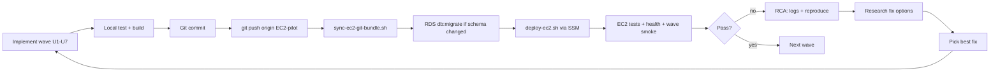

# EC2 Pilot Tier 5 Full Implementation Plan

> **Superseded:** Use `docs/superpowers/plans/2026-07-03-ec2-pilot-post-audit-tier5-plan.md` for execution. This older plan accepted 400d `cookieCache.maxAge` and treated RealPop3/transport state as pre-audit; the post-audit plan corrects those assumptions.

> **For agentic workers:** REQUIRED SUB-SKILL: Use superpowers:subagent-driven-development (recommended) or superpowers:executing-plans to implement this plan task-by-task. Steps use checkbox (`- [ ]`) syntax for tracking.

**Goal:** Implement all 24 Tier 5 backlog items from the EC2 pilot bug hunt (plus finish partial items B18, E4, E8), update the bug-fixes plan status table, and **autonomously** deploy to EC2/RDS with full test gates — RCA-fix loop until green without human input.

**Architecture:** Group fixes into 8 logical commit waves by subsystem (mail router → labels/settings/schema → auth/connections → storage/ingest → deploy scripts → test contracts → FE cache → doc/status sync). After **each wave**: local test → commit → push → EC2 sync → RDS migrate (if needed) → deploy → EC2 verify. On failure: RCA → research fixes → implement best fix → re-test → loop until pass. Reuse the bug-fix autonomous protocol and AWS deploy tooling.

**Tech Stack:** TypeScript, tRPC, Drizzle/Postgres, React/TanStack Query, Vitest, deploy scripts on EC2, AWS SSM/EC2/RDS/S3 via CLI and MCP plugins.

**Origin:** `docs/superpowers/plans/2026-07-02-ec2-pilot-bug-hunt.md` § Tier 5; `/95` audit @ `EC2-pilot` `1a3e0d98`; user promotion decision 2026-07-03.

## Global Constraints

- Branch: `EC2-pilot`. **Push after every wave commit.** Remote push OK.
- **Autonomous execution:** User may be offline. Do not stop for human input unless blocked by missing AWS credentials, missing IT-only secrets, or an irreversible prod action requiring explicit approval.
- **Prod EC2 + RDS is the integration rig.** Code is not "done" until deployed and verified on EC2 — local green alone is insufficient.
- AWS access: use `aws` CLI, SSM (`apps/server-pilot/deploy/ssm-run-command.sh`), and enabled **AWS MCP plugins** (EC2, RDS, core AWS) to inspect instance state, run remote commands, and confirm migrations.
- No edits to `apps/server/` (Workers legacy).
- C8: keep **400d sliding session** (user decision) — commit 7 closes as verified/documented, do not revert to 300s bug-hunt sketch.
- Do not conflate with `docs/superpowers/plans/2026-07-03-nava-live-mail-test-harness.md`.
- Wave overlaps already fixed (C10, D14, D15, A17, E1/E2/E5): verify in tests only, no re-work unless regression found.
- Follow existing test helpers: `withSeededTestDb`, `callerFor`, `deploy-config.test.ts` string asserts.
- Security hardening from `docs/superpowers/plans/2026-07-01-ec2-pilot-security-hardening.md` must not regress.
- Cache policy locked from bug-fix wave 4: `PERSIST_MAX_AGE=Infinity`, `QUERY_GC_TIME=Infinity`, list `staleTime=60s`, session 400d — do not shorten in E4/E7 work unless tests prove stale UI.

| Resource | ID |
|----------|-----|
| EC2 | `i-008f737974a9ba9b3` (af-south-1) |
| RDS | `nava-zero-mail-pilot` (Postgres 16) |
| S3 | `nava-zero-mail-845242190536-af-south-1` |
| Repo on EC2 | `/home/ubuntu/repos/zero` |
| Deploy | `apps/server-pilot/deploy/deploy-ec2.sh` |
| Sync | `apps/server-pilot/deploy/sync-ec2-git-bundle.sh` |
| SSM wrapper | `apps/server-pilot/deploy/ssm-run-command.sh` |
| Learnings | `docs/solutions/workflow-issues/ec2-pilot-autonomous-deploy-and-ssm-gotchas.md` |
| Prior protocol | `docs/superpowers/plans/2026-07-02-ec2-pilot-bug-fixes-autonomous.md` |

---

## Freshness Check (2026-07-03, re-verified)

| Check | Result |
|-------|--------|
| HEAD | `c0a21bd1` on `EC2-pilot` |
| Tier 5 code | Uncommitted diffs on Tier 5 files = **none** (CRLF-only noise on `mail.ts`) |
| Parallel agent | Nava harness plan only — no Tier 5 code drift |
| Already fixed | B18 `mail.get` attachment join, C8 400d TTL, E4 hash prefix partial, E8 legacy IDB delete on mount |

---

## Key Technical Decisions

1. **Full promotion** — All 24 Tier 5 IDs get code or explicit close (C8 accepted risk).
2. **7 code commits + 1 docs commit** — One commit per implementation wave; tests co-located with the code they prove (no orphan “tests only” commit). See § Commit strategy.
3. **C12 fix shape** — BE: on delete of active/default transport, reassign `is_default` to next mailbox; return `{ deleted, nextDefaultId }`. FE: `runDisconnectConnection` updates `setMailCacheScope` + `setDefault` when deleted id === active.
4. **B16 pattern** — Prefilter visible ids + single bulk UPDATE (mirror `markAsRead`), return actual `updated` count.
5. **D6** — New migration drops `user_settings_settings_idx` (no query uses it).
6. **E3/E6/E7** — Single FE wave: scope as stable React state; stop recreating QueryClient on scope change; fix QueryProvider/MailCacheScopeSync ordering.
7. **A18 / D16 / D17** — Spread into the wave that owns the behavior (mail tests → wave 1, seed-contract → wave 2, package-contract → wave 7), not a standalone commit.

---

## Commit strategy (recommended)

**Principle:** Same as the 7-wave bug-fix program — **one atomic commit per wave**, each independently deployable and bisect-friendly. Not 24 commits (one per bug ID). Not 1 mega-commit (RCA nightmare).

**Why 7 + 1, not 8 with a separate “test wave”:** A test-only commit (old U6) bisects badly — reverting mail code leaves orphan tests failing. Tests ship **with** the fix they assert.

| # | Commit message | Waves / IDs | Files (primary) | Tests bundled | EC2 migrate? |
|---|----------------|-------------|-----------------|---------------|--------------|
| 1 | `fix: tier5 mail bulk unsend attachments and sort` | B15–B19, A18 (mail slice) | `mail.ts`, new `mail-get-attachments.test.ts`, extend `mail-thread-actions.test.ts` | pagination page 2, bulk partial, mail.get attachments | no |
| 2 | `fix: tier5 labels settings and drop settings jsonb index` | B20, C11, D6, D16 | `labels.ts`, `settings.ts`, schema, `0004_*.sql`, `seed-contract.test.ts`, `settings-save.test.ts` | duplicate label, concurrent first save, pilot seed counts | **yes** 0004 |
| 3 | `fix: tier5 session errors and connection delete handoff` | C9, C12, A18 (connections slice) | `trpc.ts`, `connections.ts`, `connections/page.tsx`, `mail-cache-scope` | `connections-delete.test.ts`, disconnect FE test | no |
| 4 | `fix: tier5 s3 stream buffer and from address fallback` | C6, A16 | `s3.ts`, `parse-message.ts`, `store.ts` | `s3-stream.test.ts`, ingest From fallback | no |
| 5 | `fix: tier5 deploy and ssm script reliability` | D10–D13 | `rds-smoke.sh`, `deploy-ec2.sh`, `ssm-run-command.sh`, `package.json` if `pg` | `deploy-config.test.ts` | no |
| 6 | `fix: tier5 query cache scope and persister stability` | E3–E8, E4 finish, D17 | `query-provider.tsx`, `client-providers.tsx`, `vitest.config.ts`, `package-contract.test.ts` | `account-switch-cache.test.ts`, exports map test | no (SPA rebuild in deploy) |
| 7 | `docs: tier5 complete gate report` | C8 accepted, Tier 5 table, ledger | `2026-07-02-ec2-pilot-bug-fixes.md`, gate report, progress ledger | n/a — final EC2 full gate | no |

**Total: 7 commits** on `EC2-pilot` (6 code + 1 docs). Push after each. EC2 deploy + verify after commits 1–6.

### Bisect guidance

- Inbox/bulk/star broken → try revert **6**, then **1**
- Settings save / long prompt → **2**
- Sign-out after disconnect mailbox → **3**
- Ingest From blank / S3 → **4**
- Deploy/SSM hang → **5**
- Cache wipe / mailbox switch flicker → **6**

### What we deliberately avoid

| Anti-pattern | Why |
|--------------|-----|
| 24 commits (1 per bug ID) | Noise, partial broken states, 24 deploy cycles |
| 1 commit for all Tier 5 | Unreviewable, one RCA blob |
| Separate “tests only” commit | Bisect lies; tests fail without their fix |
| FE cache split from E3/E6/E7 | Half fix = same flicker bug |
| C12 BE without FE in same commit | Delete flow broken mid-bisect |

### C8 handling

No code commit — **400d session is accepted** (user decision). Documented in commit 7 gate report as `accepted`, not `fixed (300s)`.

---

## Wave Map (maps 1:1 to commits above)

| Wave | Commit # | Theme | IDs |
|------|----------|-------|-----|
| U1 | 1 | Mail router + A18 mail tests | B15, B16, B17, B18, B19, A18 (partial) |
| U2 | 2 | Labels + settings + schema + D16 | B20, C11, D6, D16 |
| U3 | 3 | Auth + connections + A18 conn tests | C9, C12, A18 (partial) |
| U4 | 4 | S3 + ingest From | C6, A16 |
| U5 | 5 | Deploy/ops scripts | D10, D11, D12, D13 |
| U6 | 6 | FE query cache + D17 | E3, E4, E6, E7, E8, D17 |
| U7 | 7 | Docs + final gate | C8 verify, Tier 5 table, ledger, gate report |

---

## Autonomous execution protocol (mandatory)

Full permission for EC2/RDS/SSM/S3. **Do not mark a wave complete until EC2 verification passes** (or wave is docs-only U7 final pass). Reference: `docs/superpowers/plans/2026-07-02-ec2-pilot-bug-fixes-autonomous.md`.

### Per-wave loop (repeat until gates green)



### 1. Local gate (before every commit)

```bash
pnpm --filter @zero/server test
pnpm --filter @zero/mail test
pnpm --filter @zero/server build
pnpm --filter @zero/mail build
```

Expected: all runnable tests pass; builds green. DB tests may skip locally unless `TEST_DB_AVAILABLE`.

### 2. Commit + push (after every wave)

One commit per wave with messages from the Wave Map section. Push immediately:

```bash
git push origin EC2-pilot
```

### 3. EC2 sync + RDS migrate + deploy

From dev machine after push:

```bash
bash apps/server-pilot/deploy/sync-ec2-git-bundle.sh
```

Remote on EC2 (via `ssm-run-command.sh` or AWS MCP — set `SSM_TIMEOUT_SECONDS=1800` for long builds):

```bash
cd /home/ubuntu/repos/zero
source apps/server-pilot/.env.production
pnpm --filter @zero/server db:migrate   # waves 2+ only when migration added
bash apps/server-pilot/deploy/deploy-ec2.sh
```

**Migrations touch prod RDS** — expected for wave 2 (`0004_drop_user_settings_settings_idx`).

### 4. EC2 verification (after every deploy)

**Always run:**

| Check | Command | Pass |
|-------|---------|------|
| Health | `curl -fsS http://127.0.0.1:8788/health` | `{"ok":true,"service":"server-pilot"}` |
| PM2 | `pm2 status` | `http` online; `worker` not stuck errored |
| Server tests | `pnpm --filter @zero/server test` on EC2 | 0 failures (skips OK) |
| Mail tests | `pnpm --filter @zero/mail test` on EC2 | green |

**Wave-targeted smoke (add to loop when relevant):**

| After wave | Extra verify |
|------------|--------------|
| U1 (mail) | `vitest run tests/mail-get-attachments.test.ts tests/mail-thread-actions.test.ts` |
| U2 (schema) | Confirm migration 0004 applied; settings save with long `customPrompt` |
| U3 (connections) | `vitest run tests/connections-delete.test.ts`; tRPC delete returns `nextDefaultId` |
| U5 (deploy) | Re-run deploy; health retry loop passes |
| U7 (FE cache) | Mail tests + rebuild SPA in deploy; optional mailbox-switch tRPC sequence |
| U7 (final) | Full matrix below |

**Final gate (U7 — full):**

| Check | Pass criteria |
|-------|---------------|
| Server + mail tests on EC2 | 0 fail |
| `/health` | ok |
| PM2 | http + worker online |
| Fixture transport | `MAIL_TRANSPORT_MODE=fixture`; worker logs show fixture cycle |
| Targeted Tier 5 tests | All new test files from U1–U7 pass on EC2 with env loaded |
| Load script (optional) | `load-50-users.ts` probes return 200 not 405 |
| Gate report | Write `docs/superpowers/plans/handoff-reports/2026-07-03-tier5-gate-report.md` |

**SSM gotchas** (from institutional learnings):

- Strip non-ASCII from stdout before Windows JSON parse: `tr -cd '\11\12\15\40-\176'`
- Long deploy: `SSM_TIMEOUT_SECONDS=1800`
- Use instance-profile S3 sync (no presigned URLs in SSM history)

### 5. RCA on failure (mandatory before retry)

Do not guess-and-patch. Loop until confident:

1. **Capture evidence:** failing command, exit code, `pm2 logs http --lines 50 --nostream`, `pm2 logs worker --lines 50 --nostream`, nginx error log if 413/502, migration output if schema wave.
2. **Reproduce locally** when possible (same test file, same env var).
3. **Root cause:** state hypothesis only when ~95% confident (/95 skill). Use codebase search + AWS MCP to inspect EC2/RDS state (SSM online, disk, env file present, migration journal).
4. **Research fixes:** enumerate 2–3 options; pick minimal correct fix (not largest refactor).
5. **Implement fix** → re-run local gate → commit → push → sync → migrate → deploy → EC2 verify.
6. **Do not skip gates** or mark wave complete with failing EC2 tests.
7. **Max retries:** no hard cap — continue RCA loop until green or blocked on missing creds/IT secrets (document blocker in gate report).

### 6. Progress tracking

- Update `.superpowers/sdd/progress.md` after each wave + EC2 result.
- U7: update `docs/superpowers/plans/handoff-reports/progress-ledger.md` with commit SHAs + EC2 gate results.
- U7: update Tier 5 table in `docs/superpowers/plans/2026-07-02-ec2-pilot-bug-fixes.md`.

### 7. Checkpoint policy

- **Minimum:** EC2 deploy + verify after **every** code commit (1–6), not only commit 7.
- **If wave 1 EC2 smoke fails:** do not start wave 2 until mail router fixes deploy green.
- **If deploy script fails (U5):** fix scripts first — later waves depend on reliable deploy.

---

## Implementation Units

### U1. Wave 1 — Mail router (B15, B16, B17, B18, B19, A18 mail slice)

**Goal:** Correct bulk semantics, unsend thread cleanup, attachment integration test, NULLS LAST sorts.

**Commit:** `fix: tier5 mail bulk unsend attachments and sort` (commit **#1**)

**Files:**
- Modify: `apps/server-pilot/src/trpc/routes/mail.ts`
- Test: `apps/server-pilot/tests/mail-thread-actions.test.ts`, `apps/server-pilot/tests/mail-router-isolation.test.ts`, new `apps/server-pilot/tests/mail-get-attachments.test.ts`

**Approach:**
- **B15:** After unsend delete, recompute thread `latestMessageAt` from remaining messages; delete thread if zero messages.
- **B16:** Extract `resolveVisibleThreadIds(db, ids, transportId)`; bulk ops use `WHERE id IN (...)` updates; return `{ updated: visible.length }`.
- **B17:** `toggleStar`: read all rows first; `shouldStar = !anyStarred`; set uniform value.
- **B18:** Add seeded test: message with attachment → `mail.get` → `messages[0].attachments.length === 1`.
- **B19:** Add `.nullsLast()` to `desc(mailThread.latestMessageAt)` and `desc(message.receivedAt)` orderBy clauses.
- **A18 (mail):** pagination past page 2, bulk partial failure tests in this wave.

**Test scenarios:**
- Unsend last message in thread → thread row removed.
- Bulk toggleStar on [starred, unstarred] → both end unstarred.
- Bulk modifyLabels with one foreign id → zero updated, no partial mutation (or explicit `{ updated: N }` without throw — pick markAsRead prefilter pattern).
- mail.get returns attachment metadata for seeded PDF.

**Verification:** `pnpm --filter @zero/server test` green → commit → push → **EC2 sync/deploy/verify per Autonomous protocol**.

- [ ] **Step 1:** Implement B15–B19 in `mail.ts`
- [ ] **Step 2:** Add/adjust tests
- [ ] **Step 3:** Run local gate (test + build)
- [ ] **Step 4:** Commit + push
- [ ] **Step 5:** EC2 sync → deploy → run server tests + targeted mail tests on EC2
- [ ] **Step 6:** If fail → RCA loop until green

---

### U2. Wave 2 — Labels + settings + D6 + D16 (B20, C11, D6, D16)

**Goal:** Correct PG error mapping; upsert settings; drop harmful jsonb index; fix seed-contract global count.

**Commit:** `fix: tier5 labels settings and drop settings jsonb index` (commit **#2**)

**Files:**
- Modify: `apps/server-pilot/src/trpc/routes/labels.ts`, `apps/server-pilot/src/trpc/routes/settings.ts`, `apps/server-pilot/src/db/schema/app.ts`, `apps/server-pilot/tests/seed-contract.test.ts`
- Create: `apps/server-pilot/drizzle/0004_drop_user_settings_settings_idx.sql`
- Test: `apps/server-pilot/tests/mail-router-isolation.test.ts`, new `apps/server-pilot/tests/settings-save.test.ts`

**Approach:**
- **B20:** Catch `PostgresError` code `23505` only → CONFLICT; other errors → rethrow/INTERNAL. Same in `labels.update`.
- **C11:** Replace select-then-insert with `insert...onConflictDoUpdate` on `userId`.
- **D6:** Drop index via migration; remove from schema if defined in drizzle schema file.
- **D16:** Assert pilot user ids present, not global `accounts.length === 3`.

**Test scenarios:**
- Duplicate label name → CONFLICT not 500.
- Rename label to existing name → CONFLICT.
- Two concurrent first saves → both succeed (serialized test or sequential upsert idempotency).

**Verification:** Migration applies on EC2; settings save with long `customPrompt` succeeds → **EC2 deploy verify**.

- [ ] **Step 1:** labels + settings fixes
- [ ] **Step 2:** migration 0004
- [ ] **Step 3:** tests + local gate
- [ ] **Step 4:** Commit + push → EC2 sync → **db:migrate** → deploy → verify
- [ ] **Step 5:** RCA loop if migrate or settings test fails on EC2

---

### U3. Wave 3 — Auth + connections (C9, C12, A18 connections slice)

**Goal:** DB errors surface as 500; delete mailbox does not sign user out.

**Commit:** `fix: tier5 session errors and connection delete handoff` (commit **#3**)

**Files:**
- Modify: `apps/server-pilot/src/trpc/trpc.ts`, `apps/server-pilot/src/trpc/routes/connections.ts`
- Modify: `apps/mail/app/(routes)/settings/connections/page.tsx`, `apps/mail/lib/mail/mail-cache-scope.ts`, `apps/mail/components/ui/nav-user.tsx` (if switcher needs same path)
- Test: new `apps/server-pilot/tests/connections-delete.test.ts`, `apps/mail/tests/disconnect-connection.test.ts`

**Approach:**
- **C9:** In `getSessionUser`, rethrow non-auth errors; only return null for genuine missing session.
- **C12:** Server: if deleted transport was `is_default`, promote next access row to default; return `nextDefaultId`. Client: after delete, if `connectionId === getMailCacheScope().activeTransportId`, call `setDefault({ connectionId: nextDefaultId })` and `setMailCacheScope({ activeTransportId: nextDefaultId })` before invalidating queries. Do not treat post-delete access denial as FORBIDDEN sign-out if user has other mailboxes (coordinate with existing NO_MAILBOX path).

**Test scenarios:**
- Delete non-active mailbox → user stays signed in.
- Delete active mailbox with 2+ remaining → active header switches to next default; inbox loads.
- Simulated getSession DB throw → 500 not UNAUTHORIZED.

**Verification:** No sign-out loop in disconnect flow test → **EC2 deploy + connections-delete test on EC2**.

- [ ] **Step 1:** BE connections.delete + getSessionUser
- [ ] **Step 2:** FE runDisconnectConnection scope update
- [ ] **Step 3:** tests + local gate
- [ ] **Step 4:** Commit + push → EC2 sync → deploy → verify
- [ ] **Step 5:** RCA loop if FORBIDDEN/sign-out still reproduces

---

### U4. Wave 4 — Storage + ingest (C6, A16)

**Commit:** `fix: tier5 s3 stream buffer and from address fallback` (commit **#4**)

**Goal:** RealS3 buffer-once; preserve raw From when parse fails.

**Files:**
- Modify: `apps/server-pilot/src/storage/s3.ts`, `apps/server-pilot/src/mail/ingest/parse-message.ts`, `apps/server-pilot/src/mail/ingest/store.ts`
- Test: `apps/server-pilot/tests/ingest-store.test.ts`, new `apps/server-pilot/tests/s3-stream.test.ts`

**Approach:**
- **C6:** In `RealS3Storage.putObject`, `const buf = await toBuffer(body)` once; PUT `Body: buf`, `bytes: buf.length`.
- **A16:** When `extractAddress` fails, store raw From header string (trimmed) instead of `''`.

**Test scenarios:**
- RealS3Storage with Readable stream → stored bytes match drained length.
- Fixture with weird From → non-empty stored address.

**Verification:** Ingest tests pass → **EC2 deploy + ingest tests on EC2**.

- [ ] **Step 1:** s3.ts fix
- [ ] **Step 2:** parse-message + store fallback
- [ ] **Step 3:** tests + local gate
- [ ] **Step 4:** Commit + push → EC2 sync → deploy → verify

---

### U5. Wave 5 — Deploy scripts (D10, D11, D12, D13)

**Commit:** `fix: tier5 deploy and ssm script reliability` (commit **#5**)

**Goal:** Reliable deploy/smoke tooling.

**Files:**
- Modify: `apps/server-pilot/deploy/rds-smoke.sh`, `apps/server-pilot/deploy/deploy-ec2.sh`, `apps/server-pilot/deploy/ssm-run-command.sh`
- Modify: `apps/server-pilot/package.json` (add `pg` devDep if node fallback used)
- Test: extend `apps/server-pilot/tests/deploy-config.test.ts`

**Approach:**
- **D10:** Add `pg` to server-pilot dependencies OR document psql-only and remove broken node fallback.
- **D11:** Replace `tail -1` lex sort with `ls -v ... | tail -1` or `node -v` default.
- **D12:** Health check: retry loop 5× with 2s backoff.
- **D13:** SSM poll: max iterations + timeout exit with error.

**Verification:** deploy-config tests assert new script patterns → **run deploy-ec2.sh on EC2 twice** to confirm health retry.

- [ ] **Step 1:** script fixes
- [ ] **Step 2:** deploy-config tests + local gate
- [ ] **Step 3:** Commit + push → EC2 sync → deploy (validates D11/D12/D13 live)
- [ ] **Step 4:** RCA loop if deploy or health check fails

---

### U6. Wave 6 — FE query cache + package contract (E3, E4, E6, E7, E8, D17)

**Goal:** Stable QueryClient across mailbox switch; no scope clobber; legacy IDB cleanup verified; package exports test.

**Commit:** `fix: tier5 query cache scope and persister stability` (commit **#6**)

**Files:**
- Modify: `apps/mail/providers/query-provider.tsx`, `apps/mail/providers/client-providers.tsx`, `apps/mail/lib/mail/mail-cache-scope.ts`
- Modify: `apps/server-pilot/tests/package-contract.test.ts`, `apps/server-pilot/vitest.config.ts` (D17)
- Test: `apps/mail/tests/account-switch-cache.test.ts`, extend `apps/mail/tests/query-cache-policy.test.ts`

**Approach:**
- **D16:** Moved to U2 (seed-contract with settings wave).
- **A18:** Split — mail tests in U1, connection tests in U3.
- **D17:** Package exports test + vitest config adjustment in this wave (mail imports `@zero/server/*`).
- **E3/E7:** Hold QueryClient in ref; on scope change clear cache + swap persister, do not `new QueryClient()`.
- **E6:** Single scope writer (MailCacheScopeSync); remove QueryProvider clobber.
- **E4/E8:** Finish partial fixes; staleTime stays 60s per locked cache policy.

**Verification:** Mail tests pass on EC2; SPA rebuilt in deploy → **EC2 sync → deploy → mail tests on EC2**.

- [ ] **Step 1:** query-provider refactor + D17 package test
- [ ] **Step 2:** client-providers wiring
- [ ] **Step 3:** tests + local gate
- [ ] **Step 4:** Commit **#6** + push → EC2 sync → deploy → mail tests on EC2
- [ ] **Step 5:** RCA loop if cache/scope tests fail only on EC2

---

### U7. Wave 7 — Docs, C8 close, final EC2 gate

**Goal:** Tier 5 table shows all fixed; C8 documented as accepted; **full autonomous EC2/RDS gate with gate report**.

**Commit:** `docs: tier5 complete gate report` (commit **#7** — docs only, no app code)

**Files:**
- Modify: `docs/superpowers/plans/2026-07-02-ec2-pilot-bug-fixes.md` (Tier 5 section)
- Modify: `docs/superpowers/plans/handoff-reports/progress-ledger.md`
- Create: `docs/superpowers/plans/handoff-reports/2026-07-03-tier5-gate-report.md`

**Approach:**
- Replace Tier 5 table with Status=**fixed** (or **accepted** for C8) + test file refs.
- Add wave overlaps + verification gaps sections.
- Run **full final gate matrix** from Autonomous protocol §4 (all tests on EC2, health, PM2, fixture transport).
- If any check fails: RCA loop — fix code or docs, redeploy, re-gate — until all green.
- **C8:** No code change; add note "400d sliding session — revocation latency accepted."

**Verification:** Gate report published; progress ledger updated; user can read EC2 SHAs + pass/fail without running anything locally.

- [ ] **Step 1:** Full EC2 final gate (all checks)
- [ ] **Step 2:** RCA loop until 100% green or documented blocker
- [ ] **Step 3:** Update bug-fixes plan Tier 5 table + ledger
- [ ] **Step 4:** Write gate report
- [ ] **Step 5:** Commit `docs: tier5 complete gate report` + push

---

## Deferred to Follow-Up Work

- Real POP3/SMTP TCP (IT handoff) — not Tier 5.
- Signup 403 allowlist — separate product decision.
- Nava live mail test harness — parallel plan.

---

## Risks

| Risk | Mitigation |
|------|------------|
| E3 refactor breaks inbox caching | Characterization tests before refactor; one FE wave |
| D6 migration on prod RDS | Standard migrate in deploy; index drop is safe |
| C12 FE/BE mismatch | Return explicit `nextDefaultId` from delete mutation |
| Wave 7 scope change vs wave 4 TTL | Re-read `cache-ttl.ts`; don't fight 400d/Infinity decisions |
| 7 commits touch many files | One commit per wave; run tests + EC2 deploy each code commit |
| Autonomous loop runs long | SSM_TIMEOUT_SECONDS=1800; progress.md after each wave |
| EC2 test differs from local | RCA on EC2 logs; do not mark done on local-only green |

---

## Definition of done

A wave (or the full plan) is **done** only when:

1. Local test + build pass
2. Committed and pushed to `origin/EC2-pilot`
3. EC2 synced to commit SHA
4. RDS migrated if schema changed
5. `deploy-ec2.sh` succeeded
6. EC2 health + wave-specific tests pass
7. No open RCA items for that wave

U7 adds: gate report + ledger + Tier 5 table updated.

---

## Self-Review

- **Spec coverage:** All 24 Tier 5 IDs mapped to commits 1–7.
- **Commit strategy:** 6 code + 1 docs; tests co-located; no orphan test commit.
- **C8:** Closed as accepted, not reverted.
- **B18/C10/D14/D15/A17/E1-E5:** B18 finished in U1; overlaps verified in U7 gate.
- **Placeholder scan:** None.

---

## Execution Handoff

**Plan saved to:** `docs/superpowers/plans/2026-07-03-ec2-pilot-tier5-implementation.md`

**Execution mode:** Fully autonomous — implement U1–U7 (7 commits) with EC2/RDS deploy + RCA loop after each code commit.

**Two execution options:**

1. **Subagent-Driven (recommended)** — Fresh subagent per wave (U1–U7); parent runs EC2 deploy + RCA between commits
2. **Inline Execution** — Waves sequentially in this session with EC2 checkpoint after each commit

**Which approach?**
