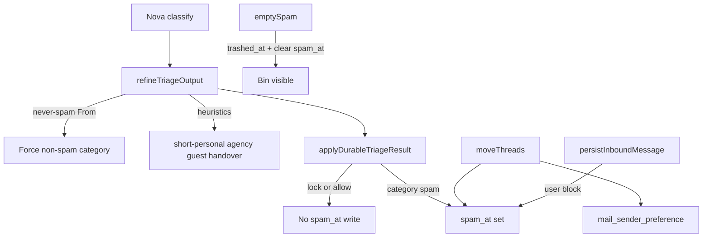

# Spam MVP + Heuristic Never-Spam Implementation Plan

> **For agentic workers:** REQUIRED SUB-SKILL: Use superpowers:subagent-driven-development (recommended) or superpowers:executing-plans to implement this plan task-by-task. Steps use checkbox (`- [ ]`) syntax for tracking.

**Goal:** Honest spam folder UX on the hotel mail pilot: classified spam leaves the inbox, Nova false-positives are refined away, hard never-spam senders never auto-triage into spam, user corrections stick, and ops can empty spam into Trash without orphaning threads.

**Architecture:** Keep `mail_thread.spam_at` as the only folder truth. Fix the `listThreads` folder matrix so Trash and Spam cannot both hide a thread. Gate auto-spam through `refineTriageOutput` (heuristics + never-spam allowlist) before `applyDurableTriageResult`. Persist user corrections with `spam_user_locked_at` and thin `mail_sender_preference` (block/allow). Manual mark-spam remains allowed even for never-spam addresses. Night-1 ships matrix + lock + never-spam + chip strip + emptySpam; 30-day purge stays off by default.

**Tech Stack:** TypeScript, Drizzle/Postgres, tRPC (`apps/server-pilot`), React Query (`apps/mail`), Vitest, PM2 on EC2 `i-008f737974a9ba9b3`.

**Sources:** [`docs/plans/2026-07-27-001-feat-spam-mvp-placement-and-persistence-plan.md`](../../plans/2026-07-27-001-feat-spam-mvp-placement-and-persistence-plan.md) (autoplan + overnight mandate), Grok 4.5 adversarial review (Codex substitute), existing `refineTriageOutput` in [`apps/server-pilot/src/ai/triage.ts`](../../../apps/server-pilot/src/ai/triage.ts).

## Global Constraints

- Implement only in `apps/server-pilot` + `apps/mail` — never port `apps/server` Gmail `deleteAllSpam`.
- API name: `mail.emptySpam` (not `deleteAllSpam`).
- Preference table: `mail_sender_preference(transport_id, email, kind)` with `kind ∈ block|allow`, unique `(transport_id, email)`.
- Lock column: `mail_thread.spam_user_locked_at`.
- Never-spam (auto-triage only): domain `legacyhotels.co.za`; emails `aroransh17@gmail.com`, `coleddofficial@gmail.com` (case-insensitive).
- Manual `moveThreads` destination `spam` still works for never-spam Froms.
- Precedence auto path: never-spam allowlist > AI category. User block preference still applies at ingest (user intent). Allow preference > AI spam.
- Folder matrix freeze (see Task 1).
- `SPAM_PURGE_ENABLED` default `false` night-1.
- TDD: failing test → implement → green → commit per task.
- Orchestrator + subagents: `/caveman ultra`. Technical terms exact.
- No force-push, no `--no-verify`, no IT mail creds in commits.

## Overnight Autonomous Execution Mandate

**User granted full autonomy.** No blocking questions overnight. No manual login. No "which approach?" pause.

**REQUIRED SUB-SKILL overlay:** `.cursor/skills/overnight-autonomous-zero/SKILL.md` (infra + RCA + ops wrappers below).

### Communication

- Orchestrator + every subagent: **Respond `/caveman ultra`. Technical terms exact.**

### AWS / infra (use freely)

| Resource | ID / path |
|----------|-----------|
| EC2 | `i-008f737974a9ba9b3` (`af-south-1`) |
| RDS | `nava-zero-mail-pilot` (Postgres 16) |
| S3 | `nava-zero-mail-845242190536-af-south-1` |
| Repo on EC2 | `/home/ubuntu/repos/zero` |
| **Primary deploy** | `apps/server-pilot/deploy/ops-deploy.sh` (`--migrate` when schema) |
| **Primary app bounce** | `apps/server-pilot/deploy/ops-restart.sh` |
| **Primary box reboot** | `apps/server-pilot/deploy/ops-reboot.sh` |
| Guts (fallback) | `sync-ec2-git-bundle.sh`, `deploy-ec2.sh`, `ssm-run-command.sh` |

**Allowed:** ops wrappers, bundle sync, deploy, migrate (via `ops-deploy --migrate`), seed (no `--rotate` unless fix requires), SSM remote tests, PM2 logs, health curl, RDS vitest on EC2.

**Forbidden:** force-push main, `--no-verify`, destructive git, IT Exchange/VPN/real mail creds.

### RCA loop (mandatory on any red)

FAIL → reproduce → root cause (file:line) → fix → test → commit → resume. Do not stop at first failure.

### Divergence authority

Better path to done criteria → take it. Log in handoff report.

### Typical overnight wave

```text
local: tests + builds green → commit → push EC2-pilot
→ ops-deploy.sh            # or ops-deploy.sh --migrate when schema changed
→ SSM: smoke checklist (Task 9)
→ handoff report under docs/superpowers/plans/handoff-reports/
```

**SSM stdout:** Windows AWS CLI may choke on vitest unicode. Use `ssm-run-command.sh` (wraps `ssm-format-invocation.cjs`). See `docs/solutions/workflow-issues/ec2-pilot-autonomous-deploy-and-ssm-gotchas.md`.

### Done criteria

- [ ] Folder matrix: emptySpam / move→bin threads appear in bin; absent from spam
- [ ] Never-spam Froms never get `spam_at` from AI apply; manual mark-spam still works
- [ ] All four refine heuristics have unit tests (short-personal, agency, guest-file, handover)
- [ ] Not-spam sets lock; AI cannot re-set `spam_at` on that thread
- [ ] No SPAM user-label chip in inbox for `spam_at` null threads
- [ ] `mail.emptySpam` + FE confirm → Trash
- [ ] Mark-spam Undo toast restores inbox + removes block (when prefs exist)
- [ ] `SPAM_PURGE_ENABLED=false` on pilot
- [ ] EC2 migrate + smoke + handoff report under `docs/superpowers/plans/handoff-reports/`

## Execution Mode

Autonomous overnight — no user checkpoint. REQUIRED SUB-SKILL: superpowers:subagent-driven-development. Do not ask "which approach?" Prefer max-completeness within **night-1** task list below; defer Night-2 items.

### Night-2 (explicitly deferred)

- 30-day purge cron (code may exist behind flag; do not enable)
- `spam_source` banner enum
- soft-quarantine display rename `Held for review`
- `listSenderPreferences` settings page (RPC ok if cheap; no full UI)
- A11y polish beyond focus/aria-live on Empty confirm
- Domain block UI

## Frozen folder matrix

| Folder | Predicate |
|--------|-----------|
| spam | `spam_at IS NOT NULL AND trashed_at IS NULL` |
| bin | `trashed_at IS NOT NULL` (**do not** also require `spam_at IS NULL` — OR clear `spam_at` whenever entering bin) |
| inbox | ¬trash ¬spam ¬archive + inbound + snooze rules (existing) |
| archive | `is_archived AND spam_at IS NULL AND trashed_at IS NULL` |
| archive ← spam | **clear `spam_at`** (keep today’s `moveThreads` archive patch; document — do not keep spam_at or threads vanish) |
| emptySpam / move→bin | set `trashed_at`, **clear `spam_at`**, clear archive |

**Chosen fix for C1 (Grok):** any transition into bin clears `spam_at`. Bin list may keep existing `else isNull(spam_at)` branch safely because trash rows never retain spam_at.

## File map

| File | Responsibility |
|------|----------------|
| `apps/server-pilot/src/ai/never-spam.ts` | Normalize email; never-spam domain/address sets; `isAutoTriageNeverSpam` |
| `apps/server-pilot/src/ai/triage.ts` | `refineTriageOutput` (never-spam first + existing heuristics); `applyDurableTriageResult` settled += lock; belt-check never-spam |
| `apps/server-pilot/src/mail/sender-preference.ts` | upsert/get/remove preference |
| `apps/server-pilot/src/db/schema/mail.ts` | `spamUserLockedAt`; `mailSenderPreference` table |
| `apps/server-pilot/drizzle/0012_*.sql` | migrations |
| `apps/server-pilot/src/trpc/routes/mail.ts` | folder matrix on bin move; `emptySpam`; extend `moveThreads`; prefs RPCs |
| `apps/server-pilot/src/mail/ingest/store.ts` | ingest block → `spam_at` (never-spam does not block *user* block) |
| `apps/server-pilot/src/ai/worker.ts` | optional purge tick gated off |
| `apps/mail/hooks/use-labels.ts` | strip user label name `SPAM` from chips |
| `apps/mail/components/mail/mail-list.tsx` | belt filter if needed |
| `apps/mail` spam folder UI | Empty spam confirm; Undo toast on mark-spam |



---

### Task 1: Folder matrix — bin clears spam_at

**Files:**
- Modify: `apps/server-pilot/src/trpc/routes/mail.ts` (`moveThreads` destination `bin` and `archive`)
- Test: `apps/server-pilot/tests/mail-thread-actions.test.ts`

**Interfaces:**
- Consumes: existing `moveThreads` input `{ threadIds, destination }`
- Produces: bin/archive patches that always set `spamAt: null` when entering bin; archive keeps clearing spam (document)

- [ ] **Step 1: Write the failing test**

```ts
it('moveThreads to bin clears spamAt so thread appears in bin', async () => {
  await withSeededTestDb(async (db) => {
    // insert thread with spamAt set, trashedAt null
    // moveThreads destination bin
    // assert spamAt null AND trashedAt not null
    // listThreads folder bin includes id
    // listThreads folder spam excludes id
  });
});
```

- [ ] **Step 2: Run test to verify it fails**

Run: `cd apps/server-pilot && pnpm test tests/mail-thread-actions.test.ts -t "bin clears spamAt"`

Expected: FAIL — `spamAt` still set after bin move (current code only sets `trashedAt`).

- [ ] **Step 3: Write minimal implementation**

In `moveThreads`, when `destination === 'bin'`:

```ts
patch.trashedAt = new Date();
patch.spamAt = null;
patch.isArchived = false;
```

Keep archive branch clearing `spamAt` (already does). Do not implement “keep spam_at on archive.”

- [ ] **Step 4: Run test to verify it passes**

Run: same as Step 2. Expected: PASS.

- [ ] **Step 5: Commit**

```bash
git add apps/server-pilot/src/trpc/routes/mail.ts apps/server-pilot/tests/mail-thread-actions.test.ts
git commit -m "$(cat <<'EOF'
fix(mail): clear spamAt when moving threads to bin

Trash+spamAt previously matched neither Spam nor Bin list filters.
EOF
)"
```

---

### Task 2: Never-spam allowlist module + refine gate

**Files:**
- Create: `apps/server-pilot/src/ai/never-spam.ts`
- Modify: `apps/server-pilot/src/ai/triage.ts` (`refineTriageOutput` — call never-spam **before** short-personal)
- Test: `apps/server-pilot/tests/ai-triage-contract.test.ts`
- Test: `apps/server-pilot/tests/never-spam.test.ts` (new)

**Interfaces:**
- Consumes: `from` raw header string
- Produces:

```ts
export function normalizeEmailAddress(raw: string): string;
export function isAutoTriageNeverSpam(fromRaw: string): boolean;
export const AUTO_TRIAGE_NEVER_SPAM_DOMAINS: ReadonlySet<string>; // 'legacyhotels.co.za'
export const AUTO_TRIAGE_NEVER_SPAM_EMAILS: ReadonlySet<string>; // two gmails lowercased
```

- [ ] **Step 1: Write the failing tests**

```ts
// never-spam.test.ts
it('matches legacyhotels.co.za domain case-insensitively', () => {
  expect(isAutoTriageNeverSpam('Martha <marthamthembu@LegacyHotels.co.za>')).toBe(true);
});
it('matches aroransh17 and coleddofficial', () => {
  expect(isAutoTriageNeverSpam('aroransh17@gmail.com')).toBe(true);
  expect(isAutoTriageNeverSpam('Cole <coleddofficial@gmail.com>')).toBe(true);
});
it('does not match unrelated gmail', () => {
  expect(isAutoTriageNeverSpam('spam@gmail.com')).toBe(false);
});

// ai-triage-contract.test.ts
it('never-spam From remaps AI spam to individual with refine:never-spam-allowlist', () => {
  const refined = refineTriageOutput(
    { from: 'frontdesk@legacyhotels.co.za', subject: 'Promo?', body: 'Book a demo unsubscribe' },
    { category: 'spam', urgent: false, confidence: 0.99, rationale: 'salesy', policyFlags: [] },
  );
  expect(refined.category).toBe('individual'); // or 'internal' if you choose hotel→internal; freeze: individual for domain too unless from matches transport — use 'internal' for @legacyhotels.co.za
  expect(refined.policyFlags).toContain('refine:never-spam-allowlist');
});
```

**Freeze category remap:** `@legacyhotels.co.za` → `internal`; the two Gmails → `individual`.

- [ ] **Step 2: Run tests — expect FAIL** (module missing / refine no flag)

- [ ] **Step 3: Implement `never-spam.ts` + prepend refine branch**

```ts
// triage.ts refineTriageOutput — first lines after haystack:
if (output.category === 'spam' && isAutoTriageNeverSpam(input.from)) {
  const category = normalizeEmailAddress(input.from).endsWith('@legacyhotels.co.za')
    ? 'internal'
    : 'individual';
  return {
    ...output,
    category,
    policyFlags: [...output.policyFlags, 'refine:never-spam-allowlist'],
    rationale: `${output.rationale} Sender is on auto-triage never-spam allowlist.`,
  };
}
// then existing short-personal, handover, guest-file, agency logic unchanged
```

- [ ] **Step 4: Run tests — PASS**

- [ ] **Step 5: Commit**

```bash
git add apps/server-pilot/src/ai/never-spam.ts apps/server-pilot/src/ai/triage.ts apps/server-pilot/tests/never-spam.test.ts apps/server-pilot/tests/ai-triage-contract.test.ts
git commit -m "$(cat <<'EOF'
feat(ai): never-spam allowlist for legacyhotels and pilot testers

Auto-triage only; manual mark-spam unchanged.
EOF
)"
```

---

### Task 3: Contract tests for all refine heuristics

**Files:**
- Modify: `apps/server-pilot/tests/ai-triage-contract.test.ts`
- Modify only if a heuristic is broken: `apps/server-pilot/src/ai/triage.ts`

**Interfaces:**
- Consumes: existing `refineTriageOutput`
- Produces: green coverage for flags `refine:short-personal-not-spam`, `refine:agency-invoice-party`, `refine:guest-file-invoice`, `refine:internal-handover-not-urgent`

- [ ] **Step 1: Write failing tests** for agency / guest-file / handover (short-personal already exists)

```ts
it('refines agency invoice party to travel-agents', () => {
  const refined = refineTriageOutput(
    {
      from: 'agent@sampletravel.example',
      subject: 'Booking',
      body: 'Please address the invoice to Sample Travel\nVAT 123',
    },
    { category: 'individual', urgent: false, confidence: 0.7, rationale: 'guest', policyFlags: [] },
  );
  expect(refined.category).toBe('travel-agents');
  expect(refined.policyFlags).toContain('refine:agency-invoice-party');
});

it('refines guest-file tax invoice away from travel-agents', () => {
  const refined = refineTriageOutput(
    {
      from: 'billing@hotel.example',
      subject: 'Tax Invoice 99',
      body: 'Tax invoice for guest John Doe stay',
    },
    { category: 'travel-agents', urgent: false, confidence: 0.7, rationale: 'agency', policyFlags: [] },
  );
  expect(refined.category).toBe('individual');
  expect(refined.policyFlags).toContain('refine:guest-file-invoice');
});

it('clears urgent on internal handover', () => {
  const refined = refineTriageOutput(
    {
      from: 'ops@legacyhotels.co.za',
      subject: 'Handover',
      body: 'Night handover — room readiness and VIP arrivals',
    },
    { category: 'internal', urgent: true, confidence: 0.9, rationale: 'urgent ops', policyFlags: [] },
  );
  expect(refined.urgent).toBe(false);
  expect(refined.policyFlags).toContain('refine:internal-handover-not-urgent');
});
```

- [ ] **Step 2: Run — if FAIL, fix refine predicates minimally; if PASS, no code change**

- [ ] **Step 3: Commit**

```bash
git add apps/server-pilot/tests/ai-triage-contract.test.ts apps/server-pilot/src/ai/triage.ts
git commit -m "$(cat <<'EOF'
test(ai): cover all Nova refine heuristic flags
EOF
)"
```

---

### Task 4: `spam_user_locked_at` + settled gate

**Files:**
- Create: `apps/server-pilot/drizzle/0012_mail_thread_spam_user_lock.sql`
- Modify: `apps/server-pilot/src/db/schema/mail.ts`
- Modify: `apps/server-pilot/src/ai/triage.ts` (`applyDurableTriageResult`)
- Modify: `apps/server-pilot/src/trpc/routes/mail.ts` (`moveThreads` spam/inbox)
- Test: `apps/server-pilot/tests/ai-triage-contract.test.ts`

**Interfaces:**
- Consumes: thread row
- Produces: settled = `primaryRows.length > 0 || spamAt != null || spamUserLockedAt != null`
- `moveThreads` inbox: `spamAt=null`, `spamUserLockedAt=now()`
- `moveThreads` spam: `spamAt=now()`, `spamUserLockedAt=now()` (lock records user intent; ham path is the critical one)

- [ ] **Step 1: Failing integration test**

```ts
it('after user not-spam with lock, AI spam apply is urgency_only and spamAt stays null', async () => {
  await withSeededTestDb(async (db) => {
    // create unsettled thread, spamAt null, set spamUserLockedAt
    // applyDurableTriageResult category spam
    // expect applyMode urgency_only, spamAt still null
  });
});
```

- [ ] **Step 2: Run — FAIL** (column missing / settled ignores lock)

- [ ] **Step 3: Migration + schema + settled + moveThreads**

```sql
ALTER TABLE mail_thread ADD COLUMN spam_user_locked_at timestamptz;
```

```ts
spamUserLockedAt: timestamp('spam_user_locked_at'),
```

- [ ] **Step 4: PASS + Commit**

```bash
git commit -m "$(cat <<'EOF'
feat(mail): spam_user_locked_at freezes AI spam folder flips after user correction
EOF
)"
```

---

### Task 5: Strip SPAM chip (U1 honesty)

**Files:**
- Create: `apps/server-pilot/drizzle/0013_strip_spam_label_ids.sql` (idempotent strip of spam label ids from `label_ids`)
- Modify: `apps/mail/hooks/use-labels.ts` — in `useThreadLabels`, exclude labels whose `name.toUpperCase() === 'SPAM'`
- Modify: `apps/server-pilot/src/trpc/routes/labels.ts` — exclude name `SPAM` from user label rows returned to FE (belt)
- Test: `apps/mail/tests/use-labels-spam-filter.test.ts` (new) or extend existing labels tests

**Interfaces:**
- Consumes: label list + thread `labelIds`
- Produces: no SPAM chip when `spam_at` null

- [ ] **Step 1: Failing unit** — threadLabels with SPAM name filtered out

- [ ] **Step 2: Implement FE filter + server list filter + migration**

- [ ] **Step 3: PASS + Commit**

```bash
git commit -m "$(cat <<'EOF'
fix(mail): hide legacy SPAM user-label chips from inbox rows
EOF
)"
```

---

### Task 6: `mail.emptySpam`

**Files:**
- Modify: `apps/server-pilot/src/trpc/routes/mail.ts`
- Modify: `apps/mail` spam folder page / context — Empty spam button + confirm modal
- Test: `apps/server-pilot/tests/mail-empty-spam.test.ts` (new)

**Interfaces:**
- Produces:

```ts
// tRPC mail.emptySpam: mailboxProcedure → { updated: number }
// SQL: UPDATE mail_thread SET trashed_at=now(), spam_at=null, is_archived=false
//      WHERE transport_id=? AND spam_at IS NOT NULL AND trashed_at IS NULL
```

- [ ] **Step 1: Failing contract test** — two spam threads → emptySpam → both in bin list, spam list empty

- [ ] **Step 2: Implement mutation + FE confirm** (copy: “Moves all spam to Trash. You can recover from Trash.”)

- [ ] **Step 3: PASS + Commit**

```bash
git commit -m "$(cat <<'EOF'
feat(mail): add emptySpam soft-trash clearing spamAt
EOF
)"
```

---

### Task 7: `mail_sender_preference` + moveThreads / ingest

**Files:**
- Create: `apps/server-pilot/drizzle/0014_mail_sender_preference.sql`
- Create: `apps/server-pilot/src/mail/sender-preference.ts`
- Modify: schema, `moveThreads`, `persistInboundMessage`, `applyDurableTriageResult` (skip AI spam if allow)
- Test: `apps/server-pilot/tests/sender-preference.test.ts`, extend ingest-store + triage tests

**Interfaces:**

```ts
export async function upsertSenderPreference(input: {
  db: DB; transportId: string; emailRaw: string; kind: 'block' | 'allow';
}): Promise<{ email: string; kind: 'block' | 'allow' }>;

export async function getSenderPreference(input: {
  db: DB; transportId: string; emailRaw: string;
}): Promise<'block' | 'allow' | null>;

export async function removeSenderPreference(input: {
  db: DB; transportId: string; emailRaw: string;
}): Promise<{ removed: boolean }>;
```

**Behavior:**
- Mark spam → upsert block for **latest inbound** `fromAddress` on thread (document multi-sender limit).
- Not spam → upsert allow + lock (Task 4).
- Ingest: if preference `block` → set `spam_at` on persist (user intent; applies even to never-spam addresses).
- Apply: if preference `allow` OR never-spam → never set `spam_at` from AI.
- `moveThreads` return optionally `{ updated, preferences: [{ email, kind }] }` for Undo.

- [ ] **Step 1: Failing tests** — upsert uniqueness; ingest block; allow skips AI spam; never-spam still remaps AI but user block at ingest works

- [ ] **Step 2: Implement**

- [ ] **Step 3: PASS + Commit**

```bash
git commit -m "$(cat <<'EOF'
feat(mail): sender block/allow preferences wire moveThreads and ingest
EOF
)"
```

---

### Task 8: Undo toast (FE)

**Files:**
- Modify: `apps/mail/hooks/use-optimistic-actions.ts` (or thread-context mark-spam path)
- Modify: toast UI after successful move to spam

**Interfaces:**
- Consumes: `moveThreads` result preferences
- Produces: 5s Undo → `moveThreads` inbox for those ids (clears spam + sets allow/removes block via existing inbox destination logic)

- [ ] **Step 1: Characterize with a focused unit or Playwright smoke if harness exists; else manual AE in handoff**

- [ ] **Step 2: Implement toast + Undo calling `moveThreads` destination `inbox`**

- [ ] **Step 3: Commit**

```bash
git commit -m "$(cat <<'EOF'
feat(mail-ui): Undo toast after mark spam
EOF
)"
```

---

### Task 9: Deploy pilot + smoke + handoff

**Files:**
- Create: `docs/superpowers/plans/handoff-reports/2026-07-27-spam-mvp-overnight.md`
- Env on EC2: `SPAM_PURGE_ENABLED=false`

- [ ] **Step 1: Push `EC2-pilot`**

- [ ] **Step 2: `apps/server-pilot/deploy/ops-deploy.sh --migrate`**

- [ ] **Step 3: SSM smoke checklist**
  1. Mark spam → leaves inbox
  2. Not spam → stays after triage
  3. From `@legacyhotels.co.za` AI spam stamp → stays inbox (or internal)
  4. Empty spam → bin has threads
  5. No SPAM chip on normal inbox row

- [ ] **Step 4: Write handoff report** (commands, commit SHAs, residual Night-2)

- [ ] **Step 5: Commit handoff only**

```bash
git add docs/superpowers/plans/handoff-reports/2026-07-27-spam-mvp-overnight.md
git commit -m "$(cat <<'EOF'
docs(spam): overnight handoff report for spam MVP
EOF
)"
```

---

### Task 10 (optional Night-1 if time): belt `applyDurableTriageResult` never-spam

**Files:**
- Modify: `apps/server-pilot/src/ai/triage.ts` — before setting `spam_at`, load latest inbound from; if `isAutoTriageNeverSpam`, treat as non-spam apply
- Test: extend ai-triage-contract

Only if Task 2 refine can be bypassed by a code path that skips refine. Prefer keeping refine as single gate; add belt if worker can call apply with raw spam category without refine.

---

## Self-review (writing-plans checklist)

| Spec item | Task |
|-----------|------|
| Folder orphan C1 | Task 1 + 6 |
| Never-spam domain + 2 gmails | Task 2 (+10 belt) |
| Heuristic refine four flags | Task 3 |
| User lock / AE4 | Task 4 |
| SPAM chip | Task 5 |
| emptySpam | Task 6 |
| block/allow | Task 7 |
| Undo | Task 8 |
| EC2 overnight | Task 9 + mandate |
| Purge off | Global + Night-2 |
| Manual mark spam for never-spam | Task 2 docs + Task 7 ingest note |
| Archive keep spam_at (old CP8) | **Rejected** — Task 1 keeps clear |

No TBD placeholders. Types match across tasks (`spamUserLockedAt`, `mail_sender_preference`, `emptySpam`, `isAutoTriageNeverSpam`).

## Adversarial review note

Grok 4.5 ([review](1216407f-d81a-4e3e-9ea0-b81f9624ea11)) replaced Codex. Critical findings C1–C4 folded into Tasks 1–4; max-C night-1 trimmed (purge UI polish → Night-2).
