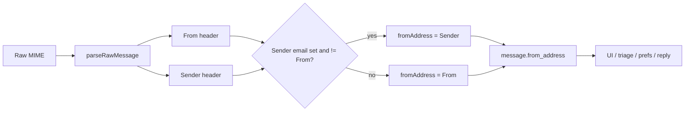

# Ingest Sender Header Attribution Fix

> **For agentic workers:** REQUIRED SUB-SKILL: Use superpowers:subagent-driven-development. Steps use checkbox (`- [ ]`) syntax for tracking.

**Goal:** Store the actual transmitting sender on Outlook calendar forwards (`Sender` header), not the preserved calendar organizer in `From`.

**Architecture:** One parse-site fix in [`apps/server-pilot/src/mail/ingest/parse-message.ts`](apps/server-pilot/src/mail/ingest/parse-message.ts). When `Sender` resolves to an email different from `From` (case-insensitive), set `fromAddress` to the Sender email. All downstream consumers (`store.ts`, triage, never-spam, reply-to, UI) already read `message.from_address` — no schema, no store/triage changes.

**Tech Stack:** TypeScript, mailparser, Vitest, EC2/PM2 via ops wrappers.

**Root cause (verified):** Prod MIME for msg `83dc749d-975e-4a26-a2b0-4f590f1da8e7` has `From: aroransh17@gmail.com`, `Sender: kdouglas@legacyhotels.co.za`, `Return-Path: kdouglas@…`. Parser only reads `From` at lines 209–210.



## Global Constraints

- Touch only ingest parse + its tests/fixture. No schema migration. No Return-Path fallback. No new `sender_address` column.
- Compare emails lowercased; use existing `extractAddress` for both headers.
- When Sender absent or equal to From → behavior unchanged.
- No force-push, no `--no-verify`, no IT mail creds in commits.
- Orchestrator + subagents: `/caveman ultra`. Technical terms exact.

## Overnight Autonomous Execution Mandate

**User granted full autonomy.** No blocking questions. No "which approach?" pause.

**REQUIRED SUB-SKILL overlay:** [`.cursor/skills/overnight-autonomous-zero/SKILL.md`](.cursor/skills/overnight-autonomous-zero/SKILL.md)

### Communication

- Orchestrator + every subagent: **Respond `/caveman ultra`. Technical terms exact.**

### AWS / infra (use freely)

| Resource | ID / path |
|----------|-----------|
| EC2 | `i-008f737974a9ba9b3` (`af-south-1`) |
| RDS | `nava-zero-mail-pilot` (Postgres 16) |
| S3 | `nava-zero-mail-845242190536-af-south-1` |
| Repo on EC2 | `/home/ubuntu/repos/zero` |
| **Primary deploy** | `apps/server-pilot/deploy/ops-deploy.sh` |
| **Primary app bounce** | `apps/server-pilot/deploy/ops-restart.sh` |
| Guts | `sync-ec2-git-bundle.sh`, `ssm-run-command.sh` |

**Allowed:** ops wrappers, bundle sync, deploy, SSM tests, PM2 logs, health curl, one-row read/update for known bad message.

**Forbidden:** force-push main, `--no-verify`, destructive git, IT Exchange/VPN/real mail creds.

### RCA loop

FAIL → reproduce → root cause (file:line) → fix → test → commit → resume.

### Done criteria

- [ ] Fixture + unit tests: divergent Sender wins; equal/absent Sender keep From
- [ ] `parse-message.ts` prefers Sender when emails differ
- [ ] `pnpm --filter server-pilot test` green for ingest parse suite (or full package test if filter name differs — use package name from `apps/server-pilot/package.json`)
- [ ] Commit on `EC2-pilot`, push, `ops-deploy.sh` + restart
- [ ] Prod: message `83dc749d-…` `from_address` corrected to `kdouglas@legacyhotels.co.za` (one-row UPDATE after verify Sender in S3 MIME)
- [ ] Handoff report under `docs/superpowers/plans/handoff-reports/`

## Execution Mode

Autonomous overnight — no user checkpoint. REQUIRED SUB-SKILL: superpowers:subagent-driven-development.

## Eng-review verdict (baked in — ponytail)

| Finding | Decision |
|---------|----------|
| Scope | 3 files max (`parse-message.ts`, one `.eml`, `ingest-store.test.ts`) — under complexity gate |
| Dual From/Sender columns | **Cut** — YAGNI; overwrite effective `fromAddress` |
| Return-Path fallback | **Cut** — Sender is enough for verified Outlook calendar FW |
| Blind Sender prefer vs list mail | **Ship Sender≠From rule.** Centurion sample has no list-Sender cases; refine later if list-bounces appear |
| Historical backfill | **One known UUID only** in smoke — not a general rehydrate job |
| Persist plan file | On execute: write [`docs/superpowers/plans/2026-07-28-ingest-sender-header.md`](docs/superpowers/plans/2026-07-28-ingest-sender-header.md) mirroring this plan |

## File map

| File | Responsibility |
|------|----------------|
| `apps/server-pilot/tests/fixtures/outlook-calendar-fw-sender.eml` | Minimal MIME: From≠Sender |
| `apps/server-pilot/tests/ingest-store.test.ts` | Failing then green parse tests |
| `apps/server-pilot/src/mail/ingest/parse-message.ts` | Prefer Sender when different |

## NOT in scope

- Schema / dual display "Ansh via Kamala"
- Return-Path / Resent-From heuristics
- Bulk reparse of all historical MIME
- Never-spam allowlist changes (after fix, #16 hits `@legacyhotels.co.za` domain — still never-spam; correct)
- Spam category redesign

## What already exists

- `extractAddress` / `firstHeader` in `parse-message.ts` — reuse
- `parseRawMessage (no DB)` suite in `ingest-store.test.ts` — extend
- `readFixture` helper — reuse
- No existing Sender coverage — gap this plan closes

---

### Task 1: Failing tests + fixture

**Files:**
- Create: `apps/server-pilot/tests/fixtures/outlook-calendar-fw-sender.eml`
- Modify: `apps/server-pilot/tests/ingest-store.test.ts` (append in `describe('parseRawMessage (no DB)')`)

- [ ] **Step 1: Write fixture** (minimal plain-text MIME, mirror prod headers):

```
Return-Path: <kdouglas@legacyhotels.co.za>
From: Ansh Arora <aroransh17@gmail.com>
Sender: Kamala Douglas <kdouglas@legacyhotels.co.za>
To: centurion@legacyhotels.com
Subject: FW: Nava AI X Centurion
Date: Mon, 27 Jul 2026 13:57:05 +0200
Message-ID: <calendar-fw-sender-test@legacyhotels.co.za>
MIME-Version: 1.0
Content-Type: text/plain; charset=utf-8
X-RS-Calendar: Yes

-----Original Appointment-----
From: Google Calendar On Behalf Of Ansh Arora
```

- [ ] **Step 2: Write failing tests** in `parseRawMessage (no DB)`:

```ts
it('prefers Sender over From when they differ (Outlook calendar FW)', async () => {
  const storage = withFakeS3();
  const raw = readFixture('outlook-calendar-fw-sender.eml');
  const parsed = await parseRawMessage(raw, {
    messageId: generateMessageId(),
    storage,
  });
  expect(parsed.fromAddress).toBe('kdouglas@legacyhotels.co.za');
});

it('keeps From when Sender absent', async () => {
  const storage = withFakeS3();
  const raw = readFixture('centurion-stamped.eml');
  const parsed = await parseRawMessage(raw, {
    messageId: generateMessageId(),
    storage,
  });
  expect(parsed.fromAddress).toBe('guest1@example.com');
});

it('keeps From when Sender equals From', async () => {
  const storage = withFakeS3();
  const base = readFixture('centurion-stamped.eml').toString('utf-8');
  const raw = Buffer.from(
    base.replace(
      'From: Guest One <guest1@example.com>',
      'From: Guest One <guest1@example.com>\r\nSender: Guest One <guest1@example.com>',
    ),
    'utf-8',
  );
  const parsed = await parseRawMessage(raw, {
    messageId: generateMessageId(),
    storage,
  });
  expect(parsed.fromAddress).toBe('guest1@example.com');
});
```

- [ ] **Step 3: Run tests — expect FAIL on first**

```bash
cd apps/server-pilot && pnpm exec vitest run tests/ingest-store.test.ts -t "prefers Sender"
```

Expected: FAIL — `fromAddress` is `aroransh17@gmail.com`, not `kdouglas@…`.

- [ ] **Step 4: Commit** (tests only; red OK only if repo policy forbids — prefer implement in Task 2 then single green commit; overnight: one green commit covering Tasks 1–2)

---

### Task 2: Prefer Sender in parse

**Files:**
- Modify: `apps/server-pilot/src/mail/ingest/parse-message.ts` (`buildParsedMessage`)

- [ ] **Step 1: Replace From-only assignment** (~lines 209–210) with:

```ts
  const fromHeaderRaw = firstHeader(headers, 'from');
  const fromEmail = extractAddress(headers.get('from')) ?? fromHeaderRaw;
  const senderEmail = extractAddress(headers.get('sender'));
  // ponytail: Outlook calendar FW keeps organizer in From; Sender is transmitter.
  const fromAddress =
    senderEmail &&
    fromEmail &&
    senderEmail.trim().toLowerCase() !== fromEmail.trim().toLowerCase()
      ? senderEmail
      : fromEmail;
```

- [ ] **Step 2: Re-run tests**

```bash
cd apps/server-pilot && pnpm exec vitest run tests/ingest-store.test.ts -t "parseRawMessage"
```

Expected: PASS (all three new + existing parse tests).

- [ ] **Step 3: Commit**

```bash
git add apps/server-pilot/src/mail/ingest/parse-message.ts \
  apps/server-pilot/tests/fixtures/outlook-calendar-fw-sender.eml \
  apps/server-pilot/tests/ingest-store.test.ts \
  docs/superpowers/plans/2026-07-28-ingest-sender-header.md
git commit -m "$(cat <<'EOF'
fix(ingest): prefer Sender over From when they differ

Outlook calendar forwards keep the organizer in From and put the
actual forwarder in Sender. Attribution, triage, and reply-to used From only.

EOF
)"
```

---

### Task 3: Deploy + fix known prod row + handoff

- [ ] **Step 1: Push + deploy**

```bash
git push -u origin HEAD
bash apps/server-pilot/deploy/ops-deploy.sh
bash apps/server-pilot/deploy/ops-restart.sh
```

- [ ] **Step 2: Correct known bad row** via SSM (read-confirm then UPDATE):

Message id `83dc749d-975e-4a26-a2b0-4f590f1da8e7`. Verify S3 MIME still has Sender=`kdouglas@…`. If `from_address` still `aroransh17@gmail.com`, UPDATE to `kdouglas@legacyhotels.co.za`. Also refresh thread search vector if a helper exists; else leave (search stale until next touch — acceptable for one row).

- [ ] **Step 3: Handoff report** at `docs/superpowers/plans/handoff-reports/2026-07-28-ingest-sender-header.md` — what shipped, prod row fixed, residual (no bulk backfill).

## Failure modes

| Failure | Mitigation |
|---------|------------|
| mailparser `sender` shape differs from `from` | Same `extractAddress`; test fails if shape wrong |
| Mailing-list Sender≠From mis-attributes | Deferred; not seen in Centurion sample |
| Deploy without restart | Use `ops-restart.sh` |
| Prod UPDATE wrong id | Verify id + current from_address before UPDATE |

## Parallelization

Sequential only — single module. No worktree split.
