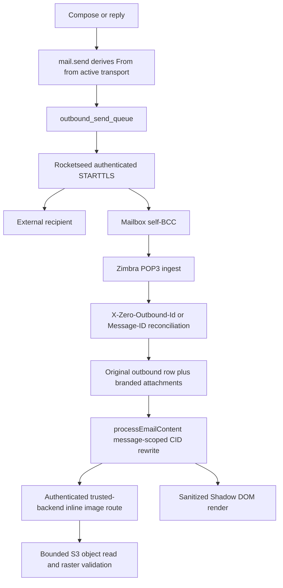

# Rocketseed Banner First-Class Implementation Plan

> **For agentic workers:** REQUIRED SUB-SKILLS: `overnight-autonomous-execution` and `superpowers:subagent-driven-development`. Execute task-by-task with test-driven development. Do not begin production SMTP cutover until autonomous Nava proof, final human visual verification, and Centurion mapping evidence all pass.

**Execution posture:** Overnight autonomous — user unavailable; implement-fix-loop until done criteria green, then request human visual verification as the final step.

**Goal:** Route every real Nava and Centurion outbound message through Rocketseed with mailbox-correct branding, reconcile the branded self-BCC into the original sent row, and render safe CID banner images inside Zero.

**Artifact readiness:** implementation-ready

**Cutover readiness:** blocked until autonomous Nava proof, final human visual check, and separate Centurion mapping evidence are complete

**Design source:** [Rocketseed office-hours design](C:/Users/gamin/.gstack/projects/kufupa-Zero/gamin-EC2-pilot-design-20260730-171800.md)

## Product Contract

- Nava and Centurion real sends use Rocketseed; POP3 remains on Zimbra.
- Backend active mailbox remains sole Header From authority.
- Rocketseed outage never falls back to direct Zimbra SMTP.
- One shared authenticated STARTTLS endpoint/credential must work for both identities. Otherwise stop and redesign.
- Branded self-BCC updates original outbound row; no duplicate unbranded/branded pair.
- CID images render without enabling remote trackers.
- Fixture and Mailpit transport routing remain unchanged.
- Existing 90-day attachment retention remains. Expired inline objects show alt text and do not fall back to remote content.
- Overnight work proves Nava end-to-end only. Centurion implementation is covered by automated identity/reconciliation tests, but Centurion production branding remains unproven until a later approved live canary or written Rocketseed tenant evidence.

## Architecture



## Explicit Non-Goals

- No Rocketseed admin/template editor.
- No provider/gateway abstraction or per-mailbox SMTP policy.
- No schema migration in this plan. If both correlation headers are stripped, stop and write a replacement design.
- No data-URI image embedding or signed S3 URL inside cached HTML.
- No remote-image restoration, inline-CSS expansion, or compose-time banner preview.
- No queue redesign, exactly-once guarantee, historical attachment restoration, or generic delivery-status UI.

## Global Constraints

- Autonomous live sender is exactly `navaai@legacyhotels.co.za`.
- Autonomous live recipients are limited to `navaai@legacyhotels.co.za` and `aroransh17@gmail.com`.
- Do not send any autonomous Centurion canary. Nava-only proof does not prove Centurion-specific Rocketseed mapping.
- Use at most three canary attempts per allowed recipient. SMTP acceptance with ambiguous downstream state is not permission to resend blindly.
- Canary content contains no guest, booking, hotel-operational, credential, or other sensitive data. Use a unique `[ZERO-ROCKETSEED-CANARY ...]` subject.
- Only Nava self-send may include one tiny synthetic PDF. Gmail canary has no attachment.
- Use existing secret ARN/runtime resolution only. Never retrieve, print, persist, or pass plaintext mail credentials through chat or CLI arguments.
- POP3 stays on Zimbra `172.24.0.10`. No direct-Zimbra SMTP fallback.
- Overnight wave may deploy code and execute one-shot Rocketseed canaries, but must not switch normal production SMTP traffic until human visual verification and Centurion mapping evidence are complete.
- Agent performs all available SMTP, MIME, ingest, database, authorization, browser-pixel, and log checks before asking user to inspect anything.
- Human check is the final acceptance step, never an overnight checkpoint.

## Overnight Autonomous Execution Mandate

**User granted full autonomy.** No blocking questions overnight. No manual login. No "which approach?" pause.

### Communication

- Orchestrator + every subagent: **Respond `/caveman ultra`. Technical terms exact.**

### AWS / infra (use freely)

| Resource | ID / path |
|----------|-----------|
| EC2 | `i-008f737974a9ba9b3` (`af-south-1`) |
| RDS | `nava-zero-mail-pilot` (Postgres 16) |
| S3 | `nava-zero-mail-845242190536-af-south-1` |
| Repo on EC2 | `/home/ubuntu/repos/zero` |
| **Primary deploy** | `apps/server-pilot/deploy/ops-deploy.sh` (`--migrate` when schema) |
| **Primary app bounce** | `apps/server-pilot/deploy/ops-restart.sh` |
| **Primary box reboot** | `apps/server-pilot/deploy/ops-reboot.sh` |
| Guts (fallback) | `sync-ec2-git-bundle.sh`, `deploy-ec2.sh`, `ssm-run-command.sh` |

**Allowed:** ops wrappers, bundle sync, deploy, migrate (via `ops-deploy --migrate`), seed (no `--rotate` unless fix requires), read-only SSM checks, PM2 logs, health curl, and tests against a disposable non-production database.

**Forbidden:** force-push main, `--no-verify`, destructive git, IT Exchange/VPN/real mail creds, pilot/production-RDS Vitest, `VITEST_ALLOW_PILOT_RDS=1`, or sourcing `.env.production` into tests.

The live-mail authorization above permits controlled sends through existing runtime secret references; it does not permit reading or exposing credentials.

### RCA loop (mandatory on any red)

FAIL → reproduce → root cause (file:line) → fix → test → commit → resume. Do not stop at first failure.

### Divergence authority

Better path to done criteria → take it. Log in handoff report.

### Done criteria

- [ ] Tasks 1–8 implemented, reviewed, and committed with focused tests green.
- [ ] Network-free Rocketseed CI suite and server/mail builds green.
- [ ] DB-backed reconciliation suites run on EC2 without conditional skip.
- [ ] CID rendering deployed and verified against a retained branded message.
- [ ] One Nava→Nava Rocketseed canary sent, ingested, reconciled into one row, and rendered with loaded banner pixels.
- [ ] One Nava→`aroransh17@gmail.com` Rocketseed canary accepted by SMTP; no claim of Gmail inbox delivery or final DMARC until human checks.
- [ ] No autonomous Centurion email sent.
- [ ] Normal production SMTP cutover remains blocked until human visual check and Centurion mapping evidence.
- [ ] Redacted handoff report records commits, commands, evidence, divergences, and remaining human checks.
- [ ] Final agent response states automated checks are complete and asks user to inspect Nava UI and Gmail.

## Execution Mode

Autonomous overnight — no user checkpoint. REQUIRED SUB-SKILL: `superpowers:subagent-driven-development`. Do not ask "which approach?"

## Task 1: Build Probe Tool and Prove Nava Tenant Path

**Files:**
- Create: [apps/server-pilot/scripts/rocketseed-probe.ts](../../../apps/server-pilot/scripts/rocketseed-probe.ts)
- Create: [apps/server-pilot/tests/rocketseed-probe.test.ts](../../../apps/server-pilot/tests/rocketseed-probe.test.ts)
- Create: [apps/server-pilot/deploy/rocketseed-cutover-evidence.md](../../../apps/server-pilot/deploy/rocketseed-cutover-evidence.md)
- Modify: [apps/server-pilot/package.json](../../../apps/server-pilot/package.json)

### Step 1: Write failing probe-option tests

Test pure builders, not network:

- reject missing host, TLS server name, user/secret, recipient, Header From, or envelope From;
- force `secure: false`, `requireTLS: true`, `rejectUnauthorized: true`;
- keep Header From and envelope From independently configurable;
- stamp `X-Zero-Mailbox`, `X-Zero-Outbound-Id`, and unique subject token;
- autonomous mode rejects every sender except Nava and every recipient except Nava/Gmail;
- autonomous mode permits a generated synthetic PDF only for Nava self-send;
- never print password or secret value.

Run:

```bash
pnpm --dir apps/server-pilot exec vitest run tests/rocketseed-probe.test.ts
```

Expected: FAIL because probe builder does not exist.

### Step 2: Implement smallest repeatable probe

Export a pure builder and a CLI entry point. Credentials come only from `SMTP_PASSWORD` or `SMTP_SECRET_ARN`.

```ts
type RocketseedProbeInput = {
  host: string;
  port: number;
  tlsServername: string;
  authUser: string;
  headerFrom: string;
  envelopeFrom: string;
  recipient: string;
  outboundId: string;
  subjectToken: string;
  mode: 'autonomous-nava' | 'manual';
  includeSyntheticPdf: boolean;
};
```

The CLI must call `verify()` and then one `sendMail()` with explicit:

```ts
{
  from: input.headerFrom,
  envelope: { from: input.envelopeFrom, to: [input.recipient] },
  headers: {
    'X-Zero-Mailbox': input.headerFrom,
    'X-Zero-Outbound-Id': input.outboundId,
  },
}
```

Add `probe:rocketseed` package script. Overnight execution must use `mode=autonomous-nava`; `manual` mode is reserved for a later explicitly approved Centurion probe. Generate the tiny PDF in memory. Keep output to endpoint, TLS mode, identities, SMTP response, accepted/rejected addresses, and Message-ID.

### Step 3: Pass tests and build

```bash
pnpm --dir apps/server-pilot exec vitest run tests/rocketseed-probe.test.ts
pnpm --dir apps/server-pilot build
```

Expected: PASS.

### Step 4: Run certificate and SMTP probes from target EC2

Require a certificate-valid Rocketseed hostname or SAN. Do not use `MAIL_TLS_REJECT_UNAUTHORIZED=false`.

```bash
openssl s_client \
  -starttls smtp \
  -connect 172.24.0.8:587 \
  -servername "$SMTP_TLS_SERVERNAME" \
  -verify_return_error
```

Run only the user-authorized Nava sends:

1. Nava Header From + Nava MAIL FROM → `navaai@legacyhotels.co.za`, with one tiny synthetic PDF.
2. Nava Header From + Nava MAIL FROM → `aroransh17@gmail.com`, without attachment.

Do not send as Centurion. Use the Nava self-copy for autonomous branding/MIME/UI inspection. Gmail SMTP acceptance is machine-checkable; inbox delivery, banner appearance, and trusted receiving-MTA `Authentication-Results` remain the final human check.

### Step 5: Record redacted evidence and enforce hard gate

Record only:

- endpoint, port, EHLO capabilities, certificate SAN/issuer/expiry, AUTH mechanism;
- Header From, MAIL FROM, SMTP response, Message-ID, accepted/rejected addresses with local parts redacted;
- approved Nava Rocketseed marker, banner SHA-256, CID set, and screenshot;
- preserved PDF, `X-Zero-Mailbox`, `X-Zero-Outbound-Id` or original Message-ID;
- Gmail SMTP acceptance; defer topmost trusted receiving-MTA SPF/DKIM/DMARC headers to the human final check.

Do not retain message bodies, credentials, full recipient addresses, or raw MIME.

Autonomous Nava proof is green only when:

- one authenticated endpoint and credential works for Nava;
- authenticated STARTTLS with valid hostname/chain;
- Nava self-copy receives the correct banner exactly once;
- one correlation field survives;
- no relay loop;
- PDF, self-BCC, and thread headers survive;
- Gmail canary is accepted by SMTP.

Live proof failure does not stop Tasks 2–8 code/test work. Apply the RCA loop, record the blocker, continue all network-independent tasks, and keep production cutover blocked.

Global production cutover additionally requires:

- human confirmation of Nava banner in Nava UI and Gmail;
- trusted Gmail `Authentication-Results` with aligned SPF, DKIM, and DMARC;
- separate Centurion banner-mapping evidence from an approved later live canary or written Rocketseed tenant configuration.

### Step 6: Commit probe tooling and redacted contract

```bash
git add apps/server-pilot/scripts/rocketseed-probe.ts apps/server-pilot/tests/rocketseed-probe.test.ts apps/server-pilot/deploy/rocketseed-cutover-evidence.md apps/server-pilot/package.json
git commit -m "test(mail): prove Rocketseed relay contract"
```

## Task 2: Harden SMTP Configuration and Cutover Semantics

**Files:**
- Modify: [apps/server-pilot/src/env.ts](../../../apps/server-pilot/src/env.ts)
- Modify: [apps/server-pilot/src/mail/send/smtp.ts](../../../apps/server-pilot/src/mail/send/smtp.ts)
- Modify: [apps/server-pilot/src/mail/ingest/pop3-client.ts](../../../apps/server-pilot/src/mail/ingest/pop3-client.ts)
- Modify: [apps/server-pilot/scripts/activate-real-mail.sh](../../../apps/server-pilot/scripts/activate-real-mail.sh)
- Modify: [apps/server-pilot/deploy/write-ec2-env.sh](../../../apps/server-pilot/deploy/write-ec2-env.sh)
- Modify: [apps/server-pilot/tests/transport-mode.test.ts](../../../apps/server-pilot/tests/transport-mode.test.ts)
- Modify: [apps/server-pilot/tests/deploy-config.test.ts](../../../apps/server-pilot/tests/deploy-config.test.ts)

### Step 1: Write failing transport/config tests

Cover:

- real mode requires SMTP host, user, password/secret, `SMTP_REQUIRE_TLS=true`, and TLS server name;
- unknown non-empty transport modes throw instead of silently selecting fixture SMTP;
- wire mode remains cleartext-capable and credential-free;
- real transport sets `requireTLS: true`, `rejectUnauthorized: true`, and `tls.servername`;
- real transport applies bounded connection, greeting, and socket timeouts;
- explicit envelope sender equals payload sender;
- `POP3_TLS_REJECT_UNAUTHORIZED=false` affects POP3 only;
- caller-supplied Rocketseed host/user/TLS values survive sourcing stale `.env.production`;
- writer persists `SMTP_REQUIRE_TLS`, `SMTP_TLS_SERVERNAME`, and `POP3_TLS_REJECT_UNAUTHORIZED`;
- activation has no direct-mail SMTP default, fails when `SMTP_HOST` is absent, and accepts `.8` only through explicit cutover configuration.

Run:

```bash
pnpm --dir apps/server-pilot exec vitest run tests/transport-mode.test.ts tests/deploy-config.test.ts
```

Expected: FAIL.

### Step 2: Split POP3 and SMTP TLS policy

Add parsed env fields:

```ts
POP3_TLS_REJECT_UNAUTHORIZED?: boolean;
SMTP_REQUIRE_TLS?: boolean;
SMTP_TLS_SERVERNAME?: string;
```

POP3 may retain the hotel exception. Real SMTP must always validate certificates.

```ts
const transporter = nodemailer.createTransport({
  host,
  port,
  secure: false,
  requireTLS: true,
  connectionTimeout: 10_000,
  greetingTimeout: 10_000,
  socketTimeout: 60_000,
  auth: { user, pass: password },
  tls: {
    rejectUnauthorized: true,
    servername: tlsServername,
  },
});
```

Set explicit envelope in `sendMail`:

```ts
envelope: {
  from: payload.from,
  to: [...payload.to, ...payload.cc, ...payload.bcc],
},
```

Do not reuse `MAIL_TLS_REJECT_UNAUTHORIZED` in SMTP. `resolveTransportMode` must throw for every unknown non-empty value; only missing mode defaults to fixture.

### Step 3: Fix activation precedence

Stage every caller-supplied POP3/SMTP host, port, TLS, user, secret ARN, and password before sourcing `.env.production`; restore non-empty staged values afterward. Keep POP3 default `.10`; remove the SMTP `.10` default entirely; require explicit `SMTP_HOST`, `SMTP_PORT`, and `SMTP_TLS_SERVERNAME`.

The SMTP auth smoke must use the same secure options as runtime.

### Step 4: Pass tests

```bash
pnpm --dir apps/server-pilot exec vitest run tests/transport-mode.test.ts tests/deploy-config.test.ts
pnpm --dir apps/server-pilot build
```

Expected: PASS.

### Step 5: Commit

```bash
git add apps/server-pilot/src/env.ts apps/server-pilot/src/mail/send/smtp.ts apps/server-pilot/src/mail/ingest/pop3-client.ts apps/server-pilot/scripts/activate-real-mail.sh apps/server-pilot/deploy/write-ec2-env.sh apps/server-pilot/tests/transport-mode.test.ts apps/server-pilot/tests/deploy-config.test.ts
git commit -m "feat(mail): enforce secure Rocketseed SMTP"
```

## Task 3: Reconcile Branded Self-BCC Into Original Sent Row

**Files:**
- Modify: [apps/server-pilot/src/trpc/routes/mail.ts](../../../apps/server-pilot/src/trpc/routes/mail.ts)
- Modify: [apps/server-pilot/src/mail/ingest/parse-message.ts](../../../apps/server-pilot/src/mail/ingest/parse-message.ts)
- Modify: [apps/server-pilot/src/mail/ingest/store.ts](../../../apps/server-pilot/src/mail/ingest/store.ts)
- Create: [apps/server-pilot/tests/fixtures/rocketseed-branded-sent-copy.eml](../../../apps/server-pilot/tests/fixtures/rocketseed-branded-sent-copy.eml)
- Modify: [apps/server-pilot/tests/ingest-store.test.ts](../../../apps/server-pilot/tests/ingest-store.test.ts)
- Create: [apps/server-pilot/tests/rocketseed-sent-copy.test.ts](../../../apps/server-pilot/tests/rocketseed-sent-copy.test.ts)
- Modify: [apps/server-pilot/tests/mail-send.test.ts](../../../apps/server-pilot/tests/mail-send.test.ts)

### Step 1: Add failing correlation tests

Tests must prove:

- outbound SMTP payload stamps local `X-Zero-Outbound-Id`;
- parser extracts it;
- branded self-BCC with matching transport/correlation updates original row;
- original `message.id` and `threadId` remain unchanged;
- branded HTML and CID attachments replace local unbranded content;
- regular PDF attachment remains attached;
- no second message/thread is inserted;
- repeated POP3 UIDL returns existing row;
- exact Message-ID fallback works when custom header is absent;
- malformed, unknown, or cross-transport correlation cannot overwrite a row.

Run:

```bash
pnpm --dir apps/server-pilot exec vitest run tests/mail-send.test.ts tests/ingest-store.test.ts tests/rocketseed-sent-copy.test.ts
```

Expected: FAIL.

### Step 2: Stamp correlation before enqueue

Generate local message UUID before `smtpPayload` and add:

```ts
extraHeaders: {
  'X-Zero-Mailbox': ctx.transportEmail,
  'X-Zero-Outbound-Id': messageId,
},
```

### Step 3: Parse and validate correlation

Add `outboundMessageId: string | null` to `ParsedInboundMessage`. Normalize only a UUID-shaped header value; retain raw headers for quarantine diagnostics.

### Step 4: Reconcile in one transaction

After mailbox routing:

1. Confirm parsed sender belongs to routed transport identity set.
2. Match outbound row by `id + transportId + direction=outbound`.
3. Fall back to exact `messageIdHeader + transportId + direction=outbound`.
4. Update delivered body/header/raw-MIME/UIDL/timestamps on existing row.
5. Delete existing attachment metadata for that row and insert delivered metadata.
6. Preserve original row and thread IDs.
7. Refresh thread search vector.

S3 keys remain opaque; they may retain the incoming parse UUID prefix.

Rename the UIDL replay lookup so it covers reconciled outbound rows as well as inbound rows.

### Step 5: Pass tests

Use a reachable test database and confirm these integration tests do not skip:

```bash
pnpm --dir apps/server-pilot exec vitest run tests/mail-send.test.ts tests/ingest-store.test.ts tests/rocketseed-sent-copy.test.ts
```

Expected: PASS, zero skipped DB suites.

### Step 6: Commit

```bash
git add apps/server-pilot/src/trpc/routes/mail.ts apps/server-pilot/src/mail/ingest/parse-message.ts apps/server-pilot/src/mail/ingest/store.ts apps/server-pilot/tests/fixtures/rocketseed-branded-sent-copy.eml apps/server-pilot/tests/ingest-store.test.ts apps/server-pilot/tests/rocketseed-sent-copy.test.ts apps/server-pilot/tests/mail-send.test.ts
git commit -m "feat(mail): reconcile branded sent copies"
```

## Task 4: Make SMTP Outcomes Honest and One-Shot Ingest Safe

**Files:**
- Modify: [apps/server-pilot/src/mail/send/smtp.ts](../../../apps/server-pilot/src/mail/send/smtp.ts)
- Modify: [apps/server-pilot/src/mail/send/outbound-queue.ts](../../../apps/server-pilot/src/mail/send/outbound-queue.ts)
- Modify: [apps/server-pilot/src/mail/ingest/worker.ts](../../../apps/server-pilot/src/mail/ingest/worker.ts)
- Modify: [apps/server-pilot/src/trpc/routes/mail.ts](../../../apps/server-pilot/src/trpc/routes/mail.ts)
- Modify: [apps/server-pilot/tests/outbound-queue.test.ts](../../../apps/server-pilot/tests/outbound-queue.test.ts)
- Create: [apps/server-pilot/tests/worker-one-shot.test.ts](../../../apps/server-pilot/tests/worker-one-shot.test.ts)

### Step 1: Write failing outcome tests

Cover:

- no accepted recipients is failure; never synthesize acceptance;
- all accepted marks queue sent and clears error;
- partial acceptance marks queue sent, preserves Message-ID, stores structured `PARTIAL_REJECTION` warning, and never retries accepted recipients;
- immediate send returns accepted/rejected lists;
- pre-accept SMTP error remains retryable;
- one-shot ingest never calls `flushDue`;
- regular worker loop still flushes due outbound rows.

### Step 2: Extend result shape and classify terminal partial delivery

```ts
interface SmtpSendResult {
  messageId: string;
  accepted: string[];
  rejected: string[];
}
```

Remove the current fallback that treats every requested address as accepted when Nodemailer reports none.

Partial acceptance is terminal for the original envelope. Persist a warning while marking queue `sent`; do not retry the full envelope.

### Step 3: Remove outbound flush from one-shot ingest

`WORKER_ONE_SHOT=1` performs POP3 ingest only. Canary sends use `probe:rocketseed`; normal worker mode retains `flushDue`.

### Step 4: Pass tests

```bash
pnpm --dir apps/server-pilot exec vitest run tests/outbound-queue.test.ts tests/worker-one-shot.test.ts
pnpm --dir apps/server-pilot build
```

### Step 5: Commit

```bash
git add apps/server-pilot/src/mail/send/smtp.ts apps/server-pilot/src/mail/send/outbound-queue.ts apps/server-pilot/src/mail/ingest/worker.ts apps/server-pilot/src/trpc/routes/mail.ts apps/server-pilot/tests/outbound-queue.test.ts apps/server-pilot/tests/worker-one-shot.test.ts
git commit -m "fix(mail): preserve partial SMTP outcomes"
```

## Task 5: Add Generic CID Projection and Raster Validation

**Files:**
- Create: [apps/server-pilot/src/mail/cid-images.ts](../../../apps/server-pilot/src/mail/cid-images.ts)
- Create: [apps/server-pilot/src/mail/safe-inline-image.ts](../../../apps/server-pilot/src/mail/safe-inline-image.ts)
- Modify: [apps/server-pilot/src/mail/sanitize-email-html.ts](../../../apps/server-pilot/src/mail/sanitize-email-html.ts)
- Create: [apps/server-pilot/tests/cid-images.test.ts](../../../apps/server-pilot/tests/cid-images.test.ts)
- Create: [apps/server-pilot/tests/safe-inline-image.test.ts](../../../apps/server-pilot/tests/safe-inline-image.test.ts)
- Modify: [apps/server-pilot/tests/sanitize-email-html.test.ts](../../../apps/server-pilot/tests/sanitize-email-html.test.ts)

### Step 1: Write failing CID tests

Normalization order:

1. remove case-insensitive `cid:` prefix;
2. percent-decode once;
3. trim;
4. remove surrounding angle brackets;
5. lowercase.

Reject control characters and `/`, `\`, `?`, `#`.

Rewrite requirements:

- only sanitized ``;
- exact same-message Content-ID match;
- image metadata only;
- duplicate normalized Content-ID is ambiguous and blocked;
- missing/malformed/oversized CID becomes blocked placeholder;
- never rewrite anchors, CSS `url()`, or `srcset`;
- preserve unrelated attributes;
- fragment serialization does not add `html/head/body`.

### Step 2: Write failing raster tests

Validate PNG, JPEG, GIF, and WebP signatures and dimensions. Reject:

- SVG and all unsupported formats;
- MIME/signature mismatch;
- truncated headers;
- width or height above 10,000;
- more than 25,000,000 pixels;
- body above 5 MiB.

### Step 3: Implement helpers

Use existing Cheerio fragment mode:

```ts
const $ = load(html, null, false);
$('img[src]').each((_index, node) => {
  // Replace only normalized cid: values with generated trusted-backend URL.
});
```

Export the existing blocked-image placeholder from sanitizer instead of duplicating it.

### Step 4: Pass tests

```bash
pnpm --dir apps/server-pilot exec vitest run tests/cid-images.test.ts tests/safe-inline-image.test.ts tests/sanitize-email-html.test.ts
```

### Step 5: Commit

```bash
git add apps/server-pilot/src/mail/cid-images.ts apps/server-pilot/src/mail/safe-inline-image.ts apps/server-pilot/src/mail/sanitize-email-html.ts apps/server-pilot/tests/cid-images.test.ts apps/server-pilot/tests/safe-inline-image.test.ts apps/server-pilot/tests/sanitize-email-html.test.ts
git commit -m "feat(mail): project safe inline CID images"
```

## Task 6: Serve Authenticated Inline Image Bytes

**Files:**
- Create: [apps/server-pilot/src/http/inline-attachment.ts](../../../apps/server-pilot/src/http/inline-attachment.ts)
- Modify: [apps/server-pilot/src/main.ts](../../../apps/server-pilot/src/main.ts)
- Create: [apps/server-pilot/tests/inline-attachment-http.test.ts](../../../apps/server-pilot/tests/inline-attachment-http.test.ts)
- Modify: [apps/server-pilot/tests/attachment-access.test.ts](../../../apps/server-pilot/tests/attachment-access.test.ts)

### Step 1: Write failing HTTP tests

Route:

`GET /api/mail/messages/:messageId/attachments/:attachmentId/inline`

Cases:

- no Better Auth session: `401`;
- unknown/inaccessible/cross-message attachment: `404`;
- disallowed MIME or magic mismatch: `415`;
- metadata/body above 5 MiB: `413`;
- expired/missing S3 object: `404`;
- authorized valid image: `200` with exact bytes;
- response headers: `Content-Type`, safe inline disposition, `Content-Length`, `Cache-Control: private, max-age=300`, `Referrer-Policy: no-referrer`, `X-Content-Type-Options: nosniff`.

### Step 2: Implement testable handler factory

Inject auth, DB, and storage getters for tests. Production route:

1. Resolve session from cookies.
2. Join attachment to message and `mailbox_access` by session user.
3. Verify path attachment belongs to path message.
4. Check metadata MIME/size.
5. Read with `getObjectBounded`.
6. Validate MIME signature and dimensions.
7. Return bytes.

Do not require `x-zero-active-transport`; image requests cannot set it.

### Step 3: Register route before tRPC wildcard

Mount in `main.ts` with the existing Better Auth instance.

### Step 4: Pass tests

```bash
pnpm --dir apps/server-pilot exec vitest run tests/inline-attachment-http.test.ts tests/attachment-access.test.ts
pnpm --dir apps/server-pilot build
```

### Step 5: Commit

```bash
git add apps/server-pilot/src/http/inline-attachment.ts apps/server-pilot/src/main.ts apps/server-pilot/tests/inline-attachment-http.test.ts apps/server-pilot/tests/attachment-access.test.ts
git commit -m "feat(mail): serve authorized inline images"
```

## Task 7: Wire Message-Scoped CID Rendering and Active-Mailbox Sender

**Files:**
- Modify: [apps/server-pilot/src/trpc/routes/mail.ts](../../../apps/server-pilot/src/trpc/routes/mail.ts)
- Create: [apps/server-pilot/tests/process-email-content.test.ts](../../../apps/server-pilot/tests/process-email-content.test.ts)
- Modify: [apps/mail/components/mail/mail-content.tsx](../../../apps/mail/components/mail/mail-content.tsx)
- Modify: [apps/mail/hooks/use-threads.ts](../../../apps/mail/hooks/use-threads.ts)
- Modify: [apps/mail/components/create/create-email.tsx](../../../apps/mail/components/create/create-email.tsx)
- Modify: [apps/mail/components/mail/reply-composer.tsx](../../../apps/mail/components/mail/reply-composer.tsx)
- Modify: [apps/mail/tests/mail-content-fallback.test.ts](../../../apps/mail/tests/mail-content-fallback.test.ts)
- Create: [apps/mail/tests/e2e/mailbox-send-identity.spec.ts](../../../apps/mail/tests/e2e/mailbox-send-identity.spec.ts)

### Step 1: Write failing tRPC projection tests

`processEmailContent` now requires `messageId`.

Prove:

- message is scoped to active transport;
- all attachment metadata loads in one query;
- valid CIDs become stable absolute inline URLs rooted at parsed `BETTER_AUTH_URL`, never request Host;
- remote images remain blocked when sender is untrusted;
- script/event-handler sanitization remains intact;
- missing/duplicate CIDs set `hasBlockedImages`;
- cross-message CID cannot resolve.

### Step 2: Implement projection order

```text
authorize message
  -> sanitize untrusted HTML
  -> query message attachment metadata once
  -> rewrite sanitized img[src=cid] values only
  -> process quoted content
  -> return processedHtml + blocked flag
```

Do not expose `contentId` through thread wire types and do not fetch one signed URL per image. Build image URLs from trusted `BETTER_AUTH_URL`; relative `/api` URLs fail during local frontend development because Vite has no backend proxy.

### Step 3: Version frontend cache

Both prefetch and renderer use:

```ts
['email-content-v2', messageId, shouldLoadImages, theme]
```

Pass `messageId` to mutation. Existing persistent `email-content` results must not be reused.

### Step 4: Preserve alt text for failed CID routes

In Shadow DOM image error handling:

- authenticated `/api/mail/messages/.../inline` failures remove unusable `src` but retain element/alt;
- do not raise remote-image trust warning;
- remote image errors retain existing blocked/hide behavior.

### Step 5: Remove live client sender override

Compose and reply/forward include `fromEmail` only in frontend-only demo mode. Live calls omit it; backend `ctx.transportEmail` owns identity.

Direct voice/unsubscribe send paths already omit `fromEmail`; verify, do not refactor.

### Step 6: Pass tests

```bash
pnpm --dir apps/server-pilot exec vitest run tests/process-email-content.test.ts tests/sanitize-email-html.test.ts
pnpm --dir apps/mail exec vitest run tests/mail-content-fallback.test.ts
pnpm --dir apps/server-pilot build
pnpm --dir apps/mail build
```

### Step 7: Browser sender-payload test

Intercept the live tRPC send request after switching Nava to Centurion. Assert:

- active transport header is Centurion;
- request body omits `fromEmail`;
- server response reports Centurion sender.

Run:

```bash
pnpm --dir apps/mail exec playwright test tests/e2e/mailbox-send-identity.spec.ts --reporter=line
```

### Step 8: Commit

```bash
git add apps/server-pilot/src/trpc/routes/mail.ts apps/server-pilot/tests/process-email-content.test.ts apps/mail/components/mail/mail-content.tsx apps/mail/hooks/use-threads.ts apps/mail/components/create/create-email.tsx apps/mail/components/mail/reply-composer.tsx apps/mail/tests/mail-content-fallback.test.ts apps/mail/tests/e2e/mailbox-send-identity.spec.ts
git commit -m "feat(mail): render branded CID banners"
```

## Task 8: Add Full Fixture and Browser Regression

**Files:**
- Modify: [apps/server-pilot/tests/fixtures/rocketseed-branded-sent-copy.eml](../../../apps/server-pilot/tests/fixtures/rocketseed-branded-sent-copy.eml)
- Create: [apps/server-pilot/tests/rocketseed-flow.test.ts](../../../apps/server-pilot/tests/rocketseed-flow.test.ts)
- Create: [apps/mail/tests/e2e/real-mail-cid-inline.spec.ts](../../../apps/mail/tests/e2e/real-mail-cid-inline.spec.ts)
- Modify: [apps/server-pilot/package.json](../../../apps/server-pilot/package.json)
- Modify: [.github/workflows/ci.yml](../../../.github/workflows/ci.yml)

### Step 1: Make fixture representative

Use multipart/related MIME with:

- Rocketseed marker and two `cid:image-...@localhost` references;
- matching PNG/JPEG MIME parts;
- one regular PDF;
- one blocked remote tracker;
- `X-Zero-Mailbox` and `X-Zero-Outbound-Id`;
- no real addresses, tokens, or production banner bytes.

### Step 2: Add server flow test

Parse -> persist/reconcile -> process HTML -> fetch inline route. Assert:

- one message row;
- original thread preserved;
- CID metadata stored;
- HTML contains authorized routes and no raw `cid:`;
- remote tracker absent;
- PDF remains downloadable;
- unauthorized mailbox gets `404`.

### Step 3: Add browser pixel test

Open fixture thread and assert:

- each Rocketseed image `complete === true`;
- `naturalWidth > 0` and `naturalHeight > 0`;
- no raw `cid:` remains in Shadow DOM;
- remote tracker request never occurs;
- PDF attachment remains listed;
- no duplicate sent message appears.

### Step 4: Add network-free CI gate

Add `test:rocketseed` script for non-DB, non-live suites. Extend CI to run that script plus server/mail builds. Keep DB-backed reconciliation and live Rocketseed tests in the predeploy gate; do not allow their conditional skip to masquerade as CI coverage.

### Step 5: Run

```bash
pnpm --dir apps/server-pilot exec vitest run tests/rocketseed-flow.test.ts
pnpm --dir apps/mail exec playwright test tests/e2e/real-mail-cid-inline.spec.ts --reporter=line
```

### Step 6: Commit

```bash
git add apps/server-pilot/tests/fixtures/rocketseed-branded-sent-copy.eml apps/server-pilot/tests/rocketseed-flow.test.ts apps/mail/tests/e2e/real-mail-cid-inline.spec.ts apps/server-pilot/package.json .github/workflows/ci.yml
git commit -m "test(mail): cover branded message end to end"
```

## Task 9: Deploy Code, Run Nava Canaries, and Hand Off Final Human Check

**Files:**
- Modify: [apps/server-pilot/deploy/navaai-real-mail-smoke.md](../../../apps/server-pilot/deploy/navaai-real-mail-smoke.md)
- Modify: [apps/server-pilot/deploy/it-handoff-runbook.md](../../../apps/server-pilot/deploy/it-handoff-runbook.md)
- Modify: [apps/server-pilot/deploy/rocketseed-cutover-evidence.md](../../../apps/server-pilot/deploy/rocketseed-cutover-evidence.md)
- Create: [docs/superpowers/plans/handoff-reports/2026-07-30-rocketseed-banner-first-class.md](handoff-reports/2026-07-30-rocketseed-banner-first-class.md)

### Step 1: Document exact config and rollback

Document:

- POP3 `.10`; SMTP `.8` plus certificate-valid `SMTP_TLS_SERVERNAME`;
- `SMTP_REQUIRE_TLS=true`;
- separate POP3 certificate exception;
- no SMTP certificate bypass;
- no direct-Zimbra fallback;
- PM2 stop/start order;
- queue inspection and partial-rejection query;
- one-shot Nava canary allowlist and send cap;
- global SMTP cutover stays blocked until human visual check and Centurion evidence.

### Step 2: Run complete local verification

```bash
pnpm --dir apps/server-pilot exec vitest run \
  tests/rocketseed-probe.test.ts \
  tests/transport-mode.test.ts \
  tests/deploy-config.test.ts \
  tests/mail-send.test.ts \
  tests/ingest-store.test.ts \
  tests/rocketseed-sent-copy.test.ts \
  tests/outbound-queue.test.ts \
  tests/worker-one-shot.test.ts \
  tests/cid-images.test.ts \
  tests/safe-inline-image.test.ts \
  tests/sanitize-email-html.test.ts \
  tests/inline-attachment-http.test.ts \
  tests/process-email-content.test.ts \
  tests/rocketseed-flow.test.ts
pnpm --dir apps/mail exec vitest run tests/mail-content-fallback.test.ts
pnpm --dir apps/server-pilot build
pnpm --dir apps/mail build
```

DB-backed tests must run, not skip.

### Step 3: Deploy code without changing normal SMTP

Deploy through `apps/server-pilot/deploy/ops-deploy.sh` while preserving current normal SMTP configuration. Run health checks, PM2 checks, and the DB-backed Rocketseed suites on EC2 through `ssm-run-command.sh`.

Open a retained existing Rocketseed-branded message and verify CID pixels plus tracker blocking before any live canary.

### Step 4: Run isolated Nava-only Rocketseed canaries

Use `probe:rocketseed` in a separate one-shot process with explicit Rocketseed env. Do not rewrite `.env.production`, restart PM2 with Rocketseed env, or alter normal queue routing.

1. Send Nava→Nava with unique subject and one tiny synthetic PDF.
2. Send Nava→`aroransh17@gmail.com` with unique subject and no attachment.
3. Never send as Centurion.
4. Never exceed three attempts per recipient.
5. If SMTP reports partial or ambiguous acceptance, inspect before any retry.

### Step 5: Perform autonomous Nava self-check

Wait for the Nava self-copy through normal Zimbra POP3 ingest. Then verify:

- one ingested message for the unique token;
- Rocketseed marker appears exactly once;
- CID parts match HTML references;
- PDF survives;
- no relay loop;
- UI Shadow DOM contains no raw `cid:`;
- banner images report `complete`, `naturalWidth > 0`, and `naturalHeight > 0`;
- remote tracker requests remain blocked;
- fixture/DB reconciliation suite remains green.

The direct one-shot probe does not create a local pre-send app row, so live sent-copy reconciliation is not claimed from this canary. Reconciliation is proven by the DB-backed representative MIME test.

For Gmail, record only SMTP acceptance and Message-ID. Do not claim inbox delivery, visual banner success, or final DMARC without user inspection.

### Step 6: Run final review and write handoff

Run whole-branch review. Fix all Critical/Important findings through the RCA loop. Write handoff report containing:

- commits and deployed revision;
- exact tests/builds/SSM commands and results;
- canary subject tokens, timestamps, Message-IDs, accepted/rejected counts;
- redacted Nava MIME/CID/banner evidence;
- browser pixel assertions;
- divergences;
- explicit unverified items: Gmail inbox/auth headers and Centurion live branding.

### Step 7: Failure handling

If any assertion fails:

- keep normal production SMTP unchanged;
- preserve redacted logs/evidence;
- run the RCA loop and retry only within the recipient cap;
- if credentials, VPN, certificate, or inbox access is genuinely unavailable, finish all independent code/tests and record the precise blocker.

### Step 8: Commit docs/evidence

```bash
git add apps/server-pilot/deploy/navaai-real-mail-smoke.md apps/server-pilot/deploy/it-handoff-runbook.md apps/server-pilot/deploy/rocketseed-cutover-evidence.md docs/superpowers/plans/handoff-reports/2026-07-30-rocketseed-banner-first-class.md
git commit -m "docs(mail): record Rocketseed canary handoff"
```

### Step 9: Final human-check flag

Only after all technical and evidence criteria above are green, send the user one final status containing:

- Nava self-send subject token and what the agent verified;
- Gmail subject token and SMTP acceptance;
- exact two checks requested from the user: open Nava message in Zero and inspect Gmail message/banner plus `Authentication-Results`;
- explicit statement that Centurion branding remains unproven because autonomous Centurion sends were forbidden.

Do not ask the user to check earlier.

## Coverage Map

```text
User switches mailbox
  -> request active-transport header ........ browser regression
  -> server derives Header From ............. mail-send integration
  -> explicit MAIL FROM + AUTH/TLS .......... transport unit + live probe
  -> durable queue .......................... queue integration
  -> Rocketseed injects one banner .......... live Nava canary + Centurion automated tests
  -> partial rejection policy ............... queue integration
  -> self-BCC returns through POP3 .......... representative MIME fixture
  -> sent-copy reconciliation ............... store integration
  -> CID metadata persists .................. parse/store integration
  -> message-scoped HTML projection ......... tRPC integration
  -> authenticated inline bytes ............. HTTP authorization matrix
  -> Shadow DOM renders pixels .............. Playwright
  -> remote trackers stay blocked ........... sanitizer + Playwright
  -> outage never bypasses Rocketseed ........ config/queue/live rollback
```

Centurion-specific production banner selection remains outside autonomous proof and blocks global cutover until separately evidenced.

## Performance and Failure Budgets

- One attachment metadata query per displayed message.
- One authorized DB join and bounded S3 read per CID image.
- Maximum served CID object: 5 MiB.
- Maximum raster dimensions: 10,000 x 10,000, capped at 25 million pixels.
- Browser cache: private, five minutes.
- No per-image tRPC/signed-URL generation and no base64 HTML growth.
- SMTP remains at-least-once. Remote acceptance before local persistence remains an explicit uncertain-delivery window.

## Deferred Follow-Ups

- User-visible deferred/partial/uncertain delivery status.
- Bounded retry/dead-letter policy.
- Attachment retention beyond 90 days and orphan cleanup.
- Historical MIME rehydration after S3 expiry.
- Remote image source preservation and safe email-style expansion.

## Ponytail Simplification Review

- Delete proposed `SMTP_BANNER_HOST`; existing `SMTP_HOST` is sufficient.
- Delete signed-URL/data-URI choice; authenticated bounded byte route is the one implementation.
- Do not expose CID metadata through wire/frontend attachment types; query once inside `processEmailContent`.
- Do not add Rocketseed provider classes, per-mailbox transport maps, schema migration, or banner-specific parser.
- Reuse existing sanitizer, Cheerio, Better Auth, `mailbox_access`, S3 storage, queue, and PM2 deployment.
- Keep only correctness-driven new modules: probe, CID projection, raster validator, inline HTTP route.

## GSTACK REVIEW REPORT

**Reviewed:** 2026-07-30  
**Original plan:** `C:/Users/gamin/.cursor/plans/rocketseed_banner_first-class_e2b1fe64.plan.md`  
**Review mode:** Full  
**Passes completed:** scope, architecture, code quality, test coverage, performance/failure handling, ponytail simplification, independent challenge  

**Findings summary:**
- P0: 8 resolved in this plan
- P1: 12 resolved in this plan
- P2: 5 deferred explicitly
- Scope reductions applied: 6

**Load-bearing corrections:**
- Rocketseed selector is unproven; Phase 0 replaces Header-From assumption.
- Stale `.env.production` can override cutover host.
- Shared POP3/SMTP certificate bypass is unsafe.
- Unknown SMTP mode currently fails open to fixture, and unbounded socket waits can stall delivery.
- Local outbound row and branded self-BCC require deterministic reconciliation.
- Nodemailer partial acceptance cannot be retried as a whole envelope.
- Worker one-shot currently flushes unrelated outbound queue rows.
- Five-minute signed URLs conflict with persistent frontend cache.
- Relative `/api` CID URLs fail under local frontend development without a Vite proxy; trusted `BETTER_AUTH_URL` supplies the origin.
- CID failures currently hide alt text; compressed raster bombs need dimension limits.
- Repository CI currently lints only; network-free Rocketseed suites and builds need an enforced gate.

**Auto-decisions applied per user instruction:**
- Evidence-gated single secure endpoint.
- Authenticated trusted-backend CID byte route.
- Server-owned live sender identity.
- Correlation header plus Message-ID fallback.
- Terminal partial-acceptance warning.
- No new gateway/schema/provider abstraction.

**Independent challenge:**
- Codex CLI attempt failed with invalid API key and selected a prohibited mini variant; no output used.
- Fresh standard independent reviewer found seven material gaps; all incorporated above.
- Tension resolved: reviewer warned schema migration might be needed for sent-copy reconciliation; plan uses preserved local UUID correlation plus Message-ID fallback, with cutover blocked if both are stripped.

**Remaining blockers:**
- Autonomous wave must prove Nava SMTP/TLS/branding/CID behavior or record a true credential/VPN/certificate blocker.
- Global production cutover waits for human Gmail/Nava visual confirmation and trusted Gmail authentication headers.
- Centurion-specific Rocketseed mapping requires a separately approved later live canary or written tenant evidence.

**Confidence:** High for code plan; production cutover remains evidence-gated.
