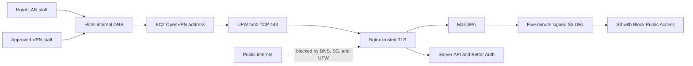

# Nava Internal HTTPS Cutover Implementation Plan

> **For agentic workers:** REQUIRED SUB-SKILL: Use superpowers:subagent-driven-development (recommended) or superpowers:executing-plans to implement this plan task-by-task. Steps use checkbox (`- [ ]`) syntax for tracking.

**Goal:** Serve Nava at `https://nava.legacyhotels.co.za` with browser-trusted TLS to authorized hotel LAN and VPN staff while keeping application ingress closed to the public internet.

**Architecture:** Hotel internal DNS resolves the canonical hostname to the EC2 OpenVPN client address. Nginx terminates the supplied DigiCert wildcard certificate on EC2, proxies same-origin API traffic, and serves the SPA; UFW permits TCP 443 only on `tun0`, while the EC2 security group retains zero inbound rules. Better Auth, SPA metadata, Nginx, readiness checks, Playwright, and S3 CORS share one canonical origin.

**Tech Stack:** OpenVPN, Ubuntu/UFW, Nginx, AWS EC2/SSM/S3, Better Auth, React Router/Vite, Vitest, Playwright, Bash, TypeScript.

## Global Constraints

- Canonical production origin: `https://nava.legacyhotels.co.za`.
- Hotel internal DNS target: `192.168.138.2`; EC2 tunnel invariant: `tun0` with `192.168.138.2/29`.
- UI, auth, and API remain hotel-LAN/VPN-only. No public DNS record and no EC2 security-group ingress.
- Direct S3 attachment downloads remain a deliberate exception: five-minute presigned URLs are bearer credentials delivered only after application authorization. S3 Block Public Access must remain fully enabled; objects are never anonymous.
- No database schema change or migration.
- Never run Vitest with production `DATABASE_URL`. Before every Vitest command: `unset DATABASE_URL VITEST_ALLOW_PILOT_RDS`.
- Never source `.env.production` into a shell that will run Vitest.
- Never print credentials, private-key bytes, environment values, private mail, or staff addresses.
- No new package, framework, proxy service, public load balancer, duplicate runbook, or broad documentation rewrite.
- Use a clean git worktree because the current workspace contains unrelated modifications.
- Keep the existing Infor hostname mapping as its own prerequisite commit; do not lose or silently fold the current uncommitted change into unrelated work.
- Ronny's completion email is accepted as confirmation that VPN assignment and hotel routing are configured; reconnect/reboot and workstation checks remain runtime proof.
- Staff should expect a fresh login. Browser cookies, local storage, IndexedDB, and open tabs do not migrate between origins.
- User authorized execution of this plan, including its cutover-branch commits. Push, PR, and merge still require separate requests.

---

## Product and Network Contract



Success means:

1. Centurion LAN and approved staff VPN resolve the canonical hostname to `192.168.138.2`.
2. Browser shows a trusted connection with no warning.
3. Fresh login, hard reload, API traffic, inline images, and one attachment open/download work.
4. Direct public IPv4/IPv6 and public-DNS paths remain closed.
5. Wrong HTTP `Host` values receive no application response.
6. Reconnect and reboot keep the exact VPN address and route.
7. Rollback can close access first and restore the pre-cutover on-box baseline without touching production data.

## Accepted Network Input

Ronny reported internal DNS, Centurion reachability, and remaining VPN work complete. No further IT email is required before deployment. Exact address persistence, TCP 443, LAN, and VPN-only checks remain mandatory verification; a failed check produces a targeted IT escalation rather than an upfront confirmation request.

## File Map

- Modify `apps/server-pilot/src/lib/auth.ts`: derive production trusted origin from `BETTER_AUTH_URL`.
- Modify `apps/server-pilot/deploy/write-ec2-env.sh`: canonical default for future environment creation.
- Modify `apps/server-pilot/deploy/deploy-ec2.sh`: canonical SPA URL and `/etc/hosts`, preserve Infor mapping, transactional Nginx install.
- Modify `apps/server-pilot/deploy/nginx.conf`: canonical host/cert, wrong-host rejection, trusted headers, exact S3 CSP endpoint.
- Modify `apps/server-pilot/deploy/launch-readiness.sh`: system-trusted TLS, canonical config, UFW, S3 CORS/Public Access, and empty-SG checks.
- Modify `apps/server-pilot/deploy/post-boot-smoke.sh`: trusted canonical HTTPS probe.
- Modify `apps/server-pilot/deploy/playwright-real-mail-ui-gate.sh`: canonical base URL and no TLS bypass.
- Modify `apps/server-pilot/deploy/playwright-ec2-gate.sh`: canonical base URL and no TLS bypass.
- Modify `apps/server-pilot/deploy/vpn-health-assert.sh`: exact interface and CIDR invariant.
- Modify `apps/server-pilot/deploy/vpn-always-on.md`: document server-side static assignment and exact health contract.
- Modify `apps/server-pilot/deploy/aws-resources.md`: additive cutover CORS, final CORS, and rollback-safe readback.
- Modify `packages/testing/playwright.config.ts`: fail closed for real-mail TLS.
- Modify `apps/server-pilot/tests/auth-trusted-origins.test.ts`: canonical origin, old-origin absence, extras, and deduplication.
- Modify `apps/server-pilot/tests/deploy-config.test.ts`: static deployment contracts for every changed gate.
- Modify `apps/mail/tests/e2e/real-mail-browser-login.spec.ts`: prove session survives a hard reload.
- Modify `docs/runbooks/centurion-day-one-operations.md`: staff access, cutover, rollback, and certificate ownership.
- No new production source file, dependency, database object, or runbook.

## Test Coverage Diagram

```text
BETTER_AUTH_URL
  ├─ unit: canonical trusted origin, extra origins, dedupe, old origin absent
  ├─ static: environment writer + SPA build derive same value
  └─ E2E: fresh browser login + hard reload session

Nginx/TLS
  ├─ static: canonical host, fullchain/key paths, CSP, headers, wrong-host guard
  ├─ syntax: nginx -t before reload
  ├─ runtime: OpenSSL system-root + hostname verification
  ├─ runtime: curl without -k and real Playwright without ignoreHTTPSErrors
  └─ negative: wrong Host gets 444

Network
  ├─ runtime: tun0 has exact 192.168.138.2/29 after reconnect and reboot
  ├─ runtime: UFW active, default deny, only tun0 TCP 443 rule
  ├─ AWS readback: zero SG ingress and no instance IPv6 exposure
  ├─ LAN workstation: DNS + TCP 443 + browser
  ├─ VPN-only workstation: DNS + TCP 443 + browser
  └─ external workstation: public DNS and direct public IP both fail

Attachments
  ├─ AWS readback: canonical CORS + GET/HEAD + Block Public Access
  ├─ response header: CSP exact S3 origin
  └─ browser: open/download one real attachment without console/CORS error

Rollback
  ├─ immutable pre-cutover SHA and bundle
  ├─ exact backups of env, hosts, Nginx, certs, CORS, and UFW state
  └─ rehearsal: access closes first; backend and pre-cutover on-box baseline restore
```

Planned coverage: 20 distinct contracts. Eleven are automated/static, six are read-only runtime checks, and three require real LAN/VPN/public workstation proof. No test touches production RDS.

---

### Task 0: Preserve Existing Infor Mapping in an Isolated Worktree

**Files:**
- Modify: `apps/server-pilot/tests/deploy-config.test.ts`
- Modify: `apps/server-pilot/deploy/deploy-ec2.sh`

**Interfaces:**
- Consumes: current `EC2-pilot` HEAD and the uncommitted Infor `/etc/hosts` mapping from the primary workspace.
- Produces: clean branch `nava-hostname-cutover-20260731` whose first commit preserves that mapping.

- [ ] **Step 1: Create the isolated worktree**

Run from the primary repository:

```bash
git worktree add "../zero-nava-hostname-cutover" \
  -b nava-hostname-cutover-20260731 \
  EC2-pilot
```

Expected: clean worktree on `nava-hostname-cutover-20260731`; primary workspace remains untouched.

- [ ] **Step 2: Write the failing preservation test**

Add to `apps/server-pilot/tests/deploy-config.test.ts`:

```typescript
it('preserves the Infor hostname mapping used by the split tunnel', async () => {
  const { readFileSync } = await import('node:fs');
  const { fileURLToPath } = await import('node:url');
  const { dirname, join } = await import('node:path');
  const here = dirname(fileURLToPath(import.meta.url));
  const deploy = readFileSync(join(here, '..', 'deploy', 'deploy-ec2.sh'), 'utf8');

  expect(deploy).toContain('appsrv-1.legacyhotels.co.za');
  expect(deploy).toContain('172.24.240.41');
});
```

- [ ] **Step 3: Run the focused test and confirm failure**

```bash
unset DATABASE_URL VITEST_ALLOW_PILOT_RDS
pnpm --dir apps/server-pilot exec vitest run tests/deploy-config.test.ts
```

Expected: FAIL only on the new Infor mapping assertion.

- [ ] **Step 4: Apply the existing mapping exactly**

Insert after the Nava `/etc/hosts` block:

```bash
echo "== hosts: appsrv-1.legacyhotels.co.za (Infor HMS via VPN) =="
# Hotel internal hostname has no public A record; EC2 split-tunnel ignores VPN DNS.
# Map to Infor app-server so Chromium hostname matches *.legacyhotels.co.za cert.
if ! grep -qE '(^|[[:space:]])appsrv-1\.legacyhotels\.co\.za([[:space:]]|$)' /etc/hosts; then
  echo '172.24.240.41 appsrv-1.legacyhotels.co.za' | sudo tee -a /etc/hosts >/dev/null
fi
```

- [ ] **Step 5: Re-run and pass**

```bash
unset DATABASE_URL VITEST_ALLOW_PILOT_RDS
pnpm --dir apps/server-pilot exec vitest run tests/deploy-config.test.ts
bash -n apps/server-pilot/deploy/deploy-ec2.sh
```

Expected: Vitest PASS and Bash syntax PASS.

- [ ] **Step 6: Commit after explicit authorization**

```bash
git add apps/server-pilot/tests/deploy-config.test.ts \
  apps/server-pilot/deploy/deploy-ec2.sh
git commit -m "fix(deploy): preserve Infor host resolution"
```

---

### Task 1: Make BETTER_AUTH_URL the Canonical Origin

**Files:**
- Modify: `apps/server-pilot/src/lib/auth.ts:15-30`
- Modify: `apps/server-pilot/tests/auth-trusted-origins.test.ts`
- Modify: `apps/server-pilot/deploy/write-ec2-env.sh:8-12`
- Modify: `apps/server-pilot/deploy/deploy-ec2.sh:34-66`
- Modify: `apps/server-pilot/tests/deploy-config.test.ts`

**Interfaces:**
- Consumes: `BETTER_AUTH_URL`.
- Produces: `resolvePilotTrustedOrigins(env): string[]`, `VITE_PUBLIC_APP_URL`, and canonical on-box hostname resolution.

- [ ] **Step 1: Replace trusted-origin tests**

Use:

```typescript
import { describe, expect, it } from 'vitest';
import { resolvePilotTrustedOrigins } from '../src/lib/auth';

const CANONICAL_ORIGIN = 'https://nava.legacyhotels.co.za';
const LEGACY_ORIGIN = 'https://nava.legacy.local';

describe('resolvePilotTrustedOrigins', () => {
  it('derives the production origin from BETTER_AUTH_URL', () => {
    const origins = resolvePilotTrustedOrigins({
      BETTER_AUTH_URL: `${CANONICAL_ORIGIN}/`,
    });

    expect(origins).toContain(CANONICAL_ORIGIN);
    expect(origins).not.toContain(LEGACY_ORIGIN);
    expect(origins).toContain('https://127.0.0.1');
    expect(origins).toContain('http://localhost:3000');
  });

  it('merges deliberate extras and removes duplicates', () => {
    const origins = resolvePilotTrustedOrigins({
      BETTER_AUTH_URL: CANONICAL_ORIGIN,
      BETTER_AUTH_TRUSTED_ORIGINS:
        `${CANONICAL_ORIGIN}, https://extra.example, http://localhost:3000`,
    });

    expect(origins.filter((origin) => origin === CANONICAL_ORIGIN)).toHaveLength(1);
    expect(origins).toContain('https://extra.example');
    expect(origins.filter((origin) => origin === 'http://localhost:3000')).toHaveLength(1);
  });
});
```

- [ ] **Step 2: Add failing deployment-contract assertions**

Add:

```typescript
it('uses BETTER_AUTH_URL as the only production app-origin source', async () => {
  const { readFileSync } = await import('node:fs');
  const { fileURLToPath } = await import('node:url');
  const { dirname, join } = await import('node:path');
  const here = dirname(fileURLToPath(import.meta.url));
  const deploy = readFileSync(join(here, '..', 'deploy', 'deploy-ec2.sh'), 'utf8');
  const writer = readFileSync(join(here, '..', 'deploy', 'write-ec2-env.sh'), 'utf8');

  expect(writer).toContain(
    ': "${BETTER_AUTH_URL:=https://nava.legacyhotels.co.za}"',
  );
  expect(deploy).toContain(
    ': "${BETTER_AUTH_URL:?BETTER_AUTH_URL required before SPA build}"',
  );
  expect(deploy).toContain(
    'export VITE_PUBLIC_APP_URL="${VITE_PUBLIC_APP_URL:-$BETTER_AUTH_URL}"',
  );
  expect(deploy).toContain('127.0.0.1 nava.legacyhotels.co.za');
  expect(deploy).not.toContain('127.0.0.1 nava.legacy.local');
});
```

- [ ] **Step 3: Run tests and confirm failure**

```bash
unset DATABASE_URL VITEST_ALLOW_PILOT_RDS
pnpm --dir apps/server-pilot exec vitest run \
  tests/auth-trusted-origins.test.ts \
  tests/deploy-config.test.ts
```

Expected: FAIL on canonical origin, writer default, SPA derivation, and host mapping.

- [ ] **Step 4: Implement the auth helper**

Replace the hardcoded production origin with:

```typescript
export function resolvePilotTrustedOrigins(
  env: Record<string, string | undefined> = process.env,
): string[] {
  const authURL = env.BETTER_AUTH_URL?.trim();
  const base = [
    authURL ? new URL(authURL).origin : undefined,
    'https://127.0.0.1',
    'http://127.0.0.1:3000',
    'http://localhost:3000',
  ].filter((origin): origin is string => Boolean(origin));
  const extra = (env.BETTER_AUTH_TRUSTED_ORIGINS ?? '')
    .split(',')
    .map((origin) => origin.trim())
    .filter(Boolean);
  return [...new Set([...base, ...extra])];
}
```

Keep static `baseURL: env.BETTER_AUTH_URL`; one production domain does not need Better Auth dynamic-host configuration.

- [ ] **Step 5: Update environment and SPA defaults**

In `write-ec2-env.sh`:

```bash
: "${BETTER_AUTH_URL:=https://nava.legacyhotels.co.za}"
```

In `deploy-ec2.sh`, after sourcing the environment:

```bash
: "${BETTER_AUTH_URL:?BETTER_AUTH_URL required before SPA build}"
```

Replace the SPA origin assignment with:

```bash
export VITE_PUBLIC_APP_URL="${VITE_PUBLIC_APP_URL:-$BETTER_AUTH_URL}"
```

Replace only the old Nava host-entry block:

```bash
echo "== hosts: nava.legacyhotels.co.za =="
# EC2 uses split-tunnel routing and does not consume hotel DNS; on-box browser gates need this.
sudo sed -i \
  '/^[[:space:]]*127\.0\.0\.1[[:space:]]\+nava\.legacy\.local[[:space:]]*$/d' \
  /etc/hosts
if ! grep -qE '(^|[[:space:]])nava\.legacyhotels\.co\.za([[:space:]]|$)' /etc/hosts; then
  echo '127.0.0.1 nava.legacyhotels.co.za' | sudo tee -a /etc/hosts >/dev/null
fi
```

Do not change the Infor block from Task 0.

- [ ] **Step 6: Pass focused tests and builds**

```bash
unset DATABASE_URL VITEST_ALLOW_PILOT_RDS
pnpm --dir apps/server-pilot exec vitest run \
  tests/auth-trusted-origins.test.ts \
  tests/deploy-config.test.ts
pnpm --dir apps/server-pilot run build
BETTER_AUTH_URL=https://nava.legacyhotels.co.za \
  VITE_PUBLIC_APP_URL=https://nava.legacyhotels.co.za \
  VITE_PUBLIC_BACKEND_URL= \
  pnpm --dir apps/mail run build
bash -n apps/server-pilot/deploy/write-ec2-env.sh
bash -n apps/server-pilot/deploy/deploy-ec2.sh
```

Expected: all commands PASS.

- [ ] **Step 7: Commit after explicit authorization**

```bash
git add apps/server-pilot/src/lib/auth.ts \
  apps/server-pilot/tests/auth-trusted-origins.test.ts \
  apps/server-pilot/tests/deploy-config.test.ts \
  apps/server-pilot/deploy/write-ec2-env.sh \
  apps/server-pilot/deploy/deploy-ec2.sh
git commit -m "feat(auth): adopt Nava canonical origin"
```

---

### Task 2: Install Canonical Nginx TLS and Reject Wrong Hosts

**Files:**
- Modify: `apps/server-pilot/deploy/nginx.conf`
- Modify: `apps/server-pilot/tests/deploy-config.test.ts`

**Interfaces:**
- Consumes: `/etc/nginx/ssl/nava.legacyhotels.co.za.fullchain.pem` and `.key`.
- Produces: HTTPS virtual host, same-origin API proxy, exact S3 CSP allowlist, and HTTP 444 for wrong hosts.

- [ ] **Step 1: Write failing Nginx assertions**

Replace existing hostname/security assertions with:

```typescript
it('nginx serves only the canonical host with the public fullchain', async () => {
  const { readNginxConfig } = await import('../src/deploy/load-pm2-config.js');
  const nginx = readNginxConfig();

  expect(nginx).toContain('listen 80 default_server');
  expect(nginx).toContain('listen 443 ssl default_server');
  expect(nginx).toContain('server_name nava.legacyhotels.co.za');
  expect(nginx).toContain(
    'ssl_certificate     /etc/nginx/ssl/nava.legacyhotels.co.za.fullchain.pem',
  );
  expect(nginx).toContain(
    'ssl_certificate_key /etc/nginx/ssl/nava.legacyhotels.co.za.key',
  );
  expect(nginx).toContain('if ($host != nava.legacyhotels.co.za)');
  expect(nginx).toContain('return 444');
  expect(nginx).not.toContain('nava.legacy.local');
});

it('nginx preserves security headers and allows only the exact S3 endpoint', async () => {
  const { readNginxConfig } = await import('../src/deploy/load-pm2-config.js');
  const nginx = readNginxConfig();

  expect(nginx).toContain(
    "connect-src 'self' https://nava-zero-mail-845242190536-af-south-1.s3.af-south-1.amazonaws.com",
  );
  expect(nginx).toContain('expires -1');
  expect(nginx).not.toContain('add_header Cache-Control "no-cache"');
  expect(nginx).toContain('add_header X-Frame-Options "DENY" always');
  expect(nginx).toContain('add_header X-Content-Type-Options "nosniff" always');
});
```

- [ ] **Step 2: Run and confirm failure**

```bash
unset DATABASE_URL VITEST_ALLOW_PILOT_RDS
pnpm --dir apps/server-pilot exec vitest run tests/deploy-config.test.ts
```

Expected: FAIL on canonical host, certificate paths, wrong-host guard, CSP, and `expires`.

- [ ] **Step 3: Replace Nginx configuration**

Use:

```nginx
server {
  listen 80 default_server;
  server_name nava.legacyhotels.co.za;
  if ($host != nava.legacyhotels.co.za) {
    return 444;
  }
  return 301 https://nava.legacyhotels.co.za$request_uri;
}

server {
  listen 443 ssl default_server;
  server_name nava.legacyhotels.co.za;

  if ($host != nava.legacyhotels.co.za) {
    return 444;
  }

  ssl_certificate     /etc/nginx/ssl/nava.legacyhotels.co.za.fullchain.pem;
  ssl_certificate_key /etc/nginx/ssl/nava.legacyhotels.co.za.key;

  add_header Strict-Transport-Security "max-age=31536000; includeSubDomains" always;
  add_header X-Frame-Options "DENY" always;
  add_header X-Content-Type-Options "nosniff" always;
  add_header Referrer-Policy "strict-origin-when-cross-origin" always;
  # Direct attachment fetches use five-minute presigned URLs on this exact bucket endpoint.
  add_header Content-Security-Policy "default-src 'self'; script-src 'self' 'unsafe-inline'; style-src 'self' 'unsafe-inline'; img-src 'self' data: https:; connect-src 'self' https://nava-zero-mail-845242190536-af-south-1.s3.af-south-1.amazonaws.com; frame-ancestors 'none';" always;

  client_max_body_size 35m;
  root /var/www/nava-mail;
  index index.html;

  location /api/ {
    proxy_pass http://127.0.0.1:8788/api/;
    proxy_set_header Host $host;
    proxy_set_header X-Forwarded-Proto https;
    proxy_set_header X-Forwarded-For $proxy_add_x_forwarded_for;
  }

  location /health {
    proxy_pass http://127.0.0.1:8788/health;
    proxy_set_header Host $host;
  }

  location / {
    try_files $uri /index.html;
    # `expires` does not cancel inheritance of server-level add_header directives.
    expires -1;
  }
}
```

`add_header_inherit merge` is intentionally not used because it requires Nginx 1.29.3; `expires -1` works on the installed older package and removes the inheritance trap.

- [ ] **Step 4: Pass static tests**

```bash
unset DATABASE_URL VITEST_ALLOW_PILOT_RDS
pnpm --dir apps/server-pilot exec vitest run tests/deploy-config.test.ts
```

Expected: PASS.

- [ ] **Step 5: Commit after explicit authorization**

```bash
git add apps/server-pilot/deploy/nginx.conf \
  apps/server-pilot/tests/deploy-config.test.ts
git commit -m "feat(nginx): serve canonical trusted host"
```

---

### Task 3: Remove Every Production TLS Bypass

**Files:**
- Modify: `apps/server-pilot/deploy/launch-readiness.sh:42-67`
- Modify: `apps/server-pilot/deploy/post-boot-smoke.sh:26-50`
- Modify: `apps/server-pilot/deploy/playwright-real-mail-ui-gate.sh:31-50,95-117`
- Modify: `apps/server-pilot/deploy/playwright-ec2-gate.sh:12-50,83-97`
- Modify: `packages/testing/playwright.config.ts:11-31`
- Modify: `apps/mail/tests/e2e/real-mail-browser-login.spec.ts`
- Modify: `apps/server-pilot/tests/deploy-config.test.ts`

**Interfaces:**
- Consumes: canonical hostname in `/etc/hosts`, Ubuntu CA bundle, installed Nginx fullchain.
- Produces: gates that fail on untrusted, expired, incomplete-chain, or wrong-host certificates.

- [ ] **Step 1: Add failing static TLS assertions**

Add:

```typescript
it('production browser and smoke gates never bypass TLS verification', async () => {
  const { readFileSync } = await import('node:fs');
  const { fileURLToPath } = await import('node:url');
  const { dirname, join } = await import('node:path');
  const here = dirname(fileURLToPath(import.meta.url));
  const files = [
    'launch-readiness.sh',
    'post-boot-smoke.sh',
    'playwright-real-mail-ui-gate.sh',
    'playwright-ec2-gate.sh',
  ];

  for (const file of files) {
    const script = readFileSync(join(here, '..', 'deploy', file), 'utf8');
    expect(script).not.toContain('--insecure');
    expect(script).not.toContain('curl -sk');
    expect(script).not.toContain('curl -fsSk');
    expect(script).not.toContain('PLAYWRIGHT_IGNORE_HTTPS_ERRORS="${PLAYWRIGHT_IGNORE_HTTPS_ERRORS:-1}"');
  }

  const config = readFileSync(
    join(here, '..', '..', '..', 'packages', 'testing', 'playwright.config.ts'),
    'utf8',
  );
  expect(config).not.toContain('|| realMailGate');
  expect(config).toContain('Real-mail Playwright requires PLAYWRIGHT_BASE_URL');
  expect(config).toContain('Real-mail Playwright forbids ignored HTTPS errors');
});
```

- [ ] **Step 2: Add the hard-reload E2E assertion**

After the existing inbox assertion:

```typescript
await page.reload({ waitUntil: 'domcontentloaded' });
await expect(page).toHaveURL(/\/mail(\/|$)/);
await expect(
  page
    .getByText(REAL_MAIL_USER, { exact: false })
    .or(page.getByText('Inbox', { exact: true }))
    .first(),
).toBeVisible({ timeout: 30_000 });
```

- [ ] **Step 3: Run static tests and confirm failure**

```bash
unset DATABASE_URL VITEST_ALLOW_PILOT_RDS
pnpm --dir apps/server-pilot exec vitest run tests/deploy-config.test.ts
```

Expected: FAIL because current scripts and Playwright config ignore HTTPS errors.

- [ ] **Step 4: Replace readiness TLS validation**

After loading `.env.production`, derive and validate the canonical URL:

```bash
: "${BETTER_AUTH_URL:?BETTER_AUTH_URL missing from production environment}"
PUBLIC_ORIGIN="$BETTER_AUTH_URL"
PUBLIC_HOST="$(
  node -e 'const url = new URL(process.argv[1]); if (url.protocol !== "https:" || url.pathname !== "/") process.exit(1); process.stdout.write(url.hostname)' \
    "$PUBLIC_ORIGIN"
)"
```

Replace the leaf-self-trust block with:

```bash
HTTPS_OK=false
TLS_VALID=false
CERT_FILE="$(mktemp)"
cleanup_cert() { rm -f "$CERT_FILE"; }
trap cleanup_cert EXIT

if timeout 10 openssl s_client \
  -connect "127.0.0.1:443" \
  -servername "$PUBLIC_HOST" \
  -verify_hostname "$PUBLIC_HOST" \
  -verify_return_error \
  -CAfile /etc/ssl/certs/ca-certificates.crt \
  -showcerts </dev/null 2>/dev/null |
  openssl x509 -outform PEM >"$CERT_FILE" 2>/dev/null \
  && openssl x509 -in "$CERT_FILE" -checkend 2592000 -noout >/dev/null 2>&1; then
  TLS_VALID=true
fi

if curl -fsS \
  --max-time 10 \
  --resolve "${PUBLIC_HOST}:443:127.0.0.1" \
  "${PUBLIC_ORIGIN%/}/health" >/dev/null 2>&1; then
  HTTPS_OK=true
fi
```

The 30-day `checkend` turns certificate renewal into a launch blocker before expiry.

- [ ] **Step 5: Harden post-boot smoke**

Load the production environment before the loop:

```bash
ENV_FILE="${ENV_FILE:-/home/ubuntu/repos/zero/apps/server-pilot/.env.production}"
if [ -r "$ENV_FILE" ]; then
  set -a
  # shellcheck disable=SC1090
  source "$ENV_FILE"
  set +a
fi
: "${BETTER_AUTH_URL:?BETTER_AUTH_URL missing from production environment}"
PUBLIC_HOST="$(node -e 'process.stdout.write(new URL(process.argv[1]).hostname)' "$BETTER_AUTH_URL")"
```

Use trusted probes:

```bash
if ! curl -fsS \
  --resolve "${PUBLIC_HOST}:443:127.0.0.1" \
  "${BETTER_AUTH_URL%/}/health" >/dev/null 2>&1 \
  && ! curl -fsS \
  --resolve "${PUBLIC_HOST}:443:127.0.0.1" \
  "${BETTER_AUTH_URL%/}/" >/dev/null 2>&1; then
  log "attempt ${attempt}: trusted :443 probe failed"
  ok=0
fi
```

- [ ] **Step 6: Fail closed in both Playwright shell gates**

After sourcing the production environment in each script:

```bash
: "${BETTER_AUTH_URL:?BETTER_AUTH_URL missing from production environment}"
export PLAYWRIGHT_BASE_URL="${PLAYWRIGHT_BASE_URL:-$BETTER_AUTH_URL}"
export PLAYWRIGHT_COOKIE_PREFIX="${PLAYWRIGHT_COOKIE_PREFIX:-better-auth}"
if [ "${PLAYWRIGHT_IGNORE_HTTPS_ERRORS:-0}" = "1" ]; then
  echo "refusing: production Playwright cannot ignore HTTPS errors" >&2
  exit 2
fi
export PLAYWRIGHT_IGNORE_HTTPS_ERRORS=0
```

Replace each `curl -skf` or `curl -fsSk` with `curl -fsS`/`curl -fsSf` as appropriate. In `playwright-ec2-gate.sh`, source `apps/server-pilot/.env.production` before deriving `PLAYWRIGHT_BASE_URL`.

- [ ] **Step 7: Fail closed in Playwright configuration**

Use:

```typescript
/** Set by playwright-real-mail-ui-gate.sh — AE1/AE7/AE9 against real transport. */
const realMailGate = process.env.REAL_MAIL_UI_GATE === '1';
const baseURL = process.env.PLAYWRIGHT_BASE_URL;
const ignoreHTTPSErrors = process.env.PLAYWRIGHT_IGNORE_HTTPS_ERRORS === '1';

if (realMailGate && !baseURL) {
  throw new Error('Real-mail Playwright requires PLAYWRIGHT_BASE_URL');
}
if (realMailGate && ignoreHTTPSErrors) {
  throw new Error('Real-mail Playwright forbids ignored HTTPS errors');
}
```

Then:

```typescript
use: {
  baseURL: baseURL ?? 'http://localhost:3000',
  ignoreHTTPSErrors,
  trace: 'on-first-retry',
  screenshot: 'only-on-failure',
},
```

- [ ] **Step 8: Pass static, syntax, and build checks**

```bash
unset DATABASE_URL VITEST_ALLOW_PILOT_RDS
pnpm --dir apps/server-pilot exec vitest run tests/deploy-config.test.ts
pnpm --dir apps/server-pilot run build
bash -n apps/server-pilot/deploy/launch-readiness.sh
bash -n apps/server-pilot/deploy/post-boot-smoke.sh
bash -n apps/server-pilot/deploy/playwright-real-mail-ui-gate.sh
bash -n apps/server-pilot/deploy/playwright-ec2-gate.sh
```

Expected: all commands PASS.

- [ ] **Step 9: Commit after explicit authorization**

```bash
git add apps/server-pilot/deploy/launch-readiness.sh \
  apps/server-pilot/deploy/post-boot-smoke.sh \
  apps/server-pilot/deploy/playwright-real-mail-ui-gate.sh \
  apps/server-pilot/deploy/playwright-ec2-gate.sh \
  packages/testing/playwright.config.ts \
  apps/mail/tests/e2e/real-mail-browser-login.spec.ts \
  apps/server-pilot/tests/deploy-config.test.ts
git commit -m "test(tls): enforce trusted production HTTPS"
```

---

### Task 4: Make VPN, Firewall, S3, and Security-Group Drift Fail Readiness

**Files:**
- Modify: `apps/server-pilot/deploy/vpn-health-assert.sh`
- Modify: `apps/server-pilot/deploy/launch-readiness.sh`
- Modify: `apps/server-pilot/deploy/aws-resources.md`
- Modify: `apps/server-pilot/deploy/vpn-always-on.md`
- Modify: `apps/server-pilot/tests/deploy-config.test.ts`

**Interfaces:**
- Consumes: `tun0`, `192.168.138.2/29`, AWS instance/bucket state, and UFW state.
- Produces: persistent readiness failures for DNS-target drift, broad/missing ingress, bad CORS, public S3 access, or SG ingress.

- [ ] **Step 1: Add failing static invariants**

Add:

```typescript
it('VPN and launch readiness enforce the private HTTPS perimeter', async () => {
  const { readFileSync } = await import('node:fs');
  const { fileURLToPath } = await import('node:url');
  const { dirname, join } = await import('node:path');
  const here = dirname(fileURLToPath(import.meta.url));
  const vpn = readFileSync(join(here, '..', 'deploy', 'vpn-health-assert.sh'), 'utf8');
  const readiness = readFileSync(join(here, '..', 'deploy', 'launch-readiness.sh'), 'utf8');

  expect(vpn).toContain('EXPECTED_VPN_INTERFACE="${EXPECTED_VPN_INTERFACE:-tun0}"');
  expect(vpn).toContain('EXPECTED_VPN_CIDR="${EXPECTED_VPN_CIDR:-192.168.138.2/29}"');
  expect(readiness).toContain('ufwTunnel443Only');
  expect(readiness).toContain('securityGroupIngressEmpty');
  expect(readiness).toContain('s3CorsCanonical');
  expect(readiness).toContain('s3PublicAccessBlocked');
});
```

- [ ] **Step 2: Run and confirm failure**

```bash
unset DATABASE_URL VITEST_ALLOW_PILOT_RDS
pnpm --dir apps/server-pilot exec vitest run tests/deploy-config.test.ts
```

Expected: FAIL on all new perimeter invariants.

- [ ] **Step 3: Enforce exact tunnel identity**

Near the top of `vpn-health-assert.sh`:

```bash
EXPECTED_VPN_INTERFACE="${EXPECTED_VPN_INTERFACE:-tun0}"
EXPECTED_VPN_CIDR="${EXPECTED_VPN_CIDR:-192.168.138.2/29}"
```

Before route checks:

```bash
if ! ip link show "$EXPECTED_VPN_INTERFACE" >/dev/null 2>&1; then
  hard_fail "VPN_HARD_FAIL_INTERFACE_${EXPECTED_VPN_INTERFACE}"
fi

if ! ip -4 -o addr show dev "$EXPECTED_VPN_INTERFACE" |
  awk -v expected="$EXPECTED_VPN_CIDR" '$4 == expected { found = 1 } END { exit found ? 0 : 1 }'; then
  hard_fail "VPN_HARD_FAIL_ADDRESS"
fi
```

Keep the existing default-route and hotel-route checks.

- [ ] **Step 4: Add remote UFW facts to launch readiness**

Before exporting remote booleans:

```bash
UFW_ACTIVE=false
UFW_DEFAULT_DENY=false
UFW_TUN443=false
UFW_BROAD443_ABSENT=true
UFW_VERBOSE="$(sudo ufw status verbose 2>/dev/null || true)"
UFW_ADDED="$(sudo ufw show added 2>/dev/null || true)"

if printf '%s\n' "$UFW_VERBOSE" | grep -q '^Status: active$'; then
  UFW_ACTIVE=true
fi
if printf '%s\n' "$UFW_VERBOSE" | grep -q 'Default: deny (incoming)'; then
  UFW_DEFAULT_DENY=true
fi
if printf '%s\n' "$UFW_ADDED" |
  grep -Fq 'ufw allow in on tun0 to any port 443 proto tcp'; then
  UFW_TUN443=true
fi
if printf '%s\n' "$UFW_ADDED" |
  awk '/443/ && $0 !~ /on tun0/ { bad = 1 } END { exit bad ? 0 : 1 }'; then
  UFW_BROAD443_ABSENT=false
fi

export UFW_ACTIVE UFW_DEFAULT_DENY UFW_TUN443 UFW_BROAD443_ABSENT
```

Add to the remote report:

```javascript
firewall: {
  active: bool("UFW_ACTIVE"),
  defaultDeny: bool("UFW_DEFAULT_DENY"),
  tunnel443: bool("UFW_TUN443"),
  broad443Absent: bool("UFW_BROAD443_ABSENT"),
},
```

- [ ] **Step 5: Read AWS perimeter state without mutation**

Add laptop-side reads:

```bash
S3_CORS="$(
  aws s3api get-bucket-cors \
    --region "$AWS_REGION" \
    --bucket "$S3_BUCKET" \
    --output json 2>/dev/null || printf '%s' '{"CORSRules":[]}'
)"

S3_PUBLIC_ACCESS="$(
  aws s3api get-public-access-block \
    --region "$AWS_REGION" \
    --bucket "$S3_BUCKET" \
    --query 'PublicAccessBlockConfiguration' \
    --output json 2>/dev/null || printf '%s' '{}'
)"

INSTANCE_NETWORK="$(
  aws ec2 describe-instances \
    --region "$AWS_REGION" \
    --instance-ids "$INSTANCE_ID" \
    --query 'Reservations[0].Instances[0].{securityGroups:SecurityGroups,ipv6:NetworkInterfaces[].Ipv6Addresses[].Ipv6Address}' \
    --output json
)"

SG_IDS="$(
  node -e 'for (const group of JSON.parse(process.argv[1]).securityGroups ?? []) process.stdout.write(`${group.GroupId}\n`)' \
    "$INSTANCE_NETWORK"
)"
SG_STATE="$(
  aws ec2 describe-security-groups \
    --region "$AWS_REGION" \
    --group-ids $SG_IDS \
    --query 'SecurityGroups[].{id:GroupId,ingress:IpPermissions}' \
    --output json
)"
```

Pass these JSON values to the report-building Node process. Add checks:

```javascript
const cors = JSON.parse(process.argv[9] || '{"CORSRules":[]}');
const publicAccess = JSON.parse(process.argv[10] || '{}');
const instanceNetwork = JSON.parse(process.argv[11] || '{}');
const securityGroups = JSON.parse(process.argv[12] || '[]');
const canonicalOrigin = 'https://nava.legacyhotels.co.za';
const corsRules = cors.CORSRules ?? [];
const corsOrigins = new Set(corsRules.flatMap((rule) => rule.AllowedOrigins ?? []));
const corsMethods = new Set(corsRules.flatMap((rule) => rule.AllowedMethods ?? []));

checks.ufwTunnel443Only =
  remote.firewall?.active === true &&
  remote.firewall?.defaultDeny === true &&
  remote.firewall?.tunnel443 === true &&
  remote.firewall?.broad443Absent === true;
checks.s3CorsCanonical =
  corsOrigins.has(canonicalOrigin) &&
  corsMethods.has('GET') &&
  corsMethods.has('HEAD');
checks.s3PublicAccessBlocked =
  publicAccess.BlockPublicAcls === true &&
  publicAccess.IgnorePublicAcls === true &&
  publicAccess.BlockPublicPolicy === true &&
  publicAccess.RestrictPublicBuckets === true;
checks.securityGroupIngressEmpty = securityGroups.every(
  (group) => (group.ingress ?? []).length === 0,
);
checks.instanceHasNoPublicIpv6 = (instanceNetwork.ipv6 ?? []).length === 0;
```

Add CORS/Public Access/SG facts to `observations` without printing object keys, environment values, or credentials.

- [ ] **Step 6: Update durable docs**

In `aws-resources.md`, document two CORS states:

1. Cutover overlap: canonical origin plus the legacy and localhost origins.
2. Final state after 24 hours: canonical and localhost origins; legacy removed.

Document read-before-write, immediate readback, and compare-before-rollback. In `vpn-always-on.md`, state that `ifconfig-persist` is not a guarantee; hotel IT must use server-side `ifconfig-push`/CCD or equivalent, and every deploy/reboot must assert the exact CIDR.

- [ ] **Step 7: Pass tests and syntax checks**

```bash
unset DATABASE_URL VITEST_ALLOW_PILOT_RDS
pnpm --dir apps/server-pilot exec vitest run tests/deploy-config.test.ts
bash -n apps/server-pilot/deploy/vpn-health-assert.sh
bash -n apps/server-pilot/deploy/launch-readiness.sh
```

Expected: PASS.

- [ ] **Step 8: Commit after explicit authorization**

```bash
git add apps/server-pilot/deploy/vpn-health-assert.sh \
  apps/server-pilot/deploy/launch-readiness.sh \
  apps/server-pilot/deploy/aws-resources.md \
  apps/server-pilot/deploy/vpn-always-on.md \
  apps/server-pilot/tests/deploy-config.test.ts
git commit -m "feat(ops): gate the private HTTPS perimeter"
```

---

### Task 5: Make Nginx Deployment Transactional and Write the Operator Runbook

**Files:**
- Modify: `apps/server-pilot/deploy/deploy-ec2.sh:75-90`
- Modify: `apps/server-pilot/tests/deploy-config.test.ts`
- Modify: `docs/runbooks/centurion-day-one-operations.md`

**Interfaces:**
- Consumes: candidate Nginx config and already-installed certificate files.
- Produces: restore-on-failure deployment and one authoritative cutover/rollback procedure.

- [ ] **Step 1: Add the failing transactional-deploy test**

Replace the old reload assertion with:

```typescript
it('deploy-ec2.sh restores Nginx when validation or reload fails', async () => {
  const { readFileSync } = await import('node:fs');
  const { fileURLToPath } = await import('node:url');
  const { dirname, join } = await import('node:path');
  const here = dirname(fileURLToPath(import.meta.url));
  const deploy = readFileSync(join(here, '..', 'deploy', 'deploy-ec2.sh'), 'utf8');

  expect(deploy).toContain('NGINX_BACKUP="$(mktemp');
  expect(deploy).toContain('sudo nginx -t');
  expect(deploy).toContain('sudo systemctl reload nginx');
  expect(deploy).toContain('restore_nginx');
  expect(deploy).toContain('nginx candidate failed; restored previous config');
});
```

- [ ] **Step 2: Run and confirm failure**

```bash
unset DATABASE_URL VITEST_ALLOW_PILOT_RDS
pnpm --dir apps/server-pilot exec vitest run tests/deploy-config.test.ts
```

Expected: FAIL on transactional markers.

- [ ] **Step 3: Replace the Nginx copy/reload block**

Use:

```bash
echo "== nginx =="
NGINX_SITE="${NGINX_SITE:-/etc/nginx/sites-available/nava-zero}"
NGINX_SRC="${SERVER_PILOT}/deploy/nginx.conf"
if command -v nginx >/dev/null 2>&1; then
  NGINX_BACKUP="$(mktemp "${TMPDIR:-/tmp}/nava-nginx.XXXXXX")"
  NGINX_EXISTED=0
  if sudo test -f "$NGINX_SITE"; then
    sudo cp --preserve=mode,ownership,timestamps "$NGINX_SITE" "$NGINX_BACKUP"
    NGINX_EXISTED=1
  fi

  restore_nginx() {
    if [ "$NGINX_EXISTED" -eq 1 ]; then
      sudo cp --preserve=mode,ownership,timestamps "$NGINX_BACKUP" "$NGINX_SITE"
    else
      sudo rm -f "$NGINX_SITE"
    fi
    sudo nginx -t
    sudo systemctl reload nginx
  }

  sudo install -o root -g root -m 644 "$NGINX_SRC" "$NGINX_SITE"
  sudo ln -sf "$NGINX_SITE" /etc/nginx/sites-enabled/nava-zero
  if sudo nginx -t && sudo systemctl reload nginx; then
    sudo rm -f "$NGINX_BACKUP"
  else
    restore_nginx
    sudo rm -f "$NGINX_BACKUP"
    echo "nginx candidate failed; restored previous config" >&2
    exit 1
  fi
else
  echo "nginx not installed; install nginx and the validated TLS files before deploy" >&2
  exit 1
fi
```

- [ ] **Step 4: Rewrite the active runbook contract**

Replace the old launch/rollback language and add these exact sections:

```markdown
## Internal HTTPS contract

- Canonical URL: `https://nava.legacyhotels.co.za`.
- Hotel internal DNS resolves the canonical hostname to the Nava EC2 OpenVPN address.
- Authorized Centurion LAN and approved staff-VPN devices may reach TCP 443.
- Public DNS remains absent. EC2 security groups retain zero ingress. UFW allows TCP 443 only on `tun0`.
- Staff must close the old tab, finish pending draft/send work, open the canonical bookmark, and log in again. Browser-origin state does not migrate.
- Direct attachments use five-minute presigned S3 URLs. S3 Block Public Access remains fully enabled.

## Cutover gates

1. Ronny's completion email is accepted as the network configuration handoff; runtime address and LAN/VPN checks still must pass.
2. Focused DB-free Vitest, both builds, and shell syntax pass.
3. Certificate hostname, key match, chain, and 30-day life checks pass.
4. Pre-cutover SHA plus env/hosts/Nginx/cert/CORS/UFW snapshots exist.
5. `/api/public/providers` reports Google disabled. If Google is enabled, register `https://nava.legacyhotels.co.za/api/auth/callback/google` before continuing.
6. Deploy with `DO_MIGRATE=0` while UFW 443 remains closed.
7. Trusted on-box TLS, headers, wrong-host rejection, login, and hard reload pass.
8. Open only `tun0` TCP 443, then require launch-readiness `READY`.
9. Prove one Centurion LAN workstation, one VPN-only workstation, and one non-hotel negative path.
10. Keep legacy CORS for 24 hours, then remove only that origin after a clean readback comparison.

## Rollback contracts

- Initial hostname-cutover rollback: delete the UFW tunnel rule first, restore the pinned pre-cutover SHA and runtime backups, and intentionally leave staff access closed. No emergency DNS change is required.
- Future application rollback: deploy the first stable post-cutover SHA while retaining the canonical hostname, trusted certificate, CORS, and UFW perimeter.
- Never wipe, reseed, migrate, or run Vitest against production RDS during rollback.

## Certificate ownership

- Hotel IT owns host-specific replacement issuance through DNS-01.
- Nava operator owns installation, Nginx validation, and trusted browser proof.
- Install replacement by `2026-11-28`; current certificate expiry is `2026-12-28`.
- Launch readiness fails when fewer than 30 days remain.
```

- [ ] **Step 5: Pass tests and syntax**

```bash
unset DATABASE_URL VITEST_ALLOW_PILOT_RDS
pnpm --dir apps/server-pilot exec vitest run tests/deploy-config.test.ts
bash -n apps/server-pilot/deploy/deploy-ec2.sh
```

Expected: PASS.

- [ ] **Step 6: Commit after explicit authorization**

```bash
git add apps/server-pilot/deploy/deploy-ec2.sh \
  apps/server-pilot/tests/deploy-config.test.ts \
  docs/runbooks/centurion-day-one-operations.md
git commit -m "fix(deploy): make hostname cutover reversible"
```

---

### Task 6: Run the Full DB-Free Verification Gate

**Files:**
- Verify all files modified in Tasks 0-5.

**Interfaces:**
- Consumes: complete feature branch.
- Produces: immutable cutover SHA and a reviewable git bundle.

- [ ] **Step 1: Prove no active production file retains the old hostname**

```bash
rg -n 'nava\.legacy\.local' \
  apps/server-pilot/src/lib/auth.ts \
  apps/server-pilot/deploy/write-ec2-env.sh \
  apps/server-pilot/deploy/deploy-ec2.sh \
  apps/server-pilot/deploy/nginx.conf \
  apps/server-pilot/deploy/launch-readiness.sh \
  apps/server-pilot/deploy/post-boot-smoke.sh \
  apps/server-pilot/deploy/playwright-real-mail-ui-gate.sh \
  apps/server-pilot/deploy/playwright-ec2-gate.sh \
  packages/testing/playwright.config.ts \
  docs/runbooks/centurion-day-one-operations.md
```

Expected: no matches.

- [ ] **Step 2: Run shell syntax**

```bash
bash -n apps/server-pilot/deploy/write-ec2-env.sh
bash -n apps/server-pilot/deploy/deploy-ec2.sh
bash -n apps/server-pilot/deploy/launch-readiness.sh
bash -n apps/server-pilot/deploy/post-boot-smoke.sh
bash -n apps/server-pilot/deploy/playwright-real-mail-ui-gate.sh
bash -n apps/server-pilot/deploy/playwright-ec2-gate.sh
bash -n apps/server-pilot/deploy/vpn-health-assert.sh
```

Expected: no output and exit 0.

- [ ] **Step 3: Run focused DB-free tests**

```bash
unset DATABASE_URL VITEST_ALLOW_PILOT_RDS
pnpm --dir apps/server-pilot exec vitest run \
  tests/auth-trusted-origins.test.ts \
  tests/deploy-config.test.ts
```

Expected: PASS.

- [ ] **Step 4: Build both applications**

```bash
unset DATABASE_URL VITEST_ALLOW_PILOT_RDS
pnpm --dir apps/server-pilot run build
BETTER_AUTH_URL=https://nava.legacyhotels.co.za \
  VITE_PUBLIC_APP_URL=https://nava.legacyhotels.co.za \
  VITE_PUBLIC_BACKEND_URL= \
  pnpm --dir apps/mail run build
```

Expected: both builds PASS.

- [ ] **Step 5: Review branch and freeze SHA**

```bash
git status --short
git diff EC2-pilot...HEAD --check
git log --oneline EC2-pilot..HEAD
CUTOVER_SHA="$(git rev-parse HEAD)"
printf 'CUTOVER_SHA=%s\n' "$CUTOVER_SHA"
```

Expected: only intentional files, no whitespace errors, and a recorded immutable SHA.

---

### Task 7: Prepare Certificates, Runtime Backups, CORS, and Rollback

**Files:**
- Read-only input: `live real data connection/server deploy/download-2026.7.31_10.53.10-root-(webserver.legacyhotels.co.za).tar.gz`
- Runtime only: `/etc/nginx/ssl`, `/root/nava-cutover/20260731`, production `.env.production`, S3 CORS, UFW.

**Interfaces:**
- Consumes: supplied `public.crt`, `intermediate.crt`, `private.key`.
- Produces: validated fullchain/key, encrypted private transfer, immutable rollback branch/bundle, and exact runtime snapshots.

- [ ] **Step 1: Validate certificate, key, hostname, chain link, and remaining life locally**

```bash
CERT_ARCHIVE='live real data connection/server deploy/download-2026.7.31_10.53.10-root-(webserver.legacyhotels.co.za).tar.gz'
CERT_STAGE="$(mktemp -d "${TMPDIR:-/tmp}/nava-tls.XXXXXX")"
cleanup_cert_stage() { rm -rf "$CERT_STAGE"; }
trap cleanup_cert_stage EXIT

tar -xzf "$CERT_ARCHIVE" -C "$CERT_STAGE"
chmod 600 "$CERT_STAGE/private.key"
openssl x509 -in "$CERT_STAGE/public.crt" \
  -checkhost nava.legacyhotels.co.za -noout
openssl x509 -in "$CERT_STAGE/public.crt" \
  -checkend 2592000 -noout
openssl verify -partial_chain \
  -CAfile "$CERT_STAGE/intermediate.crt" \
  "$CERT_STAGE/public.crt"
cmp \
  <(openssl x509 -in "$CERT_STAGE/public.crt" -pubkey -noout |
    openssl pkey -pubin -outform DER) \
  <(openssl pkey -in "$CERT_STAGE/private.key" -pubout -outform DER)
openssl x509 -in "$CERT_STAGE/public.crt" \
  -out "$CERT_STAGE/nava.legacyhotels.co.za.fullchain.pem"
openssl x509 -in "$CERT_STAGE/intermediate.crt" \
  >>"$CERT_STAGE/nava.legacyhotels.co.za.fullchain.pem"
```

Expected: every command exits 0; no key bytes or environment values are printed.

- [ ] **Step 2: Capture the real live SHA and create immutable rollback branch**

```bash
CUTOVER_DIR="$HOME/.nava-cutover/20260731"
install -d -m 700 "$CUTOVER_DIR"

LIVE_RESULT="$(
  bash apps/server-pilot/deploy/ssm-run-command.sh \
    'set -euo pipefail; cd /home/ubuntu/repos/zero; if [ -n "$(git status --porcelain --untracked-files=no)" ]; then echo TRACKED_DIRTY >&2; exit 2; fi; printf "LIVE_SHA=%s\n" "$(git rev-parse HEAD)"'
)"
LIVE_SHA="$(
  node -e '
    const invocation = JSON.parse(process.argv[1]);
    const match = String(invocation.Stdout ?? "").match(/^LIVE_SHA=([0-9a-f]{40})$/m);
    if (!match) process.exit(1);
    process.stdout.write(match[1]);
  ' "$LIVE_RESULT"
)"

git cat-file -e "${LIVE_SHA}^{commit}"
if git show-ref --verify --quiet refs/heads/rollback-nava-hostname-20260731; then
  test "$(git rev-parse rollback-nava-hostname-20260731)" = "$LIVE_SHA"
else
  git branch rollback-nava-hostname-20260731 "$LIVE_SHA"
fi
git bundle create \
  "$CUTOVER_DIR/rollback-nava-hostname-20260731.bundle" \
  rollback-nava-hostname-20260731
git bundle verify \
  "$CUTOVER_DIR/rollback-nava-hostname-20260731.bundle"
printf '%s\n' "$LIVE_SHA" >"$CUTOVER_DIR/live-sha.txt"
chmod 600 "$CUTOVER_DIR/live-sha.txt"
```

Expected: rollback bundle verifies and contains the exact live SHA. Abort if the EC2 tracked tree is dirty.

- [ ] **Step 3: Snapshot runtime state without printing contents**

```bash
BACKUP_RESULT="$(
  bash apps/server-pilot/deploy/ssm-run-command.sh \
    'set -euo pipefail
     BACKUP=/root/nava-cutover/20260731
     sudo install -d -o root -g root -m 700 "$BACKUP"
     sudo cp --preserve=mode,ownership,timestamps /etc/hosts "$BACKUP/hosts"
     sudo cp --preserve=mode,ownership,timestamps /etc/nginx/sites-available/nava-zero "$BACKUP/nginx-site"
     sudo cp --preserve=mode,ownership,timestamps /home/ubuntu/repos/zero/apps/server-pilot/.env.production "$BACKUP/env.production"
     if sudo test -f /etc/nginx/ssl/nava.crt; then sudo cp --preserve=mode,ownership,timestamps /etc/nginx/ssl/nava.crt "$BACKUP/nava.crt"; fi
     if sudo test -f /etc/nginx/ssl/nava.key; then sudo cp --preserve=mode,ownership,timestamps /etc/nginx/ssl/nava.key "$BACKUP/nava.key"; fi
     sudo stat -c "%n %U:%G %a" /etc/hosts /etc/nginx/sites-available/nava-zero /home/ubuntu/repos/zero/apps/server-pilot/.env.production | sudo tee "$BACKUP/file-modes.txt" >/dev/null
     sudo ufw status numbered | sudo tee "$BACKUP/ufw-status.txt" >/dev/null
     git -C /home/ubuntu/repos/zero rev-parse HEAD | sudo tee "$BACKUP/git-sha.txt" >/dev/null
     systemctl is-active nginx | sudo tee "$BACKUP/nginx-status.txt" >/dev/null
     ip -4 -o addr show dev tun0 | sudo tee "$BACKUP/tun0-address.txt" >/dev/null
     echo RUNTIME_BACKUP_OK'
)"
node -e '
  const invocation = JSON.parse(process.argv[1]);
  if (!String(invocation.Stdout ?? "").includes("RUNTIME_BACKUP_OK")) process.exit(1);
' "$BACKUP_RESULT"

aws s3api get-bucket-cors \
  --region af-south-1 \
  --bucket nava-zero-mail-845242190536-af-south-1 \
  --output json >"$CUTOVER_DIR/s3-cors-before.json"
aws s3api get-public-access-block \
  --region af-south-1 \
  --bucket nava-zero-mail-845242190536-af-south-1 \
  --output json >"$CUTOVER_DIR/s3-public-access-before.json"
aws ec2 describe-instances \
  --region af-south-1 \
  --instance-ids i-008f737974a9ba9b3 \
  --query 'Reservations[0].Instances[0].{securityGroups:SecurityGroups,ipv6:NetworkInterfaces[].Ipv6Addresses[].Ipv6Address}' \
  --output json >"$CUTOVER_DIR/instance-network-before.json"
SG_IDS="$(
  node -e '
    for (const group of JSON.parse(require("fs").readFileSync(process.argv[1], "utf8")).securityGroups ?? []) {
      process.stdout.write(`${group.GroupId}\n`);
    }
  ' "$CUTOVER_DIR/instance-network-before.json"
)"
aws ec2 describe-security-groups \
  --region af-south-1 \
  --group-ids $SG_IDS \
  --output json >"$CUTOVER_DIR/security-groups-before.json"
chmod 600 "$CUTOVER_DIR"/*.json "$CUTOVER_DIR"/*.bundle
```

Expected: remote command prints only `RUNTIME_BACKUP_OK`; backup files and local snapshots exist without exposing contents.

- [ ] **Step 4: Build and upload a sanitized certificate bundle**

```bash
BOOTSTRAP_BUCKET=nava-zero-bootstrap-845242190536
STAMP="$(date -u +%Y%m%dT%H%M%SZ)"
TLS_KEY="vpn-nava/tls/${STAMP}/nava-web-tls.tar.gz"
TLS_BUNDLE="$CERT_STAGE/nava-web-tls.tar.gz"

tar -czf "$TLS_BUNDLE" \
  -C "$CERT_STAGE" \
  nava.legacyhotels.co.za.fullchain.pem \
  private.key
TLS_VERSION="$(
  aws s3api put-object \
    --region af-south-1 \
    --bucket "$BOOTSTRAP_BUCKET" \
    --key "$TLS_KEY" \
    --body "$TLS_BUNDLE" \
    --server-side-encryption AES256 \
    --query VersionId \
    --output text
)"
```

Expected: only S3 key/version metadata is captured; key material never enters SSM arguments.

- [ ] **Step 5: Pull and install through the EC2 instance role**

```bash
TLS_INSTALL_CMD="set -euo pipefail
TLS_TMP=\$(mktemp -d /tmp/nava-web-tls.XXXXXX)
cleanup() { rm -rf \"\$TLS_TMP\"; }
trap cleanup EXIT
aws s3 cp 's3://${BOOTSTRAP_BUCKET}/${TLS_KEY}' \"\$TLS_TMP/bundle.tar.gz\" --region af-south-1 --only-show-errors
tar -xzf \"\$TLS_TMP/bundle.tar.gz\" -C \"\$TLS_TMP\"
sudo install -d -o root -g root -m 700 /etc/nginx/ssl
sudo install -o root -g root -m 644 \"\$TLS_TMP/nava.legacyhotels.co.za.fullchain.pem\" /etc/nginx/ssl/nava.legacyhotels.co.za.fullchain.pem
sudo install -o root -g root -m 600 \"\$TLS_TMP/private.key\" /etc/nginx/ssl/nava.legacyhotels.co.za.key
sudo openssl x509 -in /etc/nginx/ssl/nava.legacyhotels.co.za.fullchain.pem -checkhost nava.legacyhotels.co.za -noout >/dev/null
sudo openssl x509 -in /etc/nginx/ssl/nava.legacyhotels.co.za.fullchain.pem -checkend 2592000 -noout >/dev/null
cmp <(sudo openssl x509 -in /etc/nginx/ssl/nava.legacyhotels.co.za.fullchain.pem -pubkey -noout | openssl pkey -pubin -outform DER) <(sudo openssl pkey -in /etc/nginx/ssl/nava.legacyhotels.co.za.key -pubout -outform DER)
echo TLS_INSTALL_OK"
TLS_INSTALL_RESULT="$(
  bash apps/server-pilot/deploy/ssm-run-command.sh "$TLS_INSTALL_CMD"
)"
node -e '
  const invocation = JSON.parse(process.argv[1]);
  if (!String(invocation.Stdout ?? "").includes("TLS_INSTALL_OK")) process.exit(1);
' "$TLS_INSTALL_RESULT"
```

Expected: root-owned key mode 600, cert mode 644, and hostname check PASS.

- [ ] **Step 6: Delete the staged S3 object and exact version**

```bash
if [ "$TLS_VERSION" != "None" ] && [ -n "$TLS_VERSION" ]; then
  aws s3api delete-object \
    --region af-south-1 \
    --bucket "$BOOTSTRAP_BUCKET" \
    --key "$TLS_KEY" \
    --version-id "$TLS_VERSION" >/dev/null
else
  aws s3api delete-object \
    --region af-south-1 \
    --bucket "$BOOTSTRAP_BUCKET" \
    --key "$TLS_KEY" >/dev/null
fi

if aws s3api head-object \
  --region af-south-1 \
  --bucket "$BOOTSTRAP_BUCKET" \
  --key "$TLS_KEY" >/dev/null 2>&1; then
  echo "staged TLS object still exists" >&2
  exit 1
fi

if [ "$TLS_VERSION" != "None" ] && [ -n "$TLS_VERSION" ]; then
  VERSION_STATE="$(
    aws s3api list-object-versions \
      --region af-south-1 \
      --bucket "$BOOTSTRAP_BUCKET" \
      --prefix "$TLS_KEY" \
      --output json
  )"
  node -e '
    const state = JSON.parse(process.argv[1]);
    const version = process.argv[2];
    const all = [...(state.Versions ?? []), ...(state.DeleteMarkers ?? [])];
    if (all.some((entry) => entry.VersionId === version)) process.exit(1);
  ' "$VERSION_STATE" "$TLS_VERSION"
fi
```

Expected: current object and exact uploaded version are absent. Local and EC2 temporary bundles are removed by traps.

- [ ] **Step 7: Add canonical CORS without removing rollback origins**

```bash
CORS_CURRENT="$CUTOVER_DIR/s3-cors-current.json"
CORS_CUTOVER="$CUTOVER_DIR/s3-cors-cutover.json"
CORS_READBACK="$CUTOVER_DIR/s3-cors-readback.json"

aws s3api get-bucket-cors \
  --region af-south-1 \
  --bucket nava-zero-mail-845242190536-af-south-1 \
  --output json >"$CORS_CURRENT"
node -e '
  const fs = require("fs");
  const assert = require("assert");
  assert.deepStrictEqual(
    JSON.parse(fs.readFileSync(process.argv[1], "utf8")),
    JSON.parse(fs.readFileSync(process.argv[2], "utf8")),
  );
' "$CUTOVER_DIR/s3-cors-before.json" "$CORS_CURRENT"

node - "$CORS_CURRENT" "$CORS_CUTOVER" <<'NODE'
const fs = require('fs');
const input = process.argv[2];
const output = process.argv[3];
const config = JSON.parse(fs.readFileSync(input, 'utf8'));
const rules = config.CORSRules ?? [];
const matches = rules.filter((rule) => {
  const methods = new Set(rule.AllowedMethods ?? []);
  return methods.has('GET') && methods.has('HEAD');
});
if (matches.length !== 1) {
  throw new Error(`expected one GET/HEAD CORS rule, found ${matches.length}`);
}
matches[0].AllowedOrigins = [
  ...new Set([
    ...(matches[0].AllowedOrigins ?? []),
    'https://nava.legacyhotels.co.za',
  ]),
].sort();
if (matches[0].AllowedOrigins.includes('*')) {
  throw new Error('wildcard CORS origin forbidden');
}
fs.writeFileSync(output, `${JSON.stringify(config, null, 2)}\n`, { mode: 0o600 });
NODE

aws s3api put-bucket-cors \
  --region af-south-1 \
  --bucket nava-zero-mail-845242190536-af-south-1 \
  --cors-configuration "file://$CORS_CUTOVER"
aws s3api get-bucket-cors \
  --region af-south-1 \
  --bucket nava-zero-mail-845242190536-af-south-1 \
  --output json >"$CORS_READBACK"
node -e '
  const fs = require("fs");
  const assert = require("assert");
  assert.deepStrictEqual(
    JSON.parse(fs.readFileSync(process.argv[1], "utf8")),
    JSON.parse(fs.readFileSync(process.argv[2], "utf8")),
  );
' "$CORS_CUTOVER" "$CORS_READBACK"

PUBLIC_ACCESS="$(
  aws s3api get-public-access-block \
    --region af-south-1 \
    --bucket nava-zero-mail-845242190536-af-south-1 \
    --query PublicAccessBlockConfiguration \
    --output json
)"
node -e '
  const value = JSON.parse(process.argv[1]);
  for (const key of ["BlockPublicAcls", "IgnorePublicAcls", "BlockPublicPolicy", "RestrictPublicBuckets"]) {
    if (value[key] !== true) process.exit(1);
  }
' "$PUBLIC_ACCESS"
```

Expected: candidate equals readback, contains canonical plus rollback origins, has GET/HEAD, has no wildcard, and S3 Block Public Access is fully enabled.

- [ ] **Step 8: Patch only canonical-origin keys in the live environment**

Pass this exact script body to `ssm-run-command.sh`:

```bash
set -euo pipefail
ENV_FILE=/home/ubuntu/repos/zero/apps/server-pilot/.env.production
sudo cp --preserve=mode,ownership,timestamps \
  "$ENV_FILE" \
  /root/nava-cutover/20260731/env.production
sudo python3 - <<'PY'
import os
import shlex
import tempfile
from pathlib import Path

path = Path('/home/ubuntu/repos/zero/apps/server-pilot/.env.production')
canonical = 'https://nava.legacyhotels.co.za'
legacy = 'https://nava.legacy.local'
stat = path.stat()
lines = path.read_text(encoding='utf-8').splitlines(keepends=True)
auth_indexes = [index for index, line in enumerate(lines) if line.startswith('BETTER_AUTH_URL=')]
if len(auth_indexes) != 1:
    raise SystemExit(f'expected one BETTER_AUTH_URL, found {len(auth_indexes)}')

lines[auth_indexes[0]] = f"BETTER_AUTH_URL='{canonical}'\n"
for index, line in enumerate(lines):
    if line.startswith('VITE_PUBLIC_APP_URL='):
        lines[index] = f"VITE_PUBLIC_APP_URL='{canonical}'\n"
    elif line.startswith('BETTER_AUTH_TRUSTED_ORIGINS='):
        raw = line.split('=', 1)[1].strip()
        parsed = shlex.split(raw)
        if len(parsed) != 1:
            raise SystemExit('invalid BETTER_AUTH_TRUSTED_ORIGINS value')
        origins = [
            origin.strip()
            for origin in parsed[0].split(',')
            if origin.strip() and origin.strip() != legacy
        ]
        lines[index] = f"BETTER_AUTH_TRUSTED_ORIGINS='{','.join(dict.fromkeys(origins))}'\n"

result = ''.join(lines)
if legacy in result:
    raise SystemExit('legacy hostname remains in production environment')

fd, tmp_name = tempfile.mkstemp(prefix='.env.production.', dir=path.parent)
try:
    with os.fdopen(fd, 'w', encoding='utf-8') as handle:
        handle.write(result)
        handle.flush()
        os.fsync(handle.fileno())
    os.chmod(tmp_name, stat.st_mode & 0o777)
    os.chown(tmp_name, stat.st_uid, stat.st_gid)
    os.replace(tmp_name, path)
finally:
    if os.path.exists(tmp_name):
        os.unlink(tmp_name)

print('ENV_ORIGIN_PATCH_OK')
PY
```

Do not call `write-ec2-env.sh` for this cutover; it rewrites the full file and can omit unrelated live settings.

---

### Task 8: Deploy Closed, Prove Locally, Then Open Hotel Access

**Files:**
- Runtime deployment only.

**Interfaces:**
- Consumes: verified branch SHA, installed TLS files, canonical environment, additive CORS, and Ronny's completed network handoff.
- Produces: staff-accessible internal HTTPS service.

- [ ] **Step 1: Confirm the two hard gates**

Proceed only when:

1. local DB-free tests/builds from Task 6 are green;
2. runtime snapshots, rollback bundle, cert install, additive CORS, and env patch from Task 7 are complete.

- [ ] **Step 2: Confirm Google social login is not active**

Read `/api/public/providers` without logging response bodies. If Google is enabled, stop until its authorized redirect URI includes:

```text
https://nava.legacyhotels.co.za/api/auth/callback/google
```

Email/password is the expected pilot path.

- [ ] **Step 3: Deploy the committed feature branch with no migration**

```bash
DO_MIGRATE=0 \
GIT_BRANCH=nava-hostname-cutover-20260731 \
BUNDLE_KEY=git-bundles/zero-nava-hostname-cutover-20260731.bundle \
bash apps/server-pilot/deploy/ops-deploy.sh
```

Expected: exact feature SHA on EC2, builds succeed, Nginx candidate validates/reloads, PM2 processes restart, loopback backend health passes, and VPN hard check passes. UFW 443 remains closed to staff during this step.

- [ ] **Step 4: Verify trusted HTTPS and headers on-box**

Through SSM:

```bash
curl -fsS \
  --resolve nava.legacyhotels.co.za:443:127.0.0.1 \
  https://nava.legacyhotels.co.za/health >/dev/null

openssl s_client \
  -connect 127.0.0.1:443 \
  -servername nava.legacyhotels.co.za \
  -verify_hostname nava.legacyhotels.co.za \
  -verify_return_error \
  -CAfile /etc/ssl/certs/ca-certificates.crt \
  </dev/null >/dev/null

curl -fsSI \
  --resolve nava.legacyhotels.co.za:443:127.0.0.1 \
  https://nava.legacyhotels.co.za/ |
  grep -Ei 'strict-transport-security|content-security-policy|x-frame-options|x-content-type-options'
```

Expected: trusted TLS, HTTP success, and all four security headers. CSP contains the exact S3 endpoint.

- [ ] **Step 5: Prove wrong-host rejection without bypassing TLS**

```bash
status="$(
  curl -sS -o /dev/null -w '%{http_code}' \
    --resolve nava.legacyhotels.co.za:443:127.0.0.1 \
    -H 'Host: wrong.invalid' \
    https://nava.legacyhotels.co.za/ || true
)"
test "$status" = "000"
```

Expected: Nginx closes the connection; no SPA/API response.

- [ ] **Step 6: Run trusted on-box browser proof**

```bash
bash apps/server-pilot/deploy/ssm-run-command.sh \
  'cd /home/ubuntu/repos/zero && bash apps/server-pilot/deploy/playwright-real-mail-ui-gate.sh --read-only'
```

Expected: fresh UI login, inbox, hard reload, mailbox read flow, no HTTPS bypass, no mail mutation.

- [ ] **Step 7: Open only tunnel HTTPS**

Through SSM:

```bash
sudo ufw --dry-run allow in on tun0 to any port 443 proto tcp \
  comment 'nava internal HTTPS'
sudo ufw allow in on tun0 to any port 443 proto tcp \
  comment 'nava internal HTTPS'
sudo ufw status verbose
sudo ufw show added
```

Expected: UFW active, default incoming deny, exact `tun0` TCP 443 rule, no broad 443 rule. EC2 security groups still have zero ingress.

- [ ] **Step 8: Run full readiness**

```bash
bash apps/server-pilot/deploy/launch-readiness.sh
```

Expected JSON: `status: READY`, including trusted TLS, exact VPN address, UFW tunnel-only 443, canonical CORS, S3 public-access block, empty SG ingress, and no public IPv6.

- [ ] **Step 9: Prove Centurion LAN**

On one Centurion Windows workstation:

```powershell
Clear-DnsClientCache
Resolve-DnsName nava.legacyhotels.co.za
Test-NetConnection nava.legacyhotels.co.za -Port 443
Start-Process https://nava.legacyhotels.co.za
```

Expected:

- resolution to `192.168.138.2`;
- TCP 443 succeeds;
- no browser certificate warning;
- fresh login succeeds;
- hard reload remains logged in;
- inbox/API data loads;
- one real attachment opens/downloads;
- browser console shows no CSP/CORS error.

- [ ] **Step 10: Prove approved VPN-only workstation**

Disconnect hotel LAN, connect the approved staff VPN, repeat the Step 9 checks, and confirm the same outcomes. This proves VPN DNS, forwarding/client-to-client, return route, and browser policy rather than only the EC2 tunnel.

- [ ] **Step 11: Prove public paths remain closed**

From a non-hotel, non-VPN network:

1. public DNS lookup must return no usable record;
2. direct public IPv4 with canonical SNI/Host must time out or refuse;
3. direct public IPv6 must be impossible because the instance has no public IPv6;
4. anonymous S3 object URL without a signature must return access denied.

Do not change SG, DNS, UFW, or S3 policy to make these tests easier.

---

### Task 9: Observe, Remove Legacy CORS, and Freeze the Stable Rollback

**Files:**
- Modify only the live S3 CORS state and the existing runbook record.

**Interfaces:**
- Consumes: 24 hours of green readiness and staff proof.
- Produces: final canonical-only production CORS and first stable post-cutover SHA.

- [ ] **Step 1: Observe for 24 hours**

Run readiness after deploy/restart, midday, and end of day. Check PM2 restarts, certificate status, VPN address, UFW, CORS, and staff login/attachment reports. Do not run mutation tests against production.

- [ ] **Step 2: Remove only the legacy CORS origin**

```bash
CORS_LIVE="$CUTOVER_DIR/s3-cors-before-finalize.json"
CORS_FINAL="$CUTOVER_DIR/s3-cors-final.json"
CORS_FINAL_READBACK="$CUTOVER_DIR/s3-cors-final-readback.json"
aws s3api get-bucket-cors \
  --region af-south-1 \
  --bucket nava-zero-mail-845242190536-af-south-1 \
  --output json >"$CORS_LIVE"
node -e '
  const fs = require("fs");
  const assert = require("assert");
  assert.deepStrictEqual(
    JSON.parse(fs.readFileSync(process.argv[1], "utf8")),
    JSON.parse(fs.readFileSync(process.argv[2], "utf8")),
  );
' "$CUTOVER_DIR/s3-cors-cutover.json" "$CORS_LIVE"

node - "$CORS_LIVE" "$CORS_FINAL" <<'NODE'
const fs = require('fs');
const config = JSON.parse(fs.readFileSync(process.argv[2], 'utf8'));
for (const rule of config.CORSRules ?? []) {
  rule.AllowedOrigins = (rule.AllowedOrigins ?? []).filter(
    (origin) => origin !== 'https://nava.legacy.local',
  );
}
const origins = new Set(
  (config.CORSRules ?? []).flatMap((rule) => rule.AllowedOrigins ?? []),
);
if (!origins.has('https://nava.legacyhotels.co.za') || origins.has('*')) {
  throw new Error('final CORS origin contract failed');
}
fs.writeFileSync(process.argv[3], `${JSON.stringify(config, null, 2)}\n`, { mode: 0o600 });
NODE

aws s3api put-bucket-cors \
  --region af-south-1 \
  --bucket nava-zero-mail-845242190536-af-south-1 \
  --cors-configuration "file://$CORS_FINAL"
aws s3api get-bucket-cors \
  --region af-south-1 \
  --bucket nava-zero-mail-845242190536-af-south-1 \
  --output json >"$CORS_FINAL_READBACK"
node -e '
  const fs = require("fs");
  const assert = require("assert");
  assert.deepStrictEqual(
    JSON.parse(fs.readFileSync(process.argv[1], "utf8")),
    JSON.parse(fs.readFileSync(process.argv[2], "utf8")),
  );
' "$CORS_FINAL" "$CORS_FINAL_READBACK"
```

Expected: canonical origin present, legacy origin absent, methods GET/HEAD, no wildcard.

- [ ] **Step 3: Freeze the first stable post-cutover SHA**

Record the deployed SHA in the runbook as the application rollback target for future releases. Keep the pre-cutover rollback bundle only for the agreed retention period.

- [ ] **Step 4: Assign certificate replacement**

Hotel IT owns issuance of a host-specific certificate through DNS-01. Nava operator owns installation and validation. Install by `2026-11-28`; readiness already fails within 30 days of expiry. Replace the shared wildcard key and delete obsolete copies after successful installation.

---

## Emergency Rollback

Rollback is intentionally safety-first. It closes staff access and restores the previous on-box state; it does not mutate production data or ask IT to race a DNS change.

1. Stop staff activity.
2. Delete the exact UFW `tun0` TCP 443 rule first.
3. Capture redacted readiness/PM2 status; do not print environment or mail data.
4. Restore CORS baseline only if current CORS still equals the saved cutover candidate. Otherwise leave canonical CORS in place; CORS is not an ingress control.
5. Restore the root-only `.env.production` and `/etc/hosts` backups.
6. Restore old Nginx/cert files or deploy the pinned rollback branch, then validate/reload.
7. Deploy without migration:

```bash
DO_MIGRATE=0 \
GIT_BRANCH=rollback-nava-hostname-20260731 \
BUNDLE_KEY=git-bundles/rollback-nava-hostname-20260731.bundle \
bash apps/server-pilot/deploy/ops-deploy.sh
```

8. Assert exact rollback SHA, backend loopback health, PM2, Nginx active, and VPN hard health.
9. Keep UFW 443 closed. New internal DNS may still resolve, but staff access intentionally fails until the cutover issue is fixed.
10. Never wipe, reseed, migrate, or run Vitest against production RDS during rollback.

## Definition of Done

- Canonical origin aligned across auth, SPA, Nginx, shell gates, Playwright, CORS, tests, and runbook.
- Fullchain/key match and system-root TLS validation pass.
- No `curl -k`, `--insecure`, forced `ignoreHTTPSErrors`, or self-trusted leaf remains in production gates.
- Nginx security headers appear on real SPA responses.
- Wrong hosts receive no application response.
- VPN address persists through reconnect and reboot.
- UFW permits only `tun0` TCP 443; SG ingress remains empty; no public IPv6.
- S3 CORS permits canonical GET/HEAD; Block Public Access remains fully enabled.
- Fresh login, hard reload, API, and attachment pass on LAN and VPN-only workstations.
- Public DNS/direct IP/anonymous S3 negative controls pass.
- Pre-cutover and post-cutover rollback SHAs are immutable and recorded.
- Legacy CORS origin removed after 24-hour stabilization.
- Host-specific certificate replacement has owner and due date.

## Deliberate Ponytail Cuts

- No same-origin attachment proxy. Existing short-lived presigned URLs avoid new streaming code and EC2 bandwidth; the runbook explicitly treats them as bearer credentials and verifies S3 is never anonymous.
- No Better Auth dynamic-host object. One production hostname uses the static `BETTER_AUTH_URL`.
- No custom cutover framework or new secret-transfer script. Existing S3/SSM pattern plus one-time commands is smaller and reviewable.
- No duplicate LAN-access runbook. Extend `centurion-day-one-operations.md`.
- No CI redesign. Focused DB-free tests and live read-only gates cover this cutover; CI expansion is separate repo-wide work.
- No database migration, public load balancer, public certificate automation service, or global historical-doc rewrite.

## External Grounding

- Better Auth recommends an explicit static `baseURL` for a single-domain deployment and trusts that base origin: https://www.better-auth.com/docs/reference/options
- OpenVPN guarantees a client address through server-side `ifconfig-push`/CCD, not client persistence alone: https://community.openvpn.net/openvpn/wiki/Concepts-Addressing
- Nginx requires leaf-first intermediate chains: https://nginx.org/en/docs/http/ngx_http_ssl_module.html
- Nginx inherits `add_header` only when the lower level defines none; `expires -1` avoids canceling security headers: https://nginx.org/en/docs/http/ngx_http_headers_module.html
- AWS documents presigned URLs as time-limited access credentials; CORS does not replace authorization: https://docs.aws.amazon.com/AmazonS3/latest/userguide/using-presigned-url.html

## GSTACK REVIEW REPORT

**Status:** DONE_WITH_CONCERNS

**Blocking external dependencies:**

- Final proof needs one Centurion LAN workstation and one approved VPN-only workstation.

**Architecture decisions auto-selected from user preference:**

- Fix every TLS gate and Playwright configuration; no false-green bypass remains.
- Keep direct five-minute S3 signed URLs with exact CSP origin and fully blocked anonymous S3 access.
- Accept Ronny's VPN handoff and retain reconnect/reboot proof as the operational guard.
- Use layered SG plus UFW perimeter; do not bind Nginx to a boot-order-sensitive tunnel address.
- Make CORS additive for 24 hours, then remove the legacy origin.
- Use an immutable rollback branch/SHA plus runtime backups; rollback closes access before restoration.
- Accept forced fresh login instead of attempting unsafe browser-origin state migration.

**Code-quality findings incorporated:**

- `BETTER_AUTH_URL` becomes the runtime origin source; no cross-language configuration abstraction added.
- Nginx `add_header` inheritance bug is removed with `expires -1`.
- Nginx install becomes restore-on-failure.
- Old Nava `/etc/hosts` entry is removed while unrelated Infor mapping is preserved.
- Full environment rewrite is avoided; only origin keys are patched atomically.
- One active runbook owns cutover and rollback.

**Test findings incorporated:**

- Existing readiness self-trusted the served leaf and Playwright forced ignored HTTPS errors; both are replaced with system-root/hostname validation.
- Post-boot and legacy EC2 Playwright gates also contained TLS bypasses and are included.
- Fresh login now proves hard-reload cookie persistence.
- Static tests cover config drift; runtime tests cover certificate, firewall, DNS, routing, CORS, wrong-host, attachment, and public negative paths.
- All Vitest work is explicitly DB-free.

**Performance review:**

- No material regression. Direct S3 delivery remains, avoiding a new EC2 attachment proxy and its bandwidth/memory cost.

**Outside review disposition:**

- Accepted: on-box `/etc/hosts`, routing beyond CCD, DNS/DoH checks, origin-state loss, OAuth preflight, wrong-host rejection, S3 Public Access verification, additive CORS, and expiry ownership.
- Clarified: presigned S3 URLs are an intentional short-lived bearer-capability exception; UI/API ingress remains private.
- Clarified: immediate rollback restores the safe on-box baseline and intentionally leaves hotel access closed; it does not require emergency DNS mutation.
- Codex CLI review was attempted but its configured API credential returned HTTP 401. Independent fallback review supplied the accepted findings above.

