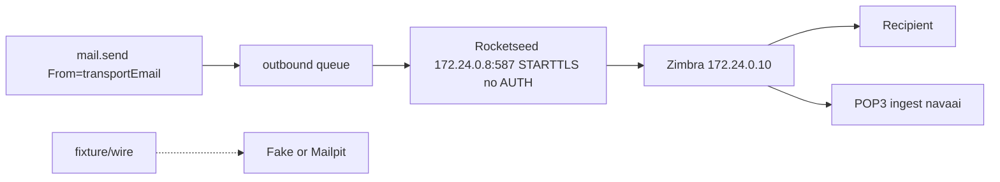

# Rocketseed Sole Real SMTP Hop

> **For agentic workers:** REQUIRED SUB-SKILL: Use `superpowers:subagent-driven-development` (recommended) or `superpowers:executing-plans` to implement task-by-task. Steps use checkbox (`- [ ]`) syntax for tracking.

**Execution posture:** Autonomous overnight. No routine user checkpoints. Resume from first incomplete task until done criteria or true blocker.

**Goal:** Every `MAIL_TRANSPORT_MODE=real` outbound message connects only to Rocketseed (`172.24.0.8:587` STARTTLS); Zimbra-direct SMTP is removed as default and as an allowed real hop. Nava may stay unbranded (tenant provisioning); mail still must traverse Rocketseed.

**Architecture:** Pin real SMTP connect host to `172.24.0.8`. Force STARTTLS + SNI `branding.legacyhotels.co.za` + cert verify. Never attach SMTP AUTH on that hop (IP-trust; leftover Zimbra passwords must not trigger AUTH 535). POP3 stays `172.24.0.10`. Fixture/wire unchanged. No Zimbra SMTP fallback on Rocketseed failure.

**Tech stack:** Nodemailer `RealSmtpTransport`, `activate-real-mail.sh`, `write-ec2-env.sh`, Vitest (disposable DB only; pilot-RDS forbidden).

## Global Constraints

- Pilot-RDS Vitest prohibited; `unset DATABASE_URL VITEST_ALLOW_PILOT_RDS` before tests; no `.env.production` sourced into test shells.
- Do **not** copy worktree `zero-rocketseed-first-class` AUTH-always / password-required real SMTP.
- Do **not** collapse `fixture` / `wire` / `real`.
- Branding still From/tenant provisioning ([rocketseed-banner-injection-from-sender-provisioning.md](../../solutions/architecture-patterns/rocketseed-banner-injection-from-sender-provisioning.md)); this plan is the **hop** contract only.
- Out of scope: provisioning Nava for banners; CID/UI render; new probe CLI.

## Overnight Autonomous Execution Mandate

**User granted full autonomy.** No blocking questions overnight. No manual login. No "which approach?" pause.

### Communication

- Orchestrator + every subagent: **Respond `/caveman ultra`. Technical terms exact.**

### AWS / infra (use freely)

| Resource | ID / path |
|----------|-----------|
| EC2 | `i-008f737974a9ba9b3` (`af-south-1`) |
| RDS | `nava-zero-mail-pilot` (Postgres 16) |
| S3 | `nava-zero-mail-845242190536-af-south-1` |
| Repo on EC2 | `/home/ubuntu/repos/zero` |
| **Primary deploy** | `apps/server-pilot/deploy/ops-deploy.sh` (`--migrate` when schema) |
| **Primary app bounce** | `apps/server-pilot/deploy/ops-restart.sh` |
| **Primary box reboot** | `apps/server-pilot/deploy/ops-reboot.sh` |
| Guts (fallback) | `sync-ec2-git-bundle.sh`, `deploy-ec2.sh`, `ssm-run-command.sh` |

**Allowed:** ops wrappers, bundle sync, deploy, migrate (via `ops-deploy --migrate`), seed (no `--rotate` unless fix requires), read-only SSM checks, PM2 logs, health curl, tests against a disposable non-production database, VPN-safe Rocketseed SMTP canaries (Nava self / approved external / Centurion From) for hop proof, activate-real-mail with Rocketseed defaults.

**Forbidden:** force-push main, `--no-verify`, destructive git, IT Exchange/VPN/real mail creds harvest, any Vitest/test command pointed at pilot or production RDS, setting `VITEST_ALLOW_PILOT_RDS=1`, sourcing `.env.production` into a test process, reintroducing Zimbra `172.24.0.10` as real SMTP, attaching SMTP AUTH to Rocketseed when leftover password present, printing DB URLs / credentials / mail bodies / PII into logs or SSM output.

### Pilot RDS safety (overrides autonomy)

Never run Vitest against `nava-zero-mail-pilot` or any production database. No overnight escape hatch exists.

Before every local or EC2 Vitest command:

```bash
unset DATABASE_URL VITEST_ALLOW_PILOT_RDS
```

If a test requires Postgres, use a disposable test database. If none exists, use read-only SQL/API health checks where they prove the requirement; otherwise report a safety blocker. Never weaken this rule to make a gate green.

### Decision authority

- Choose best safe reversible option without asking.
- Better route to accepted goal may be taken; log what changed and why (handoff report).
- Preserve requirements. Do not silently cut scope.
- Use standard non-fast subagents only; otherwise work inline.

### RCA loop (mandatory on any red)

FAIL → reproduce minimally → identify root cause and mechanism (`file:line`) → research unfamiliar behavior when useful → choose smallest correct fix → test → commit → resume plan.

Symptom patches, skipped gates, and "user can finish later" are not completion.

### Verification loop

Implement → focused tests → relevant broader tests/build → `ops-deploy` / activate / runtime gates required by plan → inspect evidence (SMTP 250, hop `.8`, no AUTH) → fix any red → repeat.

### Done criteria

- [ ] `MAIL_TRANSPORT_MODE=real` factory rejects any SMTP host other than `172.24.0.8` (including `172.24.0.10`)
- [ ] Rocketseed hop never attaches nodemailer `auth`, even when `SMTP_PASSWORD` / secret still set
- [ ] Real SMTP uses `requireTLS`, `rejectUnauthorized: true`, SNI `branding.legacyhotels.co.za`; independent of POP3 loose TLS
- [ ] `activate-real-mail.sh` defaults SMTP to `.8`, locks port 587, no AUTH smoke, fails if SMTP host is not `.8`
- [ ] deploy-config + transport-mode tests green (no pilot-RDS Vitest)
- [ ] Runbooks + CONCEPTS + CE sole-hop append updated
- [ ] EC2 cutover: activate smoke green; at least one real send proves Received / peer hop through `.8` with SMTP 250 (Nava unbranded OK)
- [ ] Centurion From regression: branding markers present (`rocketseed-strip` / banner parts) or prior human-confirmed canary still valid under same hop code path — no Zimbra-direct SMTP used
- [ ] Handoff report under `docs/superpowers/plans/handoff-reports/` with redacted evidence
- [ ] No unresolved blocker affecting plan goal

### True blockers

Stop only for: missing VPN/Rocketseed reachability that cannot be recovered via allowed ops; missing credentials/access that cannot be obtained safely; required human-only interaction outside approved canary pattern; destructive ambiguity; safety-policy conflict (including any pressure to Vitest pilot RDS); external hotel outage that prevents required hop proof.

## Execution Mode

Autonomous overnight — no user checkpoint. REQUIRED SUB-SKILL: `superpowers:subagent-driven-development`. Do not ask "which approach?" Resume from first incomplete task and continue until done criteria or true blocker.

## Decisions (reconciled eng + ponytail)

| Decision | Choice | Why |
|----------|--------|-----|
| Connect host | Hard-pin `172.24.0.10` reject + **only** `172.24.0.8` for real | User: remove other cases; avoid DNS connect to branding hostname |
| SNI | Fixed `branding.legacyhotels.co.za` in code when real host is `.8` | TLS identity without second allowlist entry |
| AUTH | **Never** set nodemailer `auth` for Rocketseed hop, even if `SMTP_PASSWORD` still in env | P0: leftover secrets otherwise cause 535 |
| Real password require | Drop `SMTP_PASSWORD`/`SMTP_SECRET_ARN` requirement for real | Live IP-trust |
| TLS | SMTP: `requireTLS`, `rejectUnauthorized: true`, `servername`; POP3 keeps existing loose `MAIL_TLS_REJECT_UNAUTHORIZED` | Shared knob would ship insecure SMTP |
| Activate port | `587` only (no 25 fallback) | Rocketseed submission contract |
| Smoke | TCP + STARTTLS verify (+ nodemailer no-auth `verify`/EHLO); no AUTH `verify()` | Match live |
| Guard site | One tiny `assertRealSmtpHop(host)` used by `createSmtpTransport` (+ activate assert) | Eng dual-enforce without allowlist module |
| CE | Append “mandatory sole hop” section to existing Rocketseed solution + CONCEPTS tweak | Ponytail: no second CE file |
| Worktree | Cherry-pick TLS split / staging patterns only | AUTH-always is wrong for hotel |



## Review disposition

- **Eng (completeness):** ship-with-fixes → all P0/P1 folded above (AUTH omit, connect=IP, TLS split, port 587, factory guard, activate no AUTH smoke).
- **Ponytail (simplicity):** cut allowlist helper, second CE doc, probe script, dual parseEnv+factory sprawl → hard-pin + one assert + CE append.
- **DevEx:** activate/runbooks become “SMTP=Rocketseed, POP3=Zimbra”; operators must not reintroduce `.10` SMTP by habit.

## Files

| File | Role |
|------|------|
| [apps/server-pilot/src/mail/send/smtp.ts](../../../apps/server-pilot/src/mail/send/smtp.ts) | Hop assert; AUTH omit on `.8`; SMTP TLS harden; drop real password require |
| [apps/server-pilot/tests/transport-mode.test.ts](../../../apps/server-pilot/tests/transport-mode.test.ts) | Invert credential tests; add hop/AUTH/TLS cases |
| [apps/server-pilot/scripts/activate-real-mail.sh](../../../apps/server-pilot/scripts/activate-real-mail.sh) | Default SMTP `.8`; stage env; no SMTP password gate; STARTTLS smoke; port 587 only |
| [apps/server-pilot/deploy/write-ec2-env.sh](../../../apps/server-pilot/deploy/write-ec2-env.sh) | Persist Rocketseed SMTP; do not require SMTP secret for real |
| [apps/server-pilot/tests/deploy-config.test.ts](../../../apps/server-pilot/tests/deploy-config.test.ts) | Assert no `SMTP_HOST:=172.24.0.10`; assert `.8` default / hop contract |
| [apps/server-pilot/src/env.ts](../../../apps/server-pilot/src/env.ts) | Optional: when mode=real and SMTP_HOST set, call same hop assert (thin) |
| Runbooks under `apps/server-pilot/deploy/*.md` | SMTP=Rocketseed, POP3=Zimbra |
| [CONCEPTS.md](../../../CONCEPTS.md) | Rocketseed = mandatory real SMTP hop; `MAIL_TRANSPORT_MODE` real wording |
| Existing CE solution | Append sole-hop section |

---

## Task 1: Real SMTP hop pin + AUTH omit + TLS split (TDD)

**Files:** `smtp.ts`, `transport-mode.test.ts` (new focused cases OK)

- [ ] Write failing tests:
  - `real` + `SMTP_HOST=172.24.0.10` → factory throws
  - `real` + non-`.8` host → throws
  - `real` + `.8`, no password → transport constructs; send path builds transporter with `auth: undefined`
  - `real` + `.8` + password still set → **still** `auth: undefined`
  - `real` + `.8` + `MAIL_TLS_REJECT_UNAUTHORIZED=false` → SMTP still `rejectUnauthorized: true`, `requireTLS: true`, `tls.servername === branding.legacyhotels.co.za`
  - `wire` + `127.0.0.1` → no hop pin; auth rules unchanged for Mailpit
  - `fixture` + `SMTP_HOST=.10` → still Fake
- [ ] Implement `assertRealSmtpHop(host)` (normalize trim; equality to `172.24.0.8` only).
- [ ] In `createSmtpTransport` for `mode === 'real'`: assert hop; do **not** require password/secret.
- [ ] In `RealSmtpTransport.send`: if host is Rocketseed, never pass `auth`; always `requireTLS: true`, `tls: { rejectUnauthorized: true, servername: 'branding.legacyhotels.co.za' }` (ignore shared POP3 TLS env for SMTP).
- [ ] Delete/invert tests that require SMTP credentials for real success.
- [ ] Run: `unset DATABASE_URL VITEST_ALLOW_PILOT_RDS; pnpm --filter @zero/server-pilot exec vitest run tests/transport-mode.test.ts` (adjust path if package name differs).
- [ ] Commit.

## Task 2: Activate + env writer + deploy-config contract (TDD)

**Files:** `activate-real-mail.sh`, `write-ec2-env.sh`, `deploy-config.test.ts`, optionally `env.ts`

- [ ] Failing deploy-config assertions: script must **not** contain `SMTP_HOST:=172.24.0.10`; must default/require Rocketseed `.8`; must not require SMTP password for activate; SMTP smoke must not call authenticated `verify()` with Zimbra creds; port probe must not fall through to 25 for real Rocketseed.
- [ ] Change activate:
  - Stage caller SMTP_* before sourcing `.env.production`; restore staged.
  - `: "${SMTP_HOST:=172.24.0.8}"` (POP3 stays `.10`).
  - After resolve: if `SMTP_HOST` ≠ `172.24.0.8`, exit non-zero.
  - Drop SMTP password/secret required block.
  - Lock `SMTP_PORT=587`, `SMTP_SECURE=false`.
  - Replace “SMTP auth smoke” with STARTTLS / no-auth smoke (openssl or nodemailer without `auth`).
- [ ] `write-ec2-env.sh`: write `SMTP_HOST`, port, and any needed TLS notes; SMTP secret optional for real.
- [ ] Thin `parseEnv` call to same hop assert when `MAIL_TRANSPORT_MODE=real` and host present (optional if factory alone is covered by tests — prefer one shared function imported/duplicated carefully for bash vs TS: TS factory is source of truth; bash duplicates the string check).
- [ ] Run deploy-config + transport-mode tests.
- [ ] Commit.

## Task 3: Docs + CONCEPTS + CE compound append

**Files:** deploy runbooks (`it-handoff-runbook.md`, `exchange-smoke.md`, `navaai-real-mail-smoke.md`, `deferred-real-mail-readiness.md`), `CONCEPTS.md`, CE solution

- [ ] Update runbooks: real SMTP = Rocketseed `.8:587` IP-trust; POP3 = Zimbra `.10`; banners still From-provisioned; Nava unbranded OK.
- [ ] CONCEPTS: extend **Rocketseed banner server** with “mandatory sole real SMTP hop”; fix **MAIL_TRANSPORT_MODE** “real = hotel Zimbra/Exchange” → real SMTP=Rocketseed, POP3=Zimbra.
- [ ] Append section **Mandatory sole SMTP hop** to [rocketseed-banner-injection-from-sender-provisioning.md](../../solutions/architecture-patterns/rocketseed-banner-injection-from-sender-provisioning.md) — hop vs branding selector; AUTH omit; no Zimbra SMTP fallback; fixture/wire carve-out.
- [ ] Commit docs.

## Task 4: Live cutover proof (ops, after code on EC2)

- [ ] Push `EC2-pilot`; run `ops-deploy.sh` (no migrate unless schema changed).
- [ ] Activate / ensure `.env.production` SMTP=`172.24.0.8:587`; smoke: STARTTLS OK, no AUTH.
- [ ] One Nava→Nava (or previously approved external) send via app path: SMTP 250; evidence of hop through `.8` (Received / peer); branding optional/absent OK. Redact PII in logs.
- [ ] Centurion From regression on same hop: confirm branding markers in returned/stored MIME (`rocketseed-strip` / branding image parts) without requiring a new interactive human pause; if Centurion send needs prior approval pattern from this thread, reuse that pattern once and capture redacted evidence.
- [ ] Short checklist in `navaai-real-mail-smoke.md` or activate output: host `.8`, no-AUTH, fail if `.10` SMTP.
- [ ] Write handoff report `docs/superpowers/plans/handoff-reports/2026-07-31-rocketseed-sole-smtp-hop.md` (redacted). Done = evidence, not narrative.

## Test matrix (must pass before cutover claim)

1. Real + `.10` → throw
2. Real + `.8` + leftover password → no AUTH
3. Real + TLS-loose env → SMTP still strict
4. Wire/fixture unaffected
5. Activate script contract tests
6. No pilot-RDS Vitest

## Risks (accepted)

- Rocketseed outage = total send outage (explicit; no fallback).
- Hotel IP-trust means any process on trusted source IP can submit; app pin only stops mis-config to Zimbra SMTP.
- Self-BCC still rides same Rocketseed session; orthogonal to branding; keep `MAIL_SELF_BCC` killswitch.

## Explicit non-goals

- Merging full `zero-rocketseed-first-class` AUTH-always branch.
- Rocketseed tenant admin to brand Nava.
- New `rocketseed-probe.ts` CLI.
- UI CID work (separate track).
