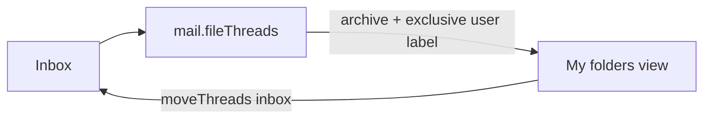

# Custom Folders + Drag-to-File

> **For agentic workers:** REQUIRED SUB-SKILL: Use superpowers:subagent-driven-development (recommended) or superpowers:executing-plans. Checkboxes track progress. Cursor plan mirror: `.cursor/plans/custom_folders_drag_d621d722.plan.md`.

**Goal:** FO creates folders under **My folders**, drags finished mail in (inbox clears), opens folder later to find it — same job as Outlook filing. Hotel AI **Folders** and PMS stay untouched.

**Architecture:** Filing = transport `mailLabel` + `label_ids` + archive flag. One mutation `mail.fileThreads`. List = `/mail/{labelId}` → `archive` + that label. UI = existing sidebar/Folder/LabelDialog tokens + `@dnd-kit` (note-panel pattern). Nesting = slash names (`Bookings/POPs`).

**Tech Stack:** server-pilot tRPC/Drizzle · mail React Router · shadcn/Radix sidebar · magicui Folder tree · `@dnd-kit/core` · Vitest on disposable DB only.

---

## Principles (elegant defaults)

| Layer | User sees | Code keeps |
|-------|-----------|------------|
| AI work queues | **Folders** | `categoryIds` |
| User filing | **My folders** | `mailLabel` / `labelIds` / `labels.*` |
| System places | Inbox / Archive / Spam / Bin | `isArchived` / `spamAt` / `trashedAt` |

- One place mail “lives” after file → exclusive among **user** label UUIDs + leave inbox.
- One mutation → no FE race of `modifyLabels` + `moveThreads`.
- One visual language → no new theme; drop highlight = Folder’s existing select/hover.
- One DnD stack → `@dnd-kit` already paid; not bare HTML5.
- Unfile = existing **Move to Inbox** (no second RPC).

---

## Global constraints

**In scope**

- Create / rename-via-existing-API / delete user folders (labels)
- Slash nesting display
- Drag (and multi-select drag) list → My folders
- Folder route list + optimistic UI + undo toast
- Reserved name guards; delete scrub + orphan unarchive
- Sidebar title **My folders**; mailbox provider create `+`

**Out of scope**

- PMS draft / booking conversion
- Filing Brain / suggest-folder AI
- New `mail_folder` table / `parentId`
- Bare HTML5 DnD; new design system; purple/glow/emoji chrome
- Renaming tRPC `labels.*` or mass symbol rename
- AI category taxonomy edits; demo invent dual-path for file
- Nested folder **reorder** DnD (file-to-folder only)

**Safety:** before Vitest → `unset DATABASE_URL VITEST_ALLOW_PILOT_RDS`; disposable DB only. Never pilot RDS.

**Docs to respect:** [hotel-folder-ui-parity](../solutions/ui-bugs/hotel-folder-ui-parity.md) (AI Folders presentation; this plan supersedes “always titled Labels” → **My folders**), [folder-first spam matrix](../solutions/architecture-patterns/folder-first-spam-at-folder-matrix.md).

---

## Product semantics (locked)

1. **`fileThreads({ threadIds, labelId })`**
   - Label must belong to `ctx.activeTransportId` else `NOT_FOUND`
   - Threads via `resolveVisibleThreadIds` only
   - Among user label UUIDs: keep only `labelId`; keep system ids (`IMPORTANT`, …)
   - Never touch `categoryIds`
   - `isArchived=true`; `trashedAt=null`; `spamAt=null`; if prior spam → `spamUserLockedAt=now()`
2. **Folder list:** `{ folder: 'archive', filters: { labelIds: [id] } }` (not `all`)
3. **Route wiring:** `resolveMailRouteFilter` + **`use-threads` must merge route `labelIds`** into list filters (today broken)
4. **Navigate:** mailbox click → `/mail/{id}`; active highlight matches that path
5. **Droppable:** real user UUID only — not `group-*`, not AI Folders, not system nav
6. **Multi-select:** dragged id ∈ selection → file all selected; else one; clear selection after
7. **Delete:** scrub id from `labelIds`; if no user labels left → `isArchived=false` (no vanish)
8. **Create names:** reject system folder / system label names case-insensitively
9. **Create gate:** show `+` for `providerId === 'mailbox'` (and google)
10. **A11y:** DnD accelerates; Move / context menus remain (WCAG 2.5.7)

---

## UI / theme lock (anti-slop)

**Reuse**

- Collapsible chrome + [LabelDialog](../../apps/mail/components/labels/label-dialog.tsx)
- [Folder](../../apps/mail/components/magicui/file-tree.tsx) tokens: `hover:bg-black/10`, `dark:hover:bg-[#202020]`, `bg-sidebar-accent`
- Sidebar vars in [globals.css](../../apps/mail/app/globals.css)
- List row hover in [mail-list.tsx](../../apps/mail/components/mail/mail-list.tsx)
- DnD pattern from [note-panel.tsx](../../apps/mail/components/mail/note-panel.tsx): `DndContext`, `PointerSensor` distance ~8px, `DragOverlay`, grab cursor

**Interaction polish**

| State | Behavior |
|-------|----------|
| Idle | Whole-row drag (no new grab-handle chrome this ship) |
| Dragging | Compact `DragOverlay` chip (subject or “N threads”); list layout stable |
| Over folder | Same highlight as Folder selected/hover — `isOver` → `bg-sidebar-accent` |
| Invalid | No highlight; ignore drop |
| Transport switch mid-drag | Cancel / no-op |
| After drop | Optimistic hide + undo toast |

**Forbidden chrome:** purple glow, neon dashed boxes, emoji folder personality, new fonts/cards, framer hero on sidebar, inventing DESIGN.md aesthetic.

---

## File map

| File | Change |
|------|--------|
| [mail.ts](../../apps/server-pilot/src/trpc/routes/mail.ts) | `fileThreads` inline (archive matrix + exclusive user labels) |
| [labels.ts](../../apps/server-pilot/src/trpc/routes/labels.ts) | Reserved create; delete scrub + orphan unarchive |
| [route-filter.ts](../../apps/mail/lib/mail/route-filter.ts) | UUID → `archive` + `labelIds` |
| [use-threads.ts](../../apps/mail/hooks/use-threads.ts) | Merge route `labelIds` into `baseListFilters` |
| [nav-main.tsx](../../apps/mail/components/ui/nav-main.tsx) | Title **My folders**; mailbox create gate |
| [recursive-folder.tsx](../../apps/mail/components/ui/recursive-folder.tsx) | Navigate + active path + `useDroppable` |
| [mail-list.tsx](../../apps/mail/components/mail/mail-list.tsx) | `useDraggable` rows |
| Mail shell layout | One live `DndContext` + overlay |
| [use-optimistic-actions.ts](../../apps/mail/hooks/use-optimistic-actions.ts) | `optimisticFileThreads` |
| [thread-actions.ts](../../apps/mail/lib/thread-actions.ts) | `fileThreadsTo` wrapper |
| Tests | BE thread-actions + labels; FE route-filter + title + drag payload |

---

## Review disposition

- **Eng:** route→list wiring; delete orphan; authZ; spam lock on file; multi-select + optimistic FILE; reserved names; transport-change cancel; UUID-only droppables. Unfile RPC cut → Move to Inbox.
- **Ponytail:** no Brain/parentId/service layer; `archive`+labelIds; exclusive only on file path. **Superseded:** HTML5 → `@dnd-kit` (already dep; better ghost/touch; still no new DS).
- **Design:** token-bound reuse; no full design-system review unless chrome invents new look.
- **Product follow-ups baked in:** sidebar **My folders**; theme-bound dnd-kit.

---

## Task 1 — `fileThreads` + delete scrub (TDD)

**Files:** `mail.ts`, `labels.ts`, `apps/server-pilot/tests/mail-thread-actions.test.ts` (+ labels tests)

- [x] Failing tests (`unset DATABASE_URL VITEST_ALLOW_PILOT_RDS`):
  - Inbox file → archived, target label, other user UUIDs stripped, `IMPORTANT` kept, categories untouched
  - Spam file → clear `spamAt`, set `spamUserLockedAt`, archived + label
  - Bin file → clear `trashedAt`, archived + label
  - Foreign label → `NOT_FOUND`; foreign threads skipped
  - Batch `updated` count
  - Delete scrub + orphan unarchive
  - Reserved create name → error
- [x] Implement `fileThreads`; scrub/orphan; reserved Set
- [x] Vitest green
- [ ] Commit: `feat(mail): atomic fileThreads and label delete scrub` (deferred — nava-run no-commit)

## Task 2 — Route + list wiring (TDD)

**Files:** `route-filter.ts`, `use-threads.ts`, `search-filter-contract.test.ts`, `[folder]/page.tsx` if needed

- [ ] Failing: known label UUID → `{ folder:'archive', filters:{ labelIds:[id] } }`; system/category unchanged; unknown safe
- [ ] Extend `resolveMailRouteFilter(..., labelIdSet?)`
- [ ] Merge route + search `labelIds` in `use-threads`
- [ ] Mailbox navigate `/mail/{id}` + active path fix
- [ ] Commit: `fix(mail): My folders routes filter archive by labelIds`

## Task 3 — My folders chrome + optimistic client (TDD)

**Files:** `nav-main.tsx`, `thread-actions.ts`, `use-optimistic-actions.ts`, FE tests

- [x] Create `+` for `mailbox` (+ google)
- [x] Header string **My folders** (update any parity test expecting `Labels`)
- [x] `fileThreadsTo` + `optimisticFileThreads` (snapshot, hide, rollback, undo)
- [ ] Commit: `feat(mail): My folders create and optimistic fileThreads`

## Task 4 — Theme-bound dnd-kit

**Files:** mail shell, `mail-list.tsx`, `recursive-folder.tsx` / `sidebar-labels.tsx`; mirror `note-panel.tsx`

- [ ] Live shell `DndContext` + `PointerSensor` `{ distance: 8 }`
- [ ] Draggable rows; multi-select payload rule
- [ ] Droppable real label UUIDs only
- [ ] `DragOverlay` compact chip (`bg-panel*` / existing radius/shadow)
- [ ] `isOver` → Folder select/hover classes
- [ ] Transport-change cancel
- [ ] Unit: payload + droppable id filter
- [ ] Commit: `feat(mail): dnd-kit file onto My folders`

## Task 5 — Verify + institutionalize

- [ ] Targeted BE/FE Vitest with safety unset
- [ ] Manual: create → drag → inbox empty → open My folders → visible → Move to Inbox → back; delete empty; delete with filed → return inbox; AI section still **Folders**; drop highlight looks like select not neon
- [ ] CE note under `docs/solutions/`: filing = label+archive; FO **My folders** ≠ AI **Folders**; supersedes Labels-title clash
- [ ] Commit docs

---

## Success criteria

- FO (`mailbox`) sees **My folders**, creates `Parent/Child`, files by drag, inbox clears, folder shows mail; UI matches existing mail chrome.
- AI **Folders** / triage / PMS untouched; APIs still `labels.*`.
- No pilot-RDS Vitest.
- Review locks above shipped, not deferred.

## Next

`/nava-run` on this plan only.
