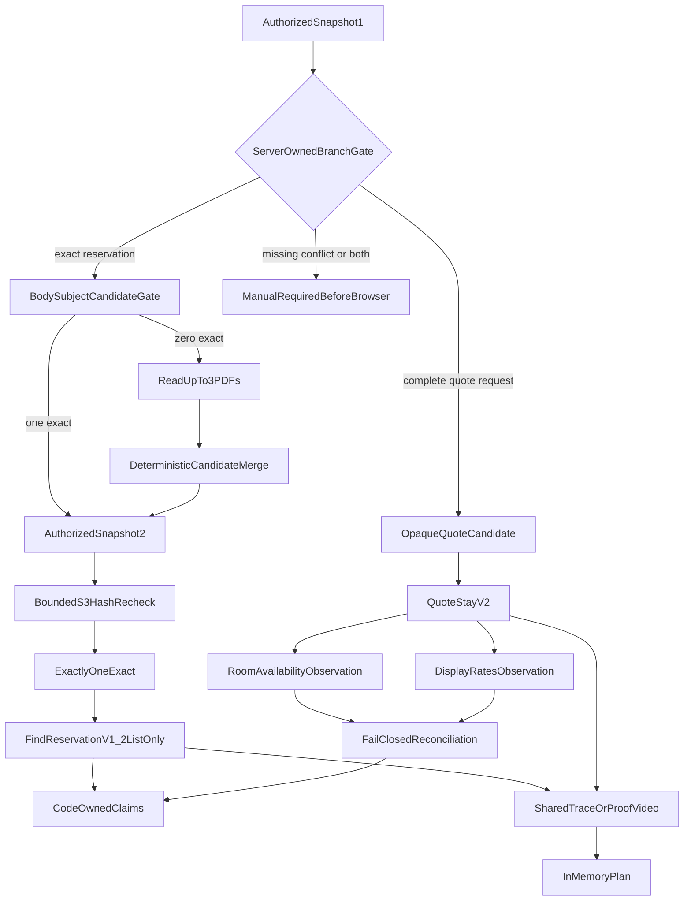

# Mail Artifact and HMS Read Expansion Implementation Plan

> **Historical quote scope (superseded 2026-09-17):** This plan's Room Availability + Display Rates quote recipe is retained for decision history only. Current client-approved quote source is Front Desk → Availability → **Hotel Availability**; do not use this plan as execution guidance for quote work.

> **For agentic workers:** REQUIRED SUB-SKILLS: `/nava-run` and `superpowers:subagent-driven-development`. Use TDD, SDD, per-task review, final correctness review, and fresh verification. Work in current `EC2-pilot` branch/worktree. Do not create another branch/worktree or commit unless user separately asks.

**Execution posture:** Phase A is complete and frozen. Preserve its evidence and Gate G1 contract. After user replies `Continue`, Phase B first applies cheap list-only `hms_find_reservation` enrichment, then completes the original mail-artifact chain, then productionizes the existing fixture-backed `hms_quote_stay` contract as the sole additional live HMS tool.

**Goal:** Preserve the accepted real-HMS reservation-search proof, enrich that tool from its existing exact list row without opening reservation detail, complete the authorized no-OCR `mail_read_artifact → hms_find_reservation` chain, and ship one additional read-only production HMS tool: `hms_quote_stay` over separate Room Availability and Display Rates observations.

**Architecture:** `createProductionHmsRuntime()` remains the sole Playwright capture/session boundary. A code-owned operation discriminator selects one exact manifest and one registered tool: reservation search or quote stay. Reservation search remains list-row only. Quote stay uses one server-owned opaque stay-request candidate, visits Room Availability and Display Rates as separate reads, reconciles observations in pure code, and always returns `bookable:false`. Normal production executions are trace-only; real-HMS acceptance executions are trace+WebM. Fixtures preflight mechanics but never satisfy live acceptance.

**Tech Stack:** TypeScript, Playwright 1.52, Poppler (`pdfinfo`, `pdftotext`), Bubblewrap, `prlimit`, AWS S3, Zod, Drizzle/PostgreSQL, Vitest, PM2.

**Delivery count:** Ship/productionize two tools: `mail_read_artifact` v2 and `hms_quote_stay` v2. Enhance one existing tool: `hms_find_reservation` v1.2 list-row claims. No other HMS tool enters executable scope.

## Global Constraints

- Current slice is read-only: no HMS create/amend/cancel/post/settle/refund/send/print/export/save/submit or mail send/draft persistence.
- Every Playwright-backed PMS tool/version must pass one acceptance proof against real production HMS. Proof starts before login, records trace+WebM, invokes the registered tool, and uses `view_only` credentials plus default-deny request policy. Mock/fixture HMS may preflight mechanics but never satisfy this gate.
- Live proof may fill only reviewed search/filter fields with server-owned synthetic or authorized exact values. No Save/New/Delete/business Submit. Any unknown, autosave-like, or mutation-capable request aborts and invalidates proof.
- Future production write tools remain a separate plan. They may reuse capture substrate, but this plan does not authorize or enable live writes.
- Every Playwright-backed PMS tool execution must produce one trace for each browser session it opens. Non-browser `mail_read_artifact` PDF/S3 work does not create a fake browser trace; its chained HMS lookup does.
- Trace starts before login navigation. Trace and video may contain credentials, session cookies, PMS data, DOM, screenshots, and network data. User authorizes that capture for audit; artifacts remain credential-grade, private, access-controlled, and absent from logs, prompts, SSM output, and public CI.
- Normal production capture is trace-only. Continuous video is mandatory for each live acceptance proof and can be requested for a future execution, but is off by default. Existing trace-only runs remain inspectable in Trace Viewer; they cannot be retroactively converted into continuous WebM by supported Playwright APIs.
- No third-party recorder, trace renderer, TTS, cinematic layer, or ffmpeg dependency. Proof output is Playwright WebM.
- Browser artifact root is `/opt/nava/shared/hms-browser-artifacts`, directory mode `0700`, files mode `0600`, 24-hour TTL, 256 MiB maximum accepted finalized capture, and 2 GiB minimum free-space preflight. Unique staging directories plus atomic final rename avoid a second cross-process lock; existing runtime semaphore and sole-starter ops isolation serialize HMS work. Fail closed before browser action when storage is unsafe.
- Playwright `tracesDir`, `recordVideo.dir`, partial trace output, and final artifacts all stay beneath that protected root. No credential-bearing intermediate may use OS/default temp. Root/ancestor ownership, symlinks, permissions, and same-filesystem atomic rename are preflight requirements.
- During capture, a 2-second watchdog aborts when observed staged trace+video reaches 256 MiB or free space falls below 1 GiB. Polling is detection, not a filesystem quota; any sampled overrun or finalized capture above 256 MiB is rejected. Capacity abort attempts bounded finalization, emits fixed `CAPTURE_CAPACITY_EXCEEDED`, withholds result, and degrades runtime.
- The 24-hour TTL is guaranteed for EC2 artifacts and transfer objects by hourly cleanup/lifecycle. Fetch refuses expired receipts. Downloaded local copies are authorized user-delivery artifacts with POSIX `0700/0600` or Windows current-user/SYSTEM ACL; no background laptop retention guarantee is claimed. Every proof/fetch/accept invocation purges expired local copies, and the user may delete them sooner.
- Trace/video filenames and receipts contain only server-generated artifact/run IDs, tool ID, fixed data class, timestamps, byte counts, and SHA-256. Never candidate/thread/message/guest/email values, raw paths, credentials, free-form errors, or model content.
- Keep artifact limits: 20 MiB PDF input, 50 pages, 256 KiB text output, 10-second parser deadline, 512 MiB address-space, and 5-second CPU.
- Maximum candidate chain budget: three artifact calls plus one HMS call.
- Reservation and quote are mutually exclusive run branches. One run may use up to three artifacts plus one reservation lookup, or one quote lookup with zero artifact calls; it never invokes both HMS tools.
- `hms_quote_stay` remains non-booking evidence. Room Availability and Display Rates never become a guaranteed offer, inventory hold, or reservation. CRS Check Availability is forbidden because Infor documents that it creates a reservation record.
- Before every Vitest command: `unset DATABASE_URL VITEST_ALLOW_PILOT_RDS`. DB tests require a disposable non-production database. Pilot/production RDS remains forbidden for tests.

## Autonomous Execution Mandate

**User granted staged autonomous execution for this plan.** `/nava-run` starts with Phase A and continues until its live proof is delivered. Gate G1 is the only planned human checkpoint. After literal user reply `Continue`, resume Phase B and continue until all done criteria are verified or a true blocker is reached.

### Decision authority

- Choose the best safe reversible option without asking. A better route to the accepted goal may be taken; record what changed and why.
- Preserve scope and requirements. Do not silently replace real-HMS proof with mocks, cut audit evidence, or weaken request policy.
- Use standard non-fast subagents only. If unavailable, execute inline.
- Before Gate G1, execute only Phase A. Do not implement `mail_read_artifact` or another new tool.
- After Gate G1, no routine questions, progress checkpoints, or approval pauses. The user may be offline/asleep.
- Do not create commits or push unless the user separately requests that git mutation.

### Zero infrastructure and safety

- Approved execution surfaces: EC2 `i-008f737974a9ba9b3` in `af-south-1`, repo `/home/ubuntu/repos/zero`, private S3 bucket `nava-zero-mail-845242190536-af-south-1`, and canonical ops wrappers under `apps/server-pilot/deploy/`.
- Purpose-built production proof scripts may load production HMS configuration and perform reviewed read-only operations. Test runners may not source `.env.production`.
- Never run Vitest or another test runner against `nava-zero-mail-pilot` or any production database. Never set `VITEST_ALLOW_PILOT_RDS=1`.
- Before every local or EC2 Vitest command:

  ```bash
  unset DATABASE_URL VITEST_ALLOW_PILOT_RDS
  ```

- Database-required tests use a disposable non-production database. Missing disposable DB blocks those tests and final completion, but not DB-free tasks.
- Never place credentials, private mail bodies, addresses, guest data, trace contents, or video contents in prompts, subagent inputs, logs, SSM output, model context, or public storage.
- Trace/video capture is authorized, but artifact access remains private and credential-grade. Authorization does not permit PMS mutation during development proof.

### RCA loop

FAIL → reproduce minimally → identify root cause and mechanism → research unfamiliar behavior when useful → choose smallest correct fix → run smallest failed gate → run phase gate → resume.

Do not treat ordinary test failures, policy drift, transient network failures, or unfamiliar code as user blockers. Never bypass a gate, broaden a candidate selector, switch to mock acceptance, weaken request policy, or use pilot RDS to get green.

### Gate G1 exception

- Gate G1 opens only after the existing registered `hms_find_reservation` tool completes a real-production-HMS read-only run with a finalized trace, finalized WebM, safe receipt, and zero business-mutation evidence.
- Deliver the local WebM path, local receipt path, trace artifact ID, hashes/bytes, and fixed no-mutation summary to the user. Do not expose raw trace/video contents through chat or SSM.
- Stop and wait. Only a new user message whose trimmed payload is exactly case-sensitive `Continue` satisfies G1: `message.trim() === 'Continue'`. Plan acceptance, prior messages, fixture success, elapsed time, or inferred approval do not.
- Waiting at G1 is expected execution state, not a blocker.

### Binary done criteria

- [ ] Phase A capture substrate works through production runtime with trace always and video only for explicit proof executions.
- [ ] Existing `hms_find_reservation` real-HMS proof is user-watchable and proves no business mutation.
- [ ] Gate G1 receives literal `Continue`.
- [ ] Authorized PDF chain derives at most one exact candidate and invokes one traced `hms_find_reservation`.
- [ ] `hms_find_reservation` v1.2.0 emits only exact list-row claims and never opens reservation detail.
- [ ] `hms_quote_stay` v2.0.0 executes one real read-only Room Availability + Display Rates session, returns `bookable:false`, and has its own verified trace+WebM proof.
- [ ] Every applicable live proof uses real production HMS; fixtures are preflight only.
- [ ] All DB-free, disposable-DB, build, shell, parser, browser, deployment, rollback, and final review gates required below are green or have an explicit safety blocker.
- [ ] No unresolved blocker affects the plan goal.

## Requirements

- **R1:** Authorize inbound, non-inline `application/pdf` attachments against current `(principalUserId, transportId)` mailbox grant and thread before S3 access.
- **R2:** Extract embedded text with sandboxed Poppler only; no OCR or unsandboxed fallback.
- **R3:** Treat artifact text as candidate input only: `draftReady:false`, `claimKeys:[]`, no `attachment_fact`.
- **R4:** Include subject/body candidates first; read at most three PDFs only when body/subject yields zero exact candidates.
- **R5:** Recheck grant, thread/attachment metadata, and bounded S3 SHA-256 before HMS; require exactly one merged exact candidate.
- **R6:** Invoke `hms_find_reservation` at most once and let only HMS-backed claims reach model planning.
- **R7:** Emit aggregate-only backtest/proof metrics; no artifact text, identifiers, filenames, hashes tied to messages, or PII.
- **R8:** Every production Playwright PMS context starts native tracing before login navigation and finalizes `trace.zip` after tool-result construction on success, error, timeout, abort, and policy block.
- **R9:** Secure storage preflight/start failure blocks before navigation. Trace-finalize failure withholds a successful tool result and degrades runtime. Hard process/host loss may leave only protected `.partial-*`/`.incomplete-*`; never claim those as complete traces.
- **R10:** Normal execution always traces and never configures `recordVideo`. Dedicated real-HMS proof execution configures video before context creation and requires both trace and WebM.
- **R11:** A prior trace opens in pinned Trace Viewer but cannot become continuous WebM. Later continuous video requires a new explicitly video-enabled execution. No unsupported trace renderer is added.
- **R12:** Every Playwright-backed PMS tool/version requires a real-production-HMS trace+WebM proof. Fixture/mock HMS remains useful preflight only and never satisfies acceptance.
- **R13:** Real-HMS proof uses `view_only`, current role proof, production browser/runtime, default-deny policy, and the actual registered tool invocation. Login/session and reviewed read-search POSTs are allowed; Save/New/Delete/business Submit and mutation-capable requests are forbidden.
- **R14:** Receipt binds Playwright/dependency revision, tool/version, operation/artifact IDs, fixed input class, safe milestone timestamps, request-rule counts, zero mutation/popup/download/WebSocket counts, terminal code, hashes, sizes, and expiry. It contains no credentials, guest/mail/candidate values, URLs with query/body data, raw paths, or model content.
- **R15:** Phase A and Gate G1 precede all `mail_read_artifact` implementation. Only `message.trim() === 'Continue'` unlocks Phase B.
- **R16:** After G1, executable scope is list-only find enrichment, the original mail-artifact chain, and production `hms_quote_stay`. Other PMS tools remain outside this plan.
- **R17:** Current plan never enables PMS writes. Future write tools prove navigation/field behavior read-only during development, then require separate production-write authorization; every actual production execution still traces and video remains opt-in per future run.
- **R18:** `hms_find_reservation` v1.2.0 may expose `guestName`, `externalReference`, `roomType`, and `ratePlan` only from one exact correlated Guest Stay list row. Room/rate fields use explicitly observed live GRID aliases only; absent or ambiguous aliases remain `null`. It never navigates to reservation detail.
- **R19:** `hms_quote_stay` v2.0.0 is the only additional live HMS tool. Room Availability and Display Rates remain distinct timestamped observations and `bookable` is always `false`.
- **R20:** Quote tool input remains `{ candidateId }`. Server-owned quote candidates require one retained message with exact arrival/departure dates, explicit rooms and adults, and either an explicit child count or explicit adults-only statement. No cross-message stitching or silent occupancy default is allowed.
- **R21:** Missing, conflicting, duplicated, stale, or ambiguous quote fields return `manual_required` before browser creation. Existing `surname_dates` candidates never invoke quote in production.
- **R22:** Quote currency comes from current root-owned property attestation, never model input, mailbox text, an arbitrary environment value, or a caller-supplied manifest.
- **R23:** A reservation/artifact run permits `mail_read_artifact<=3` and `hms_find_reservation<=1`. A quote run permits `hms_quote_stay<=1` and no artifact/find calls. Failed attempts consume the applicable cap.
- **R24:** Quote claims require complete nightly inventory coverage, requested room capacity, matching currency, explicit amount basis, and one unambiguous rate scope. Multiple room/rate options remain typed evidence with `draftReady:false`; code never chooses array element zero.
- **R25:** Every changed Playwright tool/version requires a fresh production trace+WebM receipt with current source/dependency revisions, `view_only` role proof, exact request rules, zero unsafe events, private hash-verified delivery, and successful stop/re-latch rollback.
- **R26:** Guest Stay detail, document fetch/generation, folio, sent-email audit, company/account, group/event, and every write tool are deferred. They require separate tenant evidence and plans.

## Key Technical Decisions

### KTD1: Poppler ships first; PDF Inspector remains comparison-only

Keep current sandboxed Poppler reader. Published `@firecrawl/pdf-inspector@1.12.0` resolves to a release using `lopdf 0.41.0`; [RUSTSEC-2026-0187](https://rustsec.org/advisories/RUSTSEC-2026-0187.html) confirms `lopdf <=0.41.0` can abort on a small deeply nested PDF and is patched in `>=0.42.0`. Mainline has moved, but published binary is not eligible for hostile inbound PDFs. Reconsider only after a patched package exists and a private, labelled Centurion/EC2 bake-off proves a material quality gain.

### KTD2: Playwright built-ins only

Use `context.tracing` and `recordVideo` from pinned Playwright 1.52. The repository already depends on 1.52 in `apps/server-pilot/package.json`; [Playwright tracing](https://playwright.dev/docs/api/class-tracing) records browser actions/network, and [video](https://playwright.dev/docs/videos) is saved when context closes. No recorder dependency.

### KTD3: Trace and video are parallel artifacts

Playwright opens `trace.zip` in [Trace Viewer](https://playwright.dev/docs/trace-viewer); it does not provide a trace-to-video export. Real-HMS acceptance proof records WebM during the same run and writes trace/video digests into one receipt. For a prior trace-only run, on-demand visual review means inspect the trace or run a new explicitly video-enabled execution. Never claim retroactive native conversion.

### KTD4: Trace and video start before login and remain sensitive

Playwright maintainers state traces can contain passwords, cookies, DOM values, headers, and request/response bodies ([issue #19992](https://github.com/microsoft/playwright/issues/19992)). Capture before login is required and authorized for audit. No unreliable sanitization layer is claimed. Artifacts stay in restricted local storage, never SSM/stdout/chat/public CI, and expire after 24 hours.

### KTD5: One capture layer, no per-tool recorder

`apps/server-pilot/src/hms/runtime.ts` owns capture lifecycle for every HMS context. Tool drivers supply only an opaque operation UUID, fixed tool ID/version, dependency revision, execution class, and fixed input class. Production composition allows only `normal` (trace-only) or dedicated `live_proof` (trace+video). Model input, a global environment flag, or arbitrary worker caller cannot enable video. Future read/write drivers inherit tracing without per-tool recorder code.

### KTD6: No result before capture closes

Session teardown is one idempotent promise. `searchExactAndMap()` constructs typed tool result inside audited browser session, then finalizes capture before returning it. Driver code preserves mapper/operation error plus capture-close error with `AggregateError`; runtime shutdown awaits active teardown; proof CLIs set exit status only after runtime closure. Mastra ingestion is server-only and recorded by shared call ledger, not misrepresented as browser trace content.

### KTD7: `hms_find_reservation` stays list-row only (no reservation-detail click)

Phase A proof and Phase B chained lookup both invoke the existing search tool only: exact Guest Stay search → at most one correlated list row → claims from list attrs (confirmation, status, dates; optional guest/room/ratePlan when present). **Never open reservation detail** in the default Phase A/B path (Task A1 and live driver already encode that). Rates inventory screens remain `hms_quote_stay`. Folio/account reads remain portfolio Wave 2+ (`hms_read_folio`). Manifest `detailPath`/`detailLink` may exist for future tools; they are not exercised by the default path. Do not remake Gate G1 solely to add a curiosity detail click.

### KTD8: Mandatory cheap enrichment stays on the list row

Phase B begins by emitting code-owned claims for exact list-row fields already returned by the live parser. Freeze only observed OSRESS aliases; never guess aliases, scrape arbitrary cells, open Guest Stay detail, or fall back to a maintain screen. Missing room/rate aliases remain nullable and do not block guest/reference enrichment. Bump the find tool to `1.2.0` and re-prove it against final source without rewriting the accepted G1 checkpoint.

### KTD9: Quote is the sole additional live HMS tool

`hms_quote_stay` already has typed contracts, a fixture adapter, claim kinds, and tests. Room Availability and Display Rates are the only remaining capability-matrix `active_read` surfaces. This plan productionizes that scaffold. Sent Email is the next safest research candidate, but it and every other roadmap surface remain separate work.

### KTD10: Complete server-owned quote candidate

Replace production `surname_dates → quote` routing with an opaque `quote_stay` candidate containing one message's exact dates and explicit occupancy. The model sees only `candidateId`. Property currency joins after root-owned attestation. Incomplete or conflicting requests abstain before browser creation.

### KTD11: Operation-owned manifests, one runtime

The production runtime accepts a closed operation union, not caller-supplied routes. Each operation selects its code-owned request manifest, role-proof requirements, tool ID/version, and receipt input class. Capture, login, request guards, shutdown, artifact storage, and rollback remain shared.

### KTD12: Separate quote reads, fail-closed reconciliation

One view-only session reads Room Availability and Display Rates separately. Pure reconciliation verifies every requested night, room capacity, currency, amount basis, and ambiguity. It never chooses the first returned option and always reports `bookable:false`.

### KTD13: Historical G1 remains immutable

Accepted G1 proves the prior find version and unlocks post-G1 work. Final-revision find v1.2, artifact-chain, and quote v2 proofs are additional evidence. They never rewrite or reopen G1.

## Data Flow



## File Map

- `apps/server-pilot/src/storage/s3.ts`: abortable bounded object reads.
- `apps/server-pilot/src/mail/artifacts/read-artifact.ts`: authorized sandboxed PDF extraction and stable identity.
- `apps/server-pilot/src/ai/thread-context.ts`, `hms-shadow.ts`, `run-ledger.ts`, `worker.ts`: two-pass artifact-to-HMS orchestration, shared budget, and nonretryable audit-capture classification.
- `apps/server-pilot/src/hms/browser-artifacts.ts`: native-fs trace/video staging, terminal receipts, retention, and capacity checks.
- `apps/server-pilot/src/hms/runtime.ts`: required pre-login trace lifecycle, optional live-proof video, and all-terminal finalization.
- `apps/server-pilot/src/hms/production-runtime.ts`: production Playwright factory wired to required artifact store.
- `apps/server-pilot/src/hms/live-guest-stay-driver.ts`: opaque operation identity per tool session.
- `apps/server-pilot/src/hms/live-quote-stay-driver.ts`: production Room Availability + Display Rates driver; no CRS path.
- `apps/server-pilot/src/hms/contracts.ts`, `live-read-manifest.ts`, `request-policy.ts`: closed operation/tool unions, exact per-surface rules, and `bookable:false`.
- `apps/server-pilot/src/hms/reservation-candidate-session.ts`: sibling reservation and quote session factories over the shared runtime.
- `apps/server-pilot/src/ops/mail-artifact-backtest.ts`: aggregate no-OCR corpus measurement.
- `apps/server-pilot/src/ops/hms-live-proof.ts`: bounded real-HMS proof of existing tool first, then traced artifact-chain proof after G1.
- `apps/server-pilot/deploy/*.sh`, `docs/infor-hms/live-reservation-shadow-runbook.md`: dependency, live proof/video retrieval, lifecycle, sensitive artifact handling, and rollback operations.

---

## Phase A: Existing Tool Capture and Real-HMS Proof

No `apps/server-pilot/src/mail/artifacts/**` implementation may begin in Phase A. Only the reusable browser-capture substrate, proof front door, tests, deployment wiring required for that substrate, and existing `hms_find_reservation` proof are allowed.

## Task A0: Add minimum reusable trace and live-proof video substrate

**Files:**

- Create `apps/server-pilot/src/hms/browser-artifacts.ts`
- Modify `apps/server-pilot/src/hms/runtime.ts`
- Modify `apps/server-pilot/src/hms/production-runtime.ts`
- Modify `apps/server-pilot/src/hms/request-policy.ts`
- Modify `apps/server-pilot/src/hms/live-guest-stay-driver.ts`
- Modify `apps/server-pilot/src/hms/reservation-candidate-session.ts`
- Modify `apps/server-pilot/src/ai/hms-shadow.ts`
- Modify `apps/server-pilot/src/ai/run-ledger.ts`
- Modify `apps/server-pilot/src/ai/worker.ts`
- Create `apps/server-pilot/tests/hms-browser-artifacts.test.ts`
- Modify `apps/server-pilot/tests/hms-runtime.test.ts`
- Modify `apps/server-pilot/tests/hms-live-guest-stay.test.ts`
- Modify `apps/server-pilot/tests/ai-worker-contract.test.ts`
- Modify `apps/server-pilot/tests/hms-shadow.test.ts`
- Modify `apps/server-pilot/tests/hms-production-boundary.test.ts`

**Interfaces:**

```typescript
export type HmsExecutionClass =
  | 'normal'
  | 'live_proof';

export type HmsBrowserAuditSpec = {
  operationId: string;
  toolId: 'hms_find_reservation';
  toolVersion: string;
  dependencyRevision: string;
  executionClass: HmsExecutionClass;
  inputClass: 'authorized_exact' | 'synthetic_not_found';
};

export type HmsBrowserArtifactReceiptBaseV1 = {
  schemaVersion: 1;
  artifactId: string;
  operationId: string;
  sourceRevision: string;
  toolId: 'hms_find_reservation';
  toolVersion: string;
  dependencyRevision: string;
  playwrightRevision: string;
  chromiumRevision: string;
  executionClass: HmsExecutionClass;
  inputClass: 'authorized_exact' | 'synthetic_not_found';
  credentialMode: 'view_only';
  operationOutcome:
    | 'succeeded'
    | 'business_not_found'
    | 'failed'
    | 'timed_out'
    | 'aborted'
    | 'policy_blocked';
  requestRules: Array<{
    ruleId: string;
    count: number;
  }>;
  blockedRequests: number;
  mutationRequests: number;
  popupCount: number;
  downloadCount: number;
  webSocketCount: number;
  milestones: Partial<Record<
    | 'traceStartedAt'
    | 'loginStartedAt'
    | 'toolStartedAt'
    | 'toolFinishedAt'
    | 'traceStoppedAt'
    | 'contextClosedAt',
    string
  >>;
  terminalCode:
    | 'OK'
    | 'BUSINESS_NOT_FOUND'
    | 'TOOL_ERROR'
    | 'ABORTED'
    | 'TIMEOUT'
    | 'POLICY_BLOCK'
    | 'CAPTURE_CAPACITY_EXCEEDED'
    | 'TRACE_START_FAILED'
    | 'TRACE_FINALIZE_FAILED'
    | 'VIDEO_FINALIZE_FAILED'
    | 'CONTEXT_CLOSE_FAILED';
  terminalStage:
    | 'preflight'
    | 'context_create'
    | 'trace_start'
    | 'login'
    | 'tool'
    | 'trace_stop'
    | 'context_close'
    | 'video_finalize'
    | 'receipt_finalize';
  expiresAt: string;
};

export type HmsBrowserArtifactReceiptV1 =
  | (HmsBrowserArtifactReceiptBaseV1 & {
      artifactState: 'complete';
      trace: { sha256: string; bytes: number };
      video: { sha256: string; bytes: number } | null;
    })
  | (HmsBrowserArtifactReceiptBaseV1 & {
      artifactState: 'incomplete';
      trace: { sha256: string; bytes: number } | null;
      video: { sha256: string; bytes: number } | null;
    });

export type AuditedSearchMapper<T> = (
  result: GuestStaySearchResult,
) => T | Promise<T>;

export interface LiveGuestStayDriver {
  loginAndVerifyBinding(signal: AbortSignal): Promise<void>;
  runNotFoundCanary(signal: AbortSignal): Promise<void>;
  searchExact(
    candidate: ExactReservationCandidate,
    signal: AbortSignal,
  ): Promise<GuestStaySearchResult>;
  searchExactAndMap<T>(
    candidate: ExactReservationCandidate,
    signal: AbortSignal,
    mapResult: AuditedSearchMapper<T>,
  ): Promise<T>;
}
```

- [ ] Add failing artifact-store tests for strict UUID/tool/version validation, traversal/symlink rejection, owned/non-group-writable ancestors, root `0700`, files `0600`, protected `tracesDir`/video staging, same-device atomic rename, unique staging directories, SHA/bytes, 24-hour expiry, 256 MiB finalized acceptance limit including sampled overrun, 2 GiB preflight/1 GiB live free-space gates, `.partial-*`/`.incomplete-*`, and forbidden receipt keys.
- [ ] Add failing runtime-order tests proving storage preflight and protected launch `tracesDir` precede context creation; `normal` omits `recordVideo`; `live_proof` sets per-capture video dir before context creation; trace starts immediately after context creation and before page/login navigation; guards install before navigation; and every success/error/timeout/abort/policy-block path runs one idempotent finalizer.
- [ ] Add failing result-honesty tests: preflight/start failure blocks before navigation; trace-finalize failure withholds result and degrades runtime; tool error plus close failure preserves both via `AggregateError`; 2-second staged-byte/free-space watchdog aborts at exact thresholds; normal finalization budget is 30 seconds and live-proof budget 120 seconds; `runtime.close()` waits bounded active teardown.
- [ ] Extend request-policy/live-manifest tests to normalize case, decode at most two percent-encoding rounds per field, reject malformed escapes or residual decodable `%xx` after round two in action/control keys or values, reject those fields over 8 KiB, recursively inspect query/form/JSON values, and block before `route.continue()` every create/save/delete/amend/cancel/post/settle/refund/send/print/export/submit/check-availability spelling plus nested/encoded variants. Reviewed login/bootstrap/read-search POST paths get exact field-schema rules; unknown fields, autosave signals, and mutation-shaped values terminate proof with zero server mutation hits.
- [ ] Add one receipt-plumbing test proving only reviewed rule IDs are counted; raw URL/query/body/header/cookie values never enter receipt; nonzero blocked/mutation/popup/download/WebSocket counters invalidate proof.
- [ ] Add one failing composition test proving production normal mode always traces, arbitrary callers/model/env cannot enable video, dedicated proof composition alone can select `live_proof`, and no fixture browser can enter production composition.
- [ ] Add failing lifecycle tests for `apps/server-pilot/src/ai/worker.ts` and `run-ledger.ts`: normal AI `runId` becomes `operationId`; redundant pre-tool `driver.loginAndVerifyBinding()` is removed; one `hms_find_reservation` call opens one audited tool session; close failures are never swallowed; fixed `AUDIT_CAPTURE` is nonretryable and persists no raw error/artifact data.
- [ ] Run RED:

  ```bash
  unset DATABASE_URL VITEST_ALLOW_PILOT_RDS
  pnpm --filter @zero/server exec vitest run \
    tests/hms-browser-artifacts.test.ts \
    tests/hms-runtime.test.ts \
    tests/hms-live-guest-stay.test.ts \
    tests/hms-live-quote-stay.test.ts \
    tests/ai-worker-contract.test.ts \
    tests/hms-shadow.test.ts \
    tests/hms-production-boundary.test.ts \
    --reporter=dot
  ```

  Expected: failures because context wrappers expose no trace/video lifecycle, production composition has no mandatory artifact store, worker performs a redundant login session, and close errors are swallowed.

- [ ] Implement `browser-artifacts.ts` with Node `fs/promises`, `crypto`, and fixed constants. Validate root/ancestors via `lstat`/`realpath`/owner/mode and `stat.dev`; use unique `.partial-<uuid>` staging; fixed names `trace.zip`, `video.webm`, `receipt.v1.json`; per-capture/free-space watchdog; chmod/hash/format checks; same-filesystem atomic final rename. Runtime semaphore and sole-starter ops isolation prevent competing HMS sessions; do not add a second global capture lock or total-byte ledger. Keep `artifactState` separate from `operationOutcome`: a failed/not-found operation may still have complete artifacts; incomplete artifacts never masquerade as complete.
- [ ] Configure browser launch `tracesDir` as protected `<root>/.playwright-intermediate` and per-proof `recordVideo.dir` inside current partial directory. Capture sequence is: preflight → create context → start trace → install guards → create page/login/property check → tool action/result mapping → stop trace → close context → finalize WebM when proof mode → hash/receipt → release result. Remove intermediate files after receipt or mark incomplete on failure.
- [ ] Configure `recordVideo:{dir,size:{width:1280,height:720}}` only for `live_proof`. Capture primary-page video handle before close; after context close resolve `video.path()` and atomically rename it to `video.webm` inside same staging directory. Do not copy via `saveAs`.
- [ ] Run one unref'd 2-second watchdog over partial plus Playwright intermediate bytes and `statfs`. At observed 256 MiB staged bytes or below 1 GiB free, abort browser work, attempt bounded finalization, emit `CAPTURE_CAPACITY_EXCEEDED`, and degrade runtime. Reject any sampled overrun or finalized artifact set above 256 MiB; do not claim polling enforces a hard write quota. Use 30-second normal and 120-second live-proof finalization budgets.
- [ ] Start trace with `screenshots:true`, `snapshots:true`, `sources:false`, and safe title `<toolId>:<operationId>` before login navigation. Do not add sanitization that claims to make trace contents non-sensitive.
- [ ] Export reviewed constant `CENTURION_HMS_PRODUCTION_ORIGIN = 'https://appsrv-1.legacyhotels.co.za'` from production composition. Before browser creation, compare secret login origin and every manifest-rule origin to that constant; no environment/model/caller override. Fixed mismatch: `PRODUCTION_ORIGIN_MISMATCH`.
- [ ] Remove redundant worker `driver.loginAndVerifyBinding()` because `openReadSession()` already authenticates and verifies property. Pass `runId` through `CandidateSessionInput` into the audit spec. Keep one browser session per actual tool call.
- [ ] Replace close-before-map `searchExact()` usage with `searchExactAndMap()`: perform browser search, call `mapSearchResult()` to construct typed `ToolResult`, then stop trace/close/save/finalize before returning. Mapper error plus finalizer error uses `AggregateError`. Mastra evidence ingestion remains after browser finalization and is separately recorded in `CandidateToolRunState`; trace does not falsely claim to cover server-only ingestion.
- [ ] Add `AUDIT_CAPTURE` to `AiFailureClass` and strict metrics schemas as nonretryable. Map storage/start/trace/video/capacity/close failures to it; never persist free-form capture errors.
- [ ] Run GREEN with the same test command, then:

  ```bash
  unset DATABASE_URL VITEST_ALLOW_PILOT_RDS
  pnpm --filter @zero/server build
  ```

  Expected: focused tests PASS and build exits 0.

## Task A1: Prove existing `hms_find_reservation` on real production HMS

**Files:**

- Modify `apps/server-pilot/src/ops/hms-live-proof.ts`
- Modify `apps/server-pilot/src/env.ts`
- Modify `apps/server-pilot/deploy/ops-hms-shadow.sh`
- Modify `apps/server-pilot/deploy/install-hms-browser.sh`
- Create `apps/server-pilot/deploy/ops-hms-proof.sh`
- Create `apps/server-pilot/deploy/mail-artifact-reservation-chain-files.txt`
- Modify `apps/server-pilot/deploy/sync-ec2-git-bundle.sh`
- Modify `apps/server-pilot/deploy/ssm-format-invocation.cjs`
- Modify `apps/server-pilot/deploy/write-ec2-env.sh`
- Create `apps/server-pilot/tests/hms-live-proof.test.ts`
- Modify `apps/server-pilot/tests/deploy-config.test.ts`
- Modify `apps/server-pilot/deploy/deploy-ec2.sh`
- Modify `apps/server-pilot/deploy/pm2.config.cjs`
- Modify `apps/server-pilot/deploy/pm2-boot.sh`
- Modify `apps/server-pilot/deploy/ssm-run-command.sh`
- Modify `apps/server-pilot/deploy/aws-resources.md`
- Modify `docs/infor-hms/live-reservation-shadow-runbook.md`

**Operator contract:**

- Public grammar: `ops-hms-proof.sh reservation|accept-g1|artifact-video|live-wave`, `ops-hms-proof.sh fetch-artifact <uuid> <receipt|video>`, `ops-hms-proof.sh fetch-artifact <uuid> trace --confirm-sensitive`, or `--help`. No defaults, selectors, lookup values, or extra args.
- Exit codes: `0` success/help; `2` grammar; `3` expected WAIT; `10` application/policy/evidence failure; `20` rollback incomplete and highest precedence; `70` SSM/AWS transport/poll/cancellation/empty-status/missing-response failure.
- `accept-g1` emits `G1_ACCEPTED` on success; stale/expired/drifted evidence emits `G1_WAIT code=PROOF_STALE` exit 3; malformed/unsafe evidence emits `G1_FAIL code=EVIDENCE_INVALID` exit 10.
- Delivery/execution/poll seconds: status/rearm/stop `60/180/300`; browser proof/artifact transfer `60/600/720`; backtest `60/1500/1800`. Poll timeout cancels the remote command and waits bounded terminal state.

- [ ] Add failing source/CLI tests for exact remote action `proof-video`; no lookup/candidate/thread/message argv; hardcoded production-origin attestation; `view_only`; fresh role proof; current service-user mailbox grant; bounded max-5,000-row/max-24/120-second server-side candidate discovery across authorized Centurion inbound and outbound mail; and fixed WAIT/FAIL codes. User explicitly removed the oldest-250 restriction after live diagnosis showed those rows contained only false-positive alpha tokens while real confirmation-letter `n°########-#` subjects existed elsewhere in the corpus.
- [ ] Add failing registered-tool tests: each candidate attempt creates `createCandidateTools(session)` and calls only `tools.hms_find_reservation.execute(...)`; opaque input schema and canonical tool version apply; failed/not-found attempts consume budget; discovery uses normal trace-only sessions; first matched candidate is rerun once in fresh `live_proof`; Gate evidence accepts only that fresh complete trace+WebM result with `matchCount===1`.
- [ ] Add failing capture tests requiring proof trace/video before login, `artifactState:'complete'`, `operationOutcome:'succeeded'`, one complete trace, one complete WebM, source/Playwright/Chromium/dependency/tool revisions, ordered complete milestones, only reviewed auth/session/static/navigation/OSRESS read-search rule IDs, and zero mutation/popup/download/WebSocket counts.
- [ ] Add failing outcome tests proving helpers return fixed outcomes instead of calling `process.exit()` during browser/DB work; top-level closes runtime and DB before output/`process.exitCode`; success, WAIT, timeout, policy block, and close failure preserve fixed exit semantics.
- [ ] Add failing laptop-front-door tests for `ops-hms-proof.sh reservation`: strict no-extra-arg grammar; scoped source release; off-status check; one rearm; immediate stop/re-latch trap; rollback-failure precedence; SSM exit preservation; private transfer/digest verification; local POSIX `0700/0600` or Windows current-user/SYSTEM ACL under ignored `.tmp/hms-browser-proof/<artifactId>/`; transfer cleanup; and no raw artifact/PII in SSM output.
- [ ] Add failing SSM tests: formatter includes `ResponseCode` and `StatusDetails`; wrapper preserves remote `0|3|10|20`; transport/poll/cancellation/empty/missing response use `70`; AWS-RunShellScript `executionTimeout` is distinct from 60-second delivery timeout; proof execution/poll budgets are 600/720 seconds.
- [ ] Add failing deployment tests for artifact-root owner/mode, lock-free 24-hour completed-artifact cleanup, private transfer prefix `hms-browser-proof-transfer/v1/<transferUuid>/<kind>`, AES256 encryption, public-access refusal, and lifecycle merge that preserves existing raw-MIME, attachment, and multipart rules.
- [ ] Add failing Gate-G1 checkpoint tests for `/opt/nava/shared/hms-runtime/hms-phase-a-gate.v1.json` mode `0600`: plan path, artifact ID, receipt SHA, source revision, `awaiting_continue`; exact `message.trim() === 'Continue'`; `ops-hms-proof.sh accept-g1` receipt/source/expiry revalidation; atomic `accepted` transition; stale proof returns WAIT and rewrites `awaiting_continue`; and `/continue-autonomously` refusal until accepted.
- [ ] Run RED:

  ```bash
  unset DATABASE_URL VITEST_ALLOW_PILOT_RDS
  pnpm --filter @zero/server exec vitest run \
    tests/hms-live-proof.test.ts \
    tests/hms-browser-artifacts.test.ts \
    tests/hms-runtime.test.ts \
    tests/hms-live-guest-stay.test.ts \
    tests/hms-request-policy.test.ts \
    tests/hms-live-read-manifest.test.ts \
    tests/hms-production-boundary.test.ts \
    tests/deploy-config.test.ts \
    --reporter=dot
  ```

  Expected: failures on missing proof action, pre-login capture profile, registered-tool invocation, source release/checkpoint, SSM response-code preservation, and rollback-safe front door.

- [ ] Move `HMS_SHADOW_SERVICE_USER_ID` config/deploy wiring from Task 3 into Phase A. Selector requires that exact principal's current `mailbox_access` grant before reading bounded mail candidates.
- [ ] Implement `proof-video` as a purpose-built non-test operation. Search at most 5,000 authorized Centurion rows, rank exact `n°########-#` confirmation-letter candidates first while preserving oldest-first order within each rank, derive at most 24 exact candidates within 120 seconds, and invoke the registered Mastra `hms_find_reservation` wrapper in normal trace-only mode until first single reservation match. Then rerun only that opaque candidate in a fresh `live_proof` context, require `matchCount===1`, open no detail, and emit proof only from the fresh trace+WebM.
- [ ] Treat login/session POST and reviewed `OSRESS.search` POST as read operations. Any request outside reviewed manifest, any mutation action/body, any popup/download/WebSocket, non-`view_only` credential, or missing/expired role proof fails closed and produces no Gate-G1 success.
- [ ] Create immutable source-snapshot allowlist with exactly these repo-relative paths, sorted and one per line:

  ```text
  apps/server-pilot/deploy/aws-resources.md
  apps/server-pilot/deploy/deploy-ec2.sh
  apps/server-pilot/deploy/hms-read-gate.sh
  apps/server-pilot/deploy/install-hms-browser.sh
  apps/server-pilot/deploy/mail-artifact-reservation-chain-files.txt
  apps/server-pilot/deploy/ops-hms-proof.sh
  apps/server-pilot/deploy/ops-hms-shadow.sh
  apps/server-pilot/deploy/ops-restart.sh
  apps/server-pilot/deploy/pdf-text-gate.sh
  apps/server-pilot/deploy/pm2-boot.sh
  apps/server-pilot/deploy/pm2.config.cjs
  apps/server-pilot/deploy/ssm-format-invocation.cjs
  apps/server-pilot/deploy/ssm-run-command.sh
  apps/server-pilot/deploy/sync-ec2-git-bundle.sh
  apps/server-pilot/deploy/write-ec2-env.sh
  apps/server-pilot/src/ai/candidate-draft-agent.ts
  apps/server-pilot/src/ai/draft-evidence.ts
  apps/server-pilot/src/ai/hms-shadow.ts
  apps/server-pilot/src/ai/run-ledger.ts
  apps/server-pilot/src/ai/thread-context.ts
  apps/server-pilot/src/ai/worker.ts
  apps/server-pilot/src/db/client.ts
  apps/server-pilot/src/db/ssl-config.ts
  apps/server-pilot/src/env.ts
  apps/server-pilot/src/hms/adapter.ts
  apps/server-pilot/src/hms/browser-artifacts.ts
  apps/server-pilot/src/hms/live-guest-stay-driver.ts
  apps/server-pilot/src/hms/live-read-manifest.ts
  apps/server-pilot/src/hms/production-boundary.ts
  apps/server-pilot/src/hms/production-runtime.ts
  apps/server-pilot/src/hms/request-policy.ts
  apps/server-pilot/src/hms/reservation-candidate-session.ts
  apps/server-pilot/src/hms/runtime.ts
  apps/server-pilot/src/mail/artifacts/read-artifact.ts
  apps/server-pilot/src/ops/hms-live-proof.ts
  apps/server-pilot/src/ops/mail-artifact-backtest.ts
  apps/server-pilot/src/storage/s3.ts
  apps/server-pilot/tests/ai-worker-contract.test.ts
  apps/server-pilot/tests/deploy-config.test.ts
  apps/server-pilot/tests/hms-artifact.test.ts
  apps/server-pilot/tests/hms-browser-artifacts.test.ts
  apps/server-pilot/tests/hms-candidate-agent.test.ts
  apps/server-pilot/tests/hms-candidate-state.test.ts
  apps/server-pilot/tests/hms-live-guest-stay.test.ts
  apps/server-pilot/tests/hms-live-proof.test.ts
  apps/server-pilot/tests/hms-live-read-manifest.test.ts
  apps/server-pilot/tests/hms-production-boundary.test.ts
  apps/server-pilot/tests/hms-request-policy.test.ts
  apps/server-pilot/tests/hms-runtime.test.ts
  apps/server-pilot/tests/hms-shadow.test.ts
  apps/server-pilot/tests/hms-thread-context.test.ts
  apps/server-pilot/tests/mail-artifact-backtest.test.ts
  apps/server-pilot/tests/s3-stream.test.ts
  docs/infor-hms/live-reservation-shadow-runbook.md
  ```

- [ ] Extend `sync-ec2-git-bundle.sh --plan-snapshot mail-artifact-reservation-chain` for no-commit execution: fixed allowlist; branch-HEAD git bundle plus binary tracked diff and allowlisted untracked files; reject secrets/symlinks/path escapes; hash manifest; private SSE upload under `proof-source/v1/<transferUuid>/`; remote hash verification; clone/apply into fresh `/opt/nava/releases/<sourceRevision>`; install from pinned lockfile; build; export `NAVA_PROOF_SOURCE_REVISION`; bind digest into receipt. Never reset, overwrite, or dirty canonical EC2 repo. Ignore unrelated local untracked files. Delete source-transfer objects in success/failure traps and install one-day lifecycle backstop. Phase-A ordering ensures no mail-tool diff exists before G1; same mode stages a new Phase-B release afterward.
- [ ] Make proof/shadow wrappers accept only server-resolved release revision from verified manifest/checkpoint, never arbitrary path input. Reservation proof runs from Phase-A release. Phase-B `live-wave` runs PM2 from current verified Phase-B release and leaves canonical repo untouched.
- [ ] Implement `ops-hms-proof.sh reservation` as one laptop command: scoped source release stage → remote build/dependency/storage/production-origin checks → off status → install inert cleanup trap → rearm → activate stop/re-latch flag immediately → bounded `proof-video` → stop → require `HMS_ROLLBACK_OK` → private receipt/WebM transfer → local ACL/mode and digest verification → checkpoint write → remote transfer cleanup. Keep trace private on EC2 unless separately fetched with explicit sensitive-artifact confirmation.
- [ ] Merge the named one-day proof-transfer lifecycle rule into current bucket lifecycle rather than replacing configuration; semantic readback must prove raw-MIME/attachment/multipart rules remain intact.
- [ ] Refactor `hms-live-proof.ts` now, not in Phase B: no `process.exit()` inside active browser/DB work; close resources first; close/rollback failure dominates with exit 20; otherwise preserve original 3/10.
- [ ] Run GREEN:

  ```bash
  unset DATABASE_URL VITEST_ALLOW_PILOT_RDS
  pnpm --filter @zero/server exec vitest run \
    tests/hms-live-proof.test.ts \
    tests/hms-browser-artifacts.test.ts \
    tests/hms-runtime.test.ts \
    tests/hms-live-guest-stay.test.ts \
    tests/hms-request-policy.test.ts \
    tests/hms-live-read-manifest.test.ts \
    tests/hms-production-boundary.test.ts \
    tests/deploy-config.test.ts \
    --reporter=dot
  pnpm --filter @zero/server build
  bash -n \
    apps/server-pilot/deploy/ops-hms-proof.sh \
    apps/server-pilot/deploy/ops-hms-shadow.sh \
    apps/server-pilot/deploy/ssm-run-command.sh \
    apps/server-pilot/deploy/sync-ec2-git-bundle.sh \
    apps/server-pilot/deploy/write-ec2-env.sh
  node --check apps/server-pilot/deploy/ssm-format-invocation.cjs
  ```

  Expected: focused tests PASS; build and syntax checks exit 0; no DB is required.

- [ ] Run existing fixture/security gate first. It is preflight only:

  ```bash
  bash apps/server-pilot/deploy/hms-read-gate.sh --fixture-only
  ```

- [ ] Run real proof only through canonical front door under explicit plan authorization:

  ```bash
  bash apps/server-pilot/deploy/ops-hms-proof.sh reservation
  ```

  Expected final order: `HMS_ROLLBACK_OK`; `PHASE_A_PROOF_EVIDENCE_V1` followed by one compact JSON object containing exactly artifact/source/tool/dependency revisions, production-origin boolean, credential mode, trace/video/receipt hashes and bytes, unsafe-event counters, expiry, and local video/receipt paths; then `PHASE_A_PROOF_READY`. Local watchable WebM and receipt exist with restrictive permissions; hashes verify; production origin attested; `credentialMode=view_only`; all unsafe counters are zero.

- [ ] Present to user:

  ```text
  PHASE_A_PROOF_READY
  No business mutation: view_only; reviewed auth/session/read-search only; mutation=0
  Reply exactly: Continue
  ```

  Include actual clickable local WebM path, actual receipt path, and actual trace artifact ID from verified evidence; never template placeholders.

## Gate G1: Mandatory Human Approval

**HARD STOP.** Do not begin Phase B. Wait until a new user message satisfies `message.trim() === 'Continue'`. If proof is rejected, fix only Phase-A capture/proof defects, regenerate fresh real-HMS trace+WebM evidence, and present it again. Do not infer approval.

On exact `Continue`, `/nava-run` invokes `bash apps/server-pilot/deploy/ops-hms-proof.sh accept-g1`. It revalidates checkpoint receipt SHA, source revision, artifact completeness/expiry, and no-mutation counters, then atomically marks checkpoint `accepted`. Source/artifact drift returns WAIT, reruns Task A1, rewrites `awaiting_continue`, and requires a fresh exact `Continue` within this same gate. `/continue-autonomously` may resume Phase B only from an accepted checkpoint.

## Phase B: Autonomous Mail Artifact and Read-Tool Expansion After `Continue`

## Task 0: Enrich exact reservation list rows before new tools

**Files:**

- Modify `apps/server-pilot/src/hms/live-guest-stay-driver.ts`
- Modify `apps/server-pilot/src/hms/adapter.ts`
- Modify `apps/server-pilot/src/ai/draft-evidence.ts`
- Modify `apps/server-pilot/src/ai/candidate-draft-agent.ts`
- Modify `apps/server-pilot/src/hms/browser-artifacts.ts`
- Modify `apps/server-pilot/src/ops/hms-live-proof.ts`
- Modify `apps/server-pilot/tests/hms-live-guest-stay.test.ts`
- Modify `apps/server-pilot/tests/hms-candidate-agent.test.ts`
- Modify `apps/server-pilot/tests/hms-browser-artifacts.test.ts`
- Modify `apps/server-pilot/tests/hms-live-proof.test.ts`

**Interfaces:**

```typescript
type ReservationIdentityClaim = {
  guestName: string;
  confirmationNumber: string | null;
  externalReference: string | null;
};

type StayProductClaim = {
  roomType: string;
  ratePlan: string | null;
};

export const HMS_FIND_RESERVATION_TOOL_VERSION = '1.2.0';
```

- [ ] Add failing tests proving exact live row aliases populate `guestName`/`externalReference`; only reviewed aliases may populate `roomType`/`ratePlan`; missing/lookalike aliases remain `null`; ambiguous/not-found results create no claims; no detail path/request/click occurs; receipts reject raw field values.
- [ ] Add failing claim/rendering tests for `reservation_identity` and `stay_product`. Claims require one exact correlated row. A missing room/rate field omits only that claim; it does not fabricate a value or make identity ambiguous.
- [ ] Run RED:

  ```bash
  unset DATABASE_URL VITEST_ALLOW_PILOT_RDS
  pnpm --filter @zero/server exec vitest run \
    tests/hms-live-guest-stay.test.ts \
    tests/hms-candidate-agent.test.ts \
    tests/hms-browser-artifacts.test.ts \
    tests/hms-live-proof.test.ts \
    --reporter=dot
  ```

  Expected: failures on forced room/rate nulls, absent claim kinds/renderers, and old tool version.

- [ ] Use the existing structural row fingerprint/proof path to capture column keys only. Persist no cell values. Freeze only aliases present in reviewed production evidence; unknown aliases stay nullable.
- [ ] Map those aliases in `parseLiveOsressGridRows()`. Add deterministic code-owned claims and bump find to `1.2.0`. Keep `detailPath` and `detailLink` unused.
- [ ] Run GREEN with the same command, then `pnpm --filter @zero/server build`. Expected: PASS and build exit 0.
- [ ] Do not rewrite G1. Task 8's final-revision live wave re-proves find v1.2 before completion.

## Task 1: Harden artifact v2 and abortable S3 reads

**Files:**

- Modify `apps/server-pilot/src/storage/s3.ts`
- Modify `apps/server-pilot/src/mail/artifacts/read-artifact.ts`
- Modify `apps/server-pilot/tests/s3-stream.test.ts`
- Modify `apps/server-pilot/tests/hms-artifact.test.ts`

**Interfaces:**

```typescript
getObjectBounded(
  key: string,
  maxBytes: number,
  signal?: AbortSignal,
): Promise<S3GetResult | null>;

export type ArtifactReason =
  | 'text'
  | 'no_embedded_text'
  | 'encrypted'
  | 'invalid_pdf'
  | 'input_too_large'
  | 'too_many_pages'
  | 'output_too_large'
  | 'parser_timeout'
  | 'unsupported'
  | 'not_found';

export const MAIL_READ_ARTIFACT_TOOL_VERSION = '2';
```

- [ ] Add failing tests for AWS/fake-S3 abort propagation; caller abort versus internal timeout; input/output limits; missing/invalid/encrypted/scanned PDFs; stable source hash; bounded stdout/stderr; cleanup after every terminal path; and no unsandboxed retry.
- [ ] Add failing tests that unauthorized ID throws fixed policy error before locator/S3, dependency/spawn failure throws fixed infrastructure error, and successful text returns `draftReady:false` plus empty claim keys.
- [ ] Run RED:

  ```bash
  unset DATABASE_URL VITEST_ALLOW_PILOT_RDS
  pnpm --filter @zero/server exec vitest run \
    tests/s3-stream.test.ts \
    tests/hms-artifact.test.ts \
    --reporter=dot
  ```

  Expected: failures on missing signal, old reason/version names, caller-abort misclassification, and current draft-ready result.

- [ ] Pass optional `AbortSignal` to AWS SDK request and bounded stream; make fake storage honor it.
- [ ] Reuse authorization, locator, MIME, size, prefix, bounded-S3, and hash validation for parse and freshness. Add server-only identity helper that re-reads bounded bytes and returns SHA-256 without parsing.
- [ ] Implement v2 reasons; propagate caller abort; map only internal deadline to `parser_timeout`; never return parser stderr.
- [ ] Run GREEN with same command. Expected: PASS.

## Task 2: Make artifact output candidate-only and share one budget

**Files:**

- Modify `apps/server-pilot/src/ai/draft-evidence.ts`
- Modify `apps/server-pilot/src/ai/candidate-draft-agent.ts`
- Modify `apps/server-pilot/src/ai/thread-context.ts`
- Modify `apps/server-pilot/src/hms/production-boundary.ts`
- Modify `apps/server-pilot/tests/hms-candidate-agent.test.ts`
- Modify `apps/server-pilot/tests/hms-thread-context.test.ts`
- Modify `apps/server-pilot/tests/hms-production-boundary.test.ts`
- Modify `apps/server-pilot/tests/hms-candidate-state.test.ts`

**Interfaces:**

```typescript
export type CandidateToolRunState = {
  used: number;
  byTool: Record<CandidateToolId, number>;
  calls: CandidateToolCallRecord[];
};

export function createCandidateToolRunState(): CandidateToolRunState;

export type CandidateToolOptions = {
  now?: () => Date;
  runState?: CandidateToolRunState;
};

export function createCandidateTools(
  session: CandidateToolSession,
  options?: CandidateToolOptions,
): CandidateToolsBundle;

export type HmsShadowArtifactDeps = HmsShadowPreBrowserDeps & {
  readArtifact: CandidateToolSession['readArtifact'];
  recheckArtifactIdentity: (input: {
    attachmentId: string;
    expectedSha256: string;
    signal?: AbortSignal;
  }) => Promise<boolean>;
};

export function resolveHmsShadowPreBrowser(
  deps: HmsShadowArtifactDeps,
  options: {
    signal?: AbortSignal;
    runState: CandidateToolRunState;
  },
): Promise<HmsShadowPreBrowserResult>;

export function runClaimSafeCandidateDraft(input: {
  session: CandidateToolSession;
  normalizedThreadText: string;
  signal: AbortSignal;
  runState: CandidateToolRunState;
  probeCandidateIds?: string[];
  probeAttachmentIds?: string[];
  planModel?: (prompt: {
    systemPrompt: string;
    userPrompt: string;
  }) => Promise<unknown>;
  now?: Date;
}): Promise<ClaimSafeCandidateResult>;
```

- [ ] Add failing tests proving artifact results create zero claims/evidence eligibility; `attachment_fact` is absent; subject candidates are extracted; body/PDF duplicates dedupe; conflicts remain ambiguous; failed calls consume budget; and cap is three artifact plus one HMS call.
- [ ] Replace production-boundary `pdf_text_candidate` journey with artifact candidate to HMS lookup to HMS-backed candidate. Add negative journey: readable PDF without usable HMS result never calls model.
- [ ] Run RED:

  ```bash
  unset DATABASE_URL VITEST_ALLOW_PILOT_RDS
  pnpm --filter @zero/server exec vitest run \
    tests/hms-candidate-agent.test.ts \
    tests/hms-thread-context.test.ts \
    tests/hms-production-boundary.test.ts \
    tests/hms-candidate-state.test.ts \
    --reporter=dot
  ```

  Expected: failures from current attachment claim, body-only normalization, and independent budgets.

- [ ] Remove `attachment_fact`; make mail evidence permanently non-draft-ready; derive confirmation/external-reference candidates with existing `extractLookupCandidates()` and deterministic first-seen dedupe.
- [ ] Include subject. Replace `createCandidateTools()`'s private `budget`/`calls` with one injectable plain run state. Worker creates it once and passes it through `resolveHmsShadowPreBrowser()`, `createCandidateTools()`, and `runClaimSafeCandidateDraft()`. Enforce `mail_read_artifact<=3`, `hms_find_reservation+hms_quote_stay<=1`, and `used<=4`; failed attempts consume the relevant cap. Create no second ledger, session, or orchestrator module.
- [ ] Bump `HMS_CANDIDATE_TOOLSET_VERSION` to `1.3.0`; keep `hms_find_reservation` at Task 0's `1.2.0`. Quote remains inactive until Task 8.
- [ ] Run GREEN with same command. Expected: PASS.

## Task 3: Integrate authorized two-pass artifact shadow

**Files:**

- Modify `apps/server-pilot/src/ai/thread-context.ts`
- Modify `apps/server-pilot/src/ai/hms-shadow.ts`
- Modify `apps/server-pilot/src/ai/worker.ts`
- Modify `apps/server-pilot/tests/hms-shadow.test.ts`
- Modify `apps/server-pilot/tests/deploy-config.test.ts`
- Extend Task 2 test files where contracts overlap

**Snapshot contract:** One loader returns current grant, draft revision, scoped messages, and server-only PDF locators. Thread state hashes sorted attachment ID/message/MIME/size/inline/created metadata plus hash of S3 key; raw key stays outside model context.

- [ ] Add DB-free failing tests: missing/revoked grant blocks before S3/HMS; attachment add/remove/metadata drift and S3-byte drift return stale; body exact skips PDF; zero body plus one PDF exact calls one artifact and one HMS tool; more than three, unreadable, or conflicting PDFs abstain; fake S3 is rejected only when artifact path enters; model never receives artifact text.
- [ ] Add disposable-DB cases for exact `mailbox_access.user_id + transport_id`, inbound/non-inline/PDF/thread scope, missing/revoked/mismatched grants between passes, and no draft/generation/revision/email mutations.
- [ ] Run DB-free RED:

  ```bash
  unset DATABASE_URL VITEST_ALLOW_PILOT_RDS
  pnpm --filter @zero/server exec vitest run \
    tests/hms-thread-context.test.ts \
    tests/hms-shadow.test.ts \
    tests/hms-production-boundary.test.ts \
    --reporter=dot
  ```

  Expected: failures on missing attachment snapshot/identity checks, artifact fallback, principal grant recheck, and shared run-state plumbing.

- [ ] Reuse Phase-A `HMS_SHADOW_SERVICE_USER_ID`. Resolve principal once per run: generation `requestedByUserId` when present, otherwise this service user. Pass it through both snapshots, require the same current mailbox grant each time, and never log/store it in browser receipts. Do not add a run-table column.
- [ ] Extend `resolveHmsShadowPreBrowser()` in order: snapshot 1; body/subject gate; read eligible PDFs only when count is `1..3`; merge; snapshot 2; compare state; bounded-hash used S3 objects; require one exact candidate.
- [ ] Reuse Phase-A `CandidateSessionInput.runId`; worker passes existing AI run UUID into HMS audit identity without candidate/thread/message values.
- [ ] Create existing HMS-only session once with shared ledger and one candidate ID. Model planning runs only when HMS claims exist.
- [ ] Extend strict `hmsShadowMetricsSchema` with fixed integers only: `artifactAttempted`, `artifactReadable`, `artifactManualRequired`, `hmsLookupCalls`.
- [ ] Run DB-free GREEN. Then, only with disposable DB:

  ```bash
  unset DATABASE_URL VITEST_ALLOW_PILOT_RDS
  test -n "${TEST_DATABASE_URL:-}"
  CONFIRM_DISPOSABLE_TEST_DB=1 \
    DATABASE_URL="$TEST_DATABASE_URL" \
    pnpm --filter @zero/server exec vitest run \
      tests/hms-shadow.test.ts \
      --reporter=dot
  ```

  Expected: PASS. Missing disposable DB is safety blocker, never permission to use pilot RDS.

## Task 4: Add aggregate no-OCR corpus backtest

**Files:**

- Create `apps/server-pilot/src/ops/mail-artifact-backtest.ts`
- Create `apps/server-pilot/tests/mail-artifact-backtest.test.ts`

**CLI contract:** Accept no args or `--help`; no selectors/IDs/paths. Fixed cutoff `2026-08-03T23:59:59.999Z`, cap 1000 PDFs, oldest-first order, parser concurrency 1, 10-second item limit, 20-minute total deadline, real S3 GET only. Report actual denominator and `truncatedByDeadline`; never pretend unprocessed rows were measured.

**Output contract:** `MAIL_ARTIFACT_BACKTEST_OK`; empty corpus `MAIL_ARTIFACT_WAIT code=NO_ELIGIBLE_PDF` exit 3; policy/infrastructure `MAIL_ARTIFACT_FAIL code=<FIXED_CODE>` exit 10. Atomically write `/opt/nava/shared/mail-artifact-backtest.v1.json` mode `0600` with aggregate counts and p50/p95 only.

- [ ] Add failing tests for strict argv, aggregate schema, cutoff/order/cap, item/total deadlines, read-only transaction assertion, GET-only storage, denominator math, fixed tokens/codes, and forbidden-key rejection.
- [ ] Run RED:

  ```bash
  unset DATABASE_URL VITEST_ALLOW_PILOT_RDS
  pnpm --filter @zero/server exec vitest run \
    tests/mail-artifact-backtest.test.ts \
    --reporter=dot
  ```

  Expected: failures because aggregate backtest CLI/schema, fixed corpus limits, read-only transaction assertion, and denominator math do not exist.

- [ ] Implement with production Poppler reader. Start read-only DB transaction and assert `transaction_read_only=on`; fail closed otherwise. Never broaden corpus through argv/env selectors.
- [ ] Run GREEN:

  ```bash
  unset DATABASE_URL VITEST_ALLOW_PILOT_RDS
  pnpm --filter @zero/server exec vitest run \
    tests/mail-artifact-backtest.test.ts \
    --reporter=dot
  pnpm --filter @zero/server build
  ```

  Expected: focused test PASS and build exit 0. After Gate G1, the Task 5 wave runs the compiled read-only EC2 backtest. Stop on WAIT/FAIL; never print rows.

## Task 5: Own parser deployment, live artifact-chain video proof, and rollback

**Files:**

- Modify `apps/server-pilot/deploy/pdf-text-gate.sh`
- Modify `apps/server-pilot/deploy/deploy-ec2.sh`
- Modify `apps/server-pilot/deploy/hms-read-gate.sh`
- Modify `apps/server-pilot/src/ops/hms-live-proof.ts`
- Modify `apps/server-pilot/deploy/ops-hms-shadow.sh`
- Modify `apps/server-pilot/deploy/ssm-run-command.sh`
- Modify `apps/server-pilot/deploy/ops-hms-proof.sh`
- Modify `apps/server-pilot/deploy/pm2.config.cjs`
- Modify `apps/server-pilot/deploy/pm2-boot.sh`
- Modify `docs/infor-hms/live-reservation-shadow-runbook.md`
- Extend `apps/server-pilot/tests/hms-shadow.test.ts`
- Extend `apps/server-pilot/tests/deploy-config.test.ts`

- [ ] Add failing source/ops tests for idempotent Poppler install, valid embedded-text synthetic PDF, malformed rejection, unchanged sandbox limits, bounded live selector, artifact-root modes/capacity/24-hour cleanup, source-revision attestation, and rollback after every post-rearm failure.
- [ ] Add failing remote CLI tests for exact internal actions `proof-video|artifact-proof-video|canary|start|status|stop|rearm`; `--help` exits 0, invalid/extra args exit 2; no lookup IDs/values; only `proof-video` and `artifact-proof-video` may select `live_proof`; no action may enable mutation. Artifact proof must finish PDF eligibility first, select exactly one chain, and perform exactly one registered HMS lookup.
- [ ] Add failing proof tests: every graceful canary/start browser session yields a complete trace receipt with `video:null`; `artifact-proof-video` yields trace+WebM from before login; success/WAIT/FAIL tokens emit only after runtime close; trace/video-close failure prevents success.
- [ ] Add failing laptop-front-door tests: `ops-hms-proof.sh --help` exits 0; public actions `reservation|accept-g1|artifact-video|live-wave|fetch-artifact`; strict UUID/kind parsing; receipt/video are fetched automatically for proofs; raw trace fetch requires `--confirm-sensitive`; `live-wave` installs inert trap before rearm, activates it immediately after successful rearm, always stops/re-latches, preserves original 3/10 when rollback succeeds, and returns 20 when rollback fails.
- [ ] Run RED:

  ```bash
  unset DATABASE_URL VITEST_ALLOW_PILOT_RDS
  pnpm --filter @zero/server exec vitest run \
    tests/hms-live-proof.test.ts \
    tests/hms-shadow.test.ts \
    tests/hms-browser-artifacts.test.ts \
    tests/hms-request-policy.test.ts \
    tests/hms-live-read-manifest.test.ts \
    tests/deploy-config.test.ts \
    tests/mail-artifact-backtest.test.ts \
    --reporter=dot
  ```

  Expected: failures on missing artifact-proof action, release-root PM2 cwd, hourly cleanup, strict fetch expiry, and rollback/evidence order.

- [ ] Install `poppler-utils`, `bubblewrap`, and `util-linux` idempotently in existing `deploy-ec2.sh`; run parser gate before activation. Gate emits `MAIL_ARTIFACT_DEPENDENCIES_OK`; failure leaves old build running.
- [ ] Have `deploy-ec2.sh` create `/opt/nava/shared/hms-browser-artifacts` as `ubuntu:ubuntu` mode `0700` and install one hourly systemd timer that calls the same `browser-artifacts.ts` cleanup function used by preflight. It deletes expired complete directories and stale partials only when owner PID is absent. Do not add tmpfiles/PM2 duplicate cleanup.
- [ ] Embed tiny valid PDF fixture in parser gate; prove extraction token and malformed rejection. Windows/local unit tests mock parser; Linux EC2 owns real `bwrap`/`prlimit` proof.
- [ ] Extend live selector to oldest 250 Centurion inbound rows and at most 12 PDF-bearing candidates, sequential parse, 120-second selector deadline. Eligible artifact proof has zero body/subject exact candidates, `1..3` readable PDFs, and exactly one merged candidate.
- [ ] Update `pm2.config.cjs` to derive worker `cwd` from validated `REPO_ROOT`; default remains canonical repo for ordinary service commands. Proof wrappers set only `/opt/nava/releases/<64-lowercase-hex>` after manifest verification; reject every other root.
- [ ] Preserve existing canary/start/status/stop lifecycle and add only `artifact-proof-video`. Capture finalizes before rollback, but laptop emits success in fixed order only after stop: `HMS_ROLLBACK_OK`, `MAIL_ARTIFACT_PROOF_EVIDENCE_V1` plus compact safe evidence, then `MAIL_ARTIFACT_LIVE_WAVE_OK`.
- [ ] Keep `hms-read-gate.sh --fixture-only` as existing API/security preflight. It rejects unknown/extra modes and cannot emit any live-proof/video acceptance token.
- [ ] Implement `ops-hms-proof.sh live-wave` as canonical post-G1 sequence: verify accepted G1 checkpoint; stage/attest current Phase-B release; compare current capture dependency revision to accepted proof and, when changed, run internal `proof-video` without rewriting accepted checkpoint or opening another gate; dependency gates; 20-minute backtest (execution 1500s, poll 1800s); off status; install inert cleanup trap; rearm; activate stop/re-latch flag immediately; canary; `artifact-proof-video`; start PM2 from verified release; status; stop. Any failure after rearm still stops. Rollback failure emits both original and rollback codes and exits 20; successful rollback preserves original 3/10.
- [ ] Make public `artifact-video` the one-shot safe subset: accepted G1 → verified release → off status → inert trap → rearm/activate trap → `artifact-proof-video` → stop/re-latch → private receipt/WebM fetch. It never starts shadow PM2.
- [ ] Implement private fetch as `fetch-artifact <artifactUuid> <receipt|video>` or `fetch-artifact <artifactUuid> trace --confirm-sensitive`; reject when receipt `expiresAt` has passed; use random fixed-prefix S3 transfer, AES256, no presign/public URL, restrictive local permissions, SHA verification, and transfer deletion in success/failure traps. Purge expired local copies at each proof/fetch/accept invocation and final completion. Do not add separate `artifact-status`.
- [ ] Before enabling artifact fetch, verify current EC2 `PutObject` and laptop `GetObject/DeleteObject` access, public-access block, AES256, and merged one-day lifecycle for the transfer prefix. Do not claim prefix-scoped IAM until policy is actually narrowed. Missing permission/lifecycle blocks export, not local trace capture. Never upload artifacts automatically or place contents in SSM/stdout/chat.
- [ ] Update runbook order before G1: local tests/security preflight → scoped source stage → real `hms_find_reservation` video → checkpoint → Gate G1. Post-G1: parser/backtest → real artifact-chain video → shadow wave → stop. Document exit codes `0|2|3|10|20|70`, exact SSM budgets, and recovery for trace/video finalization, no eligible candidate, source mismatch, transport, policy, build, and rollback failure.
- [ ] If Phase B changes capture/runtime/request-policy/live-driver/reservation-tool behavior or dependency revision, preserve accepted G1 checkpoint but autonomously run fresh internal `proof-video` plus `artifact-proof-video` against final revision before completion. Store final-revision evidence separately; do not call public `reservation`, rewrite G1 state, or create a second human gate.
- [ ] Run GREEN:

  ```bash
  unset DATABASE_URL VITEST_ALLOW_PILOT_RDS
  pnpm --filter @zero/server exec vitest run \
    tests/hms-live-proof.test.ts \
    tests/hms-shadow.test.ts \
    tests/hms-browser-artifacts.test.ts \
    tests/hms-request-policy.test.ts \
    tests/hms-live-read-manifest.test.ts \
    tests/deploy-config.test.ts \
    tests/mail-artifact-backtest.test.ts \
    --reporter=dot
  pnpm --filter @zero/server build
  bash -n \
    apps/server-pilot/deploy/pdf-text-gate.sh \
    apps/server-pilot/deploy/deploy-ec2.sh \
    apps/server-pilot/deploy/hms-read-gate.sh \
    apps/server-pilot/deploy/ops-hms-proof.sh \
    apps/server-pilot/deploy/ops-hms-shadow.sh \
    apps/server-pilot/deploy/ssm-run-command.sh \
    apps/server-pilot/deploy/sync-ec2-git-bundle.sh
  node --check apps/server-pilot/deploy/pm2.config.cjs
  node --check apps/server-pilot/deploy/ssm-format-invocation.cjs
  ```

  Expected: focused tests PASS; build/syntax checks exit 0.

- [ ] Run the isolated artifact proof:

  ```bash
  bash apps/server-pilot/deploy/ops-hms-proof.sh artifact-video
  ```

  Expected final order: `HMS_ROLLBACK_OK` then one safe `MAIL_ARTIFACT_PROOF_EVIDENCE_V1` object; privately fetched WebM/receipt hashes verify; no mutation count or forbidden persistence delta is nonzero. Task 8 runs the final combined `live-wave`.

## Task 6: Create complete opaque quote candidates and fail-closed claims

**Files:**

- Modify `apps/server-pilot/src/ai/thread-context.ts`
- Modify `apps/server-pilot/src/ai/draft-evidence.ts`
- Modify `apps/server-pilot/src/ai/candidate-draft-agent.ts`
- Modify `apps/server-pilot/src/ai/hms-shadow.ts`
- Modify `apps/server-pilot/src/ai/worker.ts`
- Modify `apps/server-pilot/tests/hms-thread-context.test.ts`
- Modify `apps/server-pilot/tests/hms-candidate-agent.test.ts`
- Modify `apps/server-pilot/tests/hms-candidate-state.test.ts`
- Modify `apps/server-pilot/tests/hms-shadow.test.ts`
- Modify `apps/server-pilot/tests/ai-worker-contract.test.ts`

**Interfaces:**

```typescript
export type QuoteStayCandidate = {
  id: string;
  kind: 'quote_stay';
  sourceMessageId: string;
  arrivalDate: string;
  departureDate: string;
  rooms: number;
  adults: number;
  children: number;
  roomType?: string;
  ratePlan?: string;
  boardBasis?: string;
};

export function extractQuoteStayCandidates(
  messages: readonly {
    id: string;
    subject: string;
    normalizedBody: string;
  }[],
): QuoteStayCandidate[];
```

- [ ] Add failing tests: one retained message with exact dates/rooms/adults/children yields one opaque candidate; explicit adults-only text yields `children:0`; mere omission of children does not; split-message fields, reversed/invalid dates, duplicates, conflicts, missing occupancy, and multiple complete candidates return no executable quote candidate.
- [ ] Add failing orchestration tests: `surname_dates` never invokes quote; complete quote and exact-reservation candidates in one run return `manual_required`; quote branch invokes no artifact/find tool; failed quote consumes its one-call budget; snapshot/message drift invalidates the candidate before browser creation.
- [ ] Add failing claim tests: complete nightly inventory plus one matching rate scope may emit `inventory` and `displayed_rate`; multiple room/rate choices, currency mismatch, gaps, insufficient rooms, unknown amount basis, partial data, or stale evidence create no draft-ready claim. Remove every `inventory[0]`/`rate[0]` selection.
- [ ] Run RED:

  ```bash
  unset DATABASE_URL VITEST_ALLOW_PILOT_RDS
  pnpm --filter @zero/server exec vitest run \
    tests/hms-thread-context.test.ts \
    tests/hms-candidate-agent.test.ts \
    tests/hms-candidate-state.test.ts \
    tests/hms-shadow.test.ts \
    tests/ai-worker-contract.test.ts \
    --reporter=dot
  ```

  Expected: failures on missing `quote_stay` candidate, current `surname_dates` routing, first-row claims, and branch-specific budget.

- [ ] Parse quote fields per retained message; hash the canonical tuple into opaque ID; keep raw fields server-side. Do not infer unstated occupancy or join fields across messages.
- [ ] Add branch selection before tool/session creation. Reservation/artifact and quote branches are exclusive. Missing/conflicting input returns `manual_required` without Playwright.
- [ ] Reconcile quote observations by requested nights, room capacity, room/rate scope, and currency. Render “availability observation” and “displayed rate”; never render “bookable”, “held”, “confirmed”, or “reserved”.
- [ ] Run GREEN with the same command. Expected: PASS. Run `pnpm --filter @zero/server build`; expected exit 0.

## Task 7: Admit and implement the production quote surfaces

**Files:**

- Create `apps/server-pilot/src/hms/live-quote-stay-driver.ts`
- Create `apps/server-pilot/tests/hms-live-quote-stay.test.ts`
- Modify `apps/server-pilot/src/hms/contracts.ts`
- Modify `apps/server-pilot/src/hms/adapter.ts`
- Modify `apps/server-pilot/src/hms/live-read-manifest.ts`
- Modify `apps/server-pilot/src/hms/request-policy.ts`
- Modify `apps/server-pilot/src/hms/runtime.ts`
- Modify `apps/server-pilot/src/hms/production-runtime.ts`
- Modify `apps/server-pilot/src/hms/browser-artifacts.ts`
- Modify `apps/server-pilot/src/hms/reservation-candidate-session.ts`
- Modify `apps/server-pilot/src/ops/hms-live-proof.ts`
- Modify `apps/server-pilot/tests/hms-adapter.test.ts`
- Modify `apps/server-pilot/tests/hms-live-read-manifest.test.ts`
- Modify `apps/server-pilot/tests/hms-request-policy.test.ts`
- Modify `apps/server-pilot/tests/hms-runtime.test.ts`
- Modify `apps/server-pilot/tests/hms-browser-artifacts.test.ts`
- Modify `apps/server-pilot/tests/hms-production-boundary.test.ts`
- Modify `apps/server-pilot/tests/hms-live-proof.test.ts`
- Modify `docs/infor-hms/capability-matrix.md`

**Interfaces:**

```typescript
export type HmsReadOperation =
  | { kind: 'find_reservation'; candidateId: string }
  | { kind: 'quote_stay'; candidateId: string };

export type HmsToolId =
  | 'hms_find_reservation'
  | 'hms_quote_stay';

export type HmsReadRoleProofV2 = {
  schemaVersion: 2;
  propertyCode: string;
  propertyCurrency: string;
  credentialMode: 'view_only';
  allowedSurfaces: [
    'Guest Stay',
    'Room Availability',
    'Display Rates',
  ];
  issuedAt: string;
  expiresAt: string;
  sourceSha256: string;
};

export const HMS_QUOTE_STAY_TOOL_VERSION = '2.0.0';
```

- [ ] Add failing tests proving caller-supplied manifests/routes are rejected; role proof v1 remains valid only for frozen find proof while quote requires v2; v2 requires exact surfaces, ISO-4217 property currency, expiry, source hash, and `view_only`; receipts permit both fixed tool IDs but reject raw dates/occupancy/currency/room/rate values.
- [ ] Add failing driver/policy tests for distinct Room Availability and Display Rates request rules and parsers; every required night; unknown schema/count/currency; abort/timeout; no hover/other-guest extraction; no popup/download/WebSocket; and unconditional CRS route/action block.
- [ ] Add failing adapter tests for `bookable:false`, separate observation arrays, requested-room checks, no guaranteed-offer merge, and zero navigation to CRS or Guest Stay detail.
- [ ] Run RED:

  ```bash
  unset DATABASE_URL VITEST_ALLOW_PILOT_RDS
  pnpm --filter @zero/server exec vitest run \
    tests/hms-adapter.test.ts \
    tests/hms-live-quote-stay.test.ts \
    tests/hms-live-read-manifest.test.ts \
    tests/hms-request-policy.test.ts \
    tests/hms-runtime.test.ts \
    tests/hms-browser-artifacts.test.ts \
    tests/hms-production-boundary.test.ts \
    tests/hms-live-proof.test.ts \
    --reporter=dot
  ```

  Expected: failures on single-tool audit types, Guest-Stay-only runtime, fixture quote paths, missing v2 role proof, and absent live driver.

- [ ] Add strict internal `quote-discovery` action with no user arguments. It uses server-owned future dates and explicit occupancy, starts capture before login, aborts every unreviewed request, and reports only method/path/resource type, key names, bounded sizes, grid/schema keys, and hashes. It never logs values or continues blocked requests.
- [ ] Run `bash apps/server-pilot/deploy/ops-hms-proof.sh quote-discovery`. Review one request signature at a time; add the minimum exact rule; rerun until both screens complete. Any autosave/mutation signature, CRS dependency, or inability to bind required fields emits `HMS_WAIT code=QUOTE_SURFACE_UNVERIFIED` and blocks quote promotion.
- [ ] Freeze exact production request rules and structural response aliases in code-owned manifests. Update the capability matrix with direct evidence; do not infer tenant entitlement from generic docs.
- [ ] Implement `LiveQuoteStayDriver` as one audited session: navigate/filter Room Availability, read inventory, navigate/filter Display Rates, read displayed rates, return two typed observation arrays. Reuse runtime/capture/request guards; add no generic browser framework.
- [ ] Generalize runtime/audit types only to the closed two-tool union. Select operation-owned manifest/role requirements in production composition. Add a sibling quote session factory in the existing session module.
- [ ] Run GREEN with the same command, then `pnpm --filter @zero/server build`. Expected: PASS and build exit 0.

## Task 8: Register quote, prove every final tool revision, and roll back

**Files:**

- Modify `apps/server-pilot/src/ai/candidate-draft-agent.ts`
- Modify `apps/server-pilot/src/ai/hms-shadow.ts`
- Modify `apps/server-pilot/src/ai/worker.ts`
- Modify `apps/server-pilot/src/ops/hms-live-proof.ts`
- Modify `apps/server-pilot/deploy/hms-read-gate.sh`
- Modify `apps/server-pilot/deploy/ops-hms-proof.sh`
- Modify `apps/server-pilot/deploy/ops-hms-shadow.sh`
- Modify `apps/server-pilot/deploy/sync-ec2-git-bundle.sh`
- Modify `apps/server-pilot/deploy/pm2.config.cjs`
- Modify `docs/infor-hms/live-reservation-shadow-runbook.md`
- Modify `apps/server-pilot/tests/hms-candidate-agent.test.ts`
- Modify `apps/server-pilot/tests/hms-shadow.test.ts`
- Modify `apps/server-pilot/tests/hms-live-proof.test.ts`
- Modify `apps/server-pilot/tests/deploy-config.test.ts`

**Final versions:**

```typescript
HMS_FIND_RESERVATION_TOOL_VERSION = '1.2.0';
MAIL_READ_ARTIFACT_TOOL_VERSION = '2';
HMS_QUOTE_STAY_TOOL_VERSION = '2.0.0';
HMS_CANDIDATE_TOOLSET_VERSION = '2.0.0';
```

- [ ] Add failing registration tests: production quote exists only for one complete `quote_stay` candidate; currency joins from validated role proof; model receives only opaque ID and minimized claim summaries; reservation/artifact behavior is unchanged; quote never calls find/artifact; no branch writes draft/generation/revision/email rows.
- [ ] Add failing CLI/proof tests: public actions add `quote-video`; internal actions add `quote-proof-video`; unknown/extra args exit 2; no action accepts dates/occupancy/currency; only proof actions select `live_proof`; quote proof requires exact two-surface rule counts, `bookable:false`, v2 role proof, zero unsafe counters, finalized trace+WebM, and stop before success.
- [ ] Add failing final-wave tests: accepted G1 remains immutable; changed find v1.2 triggers internal `proof-video`; artifact chain triggers `artifact-proof-video`; quote v2 triggers `quote-proof-video`; start/status/stop happens only after all three receipts pass; every post-rearm terminal path stops/re-latches; rollback failure exits 20.
- [ ] Run RED:

  ```bash
  unset DATABASE_URL VITEST_ALLOW_PILOT_RDS
  pnpm --filter @zero/server exec vitest run \
    tests/hms-candidate-agent.test.ts \
    tests/hms-shadow.test.ts \
    tests/hms-live-proof.test.ts \
    tests/deploy-config.test.ts \
    tests/hms-runtime.test.ts \
    tests/hms-browser-artifacts.test.ts \
    --reporter=dot
  ```

  Expected: failures on inactive quote, absent quote actions/receipt validation, old toolset version, and two-proof live wave.

- [ ] Register quote through the sibling production session only after role proof and exact manifest validation. Keep one shared run ledger and one HMS call.
- [ ] Extend the existing proof wrapper, source allowlist, PM2 release-root validation, private artifact fetch, and rollback trap. Add no second proof script or artifact store.
- [ ] Run GREEN with the same command, then:

  ```bash
  pnpm --filter @zero/server build
  bash -n \
    apps/server-pilot/deploy/hms-read-gate.sh \
    apps/server-pilot/deploy/ops-hms-proof.sh \
    apps/server-pilot/deploy/ops-hms-shadow.sh \
    apps/server-pilot/deploy/sync-ec2-git-bundle.sh
  node --check apps/server-pilot/deploy/pm2.config.cjs
  ```

  Expected: all focused checks pass.

- [ ] Run `bash apps/server-pilot/deploy/hms-read-gate.sh --fixture-only`. Expected: `hms-read-gate: PASS`; no live acceptance token.
- [ ] Run `bash apps/server-pilot/deploy/ops-hms-proof.sh quote-video`. Expected after rollback: one safe quote proof object; private receipt/video hashes verify; two exact read surfaces observed; no CRS rule; `bookable:false`; all unsafe counters zero.
- [ ] Run `bash apps/server-pilot/deploy/ops-hms-proof.sh live-wave`. Expected final order: `HMS_ROLLBACK_OK`, final-revision find evidence, artifact-chain evidence, quote evidence, then `HMS_READ_EXPANSION_LIVE_WAVE_OK`. Final status proves worker/browser stopped and latch disabled. No production DB or PMS mutation occurs.

## Task 9: Fresh verification and final gates

- [ ] Focused DB-free suite:

  ```bash
  unset DATABASE_URL VITEST_ALLOW_PILOT_RDS
  pnpm --filter @zero/server exec vitest run \
    tests/s3-stream.test.ts \
    tests/hms-artifact.test.ts \
    tests/hms-candidate-agent.test.ts \
    tests/hms-thread-context.test.ts \
    tests/hms-shadow.test.ts \
    tests/hms-production-boundary.test.ts \
    tests/mail-artifact-backtest.test.ts \
    tests/hms-browser-artifacts.test.ts \
    tests/hms-live-proof.test.ts \
    tests/hms-request-policy.test.ts \
    tests/hms-live-read-manifest.test.ts \
    tests/hms-runtime.test.ts \
    tests/hms-live-guest-stay.test.ts \
    tests/ai-worker-contract.test.ts \
    tests/deploy-config.test.ts \
    --reporter=dot
  ```

  Expected: PASS; DB-required cases safely skip.

- [ ] Build:

  ```bash
  pnpm --filter @zero/server build
  ```

  Expected: exit 0 with compiled backtest/proof CLIs.

- [ ] Shell syntax:

  ```bash
  bash -n \
    apps/server-pilot/deploy/pdf-text-gate.sh \
    apps/server-pilot/deploy/deploy-ec2.sh \
    apps/server-pilot/deploy/hms-read-gate.sh \
    apps/server-pilot/deploy/ops-hms-proof.sh \
    apps/server-pilot/deploy/ops-hms-shadow.sh \
    apps/server-pilot/deploy/pm2-boot.sh \
    apps/server-pilot/deploy/ssm-run-command.sh \
    apps/server-pilot/deploy/sync-ec2-git-bundle.sh \
    apps/server-pilot/deploy/write-ec2-env.sh
  node --check apps/server-pilot/deploy/ssm-format-invocation.cjs
  ```

  Expected: exit 0.

- [ ] Fixture gate:

  ```bash
  bash apps/server-pilot/deploy/hms-read-gate.sh --fixture-only
  ```

  Expected: `hms-read-gate: PASS`; API/security fixture checks pass. No live-proof/video acceptance token is emitted.

- [ ] Disposable full gate, when available: unset production test variables, set only verified `TEST_DATABASE_URL`, then run `bash apps/server-pilot/deploy/hms-read-gate.sh --full`. Expected: PASS. Never substitute pilot RDS.
- [ ] Run final correctness review and ponytail simplicity review. Fix P0/P1 findings and rerun affected tests/build. Do not commit unless user asks.
- [ ] After Gate G1, autonomously run canonical EC2/backtest/HMS wave. Final stop proves `hms-ai-worker` absent, defaults healthy, no nonterminal proof run, no forbidden persistence delta, every graceful browser session has a trace receipt, only explicit proof receipts contain video, and `HMS_ROLLBACK_OK`.
- [ ] Fetch and verify final find, artifact-chain, and quote WebM/receipts privately. Present/open/embed local WebMs when client supports local media. Raw trace retrieval remains explicit because it contains credential-grade data.

## Verification Contract

- Artifact unit/contract tests prove authorization, bounded reads, parser reasons, candidate-only semantics, freshness, and shared budget.
- Browser tests prove capture order and all-terminal finalization without real credentials or live PMS.
- Fixture/API tests preflight request policy and parser contracts only; they never satisfy live video acceptance.
- Final `hms_find_reservation` v1.2, completed artifact chain, and `hms_quote_stay` v2 each produce real-production-HMS trace+WebM proof through dedicated `live_proof` execution starting before login.
- Quote verification proves one opaque server-owned candidate, separate Room Availability and Display Rates observations, exact rule counts, full-night/capacity reconciliation, `bookable:false`, and no CRS request.
- Every normal live canary/shadow/production session produces trace only. Only a purpose-built proof action can enable video.
- Live no-mutation evidence combines `view_only` role proof, default-deny request manifest, actual registered tool invocation, reviewed request-rule counts, and zero mutation/popup/download/WebSocket counts.
- Pilot verification uses purpose-built read-only SQL/API/ops scripts, never Vitest.
- Sensitive traces/videos remain local, restricted, TTL-bounded, and absent from logs/chat/SSM. Explicit exports are private, digest-verified, lifecycle-backed, and deleted from transfer storage after download.

## Definition of Done

- [ ] Authorized attachment-only thread can derive one exact candidate and reach one HMS lookup without exposing artifact text to model/logs.
- [ ] Artifact results never create claims; only HMS evidence can ground draft planning.
- [ ] No-OCR corpus report is aggregate-only and honestly reports readable/manual/ambiguous coverage.
- [ ] Every graceful Playwright PMS session writes one complete trace receipt; trace start failure blocks before tool action and trace-finalize failure blocks result/success.
- [ ] Normal production/live is structurally trace-only; explicit proof execution is structurally trace+video.
- [ ] Existing `hms_find_reservation` real-HMS video is delivered before Gate G1, and exact normalized `Continue` plus accepted checkpoint are recorded before Phase B.
- [ ] Final artifact-chain real-HMS video is locally watchable and proves actual registered-tool navigation/search with zero business mutation.
- [ ] Final find v1.2 proof is list-row only, claims exact observed fields, and contains no reservation-detail navigation.
- [ ] Final quote v2 proof is locally watchable, uses one opaque server-owned request, reads only Room Availability and Display Rates, returns `bookable:false`, and records zero unsafe events.
- [ ] Missing/ambiguous quote occupancy, currency, dates, or rate scope returns `manual_required` before model planning and, when pre-browser, before browser creation.
- [ ] No new recorder/PDF parser dependency, OCR path, generic parser framework, write adapter, schema migration, or public artifact hosting.
- [ ] No Guest Stay detail, document, folio, sent-email, company, group/event, create, amend, cancel, generate, or send tool is implemented by this plan.
- [ ] Fresh DB-free tests/build/shell gates pass; disposable DB gates pass when safe DB exists; live proof stops cleanly with rollback token.

## Review Disposition

- Engineering completeness: preserve prior capture/artifact hardening; add closed operation manifests, complete quote candidate admission, no-first-row ambiguity handling, exact role/currency attestation, version-specific proofs, and rollback.
- Simplicity ceiling: one new production driver and one new focused test file; reuse runtime, policy, capture spool, adapter schemas, session module, ops front door, fetch path, and rollback. No generic multi-tool framework or roadmap-surface scaffolding.
- DevEx/ops: retain one laptop proof front door; add only `quote-video` plus internal discovery/proof actions with no raw input arguments; final `live-wave` owns all three proofs and rollback.
- Late safety reconciliation: protected Playwright intermediates, exhaustive mutation-field normalization, live capacity watchdog, profile-specific finalization budgets, and nonretryable `AUDIT_CAPTURE` were added. Fixture-video stack and generic recorder/export abstractions remain deleted because real-HMS proof and one private delivery path satisfy requirements.
- Conflict resolution: real-HMS proof, audit evidence, safety, and result honesty override deletion requests; existing runtime/ops paths absorb all remaining machinery.

## True Blockers

- Missing disposable DB blocks DB-backed test gates and final completion; it never permits pilot/production RDS tests.
- Missing/invalid `view_only` HMS secret, expired role proof, production-origin mismatch, or sustained production HMS/auth outage blocks Phase-A proof and Gate G1.
- Missing secure trace/video capacity or private transfer IAM/lifecycle blocks the corresponding proof delivery.
- Missing eligible attachment-only mail blocks artifact live proof only; selector must not broaden.
- Missing mailbox grant, real S3, Poppler sandbox, or Playwright browser blocks the corresponding Phase-B live gate.
- No eligible real reservation candidate blocks Phase-A matched proof; selector must not broaden and mock/not-found proof cannot substitute.
- Any quote request needed to reach CRS, Save, Submit, autosave, reservation creation, or another mutation-capable endpoint blocks quote promotion.
- Missing/expired property-currency attestation, inability to bind exact quote fields, or absence of typed Room Availability/Display Rates observations blocks quote v2; no default, guessed value, or fixture acceptance may substitute.
- User message has not yet satisfied `message.trim() === 'Continue'` after valid Phase-A proof: expected Gate-G1 wait, not a technical blocker.
- None permits PMS mutation, pilot-RDS tests, mock acceptance, or skipped trace/video proof.

## Sources

- `docs/infor-hms/centurion-email-tool-demand-handoff-2026-08-03.md`
- `docs/infor-hms/centurion-pms-tool-demand-2026-08-04.md`
- `docs/infor-hms/capability-matrix.md`
- `docs/superpowers/plans/2026-07-29-infor-hms-full-tool-portfolio-roadmap.md`
- `docs/superpowers/plans/2026-08-01-infor-hms-live-reservation-shadow.md`
- `docs/solutions/integration-issues/live-osress-gridresult-parse-canary-row-ok.md`
- `apps/server-pilot/src/hms/runtime.ts`
- `apps/server-pilot/src/hms/live-guest-stay-driver.ts`
- `apps/server-pilot/src/ops/hms-live-proof.ts`
- [Playwright 1.52 release](https://github.com/microsoft/playwright/releases/tag/v1.52.0)
- [Playwright tracing](https://playwright.dev/docs/api/class-tracing)
- [Playwright videos](https://playwright.dev/docs/videos)
- [Playwright Trace Viewer](https://playwright.dev/docs/trace-viewer)
- [Playwright sensitive trace discussion](https://github.com/microsoft/playwright/issues/19992)
- [RUSTSEC-2026-0187](https://rustsec.org/advisories/RUSTSEC-2026-0187.html)
- [Infor HMS: Guest Stay](https://docs.infor.com/hms/3.8/en-us/hmsolh/pages/osresv_help.html)
- [Infor HMS: Room Availability](https://docs.infor.com/hms/3.8.x/en-us/hmsolh/s_t1424428570987.html)
- [Infor HMS: Display Rates](https://docs.infor.com/hms/2025.x/en-us/hmsolh/s_t1424428571268.html)
- [Infor HMS: Sent Email](https://docs.infor.com/hms/2025.x/en-us/hmsolh/pages/pssnel_help.html)
- [Infor HMS: Folios](https://docs.infor.com/hms/2024.x/en-us/hmsolh/s_t1424428571861-2.html)
- [Infor HMS: CRS reservation creation](https://docs.infor.com/hms/2025.x/en-us/hmsolh/s_t1424428583967.html)
