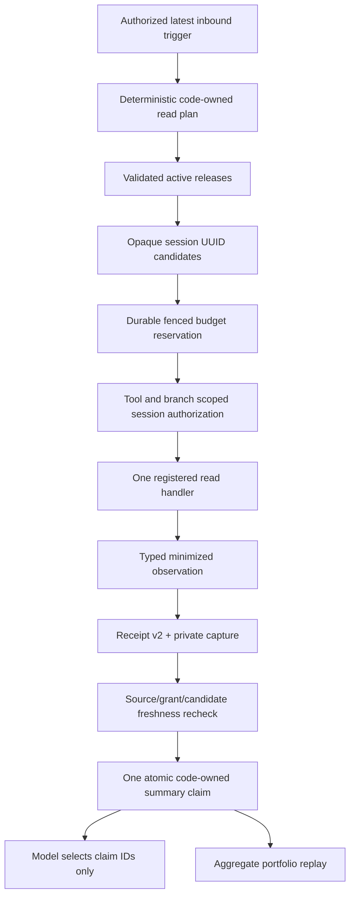

# Phase B Expanded HMS Read Portfolio

> **Quote workflow superseded 2026-09-17:** The `hms_quote_stay` OSRRAV/Room Type and Rate Availability sections below are legacy decision history. Current client-approved quote work uses Front Desk → Availability → **Hotel Availability** with applied adults/children/ages and read-only Availability Details. CRS Check Availability remains forbidden.

> **For agentic workers:** REQUIRED SUB-SKILL: use `/nava-run` with `superpowers:subagent-driven-development` to execute this plan task-by-task. Every implementation step uses TDD, per-task review, and fresh verification.

**Goal:** autonomously finish the seven fixture-verified HMS reads, prove each against the live HRCEN tenant without writes, and leave masked private trace/video evidence when safe plus independently reversible production releases.

**Architecture:** reuse the proven Phase A browser owner, request firewall, capture spool, candidate binding, and release kernel. Add action-specific gates, AI/operator-observed role-proof-v2, one narrow driver per proven surface, and one root-owned active registry that is the sole production activation authority.

**Tech stack:** TypeScript, Zod, Playwright, Vitest, Bash, PM2, AWS SSM/S3/Secrets Manager, existing Postgres run ledger.

## Global Constraints

- Production HMS is read-only; every unknown or mutation-like action aborts before transmission.
- Never run Vitest or another test runner against pilot/production RDS. DB tests require a verified disposable database.
- No credentials, private mail, guest values, addresses, or raw identifiers enter prompts, logs, SSM output, proof JSON, or terminal records.
- One serialized browser owner; each HMS call receives tool/branch-scoped authorization.
- No fake evidence, placeholder digest, fixture-only activation, or accepted implementation-gap blocker.
- Tasks 11–18 run autonomously; only observed external/safety blockers stop a tool.

---

This file is the canonical executable Phase B plan. Preserve [docs/superpowers/plans/2026-08-04-mail-read-artifact-reservation-chain.md](docs/superpowers/plans/2026-08-04-mail-read-artifact-reservation-chain.md) unchanged as Phase A/G1 evidence. New release manifests bind both plan digests; no Phase A allowlist, gate, receipt-v1, or role-proof-v1 history is rewritten.

> **Required execution directive:** use `/nava-run` task-by-task with TDD. Live production mail/RDS and HMS reads are authorized for building and validating these tools; production HMS writes remain forbidden. Do not stop at the first negative result, accept fixture success as live proof, or infer “the PMS has no data” from a bounded failed sample. For every unexpected result invoke the `ce-debug` causal-chain workflow; for every decision-critical evidence gap invoke `/95`, then official docs and Exa/independent subagents when local runtime evidence cannot settle it. Continue autonomously through research → reproduce → RCA → failing regression → minimal fix → real re-test until the tool works or a named true blocker is evidenced.

## Outcome

Target eight new production reads plus one upgrade:

1. `mail_read_artifact@2`
2. `hms_quote_stay@2.0.0`
3. `hms_list_documents@1.0.0`
4. `hms_sent_email_audit@1.0.0`
5. `hms_read_folio@1.0.0`
6. `hms_company_account_read@1.0.0`
7. `hms_group_block_read@1.0.0`
8. `hms_event_read@1.0.0`
9. Upgrade `hms_find_reservation@1.2.0`

Candidate toolset `3.x` versions describe the static `READ_TOOLS` contract schema and canonical contract fingerprint, not the currently active portfolio shape. B1–B6 remain ordered batch labels. Every independent activation increments the active registry generation and recomputes its canonical active-set fingerprint, so two different release sets never share one registry identity.

This is a target portfolio, not a tool-count promise. Each HMS tool ships independently only after exact tenant entitlement, view-only role, request manifest, no-write proof, fixture gate, live artifact, and shadow replay with its exact available denominator. Thirty-case `shadow_enabled` qualification is stronger evidence, not an activation prerequisite. Unsupported surfaces produce an explicit blocker; no hollow `manual_required` tool is promoted to satisfy count.

Boundary definitions:

- Seven new HMS tools authenticate to Infor HMS and read hotel-system facts: quote, documents, sent-email audit, folio, company account, group block, and event. They require HMS role/request/no-write evidence and browser proof.
- `mail_read_artifact` never logs into HMS. It reads an authorized inbound email PDF from mail storage, extracts bounded text in a sandbox, and may produce a private lookup candidate for `hms_find_reservation`.
- `hms_find_reservation@1.2.0` is an upgrade to the already proven HMS tool, not another new tool.
- Independent proof/release/rollback is deployment safety around every tool, not another tool.
- Measured coverage is the marginal change in materially complete drafts under frozen replay. It prevents overlapping keyword percentages from being falsely added.

## Evidence correction

- Foundation three are useful evidence, not high drafting coverage. The earlier labelled 56-thread baseline estimated only `0–5.4%` materially complete with the foundation.
- Corpus fact signals are large but overlapping: documents `42.2%`, payment/deposit/refund `38.3%`, quote/rate `35.5%`, company/agency `26.9%`, group/allotment `26.6%`, event `12.9%`. Never sum these percentages.
- Official Infor evidence is uneven:
  - `Front Desk > Tax Invoice` is the only researched list explicitly documented as display-only.
  - Sent Email is documented as a view of sent HMS emails, but attachment opening and menu path remain tenant-proof items.
  - Folio, Group Booking, and Event Reservation are mixed read/write screens.
  - Company/agency billing terms lack a verified generic read-only screen. This tool remains blocked until exact tenant fields and path are proven.
- Coverage claims come from frozen workflow replay and marginal `ΔFull`, not regex score or number of tools.

## Release subwaves

- **B0 — Portfolio truth and release kernel:** contracts, capability states, coverage denominator, structural read facades, durable budgets, CLI, per-tool manifests, compatibility, rollback.
- **B1 — Foundation:** find v1.2, artifact v2 chain, quote v2.
- **B2 — Communications:** document metadata plus sent-email audit.
- **B3 — Finance:** folio/deposit summary.
- **B4 — Account:** company/agency billing read.
- **B5 — Group/event:** aggregate group block and event summary.
- **B6 — Portfolio integration:** deterministic multi-read plans and cumulative evals.

Each tool has its own release and rollback; subwaves are ordered batches, not activation units. Do not wait for all eight to deploy already proven tools. Do not call the full Phase B portfolio complete until all eight ship or the user accepts evidence-backed blockers.

## Detailed safety boundary

- Live production HMS remains read-only. Never save, submit, create, amend, cancel, assign, post, settle, refund, transfer, void, finalize, send, resend, print, export, generate, or trigger CRS Check Availability.
- Purpose-built read-only code may access the live production mail corpus, pilot RDS, stored attachments, and HMS records needed to construct and validate exact candidates. Test runners remain forbidden against pilot RDS. Sensitive values may be processed in memory. Prompts, subagent instructions, web queries, logs, SSM output, receipts, and durable metadata retain only approved minimized fields, purpose-separated HMACs, counts, or sanitized structural fingerprints.
- Raw trace/video is sensitive ephemeral evidence, not ordinary metadata: capture-time masking is mandatory; root-only `0700` directories/`0600` files, encrypted volume/transfer, audited explicit fetch, and verified 24-hour purge apply. If masking cannot be guaranteed, omit video. Raw media never enters prompts, logs, SSM output, or handoff documents.
- Search/filter POST is allowed only after exact proof that it is query-only. Unknown request, route, popup, download, WebSocket, autosave, or DOM-triggered action aborts before transmission.
- Keep raw Playwright pages private inside runtime. Production drivers receive tool-specific facades exposing only proven operations such as `searchExactReservation` or `observeEventSummary`. No `goto`, `content`, `postForm`, `click`, `fill`, `press`, locator, arbitrary request, or page evaluation crosses that boundary.
- No Guest Stay detail. No rooming-list identities. No event contacts/notes. No PAN, VCC, last-four, bank, tax identifier, credit limit, address, phone, email address, raw attachment name, or free-text financial description reaches model, logs, receipts, or proof output.
- Tests never use pilot RDS. Before Vitest: `unset DATABASE_URL VITEST_ALLOW_PILOT_RDS`. DB suites require verified disposable `TEST_DATABASE_URL` and `CONFIRM_DISPOSABLE_TEST_DB=1`.

## Overnight Autonomous Execution Mandate

**User granted full autonomy.** No blocking questions overnight. No manual login. No hotel-admin paperwork pause. No "which approach?" pause. The AI/operator owns role-proof-v2 staging, reviewed-manifest authoring, driver implementation, empirical RCA, proof capture, deployment, rollback drill, and re-promotion.

### Communication

- Orchestrator + every subagent: **Respond `/caveman ultra`. Technical terms exact.**

### AWS / infra (use freely)

| Resource | ID / path |
|----------|-----------|
| EC2 | `i-008f737974a9ba9b3` (`af-south-1`) |
| RDS | `nava-zero-mail-pilot` (Postgres 16) |
| S3 | `nava-zero-mail-845242190536-af-south-1` |
| Repo on EC2 | `/home/ubuntu/repos/zero` |
| **Primary deploy** | `apps/server-pilot/deploy/ops-deploy.sh` (`--migrate` when schema) |
| **Primary app bounce** | `apps/server-pilot/deploy/ops-restart.sh` |
| **Primary box reboot** | `apps/server-pilot/deploy/ops-reboot.sh` |
| Guts (fallback) | `sync-ec2-git-bundle.sh`, `deploy-ec2.sh`, `ssm-run-command.sh` |

**Allowed:** ops wrappers, bundle sync, deploy, migrate (via `ops-deploy --migrate`), seed (no `--rotate` unless fix requires), read-only SSM checks, PM2 logs, health curl, tests against a disposable non-production database, purpose-built live HMS read probes, abort-first structural request capture, and root-owned operator-observed role-proof-v2 staging.

**Forbidden:** force-push main, `--no-verify`, destructive git, IT Exchange/VPN/real mail creds, any Vitest/test command pointed at pilot or production RDS, setting `VITEST_ALLOW_PILOT_RDS=1`, or sourcing `.env.production` into a test process.

### Operator-observed role-proof-v2

Phase A already allowed AI/operator-observed attestation. Phase B uses the same trust model with a stricter per-tool v2 file. Missing proof JSON is implementation work, not a human blocker.

The execution agent may stage `/etc/nava/hms-read-role-proofs/v2/<tool-id>.json` autonomously only after all checks pass:

1. HMS Secrets Manager metadata resolves to `view_only`; secret values never enter logs, prompts, SSM output, or durable evidence.
2. Authenticated HRCEN structural inventory reaches the exact approved surface.
3. Required view fields exist and all tool-specific denied controls/actions are absent or structurally unreachable.
4. Request firewall blocks mutation-looking paths, methods, fields, popups, downloads, WebSockets, service workers, cross-origin redirects, and unknown requests before transmission.
5. `actorHmacSha256` and `credentialVersionHmacSha256` use purpose-separated HMAC-SHA-256 under the runtime-only evidence key; only `privateDigestKeyVersion` persists. The key is separate from HMS credentials and never enters logs, prompts, artifacts, or SSM output.
6. `toolId`, discovery operation ID, observer source revision, protected evidence artifact ID, current Secrets Manager `AWSCURRENT` version, and runtime fingerprint bind the proof to one observed tool run.
7. `roleFingerprintSha256` binds sanitized post-login role/property structure; `evidenceSha256` binds the PII-free structural inventory; `attestationKind` is exactly `operator_observed_runtime`.
8. File is atomically installed as root-owned, regular, non-symlink, mode `0444`, with TTL at most 30 days.
9. `allowedSurfaces` covers the enabled request branch; `deniedActions` is a superset of that tool’s registry contract. Credential rotation or runtime-fingerprint drift invalidates execution and requires fresh discovery, proof, and release.

This is not an invented hotel-admin signature. Fake digests, unobserved surfaces, copied v1 claims, writable proof files, or proof creation after failed checks remain forbidden.

### Human gates

Stop only for inaccessible HMS/AWS credentials, VPN/external outage, observed non-view-only role, observed unsafe/mutating surface, destructive ambiguity, or pilot-RDS safety conflict. Missing proof files, missing manifests, fixture-only registry state, unwired CLI actions, absent drivers, failed tests, and first-pass live mismatches are agent-owned work.

### Pilot RDS safety (overrides autonomy)

Never run Vitest against `nava-zero-mail-pilot` or any production database. No overnight escape hatch exists.

Before every local or EC2 Vitest command:

```bash
unset DATABASE_URL VITEST_ALLOW_PILOT_RDS
```

If a test requires Postgres, use a disposable test database. If none exists, use read-only SQL/API health checks where they prove the requirement; otherwise report a safety blocker. Never weaken this rule to make a gate green.

### RCA loop (mandatory on any red)

FAIL → reproduce → root cause (file:line) → fix → test → commit → resume. Do not stop at first failure.

### Divergence authority

Better path to done criteria → take it. Log in handoff report.

### Done criteria

- [x] Tasks 1–10 fixture/kernel/portfolio grammar shipped with evidence
- [x] Tasks 11–18 autonomous live recovery complete (deposit unlocked 2026-08-07; Tax/Company/Group/Event remain named true blockers)
- [x] Every target HMS tool has operator-observed role-proof-v2, reviewed manifest, live driver, masked private trace and video when mask-safe, receipt v2, immutable release, rollback proof, and explicit promotion; unsupported tools have observed true blockers
- [x] Production handler set equals validated active registry; no fixture/static-evidence activation (six actives on EC2 gen 16)
- [x] Push `EC2-pilot` and deploy every green release through `ops-deploy.sh` (origin `5c0f8101+`; runtime deploy HEAD `a5a9945c` + folio release `668c7395-…`)
- [x] Final handoff links private artifact IDs and PII-free outcomes; it does not assign technical setup to the user

## Execution Mode

Autonomous overnight — no user checkpoint. REQUIRED SUB-SKILL: superpowers:subagent-driven-development. Do not ask "which approach?"

## Mandatory autonomous empirical build-debug loop

The plan is not “implement once, trust fixtures.” Every tool repeats this loop until its promotion scorecard passes or a true blocker is proven:

1. **Research before assumption:** read relevant code, matching `docs/solutions/`, current official Infor documentation, and exact tenant discovery evidence. When local evidence and docs conflict, inspect the live read response; never force reality to match the plan. External searches use no private mail, guest data, addresses, credentials, or tenant URLs.
2. **Write the failing contract first:** add or strengthen the smallest fixture/regression test for the expected positive, canonical no-match, ambiguity, malformed/schema-drift, authorization/freshness, size/time, and unsafe-action cases.
3. **Observe real behavior:** run the guarded read against a current exact candidate. Capture masked private trace/video when safe plus key-only route, request, response-envelope, and field fingerprints. Never log values; omit video if capture-time masking cannot be guaranteed.
4. **Compare assumption to observation:** verify actual transport, envelope, field aliases, search semantics, date/filter behavior, pagination, and empty-result shape. A visually plausible screen is not parser proof.
5. **On any mismatch, enter `ce-debug` RCA:** reproduce; trace valid state until it becomes invalid; list verified assumptions; form a causal chain with a falsifiable prediction for uncertain links; test one hypothesis; make one minimal fix. No shotgun changes or blind retries.
6. **Lock the learning:** the observed failure must fail a regression test before the fix and pass afterward. Add a sanitized structural fixture or key-only fingerprint and, when non-obvious, a `docs/solutions/` learning.
7. **Re-verify full path:** rerun focused tests, broader scoped gate, real positive/no-match/ambiguity probes, registered-tool proof, receipt validation, shadow replay, rollback drill, and re-promotion.
8. **Repeat:** unexplained `WAIT`, `SCHEMA_DRIFT`, wrong/empty result, partial parse, unsafe event, or coverage regression re-enters RCA. First-pass green is insufficient.

Standing autonomy for plan execution: all seven named Phase B HMS surfaces are approved discovery scope. Convergent fixes inside their narrow contracts proceed without pausing. “Opens a new surface” means a screen or action outside quote, Sent Email, Tax Invoice, Folio/Deposit Ledger, reservation-linked company billing, Group Block, or Event List. A change that widens disclosure, adds a PMS action, relaxes exact matching, or changes product semantics stops that tool and records an observed blocker; it never weakens safety to make a test green.

## Current implementation baseline and correction

Tasks 1–10 shipped fixture contracts, deterministic planning, admission, claim envelopes, registry schemas, status/doctor output, RCA dossier stubs, and the `hms_find_reservation@1.2.0` live path. They did **not** finish Phase B live delivery:

- production active-read remains `hms_find_reservation` only;
- the seven new HMS tools are `fixture_verified`; no live driver files exist;
- `phase-b-read-preflight.ts` requires discovery evidence before discovery and returns `PHASE_B_BLOCKED` after successful checks;
- `ops-hms-proof.sh` delegates read actions only to that offline preflight;
- `READ_TOOLS` contains placeholder find discovery/live digests and static promotion flags;
- the root-owned active registry exists but does not control worker handler registration;
- Phase B omitted Phase A’s explicit operator-observed clause, and the overnight handoff incorrectly converted missing agent-buildable artifacts into a human gate.

This amendment supersedes any earlier checkbox or handoff statement that counts those implementation gaps as accepted live completion. Tasks 11–18 below are the remaining executable work.

## Key technical decisions for autonomous recovery

1. **Action-specific gates, no circular discovery:** `read-discovery` needs a sealed fixture contract and safe bootstrap runtime, not a pre-existing discovery digest. `read-proof` needs current proof, exact manifest, discovery evidence, driver, and controls. `read-promote` prevalidates an immutable release and loadable handler, then performs post-activation exact-release health verification. `read-rollback` needs only active registry state; it restores the immediate predecessor or disables a first release.
2. **Per-tool operator attestation:** role proof root is `/etc/nava/hms-read-role-proofs/v2`; each HMS tool owns one file so expiry/revocation does not invalidate unrelated tools. Phase A v1 path stays unchanged. `mail_read_artifact` uses its existing grant/S3 proof path and never requires HMS role proof.
3. **Source-controlled exact request branches:** `READ_TOOLS` stores closed discovery-operation IDs, branch IDs, manifest paths, parser-schema digests, control-oracle definitions, and required role surfaces—not fabricated endpoint values. Initial discovery route-intercepts and aborts every unknown request before transmission, recording only redacted structural signatures. Transmission is authorized only by exact pre-transmission evidence: a prior same-fingerprint no-write proof, exact-version official semantics plus static client-handler mapping, or a same-version non-production no-mutation audit. Shape alone never authorizes a POST/search. The execution agent adds reviewed exact rules with tests, deploys, and retries; otherwise the branch records a named safety blocker.
4. **Active registry is sole authority:** `READ_TOOLS` owns static contracts and fixture digests. Capability/status derives from validated releases, protected artifacts, and active registry. One generated handler index keyed by `(toolId, implementationSha256)` constructs exactly the handlers named by valid active releases. Keep only current and immediate-predecessor implementations while referenced; no plugin loader or second handwritten registry.
5. **Reuse before building:** extend Phase A login, one-browser owner, request policy, capture spool, artifact index, receipt exclusivity, and proof transfer. Add one narrow driver per actually distinct surface. No universal HMS scraper, generic browser tool, second release system, or per-tool shell branch.
6. **Serialized live loop:** contracts/fixtures may run in parallel; one HMS owner serializes discovery/proof/promotion. Each tool runs observe → RCA → RED → minimal fix → proof → rollback → re-promote.
7. **Safe cutover before new promotion:** seed valid releases for `hms_find_reservation@1.2.0` and `mail_read_artifact@2`, then move worker activation to the active registry before any new tool promotes. Promotion and rollback use one transaction: prevalidate → quiesce → compare-and-swap source/registry → restart → verify exact release IDs. Failure restores source/registry, restarts, and verifies the prior set; incomplete restore exits `20` and halts the lane.
8. **Build compatibility, not whole-commit coupling:** every release binds source revision for audit, one explicit `runtimeAbiVersion`, one per-tool `implementationSha256` covering registry definition/handler/parser/transitive code and locked runtime dependencies, and one `runtimeFingerprintSha256` covering Node/Playwright/Chromium/launch policy for HMS or Poppler/bwrap/prlimit for mail artifacts. Candidate deploy refuses to orphan an active/immediate-predecessor implementation. Behavior changes add a versioned factory entry instead of replacing a referenced predecessor. Unrelated commits do not invalidate proof; implementation, runtime, manifest, credential-version, or requester-policy drift does.
9. **Durable operations:** Windows creates an operation UUID before SSM submission. EC2 owns a fenced atomic operation record. Same operation + input digest attaches/resumes; it never starts duplicate browser work or consumes a candidate twice.
10. **Private identity and disclosure:** plain SHA-256 remains for code, manifests, sanitized artifact bytes, and media. Actor, requester, candidate, scope, result, source-reference, and other private-value-derived digests use `node:crypto.createHmac` with a purpose label and key version. Sensitive claims require a server-issued, thread-bound requester authorization; HMS observations never self-declare recipient or inquiry trust.

Historical prevention case: the original live reservation tool passed fixture HTML but live OSRESS returned `pageData/GRIDRESULT` JSON; canonical no-match was `grid:null/messages:null`; empty OR fields behaved as wildcards; narrow date windows and one-shot oldest-candidate selection hid valid matches. Real-response RCA produced the JSON parser, exact unused-token filters, bounded real date window, candidate walk, and regression coverage. Every new surface must repeat that evidence-led method rather than reuse fixture assumptions.

The complete historical chain contained multiple independent assumption failures:

- DOM search field was live `ff_confirmationnumber`, not the initially assumed `confirmationnumber`.
- ExtJS search request used `COMPONENT_INFO_TYPE=DATA_ONLY`, `DATASPY_ID=1941`, `GRID_ID=1775`, and a live Dataspy filter chain—not the hard-coded `LIST_VIEW/1001` scaffold.
- Empty OR filter slots were wildcards and returned a broad grid; a failed correlation was not evidence that a candidate was absent.
- Live search returned an XHR `pageData/GRIDRESULT` envelope; fixture HTML parsing could not see its rows.
- A real no-match had a validated null-grid/null-messages envelope; other empty-looking shapes were schema drift.
- A small oldest-candidate batch and narrow date window were sampling assumptions, not proof that production mail had no matching PMS record.

## Negative-result and assumption-challenge gate

No HMS result may be classified as business `not_found`, no-candidate blocked, or “need more email data” until all gates below pass:

1. **Candidate-source truth:** freeze an immutable authorized-source snapshot. Account for every source as zero, one, multiple, truncated, unsupported, or failed; none may disappear as “ineligible.” Require seeded extractor controls plus an independently labelled live control. Prove normalization did not truncate, reformat, or choose quoted history incorrectly. Any gap is `CANDIDATE_EXTRACTION_UNVERIFIED`.
2. **Surface truth:** property, user role, menu, screen, Dataspy/view, and field names match the live tenant.
3. **Native-request differential:** for every request-shape branch capable of emitting a negative, compare safe UI-generated and deterministic-driver wire requests as ordered multimaps: method, path/query, key order and multiplicity, byte encoding, content type, required headers/tokens, cookie/session binding, fixed and candidate-derived values, operators, joiners, parentheses, request count, and trigger sequence. Key-set-only parity never passes. Values remain private or digest-compared.
4. **Response truth:** parser input is the exact body bound by request/response IDs to the certified request. Verify status, original/final route, redirect count, content type/charset, timing, body digest/length, session/property/role fingerprint, and envelope discriminator. URL-substring waits, DOM snapshots, redirects, login/permission shells, cached or pre-submit responses, and body/trace mismatch cannot certify a negative. Empty, populated, partial, timeout, and malformed shapes remain distinct.
5. **Parser conservation truth:** declared rows equal decoded rows plus explicitly rejected rows. A certified negative requires zero rejected, skipped, defaulted, or silently filtered rows. Nonempty decoded data with zero correlation is `CORRELATION_GAP` unless broad-search semantics and complete traversal are independently proven. Catch-to-empty, fallback-to-empty, unknown-alias-to-null, and fixture-only production fallback are forbidden.
6. **Scope completeness truth:** record effective filters, declared total, returned count, page/cursor, page size, cap, sort, has-more, timezone, and status/property partitions. Prove exact singleton semantics or traverse every page/partition with a snapshot-bound cursor. Unknown totals, cap hits, truncation, unvisited pages, or uncertain date/status/currency semantics yield `WINDOW_OR_PAGINATION_MISS`.
7. **Control pair:** every request branch declares one closed oracle kind (`authorized_source_artifact`, `preexisting_record`, or `independent_rendered_observation`), its autonomous acquisition operation, protected provenance, maximum age, and required build/credential/runtime/property/role/surface/branch binding. Oracle acquisition cannot call the extractor, driver, or parser under test. Label the positive before driver execution; bracket each negative batch `positive → target(s) → positive`, plus one synthetic/canonical negative. Missing or stale oracle disables that branch as `BLOCKED_NO_POSITIVE_CONTROL`; it never proves PMS absence.
8. **Candidate exhaustion truth:** proof uses bounded resumable batches and a durable cursor, but exhaustion means every source in the frozen authorized snapshot is accounted—not merely every extractor-produced candidate. Exhausting the first `9`, first `30`, oldest `250`, any single batch, or an empty extractor result is not source exhaustion.

Unexpected negatives use exhaustive internal classes:

- `CANDIDATE_EXTRACTION_UNVERIFIED`
- `UNVERIFIED_NEGATIVE`
- `REQUEST_DRIFT`
- `RESPONSE_SCHEMA_DRIFT`
- `PARSER_GAP`
- `CORRELATION_GAP`
- `WINDOW_OR_PAGINATION_MISS`
- `ROLE_OR_PROPERTY_SCOPE`
- `BLOCKED_NO_CANDIDATE_AFTER_VERIFIED_SOURCE_EXHAUSTION`
- `BLOCKED_NO_POSITIVE_CONTROL`
- `BUSINESS_NOT_FOUND` only after all gates pass

The execution agent must actively try to disprove its first explanation. Required alternative hypotheses for repeated negatives: bad candidate, wrong field, wrong screen/Dataspy, wrong request format, wildcard filter, narrow date/status window, paging cap, permission-filtered rows, unexpected response envelope, parser fallback, and correlation bug. “More data may arrive later” is a conclusion only after those alternatives are falsified.

## Research escalation inside the loop

- Start with observed live transport, code, tests, logs, and matching `docs/solutions/`.
- Use `/ce-debug` whenever behavior differs from contract, fixtures, or prior proof. Require full trigger → invalid transition → symptom causal chain before changing code.
- Use `/95` for every unresolved decision-critical claim. Track support, counterevidence, and remaining gap; search for contradiction before accepting the leading explanation.
- Use current official Infor docs next. If they do not settle the observed version/tenant behavior, run 2–3 semantically different Exa searches. Use Exa advanced or explicitly authorized Exa Agent/independent standard subagents for multi-hop gaps.
- Web and remote-agent prompts contain no private values. Local authorized read-only diagnostics may inspect the sensitive source data needed to test the claim.
- Two failed hypotheses force a mental-model reset: recapture the native request/response and re-trace boundaries instead of adding another special case.
- Every `/95` closure links the contradiction test and evidence that falsified alternatives. Confidence prose, repeated agreement, or an executing LLM’s self-attestation cannot satisfy a gate.

Minimum real-example matrix per promoted HMS tool:

- one current exact positive;
- one canonical no-match;
- one ambiguity/conflict case where the surface can produce it;
- one malformed or incomplete structural fixture;
- one stale/revoked/wrong-scope rejection;
- one unsafe-action/request denial;
- a second structurally distinct positive when available;
- one independently labelled positive plus canonical negative for every production request/parser branch. A branch lacking controls remains disabled; an evidence-gap note cannot promote it.

`mail_read_artifact` substitutes authorized PDF cases: embedded-text positive, no usable lookup candidate, encrypted/scanned unsupported, malformed, oversized/page/output/time limit, stale grant/S3 identity, and parser abort.

## Shared architecture



```typescript
type ReadToolId =
  | 'mail_read_artifact'
  | 'hms_find_reservation'
  | 'hms_quote_stay'
  | 'hms_list_documents'
  | 'hms_sent_email_audit'
  | 'hms_read_folio'
  | 'hms_company_account_read'
  | 'hms_group_block_read'
  | 'hms_event_read';

type HmsReadToolId = Exclude<ReadToolId, 'mail_read_artifact'>;

type CandidateReadPlan =
  | { kind: 'reservation'; find: true; followups: Array<'documents' | 'sent_email' | 'folio' | 'company'> }
  | { kind: 'artifact_reservation'; artifacts: number; find: true; followups: Array<'documents' | 'sent_email' | 'folio' | 'company'> }
  | { kind: 'quote'; quote: true }
  | { kind: 'group'; group: true }
  | { kind: 'event'; event: true };
```

- `READ_TOOLS` is the single static contract registry. It owns tool/version, candidate schema, operation plan, attempt caps, observation/claim schema, privacy class, renderer, TTL, source URLs, denied actions, fixture evidence, and request-branch definitions. One exhaustive handler factory covers the same closed ID union. Dynamic capability and activation come only from immutable releases plus the active registry.
- Planner parses one authored, unquoted latest-inbound segment only. Its closed Zod union chooses one branch and at most two unique deterministic followups. Model cannot request arbitrary tools.
- Find mints followup child UUIDs server-side. Each child binds session, parent evidence ID, tool, property, HMAC scope binding, requester authorization, and expiry. Group/event require exact identifier plus bounded dates; zero, multiple, conflicting, expired, cross-session, cross-thread, swapped-parent, swapped-tool, or requester-authorization mismatch abstains.
- Before every tool I/O, `reserveReadAttempt(fence, planKind, toolId)` atomically increments typed `metrics.readBudget.total/byTool` under run state, claim owner/token, branch, per-tool cap, total cap, and absolute deadline. No returned row means lease lost and no call starts. Reservations never decrement; crash/retry/reclaim retains them; terminal metrics merge and cannot overwrite `readBudget`.
- Maximum attempts: reservation `3`; artifact-reservation `6` (`3` PDF + `1` find + `2` followups); quote/group/event `1`. Before branch start, worst-case queue wait, login, navigation, reads, capture finalization, and `10 s` cleanup reserve must fit the `150 s` run deadline. Bound session waiters; reject excess with a fixed code. Keep one browser owner until measured evidence supports concurrency.
- All candidate IDs are session-owned UUIDv4 values created after private canonical dedupe. Raw lookup values never enter model prompts. Private-value-derived bindings are purpose-separated HMACs; plain hashes remain file/code integrity digests.
- `HmsReadRoleProofV2` applies only to `HmsReadToolId` and proves tool/operation/source/evidence, credential version, runtime, actor/role, property, currency, `view_only` mode, allowed surfaces, denied actions, issue/expiry, and evidence binding. Production file: root-owned, regular, non-symlink, `0444`.
- `HmsBrowserArtifactReceiptV2` is one strict `discovery | proof` union. Discovery binds structural signature, credential/runtime/source, and private capture but omits proof-only fields. Proof binds branch, role, oracle, candidate/scope/result/source HMACs, and trace/video integrity digests. Neither variant contains guest, mail, rate, account, document, or credential values.
- Closed per-tool Zod schemas replace production `data: unknown`, `value: unknown`, arbitrary tool IDs, and arbitrary claim paths. Each result maps through shared generic envelopes to one typed summary claim with `evidenceIds[]`. Disclosure gate runs before claim creation; reject extra fields. Model receives claim ID/kind/status only.
- `HmsPortfolioToolReleaseV2` is immutable and discriminates HMS from mail evidence. It binds tool/version, static toolset contract identity, source, runtime ABI/fingerprint, implementation digest, parser/request branches, credential/requester policy, role/discovery/live-proof/receipt, qualification, and predecessor. A locked root-owned active registry owns monotonic generation plus active-set fingerprint and enables/rolls back one tool without touching others; wave membership is static registry data, not another manifest.
- Phase A/G1 keeps receipt v1 and role proof v1. New captures write `receipt.v2.json`; fetch/index/purge accept exactly one valid v1 or v2 receipt and reject dual-file ambiguity. Release manifest selects role-proof schema. Retain predecessor releases.
- Extract shared session/grid parsing only after two proven surfaces share the same transport. No universal HMS scraper.

## Narrow tool contracts

### `hms_find_reservation@1.2.0`

- One exact correlated Guest Stay list row only.
- Return status, dates, guest identity, external reference, room type, and rate plan only when reviewed live aliases prove them.
- Missing columns stay null. Ambiguity returns no identity. Never open detail.

### `mail_read_artifact@2`

- Authorized inbound non-inline PDF only; `%PDF-` magic; `20 MiB`, `50` pages, `256 KiB` text, `10 s`.
- Bounded abortable S3 read plus sandboxed Poppler. No OCR.
- Extracted text remains server-only candidate material; never becomes an `attachment_fact` claim.

### `hms_quote_stay@2.0.0`

- **Historical baseline:** single `Room Type and Rate Availability` surface, one exact search, contiguous requested nights, no paging/result clicks. Current standalone quote proof uses Hotel Availability and read-only Availability Details; OSRRAV is diagnostic only.
- Return date, room type, available count, rate plan, displayed amount, currency, rate basis, restrictions, and observation time.
- Always `bookable:false`, `stayTotal:null`, `occupancyPriced:false`. Missing nightly semantics returns `manual_required`.

### `hms_sent_email_audit@1.0.0`

- Exact reservation/account-bound Sent Email search.
- Return send timestamp, type, subject class, attachment-present flag, report code, error class, and evidence time.
- Match recipient server-side; never return address or attachment filename. Never open attachment or resend.

### `hms_list_documents@1.0.0`

- Read metadata only from proven sources:
  - finalized Tax Invoice display-only list;
  - sent-document metadata observed on Sent Email.
- Return document type, status, generated/sent time, source surface, attachment-present, and `retrievable:false`.
- Do not claim a complete reservation document inventory. Confirmation/pro-forma bytes, preview, print, email, resend, or generation remain blocked until a separate exact no-side-effect retrieval path is proven.

### `hms_read_folio@1.0.0`

- Exact reservation-linked folio/deposit summary only.
- Return currency, total balance, deposit summary, due/paid/refunded/forfeited/transfer status, and observed time when exact fields are proven.
- No card/payment credentials, transaction free text, line-item export, posting, transfer, settlement, refund, void, email, print, or report execution.

### `hms_company_account_read@1.0.0`

- Exact organization/booking-agency link from a previously validated reservation only; no arbitrary company search.
- Return only proven billing mode/eligibility, approved payment-term class, contract status, and observed time.
- Do not infer bill-to, A/R eligibility, rate entitlement, credit terms, or account status from profile existence. If tenant does not expose exact view-only fields, tool does not ship.

### `hms_group_block_read@1.0.0`

- Exact group reference plus bounded date range.
- Return group status, dates, room-type/date block counts, pickup/remaining/release values only when semantics are proven, and restriction indicators.
- No delegate identities, rooming list, notes, rates, billing instructions, quick entry, room assignment, release, or save.

### `hms_event_read@1.0.0`

- Exact event confirmation/reference only.
- Return event status/type, dates, layout, attendee count, setup/teardown, approved item summary, currency/totals, linked group/account class, deposit status, and observed time only when proven.
- No contact data, notes, create/change/copy/cancel, calculate, post, BEO/pro-forma generation, print, or save.

## Task 1: Freeze portfolio truth and promotion gates

Files: [contracts.ts](apps/server-pilot/src/hms/contracts.ts), [capability-matrix.md](docs/infor-hms/capability-matrix.md), existing v1 eval compatibility readers, [analyse-centurion-pms-tools.mjs](scripts/analyse-centurion-pms-tools.mjs), plus one new `evals/hms/portfolio-cases.v3.json`.

- RED: typed registry rejects unproven production tools; every tool has exact version, closed contracts, source URLs, privacy class, denied actions, candidate requirement, caps, and promotion evidence.
- Capability state derives from present, valid evidence refs: `planned -> fixture_verified -> discovery_verified -> live_verified -> shadow_enabled`. Both `live_verified` and `shadow_enabled` releases may enter the active read registry; the latter is a stronger evidence state, not an activation prerequisite.
- Keep raw corpus private. Analyzer emits non-overlapping aggregate intent/fact memberships and opaque thread IDs only.
- Migrate the frozen 56-thread IDs, requirements, adjudicated labels, and ablation expectations into one case file without message text. Placeholder labels do not score. Until labels are complete, report raw eligible/attempted/exact/partial/manual counts only.
- Add ablation replay: baseline, then each tool in release order. Report numerator, denominator, `ΔFull`, and one-sided 95% interval only at `n>=30`; never pre-credit unbuilt tools.

## Task 1B: Build read-only and operator release kernel

Files: [runtime.ts](apps/server-pilot/src/hms/runtime.ts), [run-ledger.ts](apps/server-pilot/src/ai/run-ledger.ts), [draft-evidence.ts](apps/server-pilot/src/ai/draft-evidence.ts), [production-boundary.ts](apps/server-pilot/src/hms/production-boundary.ts), browser artifact/fetch/purge modules, [ops-hms-proof.sh](apps/server-pilot/deploy/ops-hms-proof.sh), [hms-read-gate.sh](apps/server-pilot/deploy/hms-read-gate.sh), deploy tests, and new portfolio operator runbook.

- Refactor find through a tool-specific facade first. Add syntax-aware import/API tests plus abort-before-transmission fixtures. No new live driver starts until low-level browser methods are unreachable from production driver modules.
- Implement atomic `reserveReadAttempt`, candidate parent/child graph, typed claim envelopes, deadline admission, bounded semaphore queue, and metrics-merge tests: concurrent owners, stale token, crash after reservation, reclaim, exhausted branch, terminal merge, cross-session child, changed thread/grant, expired child.
- Implement per-tool release manifests, static wave membership, atomic active registry, immediate-predecessor retention, v1/v2 receipt and role-proof compatibility, protected artifact index, idempotent promotion/rollback/resume, and interrupted-activation tests.
- `read-wave` quiesces the HMS lane, rejects nonterminal runs, proves tools, and never implicitly promotes. `read-promote` prevalidates loadability, atomically activates one tool, restarts, then verifies exact handler/release IDs; any failure restores and verifies the prior set. Upgrade rollback selects the retained immediate predecessor; first-release rollback disables the tool; shared-runtime failure rolls back the source/registry pair.
- Build runbook golden path from Windows Git Bash in a repo path containing spaces and Linux Bash on EC2. Raw SSM commands live in debug appendix.
- Add a reusable RCA dossier format per tool: symptom, real structural observation, assumptions verified/invalidated, causal chain, prediction, failing test, minimal fix, verification commands, live artifact IDs, and unresolved gaps. Dossiers contain no private values.
- Add a native-request differential report and negative-result certificate to every HMS dossier. Promotion tooling rejects `not_found`/`WAIT` evidence lacking all eight assumption-challenge gates.
- **Negative quarantine:** parsers and drivers emit only `UNVERIFIED_NEGATIVE`. Only `validateNegativeResultCertificate` may construct `BUSINESS_NOT_FOUND`, no-candidate blocked status, receipt terminal state, or model-visible negative claim. Missing, unknown, stale, or failed evidence returns its specific diagnostic class. Import-boundary tests prove no parser, driver, worker, proof CLI, or alternate branch can bypass this validator.
- Define `NegativeResultCertificateV1` as a closed schema containing verifier version plus immutable evidence IDs/digests for all eight gates—no free-form pass booleans. Independent gate code recomputes invariants from private artifacts; the function under test cannot produce and verify its own evidence.

## Task 2: Upgrade exact reservation list evidence

Files: [live-guest-stay-driver.ts](apps/server-pilot/src/hms/live-guest-stay-driver.ts), [adapter.ts](apps/server-pilot/src/hms/adapter.ts), [draft-evidence.ts](apps/server-pilot/src/ai/draft-evidence.ts), [candidate-draft-agent.ts](apps/server-pilot/src/ai/candidate-draft-agent.ts), matching tests, and new key-only `live-guest-stay-row-fingerprint.v2.json`.

- RED: one correlated row; reviewed aliases only; key names captured without values; lookalikes rejected; absent room/rate null; no detail route/request/click; driver cannot import raw `HmsPage`.
- Extend one atomic reservation-summary claim. No split-field cherry-picking.
- Set `HMS_FIND_RESERVATION_TOOL_VERSION='1.2.0'`; produce fresh registered-tool masked trace/video when safe.

## Task 3: Harden artifact v2 and durable artifact-to-find chain

Files: [read-artifact.ts](apps/server-pilot/src/mail/artifacts/read-artifact.ts), [s3.ts](apps/server-pilot/src/storage/s3.ts), [run-ledger.ts](apps/server-pilot/src/ai/run-ledger.ts), [thread-context.ts](apps/server-pilot/src/ai/thread-context.ts), [worker.ts](apps/server-pilot/src/ai/worker.ts), [reservation-candidate-session.ts](apps/server-pilot/src/hms/reservation-candidate-session.ts), [mail-artifact-backtest.ts](apps/server-pilot/src/ops/mail-artifact-backtest.ts), and matching tests.

- RED: authorization/grant/S3 identity drift, PDF bounds, abort propagation, parser failure, max three PDFs, exact-candidate dedupe, zero/multiple lookup candidates, atomic concurrent budget, stale fence, crash/retry/reclaim consumption, terminal metrics merge.
- Snapshot authorization before and after extraction. Extracted text never reaches model/logs.
- Set `MAIL_READ_ARTIFACT_TOOL_VERSION='2'`; keep aggregate backtest private and PII-free.

## Task 4: Ship quote v2

Create contract and fixtures first. Run abort-first tenant discovery and freeze role/request/evidence digests. Only then create [live-quote-stay-driver.ts](apps/server-pilot/src/hms/live-quote-stay-driver.ts), its tests, and key-only live evidence.

- RED candidate parser: one authored segment; explicit unambiguous dates/occupancy; strict bounds; conflict/multiple tuple abstention.
- RED driver: one surface/search; complete requested-night schedule; exact currency/basis/restrictions; no click/paging/CRS route.
- Role proof v2 and discovery must attest exact route/request/date horizon and zero unsafe events.
- Produce one atomic quote evidence pack with mandatory caveat and fresh registered-tool masked trace/video when safe.

## Task 5: Add communications reads

Create contracts/fixtures first, then run separate abort-first Sent Email and Tax Invoice tenant discovery. Only proven paths get focused drivers/tests. Share immutable session/grid helpers only where observed envelopes match.

- RED `hms_sent_email_audit`: exact scope, redacted recipient, bounded rows/time/bytes, no attachment open, no resend, no raw subject/address leakage.
- RED `hms_list_documents`: explicit source class, finalized-invoice metadata, sent-attachment metadata, `retrievable:false`, no inference of unsent/current artifacts.
- Register separate closed contracts and claim mappers in shared candidate/claim/receipt/release machinery despite shared internals.
- Promotion requires tenant menu/route discovery and zero unsafe counters. Metadata-only tools receive Partial—not Full document-delivery credit.

## Task 6: Add redacted folio/deposit summary

Create closed contract, privacy policy, and fixtures first. Run abort-first Folio/Deposit Ledger discovery; only then create `live-folio-read-driver.ts` and parser tests for proven fields.

- RED: reservation binding, finance-role requirement, VVIP/incognito masking, currency/total consistency, stale source, PCI/VCC/card/transaction-text redaction, row/byte/time caps.
- Prefer display/list observations. No Advance Deposit form, report execution, email/print, or transaction actions.
- Claims are recipient-class gated. Existing balance/deposit status can earn Full only for a labelled narrow status inquiry; refund/settlement/invoice requests remain Partial.

## Task 7: Discover then add company/agency billing read

Create contract/fixtures first; do not create a production driver until exact tenant evidence exists.

- RED: candidate must originate from exact reservation link; arbitrary/fuzzy profile search rejected; account identifiers/contact/credit data suppressed.
- Discovery must identify exact view-only fields for billing mode/terms and prove opening them does not autosave.
- Booking-agency contract availability fields are not billing terms. Do not substitute them.
- If evidence is absent, record `BLOCKED_COMPANY_READ_SURFACE_UNPROVEN` and stop this subwave. Other subwaves continue.

## Task 8: Add aggregate group-block read

Create aggregate contract/fixtures, run abort-first tenant discovery, and freeze proven semantics first. Only then create `live-group-block-driver.ts` and parser tests.

- RED: exact group reference; bounded dates; CON/BLK/pickup/remaining semantics individually proven; restriction parsing; no rooming-list identity; no edit focus/input/change/blur.
- Production facade can open/search/observe only. Block tab direct-entry, Quick Entry, Save, assignment, and document tabs are structurally absent.
- Existing group-status queries may earn Full; create/amend/allocation-action requests remain Partial.

## Task 9: Add event-summary read

Create minimized contract/fixtures and run list-only tenant discovery first. Only then create `live-event-read-driver.ts` and parser tests for a proven inert path.

- RED: exact event reference; status/date/count/total consistency; private fields absent; no double-click/detail path until no-write proof; no calculate/post/copy/cancel/print/save.
- If list rows lack required summary and detail navigation cannot be proven inert, record `BLOCKED_EVENT_READ_SURFACE_UNPROVEN`.
- Existing event-status queries may earn Full; quote/create/amend/BEO/pro-forma workflows remain Partial.

## Task 10: Integrate portfolio plans and cumulative evals

Files: [hms-shadow.ts](apps/server-pilot/src/ai/hms-shadow.ts), [worker.ts](apps/server-pilot/src/ai/worker.ts), candidate planner, registry-derived eval command, and cumulative runbook sections.

- Integrate closed `CandidateReadPlan`; max two reservation followups; no model-driven loops.
- Emit one typed workflow summary claim with evidence IDs; model selects whole claim IDs only.
- Run cumulative ablation and load/capacity replay across currently promoted releases. Never couple a proven tool to blocked company/group/event surfaces.
- Run per-task correctness review, ponytail simplicity review, and final CE code review before each live promotion.

## Task 11: Restore autonomous attestation and action-specific gates

**Files:**

- Modify: `apps/server-pilot/src/hms/contracts.ts`
- Modify: `apps/server-pilot/src/hms/read-tools.ts`
- Modify: `apps/server-pilot/src/hms/release-kernel.ts`
- Modify: `apps/server-pilot/src/hms/request-policy.ts`
- Modify: `apps/server-pilot/src/hms/negative-result.ts`
- Create: `apps/server-pilot/src/hms/private-digests.ts`
- Create: `apps/server-pilot/src/hms/requester-authorization.ts`
- Modify: `apps/server-pilot/src/hms/runtime.ts`
- Modify: `apps/server-pilot/src/hms/production-runtime.ts`
- Modify: `apps/server-pilot/src/hms/browser-artifacts.ts`
- Modify: `apps/server-pilot/src/hms/claim-envelope.ts`
- Modify: `apps/server-pilot/src/hms/production-boundary.ts`
- Modify: `apps/server-pilot/src/ai/draft-evidence.ts`
- Modify: `apps/server-pilot/src/ai/worker.ts`
- Modify: `apps/server-pilot/src/ops/hms-live-proof.ts`
- Modify: `apps/server-pilot/src/ops/phase-b-read-preflight.ts`
- Modify: `apps/server-pilot/src/ops/phase-b-status.ts`
- Modify: `apps/server-pilot/src/ops/phase-b-doctor.ts`
- Modify: `apps/server-pilot/src/env.ts`
- Create: `apps/server-pilot/deploy/vendor/asm-exec`
- Create: `apps/server-pilot/deploy/provision-hms-evidence-key.sh`
- Modify: `apps/server-pilot/deploy/install-hms-browser.sh`
- Modify: `apps/server-pilot/deploy/write-ec2-env.sh`
- Modify: `apps/server-pilot/deploy/pm2.config.cjs`
- Modify: `apps/server-pilot/deploy/aws-resources.md`
- Test: `apps/server-pilot/tests/hms-request-policy.test.ts`
- Test: `apps/server-pilot/tests/hms-negative-result.test.ts`
- Create: `apps/server-pilot/tests/hms-private-digests.test.ts`
- Create: `apps/server-pilot/tests/hms-requester-authorization.test.ts`
- Test: `apps/server-pilot/tests/hms-runtime.test.ts`
- Test: `apps/server-pilot/tests/hms-browser-artifacts.test.ts`
- Test: `apps/server-pilot/tests/hms-claim-envelope.test.ts`
- Test: `apps/server-pilot/tests/hms-production-boundary.test.ts`
- Test: `apps/server-pilot/tests/hms-live-proof.test.ts`
- Test: `apps/server-pilot/tests/ai-worker-contract.test.ts`
- Test: `apps/server-pilot/tests/hms-portfolio-release.test.ts`
- Test: `apps/server-pilot/tests/phase-b-read-preflight.test.ts`
- Test: `apps/server-pilot/tests/phase-b-status.test.ts`
- Test: `apps/server-pilot/tests/phase-b-doctor.test.ts`
- Test: `apps/server-pilot/tests/deploy-config.test.ts`

**Interfaces:**

```typescript
type RoleSurfaceId =
  | 'guest_stay'
  | 'room_type_rate_availability'
  | 'sent_email'
  | 'tax_invoice'
  | 'folio'
  | 'deposit_ledger'
  | 'company_account_billing'
  | 'group_block'
  | 'event_list';

type DiscoveryOperationId =
  | 'guest_stay_search'
  | 'quote_availability_search'
  | 'sent_email_list'
  | 'tax_invoice_list'
  | 'folio_summary'
  | 'deposit_ledger_summary'
  | 'reservation_linked_company_billing'
  | 'group_block_list'
  | 'event_list';

type ControlOracleDefinition = {
  kind: 'authorized_source_artifact' | 'preexisting_record' | 'independent_rendered_observation';
  acquisitionOperationId: DiscoveryOperationId;
  maxAgeMs: number;
};

type HmsReadRoleProofV2 = {
  schemaVersion: 2;
  attestationKind: 'operator_observed_runtime';
  toolId: HmsReadToolId;
  discoveryOperationId: DiscoveryOperationId;
  operationId: string;
  observerSourceRevision: string;
  evidenceArtifactId: string;
  privateDigestKeyVersion: string;
  actorHmacSha256: string;
  credentialVersionHmacSha256: string;
  runtimeFingerprintSha256: string;
  roleFingerprintSha256: string;
  propertyCode: 'HRCEN';
  currency: 'ZAR';
  credentialMode: 'view_only';
  allowedSurfaces: RoleSurfaceId[];
  deniedActions: string[];
  issuedAt: string;
  expiresAt: string;
  evidenceSha256: string;
};

type RequestBranchDefinition = {
  id: string;
  discoveryOperationId: DiscoveryOperationId;
  manifestPath: string;
  requiredRoleSurfaces: readonly RoleSurfaceId[];
  parserSchemaSha256: string;
  requiredControlKinds: readonly ('positive' | 'canonical_negative' | 'ambiguity')[];
  controlOracle: ControlOracleDefinition;
};

type TrustedRequesterAuthorizationV1 = {
  schemaVersion: 1;
  authorizationId: string;
  operationId: string;
  mailboxGrantSha256: string;
  threadIdHmacSha256: string;
  threadStateVersion: string;
  requesterIdentityHmacSha256: string;
  requesterClass:
    | 'reservation_guest'
    | 'authorized_booking_contact'
    | 'internal_finance'
    | 'third_party'
    | 'unknown';
  inquiryClass:
    | 'labelled_narrow_status'
    | 'refund_request'
    | 'settlement_request'
    | 'invoice_request'
    | 'quote_request'
    | 'document_request'
    | 'group_status_request'
    | 'event_status_request'
    | 'other';
  allowedClaimKinds: readonly (
    | 'reservation_summary'
    | 'quote'
    | 'document_metadata'
    | 'sent_email_audit'
    | 'folio_status'
    | 'company_billing'
    | 'group_status'
    | 'event_status'
  )[];
  privateDigestKeyVersion: string;
  issuedAt: string;
  expiresAt: string;
};

type HmsArtifactReceiptCommonV2 = {
  schemaVersion: 2;
  artifactId: string;
  operationId: string;
  toolId: HmsReadToolId;
  discoveryOperationId: DiscoveryOperationId;
  toolVersion: string;
  sourceRevision: string;
  credentialVersionHmacSha256: string;
  runtimeFingerprintSha256: string;
  privateDigestKeyVersion: string;
  traceSha256: string;
  videoSha256: string | null;
  operationOutcome:
    | 'succeeded'
    | 'unverified_negative'
    | 'failed'
    | 'timed_out'
    | 'aborted'
    | 'policy_blocked';
  expiresAt: string;
};

type HmsBrowserArtifactReceiptV2 =
  | (HmsArtifactReceiptCommonV2 & {
      executionClass: 'discovery';
      structuralSignatureSha256: string;
      candidateSnapshotSha256: string | null;
    })
  | (HmsArtifactReceiptCommonV2 & {
      executionClass: 'proof';
      requestBranchId: string;
      candidateSnapshotSha256: string;
      candidateHmacSha256: string;
      scopeHmacSha256: string;
      resultHmacSha256: string;
      sourceRefHmacSha256: string;
      roleProofSha256: string;
      discoveryReceiptSha256: string;
      oracleArtifactSha256: string;
    });

type HmsEvidenceBindingV1 = {
  toolId: HmsReadToolId;
  toolVersion: string;
  operationId: string;
  discoveryOperationId: DiscoveryOperationId;
  candidateSnapshotSha256: string;
  propertyCode: 'HRCEN';
  credentialVersionHmacSha256: string;
  runtimeFingerprintSha256: string;
  privateDigestKeyVersion: string;
  roleProofSha256: string;
  requestBranchId: string;
  sourceRevision: string;
  verifierVersion: string;
};

type HmsPortfolioToolReleaseBaseV2 = {
  schemaVersion: 2;
  releaseId: string;
  toolId: ReadToolId;
  toolVersion: string;
  toolsetVersion: string;
  toolsetFingerprint: string;
  sourceRevision: string;
  phaseAPlanSha256: string;
  phaseBPlanSha256: string;
  gateSha256: string;
  runtimeAbiVersion: string;
  runtimeFingerprintSha256: string;
  implementationSha256: string;
  requesterPolicySha256: string;
  privateDigestKeyVersion: string;
  liveProofSha256: string;
  receiptSha256: string;
  rollbackAction: 'restore_predecessor' | 'disable';
};

type ReleaseQualification =
  | {
      qualification: 'live_verified';
      shadowSha256: null;
      predecessorReleaseId: string | null;
    }
  | {
      qualification: 'shadow_enabled';
      shadowSha256: string;
      predecessorReleaseId: string;
    };

type HmsPortfolioToolReleaseV2 = HmsPortfolioToolReleaseBaseV2 &
  ReleaseQualification &
  (
    | {
        evidenceKind: 'hms';
        toolId: HmsReadToolId;
        requestBranches: Array<{
          id: string;
          discoveryOperationId: DiscoveryOperationId;
          manifestSha256: string;
          discoverySha256: string;
          parserSchemaSha256: string;
        }>;
        credentialVersionHmacSha256: string;
        roleProofSha256: string;
      }
    | {
        evidenceKind: 'mail';
        toolId: 'mail_read_artifact';
        toolVersion: '2';
        grantPolicySha256: string;
        s3IdentitySha256: string;
        parserSandboxSha256: string;
      }
  );

function roleProofV2Path(root: string, toolId: HmsReadToolId): string;
function validateRoleProofV2ForTool(
  proof: HmsReadRoleProofV2,
  tool: ReadToolDefinition,
  now: Date,
): void;
```

`ReadToolDefinition` gains closed `discoveryOperationIds` and `requestBranches`; `mail_read_artifact` has neither and cannot enter any HMS proof/browser type. One operator interprets the closed discovery union—no selector/URL/browser DSL reaches the CLI. Phase B request rules gain required content type, required header HMACs, ordered query key sequence, and ordered body key sequence; production proof rejects key order or multiplicity drift.

`PhaseBPreflightResult` remains the one action-gate type; make it table-driven with ready codes `DISCOVERY_READY|PROOF_READY|PROMOTE_READY|ROLLBACK_READY`. Do not create a parallel gate hierarchy.

`HmsEvidenceBindingV1` is the shared binding extracted from receipt v2, not a second evidence source. `NegativeResultCertificateV1` carries it; every referenced artifact must match it. `validateNegativeResultCertificate` recomputes canonical certificate SHA-256 internally and is the sole adapter to receipt/model/business `not_found`.

Do not add another generic result envelope. Live observers map existing per-tool `*KernelResult` values into existing `ToolResult<T>`; negative certification is the only path from `unverified_negative` to `not_found`.

`TrustedRequesterAuthorizationV1` is issued from the authorized mailbox grant plus current thread/transport identity before candidate planning. It is passed separately to claim mappers; observations cannot set requester or inquiry trust. Missing, stale, cross-thread, forwarded/spoofed, forged, or claim-kind-mismatched authorization produces no sensitive claim. `third_party|unknown` stays blocked where the existing contract requires a trusted guest/contact/finance recipient.

- [ ] **Step 1: Write RED tests for the trust model and action matrix**

  Add cases proving: v2 requires `operator_observed_runtime`; TTL is `>0` and `<=30d`; private-value digests use purpose-separated HMAC plus key version while code/file digests remain SHA-256; proof binds tool/discovery-operation/operation/source/evidence/credential/runtime/role and covers exact branch surfaces/actions; same-tool cross-operation swaps fail; credential rotation/runtime drift invalidates execution; writable/symlink/non-root files fail; discovery receipt omits proof-only fields; proof requires proof + enabled branch manifest + matching discovery operation + discovery receipt + independent oracle; mail cannot enter HMS schemas; patched `asm-exec` replaces itself with the child and PM2 SIGTERM leaves no descendant; `live_verified` and `shadow_enabled` may activate; qualification/predecessor/rollback-action invariants hold; rollback ignores expired/missing live evidence.

  Add certificate tests for schema-ordered canonical digest recomputation, including key-order permutations; common tool/version/operation/snapshot/property/role/branch/source/verifier binding; duplicate/missing/cross-run evidence rejection; and sole-path conversion to business `not_found`.

  Add requester tests proving authorization is server-issued from current mailbox/thread state, HMS observations cannot self-assert trust, and stale/cross-thread/spoofed/unknown or claim-kind mismatch produces no sensitive claim. Add import-boundary tests proving parser, driver, proof CLI, receipt builder, claim mapper, and worker cannot construct business `not_found` except through the branded validator.

- [ ] **Step 2: Run RED**

  ```bash
  cd apps/server-pilot
  unset DATABASE_URL VITEST_ALLOW_PILOT_RDS
  pnpm exec vitest run \
    tests/hms-request-policy.test.ts \
    tests/hms-negative-result.test.ts \
    tests/hms-private-digests.test.ts \
    tests/hms-requester-authorization.test.ts \
    tests/hms-private-digests.test.ts \
    tests/hms-requester-authorization.test.ts \
    tests/hms-runtime.test.ts \
    tests/hms-browser-artifacts.test.ts \
    tests/hms-claim-envelope.test.ts \
    tests/hms-production-boundary.test.ts \
    tests/hms-live-proof.test.ts \
    tests/ai-worker-contract.test.ts \
    tests/hms-portfolio-release.test.ts \
    tests/phase-b-read-preflight.test.ts \
    tests/phase-b-status.test.ts \
    tests/phase-b-doctor.test.ts \
    tests/deploy-config.test.ts
  ```

  Expected: FAIL because v2 lacks credential/runtime/HMAC binding, discovery/proof receipts are not discriminated, requester trust is caller-supplied, release v1 requires sentinel evidence, negative certificates trust caller digest, and preflight is circular.

- [ ] **Step 3: Implement the minimal schemas and gates**

  Move v1/v2 role schemas and loaders into `release-kernel.ts` so `production-runtime.ts` consumes them without reverse imports. Add strict HMS discovery/proof receipt and HMS/mail release unions. Keep v1 readers for existing artifacts. Keep `READ_TOOLS` as static contract + fixture evidence; remove placeholder `222…`/`333…` find digests. Make status/doctor consume an explicit release/capability snapshot instead of treating source constants as production activation.

  Add locked compare-and-swap registry writes using the existing `/opt/nava/releases/.publish.lock` pattern, generation checks, file fsync, directory fsync, immutable release-file create, and root ownership verification.

  Add runtime config `HMS_EVIDENCE_HMAC_SECRET_ARN`, `HMS_EVIDENCE_HMAC_KEY_VERSION`, and child-only `HMS_EVIDENCE_HMAC_KEY`. `provision-hms-evidence-key.sh` runs from the authorized operator host, sets `umask 077`, generates one base64-encoded 32-byte key into a `0600` temporary file, creates `nava-zero/server-pilot/hms-evidence-hmac` from that file, removes the file via `trap`, and prints only ARN/version metadata. Existing-secret flow uses `describe-secret` metadata only; it never calls `get-secret-value` or echoes a secret.

  Vendor the AWS Secrets Manager skill’s `asm-exec` reference as `deploy/vendor/asm-exec` with one lifecycle patch: after resolving arguments, replace `subprocess.run` with `os.execvpe(args[0], args, os.environ.copy())` so PM2 owns the Node PID and SIGTERM cannot orphan a child. Pin patched SHA-256 `5f0c7f82827fe4eb89db0ba177aec694cd4cbf3acff003b09d1b545ea8595b7f` and install it root-owned `0755` at `/usr/local/bin/asm-exec`. Extend `NavaZeroSecretsRead` only with `secretsmanager:GetSecretValue|DescribeSecret` on `arn:aws:secretsmanager:af-south-1:845242190536:secret:nava-zero/server-pilot/hms-evidence-hmac-*`; no wildcard account/resource and no IAM pass-role.

  Windows Git Bash owns idempotent create/describe/IAM update and SSM transport. SSM atomically writes only ARN/version metadata to `/etc/nava/hms-evidence-hmac.env`; EC2 owns `asm-exec` resolution and runtime use. PM2 starts `hms-ai-worker` as `/usr/local/bin/asm-exec -- /usr/bin/env HMS_EVIDENCE_HMAC_KEY={{resolve:secretsmanager:nava-zero/server-pilot/hms-evidence-hmac}} /usr/bin/node dist/ai/worker.js`; the dynamic reference is a command argument because the pinned wrapper resolves arguments before `/usr/bin/env` creates the child-only variable. PM2/config/artifacts store only that reference, ARN, and `VersionId`. Runtime uses `node:crypto.createHmac`, no custom key service. Derive `credentialVersionHmacSha256` from the HMS secret ARN + current SDK-returned `VersionId`; never persist either raw input. Revalidate `AWSCURRENT`, evidence-key version, runtime fingerprint, requester authorization, and thread state before each context/claim. Canonicalize certificate hashes by hashing the Zod-parsed object in schema field order. Route every receipt/claim/terminal/model negative through the branded validator. All other modules may emit only `unverified_negative` plus a diagnostic.

  Keep the existing Poppler/bubblewrap/prlimit isolation; bind its toolchain/policy fingerprint into mail releases and add regression coverage. Do not add a second sandbox or container layer.

- [ ] **Step 4: Run GREEN and build**

  ```bash
  cd apps/server-pilot
  unset DATABASE_URL VITEST_ALLOW_PILOT_RDS
  pnpm exec vitest run \
    tests/hms-request-policy.test.ts \
    tests/hms-negative-result.test.ts \
    tests/hms-private-digests.test.ts \
    tests/hms-requester-authorization.test.ts \
    tests/hms-runtime.test.ts \
    tests/hms-browser-artifacts.test.ts \
    tests/hms-claim-envelope.test.ts \
    tests/hms-production-boundary.test.ts \
    tests/hms-live-proof.test.ts \
    tests/ai-worker-contract.test.ts \
    tests/hms-portfolio-release.test.ts \
    tests/phase-b-read-preflight.test.ts \
    tests/phase-b-status.test.ts \
    tests/phase-b-doctor.test.ts \
    tests/deploy-config.test.ts
  pnpm build
  bash -n deploy/provision-hms-evidence-key.sh
  printf '%s  %s\n' \
    5f0c7f82827fe4eb89db0ba177aec694cd4cbf3acff003b09d1b545ea8595b7f \
    deploy/vendor/asm-exec | sha256sum -c -
  ```

  Expected: all selected suites pass; build and shell syntax exit `0`; tests perform no AWS/secret read; no placeholder evidence digest remains.

- [ ] **Step 5: Review and commit**

  Run per-task correctness review plus `ponytail-review`. Commit only Task 11 files with message `feat(hms): restore autonomous Phase B evidence gates`.

- [ ] **Step 6: Provision and verify the evidence-key bootstrap before live-operator work**

  Push the Task 11 commit, deploy it through `apps/server-pilot/deploy/ops-deploy.sh`, then run:

  ```bash
  bash apps/server-pilot/deploy/provision-hms-evidence-key.sh \
    --region af-south-1 \
    --instance i-008f737974a9ba9b3 \
    --secret-name nava-zero/server-pilot/hms-evidence-hmac \
    --asm-exec-sha256 5f0c7f82827fe4eb89db0ba177aec694cd4cbf3acff003b09d1b545ea8595b7f \
    --json
  bash apps/server-pilot/deploy/ops-hms-proof.sh doctor \
    --tool hms_find_reservation \
    --action read-discovery \
    --json
  ```

  Expected: provisioning emits one PII-free JSON object with `secretMetadataReady:true`, `instanceMetadataInstalled:true`, and `asmExecPinned:true`; it never emits key bytes. Scoped doctor verifies EC2 metadata plus an `asm-exec` fixed-sentinel child probe, performs no HMS browser action, and exits `0`. Any IAM/SSM failure is returned as an agent-owned setup failure unless access itself is denied.

## Task 12: Wire one registry-driven live operator

**Files:**

- Create: `apps/server-pilot/src/ops/phase-b-operation.ts`
- Create: `apps/server-pilot/tests/phase-b-operation.test.ts`
- Create: `apps/server-pilot/tests/phase-b-ops-contract.test.ts`
- Create on observed evidence: `apps/server-pilot/src/hms/request-manifests/<tool-id>.<branch-id>.<version>.json`
- Modify: `apps/server-pilot/src/ops/hms-live-proof.ts`
- Modify: `apps/server-pilot/src/hms/browser-artifacts.ts`
- Modify: `apps/server-pilot/src/hms/artifact-index.ts`
- Modify: `apps/server-pilot/src/hms/receipt-exclusivity.ts`
- Modify: `apps/server-pilot/deploy/ops-hms-proof.sh`
- Modify: `apps/server-pilot/deploy/hms-read-gate.sh`
- Modify: `apps/server-pilot/tests/hms-live-proof.test.ts`
- Modify: `apps/server-pilot/tests/deploy-config.test.ts`
- Modify: `docs/infor-hms/phase-b-read-portfolio-operator-runbook.md`

**Interfaces:**

```typescript
type PhaseBOperationStage =
  | 'created'
  | 'preflight'
  | 'candidate_snapshot'
  | 'browser'
  | 'receipt'
  | 'release'
  | 'terminal';

type PhaseBOperationV1 = {
  schemaVersion: 1;
  operationId: string;
  supersedesOperationId: string | null;
  action: PhaseBReadAction | 'read-wave' | 'rearm';
  target:
    | { toolId: ReadToolId }
    | { waveId: PhaseBWaveId; toolIds: readonly ReadToolId[] };
  sourceRevision: string;
  inputSha256: string;
  candidateSnapshotArtifactId: string | null;
  candidateSnapshotSha256: string | null;
  cursor: number;
  stage: PhaseBOperationStage;
  leaseEpoch: number;
  lastCode: string;
  createdAt: string;
  updatedAt: string;
};

type CandidateSnapshotV1 = {
  schemaVersion: 1;
  operationId: string;
  authorizedSourceSnapshotSha256: string;
  extractorVersion: string;
  privateDigestKeyVersion: string;
  credentialVersionHmacSha256: string;
  runtimeFingerprintSha256: string;
  sources: Array<{
    privateSourceRefId: string;
    ordinal: number;
    status: 'zero' | 'one' | 'multiple' | 'truncated' | 'unsupported' | 'failed';
    candidateIds: string[];
  }>;
  candidates: Array<{
    candidateId: string;
    sourceOrdinal: number;
    kind: string;
    canonicalValueHmacSha256: string;
  }>;
  createdAt: string;
};

type PhaseBOperatorResult = {
  schemaVersion: 1;
  outcome: 'ok' | 'wait' | 'fail';
  action: string;
  stage: string;
  code: string;
  exitCode: 0 | 2 | 3 | 10 | 20 | 70;
  blockingOwner: 'none' | 'agent' | 'external' | 'safety';
  retryMode: 'none' | 'same_operation' | 'after_source_change' | 'after_external_recovery';
  operationId: string | null;
  sourceRevision: string;
  toolId: ReadToolId | null;
  waveId: PhaseBWaveId | null;
  artifactIds: string[];
  releaseId: string | null;
  elapsedMs: number;
  nextCommand: string | null;
  docsAnchor: string;
};
```

Windows Git Bash owns operation-ID generation and SSM transport only. One TypeScript command parser validates Phase B argv locally before AWS and parses the canonical command envelope remotely. EC2 immutable release owns browser execution, operation lock/ledger, role proofs, artifact index, release files, and active registry. Every remote action binds AWS account, region, instance, source revision, and operation ID. Public flow requires no proof-path or manifest-path environment variables.

`hms-live-proof.ts` remains the sole TypeScript proof operator. Extract only the atomic operation store into `phase-b-operation.ts`; do not create a second proof CLI. Discovery uses the receipt-v2 `executionClass:'discovery'` branch with structural-signature, credential/runtime, and protected-artifact bindings; proof-only fields are absent rather than null/sentinel.

The Bash front door passes Phase B argv through that shared local parser, then delegates one canonical envelope. It has no second Phase B `case` grammar or per-tool behavior. Discovery interprets only the registry’s closed `DiscoveryOperationId` union through proven Phase A login/chrome rules; CLI input cannot supply URL, selector, method, body, or arbitrary action. Route interception aborts every unknown request before transmission and records only redacted structural signatures.

An observed signature becomes a manifest rule only when `preTransmissionEvidence` records one allowed source: prior same-property/role/runtime/credential-fingerprint no-write proof, exact deployed-version official semantics plus static client-handler mapping, or same-version non-production no-mutation audit. Method/path/field shape alone never proves read-only semantics. The execution agent adds one exact rule + regression, deploys, then uses scoped `rearm` to create a successor operation bound to the new source. Missing evidence returns `BLOCKED_REQUEST_SEMANTICS_UNPROVEN`; unknown rules are never auto-approved or transmitted.

The same operator acquires the branch-declared control oracle without calling the extractor/driver/parser under test, seals provenance/freshness, and binds it to build, credential, runtime, property, role, surface, branch, candidate kind, and envelope class. Missing control returns `BLOCKED_NO_POSITIVE_CONTROL`.

Terminal ownership is fixed:

- safe intercepted semantics requiring a manifest/source change → `MANIFEST_SOURCE_CHANGE_REQUIRED`, exit `3`, owner `agent`, retry `after_source_change`;
- semantics not proven read-only → `BLOCKED_REQUEST_SEMANTICS_UNPROVEN`, exit `10`, owner `safety`, retry `none`;
- no independent positive control after autonomous acquisition → `BLOCKED_NO_POSITIVE_CONTROL`, exit `3`, owner `external`, retry `after_external_recovery`.

Canonical terminal-result matrix:

- exit `0`, `COMPLETE|NOOP_ALREADY_APPLIED`: owner `none`, retry `none`, `nextCommand:null`;
- exit `0`, `NEXT_ACTION_READY`: owner `none`, retry `none`, `nextCommand` is the canonical next CLI command rendered with actual tool/wave/operation/release IDs;
- exit `2`, `USAGE_ERROR`: owner `agent`, retry `none`, `operationId:null`, `nextCommand:null`;
- exit `3`, `MANIFEST_SOURCE_CHANGE_REQUIRED|AGENT_REPAIR_REQUIRED`: owner `agent`, retry `after_source_change`, `nextCommand:null`; after deployment, scoped status emits the literal successor `rearm` command;
- exit `3`, `BLOCKED_NO_POSITIVE_CONTROL`: owner `external`, retry `after_external_recovery`, `nextCommand` is literal `read-proof <tool-id> --json` with the actual tool ID and no resume ID, creating a fresh operation;
- exit `3`, `BLOCKED_EXTERNAL`: owner `external`, retry `after_external_recovery`, `nextCommand` is the literal same operation action/target with `--resume <operation-id> --json`; read-only `doctor|status|artifacts|fetch-artifact` repeats its original literal command without resume;
- exit `10`, `POLICY_OR_EVIDENCE_REJECTED|BLOCKED_REQUEST_SEMANTICS_UNPROVEN`: owner `safety`, retry `none`, `nextCommand:null`;
- exit `20`, `ROLLBACK_INCOMPLETE`: owner `safety`, retry `none`, `nextCommand:null`;
- exit `70`, `TRANSPORT_UNCERTAIN`: owner `agent`, retry `same_operation`, `nextCommand` is the literal same operation action/target with `--resume <operation-id> --json`. Read-only commands never emit `70`.

One shared command renderer shell-quotes actual IDs and emits no placeholders. Snapshot tests cover every row, tool/wave targets, success/no-op, and null-vs-literal command behavior.

Operation semantics:

- operation UUID is generated before SSM submission;
- same operation ID + input digest attaches or returns cached terminal result;
- a live lease attaches/polls; it never launches duplicate browser work;
- a stale lease uses fenced reclaim;
- completed stages never reopen a context or consume a candidate;
- candidate snapshots are root-owned protected sidecars; source references are opaque IDs and raw candidate values never persist;
- resume reauthorizes each opaque source reference, reloads current credential/key/runtime versions, reruns the same extractor version, verifies canonical-value HMACs, and restores the original candidate UUID mapping;
- closed stage transitions and cursor bounds reject skips, rewinds, source-accounting gaps, or snapshot drift;
- attempt counts remain in the existing durable read-budget ledger; artifacts/releases resolve by operation ID instead of duplicating them in operation state;
- source/candidate snapshot drift rejects same-operation resume;
- `rearm --after-source` requires a changed deployed revision, closes the old operation, and returns a new operation ID linked by `supersedesOperationId`; it never waives unresolved policy/evidence failures and reruns every gate on the successor;
- exit `70` returns the same-operation resume command;
- repeated promote/rollback returns explicit no-op success.

- [ ] **Step 1: Write RED operator contract tests**

  Cover `DISCOVERY_READY`; closed discovery-operation dispatch; arbitrary URL/selector/action rejection; unknown request abort + redacted structural capture; refusal to transmit without allowed pre-transmission evidence; independent control-oracle acquisition; snapshot every canonical terminal-result row for exits `0|2|3|10|20|70`, owner/retry, tool/wave rendering, and literal/null `nextCommand`; round-trip `--resume` grammar for discovery/proof/wave/promote/rollback/rearm, including separate superseded/successor IDs; source-bound resume rejection and scoped successor rearm after manifest deploy; rearm reruns and cannot waive policy/evidence gates; atomic root `0444` proof install only after zero unsafe counters; strict discovery/proof receipt variants for `HmsReadToolId`; same-tool cross-discovery-operation swap rejection; fenced operation claim/reclaim/cache; source reauthorization and UUID/HMAC reconstruction after crash; credential/key/runtime drift; closed stage transitions; cursor/snapshot/source-accounting drift; artifact recovery; raw media `0700/0600`, confirm-sensitive fetch, access audit, capture-time masking, and 24-hour purge; GC retention for active/immediate-predecessor metadata plus 90-day retirement window.

- [ ] **Step 2: Run RED**

  ```bash
  cd apps/server-pilot
  unset DATABASE_URL VITEST_ALLOW_PILOT_RDS
  pnpm exec vitest run \
    tests/phase-b-operation.test.ts \
    tests/phase-b-ops-contract.test.ts \
    tests/hms-live-proof.test.ts \
    tests/deploy-config.test.ts
  ```

  Expected: FAIL because actions still terminate in offline preflight/`PHASE_B_BLOCKED`.

- [ ] **Step 3: Implement the operator by extracting, not cloning**

  Reuse Phase A login, browser owner, request guard, capture finalization, transfer, and receipt verification in `hms-live-proof.ts`. Extend `HmsBrowserAuditSpec.toolId` and v2 receipt creation to `HmsReadToolId`; preserve v1 find receipts. Extend protected artifact entries with operation ID, source revision, release ID, completeness, digest-valid state, sensitive-media expiry, and PII-free access-audit metadata. Mask before capture; if video masking is uncertain, set `videoSha256:null` and continue with the minimized receipt/trace path.

- [ ] **Step 4: Run GREEN, syntax gates, and local smoke**

  ```bash
  cd apps/server-pilot
  unset DATABASE_URL VITEST_ALLOW_PILOT_RDS
  pnpm exec vitest run \
    tests/phase-b-operation.test.ts \
    tests/phase-b-ops-contract.test.ts \
    tests/hms-live-proof.test.ts \
    tests/deploy-config.test.ts
  pnpm build
  cd ../..
  bash -n apps/server-pilot/deploy/ops-hms-proof.sh
  bash -n apps/server-pilot/deploy/hms-read-gate.sh
  bash apps/server-pilot/deploy/ops-hms-proof.sh --help
  bash apps/server-pilot/deploy/ops-hms-proof.sh doctor --json
  ```

  Expected: all tests/build/syntax pass; help and offline doctor perform no HMS call; executable source contains no `PHASE_B_BLOCKED`; `--json` emits exactly one object on stdout and hides raw SSM output.

- [ ] **Step 5: Review and commit**

  Run correctness, simplicity, and shell/CLI contract review. Commit `feat(hms): wire autonomous Phase B live operator`.

## Task 13: Cut production to plan-scoped immutable releases

This task must pass before any new Phase B tool promotes. Discovery may run before cutover; `read-promote` must return `BLOCKED_REGISTRY_CUTOVER_PENDING` until find/mail seed releases and the final handler path are active.

**Files:**

- Modify: `apps/server-pilot/src/hms/read-tools.ts`
- Modify: `apps/server-pilot/src/hms/release-kernel.ts`
- Create: `apps/server-pilot/src/hms/read-handler-index.ts`
- Modify: `apps/server-pilot/src/hms/runtime.ts`
- Modify: `apps/server-pilot/src/hms/production-runtime.ts`
- Modify: `apps/server-pilot/src/hms/candidate-read-plan.ts`
- Modify: `apps/server-pilot/src/hms/reservation-candidate-session.ts`
- Modify: `apps/server-pilot/src/hms/candidate-graph.ts`
- Modify: `apps/server-pilot/src/ai/candidate-draft-agent.ts`
- Modify: `apps/server-pilot/src/ai/worker.ts`
- Modify: `apps/server-pilot/src/ai/thread-context.ts`
- Modify: `apps/server-pilot/src/env.ts`
- Modify: `apps/server-pilot/deploy/pm2.config.cjs`
- Modify: `apps/server-pilot/deploy/sync-ec2-git-bundle.sh`
- Modify: `apps/server-pilot/deploy/ops-deploy.sh`
- Modify: `apps/server-pilot/deploy/deploy-ec2.sh`
- Test: `apps/server-pilot/tests/hms-read-tools-registry.test.ts`
- Test: `apps/server-pilot/tests/hms-portfolio-release.test.ts`
- Test: `apps/server-pilot/tests/hms-candidate-agent.test.ts`
- Test: `apps/server-pilot/tests/ai-worker-contract.test.ts`
- Test: `apps/server-pilot/tests/hms-production-boundary.test.ts`
- Test: `apps/server-pilot/tests/hms-runtime.test.ts`
- Test: `apps/server-pilot/tests/deploy-config.test.ts`

**Interfaces:**

```typescript
type HmsSessionAuthorization = {
  operationId: string;
  toolId: HmsReadToolId;
  discoveryOperationId: DiscoveryOperationId;
  releaseId: string;
  requestBranchId: string;
  manifest: RequestPolicyManifest;
  manifestSha256: string;
  roleProofPath: string;
  roleProofSha256: string;
  credentialVersionHmacSha256: string;
  runtimeFingerprintSha256: string;
  privateDigestKeyVersion: string;
  sourceRevision: string;
  expiresAt: string;
};

type MailArtifactAuthorization = {
  operationId: string;
  releaseId: string;
  grantPolicySha256: string;
  s3IdentitySha256: string;
  runtimeFingerprintSha256: string;
  privateDigestKeyVersion: string;
  sourceRevision: string;
  expiresAt: string;
};

type CandidateReadHandler = {
  toolId: ReadToolId;
  execute(candidateId: string, signal: AbortSignal): Promise<ToolResult<unknown>>;
};

type ExecutableReadStep = {
  toolId: ReadToolId;
  requestBranchId: string | null;
  candidateId: string;
  releaseId: string;
  requesterAuthorizationId: string;
  attemptCost: 1;
};

type ExecutableReadPlanResult = {
  status: 'complete' | 'manual_required';
  steps: ExecutableReadStep[];
  omittedRequestClasses: string[];
};

type CandidateBinding = {
  candidateId: string;
  toolId: ReadToolId;
  allowedRequestBranchIds: readonly string[];
  parentEvidenceId: string | null;
  requesterAuthorizationId: string;
};

type ReadonlyCandidateBindings = ReadonlyMap<string, CandidateBinding>;

type HmsActiveRegistryV2 = {
  schemaVersion: 2;
  generation: number;
  toolsetVersion: string;
  toolsetFingerprint: string;
  activeSetFingerprint: string;
  active: Partial<Record<ReadToolId, string>>;
  immediatePredecessor: Partial<Record<ReadToolId, string>>;
};

async function loadValidatedActiveReadSet(input: {
  registryPath: string;
  releaseRoot: string;
  runtimeAbiVersion: string;
  runtimeFingerprintSha256: string;
  availableImplementationDigests: ReadonlyMap<ReadToolId, ReadonlySet<string>>;
}): Promise<{
  toolIds: Set<ReadToolId>;
  releases: Map<ReadToolId, HmsPortfolioToolReleaseV2>;
}>;

function createReadToolHandler(
  release: HmsPortfolioToolReleaseV2,
  authorization: HmsSessionAuthorization | MailArtifactAuthorization,
): CandidateReadHandler;

function executableReadStepsForPlan(
  plan: CandidateReadPlan,
  activeReleases: ReadonlyMap<ReadToolId, HmsPortfolioToolReleaseV2>,
  candidates: ReadonlyCandidateBindings,
  requesterAuthorization: TrustedRequesterAuthorizationV1,
): ExecutableReadPlanResult;
```

Compute `CandidateReadPlan` before browser context creation. Each HMS tool call opens a fresh context under one `HmsSessionAuthorization`; never union every active manifest into process-wide authority. One Chromium owner still serializes contexts. Request firewall checks the current tool lease and selected branch on every request.

`ReadCandidateChild` gains `requestBranchId`; resolution rejects sibling-branch swaps. Branch selection is deterministic from the authored segment and enabled release branches. Ambiguous or disabled branch choice returns `manual_required`; it never falls back to another surface.
The reservation followup limit applies after branch expansion, not before: document/Folio requests may consume one or two branch steps. More than two requested classes are never silently dropped: return the first two deterministic steps plus `status:'manual_required'` and every omitted class; that run cannot score Full.

The generated handler index is static trusted code keyed by `(toolId, implementationSha256)`. A behavior-changing release adds a versioned factory entry and keeps exactly the active and immediate-predecessor entries while registry-referenced; no runtime plugin loader. Shared runtime changes use the atomic source/registry transaction. Release validation enforces: first live release = `predecessorReleaseId:null` + `rollbackAction:'disable'`; upgrade or shadow successor = exact active predecessor + `rollbackAction:'restore_predecessor'`; both `live_verified` and `shadow_enabled` may be active.

`toolsetVersion/toolsetFingerprint` bind the static contract registry. `generation/activeSetFingerprint` bind each active registry snapshot and change after every successful promotion or rollback. `read-wave` snapshots static wave membership into its operation input; no wave-manifest artifact exists.

Execution branches:

- `artifact_reservation`: at most three PDFs → exact find → at most two bound branch steps;
- `reservation`: exact find → at most two bound branch steps;
- `quote`, `group`, `event`: one direct candidate and no reservation prerequisite;
- durable total cap remains six; no branch can borrow another branch’s budget.

- [ ] **Step 1: Write RED cutover and plan-scoped authorization tests**

  Prove invalid/missing registry fails closed; handler index is exhaustive over active `(toolId, implementationSha256)` pairs and retains a differing immediate predecessor; fixture constants cannot activate; swapped tool/version/runtime ABI/runtime fingerprint/implementation/manifest/credential/requester/proof digest rejects; mail cannot load an HMS authorization; one tool cannot use another branch manifest; sibling-branch swaps/disabled branches/ambiguous branch choice reject; stale/cross-thread requester authorization rejects; quote/group/event work without exact reservation; reservation followups bind parent evidence + branch + requester authorization; more than two requested classes returns explicit omissions/manual status and cannot score Full; total cap six; candidate deploy rejects orphaning active/immediate-predecessor releases; first-release rollback disables; upgrade rollback restores a differing implementation digest; injected crashes before/after source switch, registry rename, PM2 restart, and health verdict restore and verify the previous source + registry pair.

- [ ] **Step 2: Run RED**

  ```bash
  cd apps/server-pilot
  unset DATABASE_URL VITEST_ALLOW_PILOT_RDS
  pnpm exec vitest run \
    tests/hms-read-tools-registry.test.ts \
    tests/hms-portfolio-release.test.ts \
    tests/hms-candidate-agent.test.ts \
    tests/ai-worker-contract.test.ts \
    tests/hms-production-boundary.test.ts \
    tests/hms-runtime.test.ts \
    tests/deploy-config.test.ts
  ```

  Expected: FAIL because static evidence/reservation-only session chooses tools and runtime owns one process-wide Guest Stay manifest.

- [ ] **Step 3: Implement registry cutover and per-context authorization**

  Load active releases at HMS worker startup. Construct handlers through the generated `(toolId, implementationSha256)` index. Derive `ExecutableReadPlanResult` before any browser I/O and reject omitted-class Full scoring. Change runtime from process-wide manifest/role proof to per-context `HmsSessionAuthorization`.

  Candidate deploy computes runtime ABI/fingerprint and each tool’s implementation digest, then refuses before restart if any active or immediate-predecessor release would become unloadable. Validate credential version and requester policy separately. Unrelated source commits remain compatible when behavior fingerprints stay equal.

- [ ] **Step 4: Stage and prove the candidate runtime before cutover**

  Run the RED suite plus `pnpm build`. Run correctness, simplicity, and final CE code review. Commit `feat(hms): activate reads from plan-scoped immutable releases` and push.

  Extend the existing content-addressed `/opt/nava/releases/<sourceRevision>/worktree` flow for Phase B. Stage and build the committed candidate without replacing the active app. Quiesce the HMS lane, run fresh find/mail proofs from that staged worktree, and create seed release-v2 plus registry-candidate files bound to staged runtime, implementation, credential, requester-policy, and active-set digests.

- [ ] **Step 5: Atomically switch source and registry, then prove rollback**

  Use one promotion/rollback transaction: prevalidate all release/handler/runtime/credential/requester bindings; quiesce; preserve prior source/registry; compare-and-swap candidate source + validated registry; restart HMS worker; verify exact release IDs and active-set fingerprint. Failure or injected crash at every boundary restores both source and registry, restarts the prior worker, and verifies the prior IDs.

  Then simulate expired proof and unavailable HMS: rollback an upgrade to a differing immediate-predecessor implementation, and rollback a first release by disabling it. Both use registry state only. Repeated rollback returns no-op success. Any incomplete restore exits `20` and halts live lane. No new Phase B tool promotes before this cutover is green.

## Task 14: Prove and ship quote v2 first

Create live driver/manifest files only after abort-first discovery proves a safe branch. An observed true blocker produces a protected blocker artifact and no production driver.

**Files:**

- Create: `apps/server-pilot/src/hms/live-quote-stay-driver.ts`
- Create: `apps/server-pilot/tests/hms-live-quote-stay.test.ts`
- Create from observed safe transport: `apps/server-pilot/src/hms/request-manifests/hms_quote_stay.availability.2.0.0.json`
- Modify: `apps/server-pilot/src/hms/quote-stay-contract.ts`
- Modify: `apps/server-pilot/src/hms/quote-stay-candidate.ts`
- Modify on mismatch: `apps/server-pilot/evals/hms/rca-dossiers/hms_quote_stay.json`

**Interface:**

```typescript
export function observeExactQuote(
  authorization: HmsSessionAuthorization,
  candidate: QuoteStayCandidate,
  signal: AbortSignal,
): Promise<ToolResult<QuoteStayReadData>>;
```

- [ ] **Step 1: Run abort-first discovery**

  Execute `read-discovery hms_quote_stay --json`. For each aborted signature, require an allowed pre-transmission evidence source before adding one exact manifest rule + request-policy regression, deploy, and use returned scoped successor-rearm command. Acquire the branch’s positive oracle through its declared independent operation before driver proof. Never approve CRS, result click, paging, save, or unknown requests.

- [ ] **Step 2: Write RED live-driver tests from the structural capture**

  Cover one exact authored candidate, requester authorization/claim-kind binding, contiguous requested nights, currency/basis/restrictions, complete schedule, malformed envelope, canonical negative, ambiguity, timeout, and denied action. Production must reject fixture HTML fallback.

- [ ] **Step 3: Run RED, implement minimal driver, run GREEN**

  ```bash
  cd apps/server-pilot
  unset DATABASE_URL VITEST_ALLOW_PILOT_RDS
  pnpm exec vitest run tests/hms-quote-stay-v2.test.ts tests/hms-live-quote-stay.test.ts
  ```

  Expected RED before implementation; GREEN after the narrow facade/parser lands.

- [ ] **Step 4: Review, commit, and deploy exact SHA**

  Run correctness + simplicity review. Commit `feat(hms): add live quote read`, push, deploy, and require EC2 HEAD match. Proof never runs against uncommitted or mismatched source.

- [ ] **Step 5: Run the empirical proof and release loop**

  Use one independently labelled positive with sealed oracle provenance, canonical negative, ambiguity when surface supports it, malformed fixture, stale/wrong-scope/credential/runtime/requester proof, and unsafe request. Any mismatch requires RCA → RED regression → minimal fix → review → new commit/deploy → fresh proof. Produce masked private trace/video when safe, receipt v2, release, promotion, rollback drill, and re-promotion. `status --tool hms_quote_stay --json` must report the active release and current private artifact IDs.

## Task 15: Prove communications reads

Create each live branch/driver only after its own safe discovery. Disabled branches remain absent from releases.

**Files:**

- Create: `apps/server-pilot/src/hms/live-document-list-driver.ts`
- Create: `apps/server-pilot/src/hms/live-sent-email-observer.ts`
- Create: `apps/server-pilot/tests/hms-live-communications-reads.test.ts`
- Create from observed transport:
  - `apps/server-pilot/src/hms/request-manifests/hms_list_documents.tax-invoice.1.0.0.json`
  - `apps/server-pilot/src/hms/request-manifests/shared/sent-email.list.1.json`
- Modify: `apps/server-pilot/src/hms/document-list-contract.ts`
- Modify: `apps/server-pilot/src/hms/sent-email-audit-contract.ts`
- Modify corresponding RCA dossiers only after observed mismatches

**Interfaces:**

```typescript
type MinimizedSentEmailRows = {
  scopeClass: 'reservation' | 'account';
  recipientMatch: 'exact_redacted';
  rows: Array<{
    sentAt: string;
    emailType: 'transactional' | 'report' | 'system';
    subjectClass: 'reservation_confirmation' | 'tax_invoice' | 'statement' | 'other_transactional';
    documentType: 'tax_invoice' | 'reservation_confirmation' | 'statement' | 'other_sent_document';
    attachmentPresent: boolean;
    reportCode: string | null;
    errorClass: 'none' | 'delivery_error';
    observedAt: string;
  }>;
};

export function observeTaxInvoiceMetadata(
  authorization: HmsSessionAuthorization,
  child: ReadCandidateChild,
  signal: AbortSignal,
): Promise<ToolResult<DocumentListReadData>>;

export function observeSentEmailRows(
  authorization: HmsSessionAuthorization,
  child: ReadCandidateChild,
  signal: AbortSignal,
): Promise<MinimizedSentEmailRows>;

export function toSentDocumentMetadata(rows: MinimizedSentEmailRows): ToolResult<DocumentListReadData>;
export function toSentEmailAudit(rows: MinimizedSentEmailRows): ToolResult<SentEmailAuditReadData>;
```

- [ ] **Step 1:** Run separate abort-first discovery for Sent Email and Tax Invoice. Require allowed pre-transmission evidence and an independently acquired control oracle for each enabled branch. Tax Invoice owns one manifest. Both tools’ tool-local branch definitions reference the same neutral proven Sent Email manifest/observer digest but retain separate branch IDs, contracts, receipts, and releases. A proven branch may ship while another remains disabled.
- [ ] **Step 2:** Write RED tests for exact parent + requester-authorization binding, recipient server-side correlation, stale/cross-thread/unknown requester rejection, bounded rows/time/bytes, metadata source class, and blocked attachment/preview/resend/generate/print/export.
- [ ] **Step 3:** Implement one Tax Invoice observer and one minimized Sent Email transport observer. Map shared rows through separate document/audit adapters; neither adapter receives recipient addresses, attachment filenames, or raw subjects.
- [ ] **Step 4:** Run `unset DATABASE_URL VITEST_ALLOW_PILOT_RDS && pnpm exec vitest run tests/hms-live-communications-reads.test.ts tests/hms-portfolio-release.test.ts`; review, commit `feat(hms): add live communications reads`, deploy exact SHA, and require EC2 HEAD match.
- [ ] **Step 5:** Complete independent-oracle proof, masked video/trace when safe, receipt/release/promotion/rollback/re-promote for each tool separately. Any behavior fingerprint change invalidates only affected proofs/releases plus shared-runtime dependents.

## Task 16: Prove finance and reservation-linked company reads

Create each live branch/driver only after its own safe discovery. Company failure never blocks Folio/Deposit Ledger.

**Files:**

- Create: `apps/server-pilot/src/hms/live-folio-read-driver.ts`
- Create: `apps/server-pilot/src/hms/live-company-account-read-driver.ts`
- Create: `apps/server-pilot/tests/hms-live-folio-read.test.ts`
- Create: `apps/server-pilot/tests/hms-live-company-account-read.test.ts`
- Create from observed transport:
  - `apps/server-pilot/src/hms/request-manifests/hms_read_folio.folio.1.0.0.json`
  - `apps/server-pilot/src/hms/request-manifests/hms_read_folio.deposit-ledger.1.0.0.json`
  - `apps/server-pilot/src/hms/request-manifests/hms_company_account_read.reservation-linked.1.0.0.json`
- Modify: `apps/server-pilot/src/hms/folio-read-contract.ts`
- Modify: `apps/server-pilot/src/hms/company-account-read-contract.ts`
- Modify corresponding RCA dossiers only after observed mismatches

**Interfaces:**

```typescript
type FolioBalanceKernelResult = {
  status: 'ok' | 'unverified_negative' | 'manual_required';
  currency: string | null;
  totalBalance: string | null;
  evidenceId: string | null;
  blocker: string | null;
};

type DepositSummaryKernelResult = {
  status: 'ok' | 'unverified_negative' | 'manual_required';
  currency: string | null;
  depositSummary: FolioReadData['depositSummary'] | null;
  evidenceId: string | null;
  blocker: string | null;
};

export function observeFolioBalance(
  authorization: HmsSessionAuthorization,
  child: ReadCandidateChild,
  signal: AbortSignal,
): Promise<FolioBalanceKernelResult>;

export function observeDepositSummary(
  authorization: HmsSessionAuthorization,
  child: ReadCandidateChild,
  signal: AbortSignal,
): Promise<DepositSummaryKernelResult>;

export function mergeFolioEvidence(
  steps: readonly (FolioBalanceKernelResult | DepositSummaryKernelResult)[],
): ToolResult<FolioReadData>;

export function observeReservationLinkedBilling(
  authorization: HmsSessionAuthorization,
  child: ReadCandidateChild,
  signal: AbortSignal,
): Promise<ToolResult<CompanyAccountReadData>>;
```

- [ ] **Step 1:** Discover Folio/Deposit Ledger and reservation-linked organization independently. Require allowed pre-transmission evidence and a branch-specific independent oracle before proof. Company discovery starts from a validated reservation link; arbitrary profile search is structurally unavailable.
- [ ] **Step 2:** Write RED tests for parent + branch + requester-authorization binding, stale/cross-thread/third-party/unknown rejection, deterministic Folio/Deposit branch selection, sibling-branch swap, two-step merge, currency/total consistency, VVIP/incognito masking, PCI/VCC/card/free-text suppression, account/contact/credit suppression, and every posting/transfer/settlement/refund/autosave denial. Observations cannot supply `recipientClass` or `inquiryClass`.
- [ ] **Step 3:** Implement separate minimal Folio and Deposit Ledger observers, then merge typed evidence after both calls. One selected branch yields an explicitly partial result; no observer receives another branch’s authorization. No Advance Deposit form, report execution, transaction detail, or editable company screen.
- [ ] **Step 4:** Run focused fixture/live tests and build with DB env unset; review, commit `feat(hms): add live finance reads`, deploy exact SHA, and require forbidden fields absent from serialized observations.
- [ ] **Step 5:** Complete separate independent-oracle proof and release loops. If exact company billing fields do not exist on a safe linked surface, record the observed blocker for company only and continue Folio.

## Task 17: Prove aggregate group and event reads

Create each live branch/driver only after list-only discovery proves the narrow contract without unsafe detail navigation.

**Files:**

- Create: `apps/server-pilot/src/hms/live-group-block-driver.ts`
- Create: `apps/server-pilot/src/hms/live-event-read-driver.ts`
- Create: `apps/server-pilot/src/hms/group-read-candidate.ts`
- Create: `apps/server-pilot/src/hms/event-read-candidate.ts`
- Create: `apps/server-pilot/tests/hms-live-group-block.test.ts`
- Create: `apps/server-pilot/tests/hms-live-event-read.test.ts`
- Create from observed transport:
  - `apps/server-pilot/src/hms/request-manifests/hms_group_block_read.aggregate-list.1.0.0.json`
  - `apps/server-pilot/src/hms/request-manifests/hms_event_read.event-list.1.0.0.json`
- Modify: `apps/server-pilot/src/hms/group-block-read-contract.ts`
- Modify: `apps/server-pilot/src/hms/event-read-contract.ts`
- Modify corresponding RCA dossiers only after observed mismatches

**Interfaces:**

```typescript
export function observeGroupBlockAggregate(
  authorization: HmsSessionAuthorization,
  candidate: GroupReadCandidate,
  signal: AbortSignal,
): Promise<ToolResult<GroupBlockReadData>>;

export function observeEventListSummary(
  authorization: HmsSessionAuthorization,
  candidate: EventReadCandidate,
  signal: AbortSignal,
): Promise<ToolResult<EventReadData>>;
```

- [ ] **Step 1:** Run list-only abort-first discovery. Require allowed pre-transmission evidence and independent oracle provenance. Reject any path requiring rooming-list identity, event contact/note data, edit focus/input/change/blur, detail double-click, calculate, post, copy, cancel, print, or save.
- [ ] **Step 2:** Write RED candidate/parser tests for exact reference, requester-authorization binding, stale/cross-thread/third-party/unknown rejection, bounded dates, zero/multiple/conflicting candidates, count/total conservation, malformed envelope, pagination cap, and unsafe detail requirement. Observations cannot self-assert requester trust.
- [ ] **Step 3:** Implement minimal aggregate/list observers; do not open detail to “get enough fields.”
- [ ] **Step 4:** Run `unset DATABASE_URL VITEST_ALLOW_PILOT_RDS && pnpm exec vitest run tests/hms-live-group-block.test.ts tests/hms-live-event-read.test.ts tests/hms-group-block-read.test.ts tests/hms-event-read.test.ts`; review, commit `feat(hms): add live group and event reads`, deploy exact SHA.
- [ ] **Step 5:** Complete separate proof/release loops. If safe list rows cannot satisfy the narrow contract, block only that tool with observed evidence.

## Task 18: Execute autonomous empirical proof, promotion, and handoff

**Files:**

- Modify only after a mismatch: `apps/server-pilot/evals/hms/rca-dossiers/<tool-id>.json`
- Modify when non-obvious learning is verified: matching `docs/solutions/<category>/<slug>.md`
- Modify: `docs/infor-hms/phase-b-read-portfolio-operator-runbook.md`
- Create final handoff: `docs/superpowers/plans/handoff-reports/2026-08-06-phase-b-autonomous-live-completion.md`

Temporary `apps/server-pilot/scripts/tmp-hms-*.mjs` probes may help investigation but are never proof infrastructure, release inputs, or promotion evidence.
Preserve the earlier blocker report as history; the completion handoff links it and explains why its “human next” conclusion was superseded.

- [ ] **Step 1: Run full safe local gate**

  ```bash
  cd apps/server-pilot
  unset DATABASE_URL VITEST_ALLOW_PILOT_RDS
  pnpm exec vitest run \
    tests/hms-request-policy.test.ts \
    tests/hms-negative-result.test.ts \
    tests/hms-runtime.test.ts \
    tests/hms-browser-artifacts.test.ts \
    tests/hms-portfolio-release.test.ts \
    tests/phase-b-read-preflight.test.ts \
    tests/phase-b-status.test.ts \
    tests/phase-b-doctor.test.ts \
    tests/phase-b-operation.test.ts \
    tests/phase-b-ops-contract.test.ts \
    tests/hms-live-quote-stay.test.ts \
    tests/hms-live-communications-reads.test.ts \
    tests/hms-live-folio-read.test.ts \
    tests/hms-live-company-account-read.test.ts \
    tests/hms-live-group-block.test.ts \
    tests/hms-live-event-read.test.ts \
    tests/hms-read-kernel.test.ts \
    tests/hms-read-tools-registry.test.ts \
    tests/hms-production-boundary.test.ts \
    tests/hms-candidate-agent.test.ts \
    tests/ai-worker-contract.test.ts \
    tests/deploy-config.test.ts
  pnpm build
  cd ../..
  bash -n apps/server-pilot/deploy/ops-hms-proof.sh
  bash -n apps/server-pilot/deploy/hms-read-gate.sh
  bash apps/server-pilot/deploy/hms-read-gate.sh --fixture-only --wave B6
  ```

  Expected: all pass. Before any DB-backed gate, require a verified disposable `TEST_DATABASE_URL` plus `CONFIRM_DISPOSABLE_TEST_DB=1`; missing disposable DB blocks that gate only and never permits pilot RDS.

- [ ] **Step 2: Final review, commit, and deploy the green source**

  Run final CE code review and ponytail simplicity review across branch changes before deployment. Fix Critical/Important findings, rerun affected gates, commit/push `EC2-pilot`, run `apps/server-pilot/deploy/ops-deploy.sh`, require EC2 HEAD match, `/health` 200, `VPN_HARD_OK`, and scoped doctor JSON without private values. Any review fix changing runtime ABI/fingerprint, implementation, manifest, credential version, requester policy, or private-digest key version invalidates affected live evidence and must be re-proved after deployment.

- [ ] **Step 3: Reconcile live state and resume only stale/failed work**

  ```bash
  for wave in B1 B2 B3 B4 B5; do
    bash apps/server-pilot/deploy/ops-hms-proof.sh doctor --wave "$wave" --json
  done
  ```

  Follow each returned `nextCommand`. Valid current releases are not re-run. Stale/failed tools resume by operation ID from protected operation/release state. `read-wave` skips HMS discovery for `mail_read_artifact` and never implicitly promotes. First unexplained negative or mismatch immediately enters `/ce-debug`; do not consume another candidate until causal chain, RED regression, minimal fix, review, redeploy, and fresh affected proof.

- [ ] **Step 4: Verify independent activation and rollback evidence**

  For each proven tool, require final status active, one successful rollback/no-op record, current receipt/release IDs, and zero unsafe counters. Use `artifacts --latest-usable` only as recovery; normal automation follows operation/release IDs returned by prior commands. An observed blocker for one tool never stops other waves.

- [ ] **Step 5: Run portfolio verification**

  ```bash
  cd apps/server-pilot
  unset DATABASE_URL VITEST_ALLOW_PILOT_RDS
  pnpm eval:hms-portfolio-ablation
  pnpm eval:hms-shadow
  ```

  Finish remaining frozen-case labels before outcome scoring. Publish raw denominators, useful-result counts, `ΔFull`, queue/latency/capture measurements, and tool capability states. Do not claim additive keyword coverage. `live_verified` requires the real-example matrix and may remain active.

  Shadow qualification uses one consecutive portfolio holdout after behavior freeze. Exclude fixture, discovery, RCA, tuning, and previously inspected cases; adjudicate labels independently after observation. Bind the cohort to implementation, manifest, runtime, credential, requester-policy, and private-digest-key fingerprints. Any behavior-changing fingerprint resets the cohort; unrelated source commits do not. When at least 30 eligible cases pass the existing quality gate, create and promote an immutable `shadow_enabled` successor pointing to the prior live release. Otherwise retain `live_verified` and report the exact denominator.

  Portfolio product completion requires cumulative holdout `ΔFull > 0` versus the frozen foundation baseline and no material completeness/privacy/factual regression. Do not require positive per-tool lift. If the tools are technically proven but cumulative `ΔFull` is zero, keep valid tools independently active, mark product impact unproven, and stop Phase C expansion rather than hiding the result.

- [ ] **Step 6: Evidence handoff**

  Write the final handoff with commit/deploy HEAD, per-tool state, private artifact UUIDs/expiry, PII-free verification outcomes, divergences, and exact observed blockers. User wake-up action must be empty unless a true blocker from this plan remains.

## Public operator contract

Registry-driven dispatcher; no per-tool shell branches:

Action prerequisites:

- `read-discovery`: sealed fixture contract, immutable deployed source, closed discovery operation, deny-all bootstrap login/chrome policy, and `view_only` credential metadata. It must not require role-proof-v2, exact tool manifest, or prior discovery digest. Unknown requests are captured only after route-intercept abort; transmission waits for allowed pre-transmission evidence.
- `read-proof`: current tool-local role proof, enabled exact request branch, discovery receipt, frozen candidate snapshot, registered driver, fixture gate, and required controls.
- `read-promote`: explicit immutable release ID plus loadable implementation/runtime/credential/requester bindings. Transaction is prevalidate → quiesce → registry/source CAS → restart → exact-release health; failure restores/restarts/verifies predecessor.
- `read-rollback`: active registry plus optional immediate predecessor only. Upgrade restores predecessor; first release disables. Same transaction works during HMS outage, expired proof, or missing manifest.
- `status`, `artifacts`, and `fetch-artifact`: operation/release/index reads only.
- `mail_read_artifact`: grant policy, S3 identity, parser sandbox, receipt, and release evidence only; no HMS role/discovery/manifest.
- “Reviewed manifest” means source-controlled rules passed automated policy, correctness, and simplicity reviews. No human signature is required.

```text
ops-hms-proof.sh --help
ops-hms-proof.sh doctor [--offline] [--tool <tool-id>|--wave <subwave-id>] [--action <action>] [--json]
ops-hms-proof.sh status [--tool <tool-id>|--wave <subwave-id>|--operation <uuid>] [--json]
ops-hms-proof.sh read-discovery <tool-id> [--resume <operation-id>] [--json]
ops-hms-proof.sh read-proof <tool-id> [--resume <operation-id>] [--json]
ops-hms-proof.sh read-wave <subwave-id> [--resume <operation-id>] [--json]
ops-hms-proof.sh artifacts <tool-id> [--operation <uuid>|--release <uuid>|--latest-usable] [--json]
ops-hms-proof.sh fetch-artifact <uuid> receipt
ops-hms-proof.sh fetch-artifact <uuid> <trace|video> --confirm-sensitive
ops-hms-proof.sh read-promote <tool-id> --release <release-id> [--resume <operation-id>] [--json]
ops-hms-proof.sh read-rollback <tool-id> [--resume <operation-id>] [--json]
ops-hms-proof.sh rearm <tool-id> --operation <superseded-operation-id> --after-source <revision> [--resume <successor-operation-id>] [--json]
```

- Help and grammar errors perform no AWS call. Unknown IDs, unsupported tool/action pairs, missing/extra/repeated args exit `2`. `read-discovery` rejects `mail_read_artifact`. Every operation action accepts `--resume`; for `rearm`, `--operation` names the superseded operation while `--resume` names the already-created successor after transport uncertainty.
- Keep Phase A actions compatible. Unscoped `hms-read-gate.sh --fixture-only|--full` preserves Phase A behavior; Phase B adds optional exact `--tool` or `--wave` scope.
- `--json` emits exactly one `PhaseBOperatorResult` on stdout. Wrapper suppresses raw SSM output. Static `message` text may go to stderr; no free-form runtime error or private value.
- Every result follows Task 12’s canonical terminal-result matrix for exits `0|2|3|10|20|70`; no additional owner/retry combination is valid. `nextCommand` is either `null` or one shell-quoted literal generated from actual result IDs—never prose or an unresolved placeholder. Exit `20` halts the live lane; exit `70` resumes the same operation ID.
- Protected atomic artifact index records operation, tool/version, source revision, release, artifact kinds, receipt schema, completeness, digest validity, timestamps, and expiry only. `--latest-usable` means newest complete, unexpired, digest-valid artifact matching tool/version/source/operation/release; stale-latest, partial-write, wrong-release, expiry, and dual-receipt cases fail closed.
- Receipt fetch is PII-free metadata. Raw trace/video fetch requires `--confirm-sensitive`, root authorization, a PII-free access-audit entry, encrypted transient transfer, and verified local/remote cleanup. Raw media expires after 24 hours and never appears in terminal JSON or handoff.
- `read-wave` is a thin loop over per-tool operation/release state. Resume skips valid completed stages/releases and never implicitly promotes.
- `rearm` never waives unresolved policy/evidence failures. After a corrected source deploy, it closes only the named operation, creates a scoped successor linked by `supersedesOperationId`, and reruns all gates; it cannot touch another operation’s lease.
- Runbook path: scoped doctor → fixture gate → discovery/manifest-edit/deploy/scoped successor rearm → proof → explicit release promotion → status → rollback → status → re-promote → status. Follow returned `nextCommand`, not inferred shell steps.
- Targets: local grammar `<1 s`; offline doctor `<5 s`; live scoped doctor `<60 s`; warm fixture gate `<5 m`; warm proof `<15 m`; cold proof `<30 m`; rollback `<5 m`. TTFP starts at scoped doctor and ends at first usable proof artifact. Record PII-free stage durations/outcomes/retries.
- DevEx acceptance: a fresh spawned agent completes one tool using help, runbook, and terminal JSON only, without raw SSM, source inspection, proof/manifest path env vars, or human technical choices.

## Promotion scorecard

- Hard invariants at every sample: zero PMS mutation, unknown request, popup, unexpected WebSocket, unauthorized download, restricted-data leak, cross-property/thread binding, or wrong-record result.
- `live_verified` requires one current registered-tool proof plus all fixtures.
- `live_verified` also requires the tool’s real-example matrix and no unexplained parser/search failures. A mismatch requires an RCA dossier; a clean path does not create one. “Worked once” does not qualify.
- A valid `live_verified` release may be active. `shadow_enabled` adds holdout evidence; it is not a prerequisite for activation.
- Any repeated negative across real candidates triggers RCA before more candidates are consumed. Candidate-batch exhaustion without a positive control cannot advance capability state.
- `shadow_enabled` requires one consecutive post-freeze portfolio holdout of at least 30 independently adjudicated eligible outcomes, zero material factual errors/stale use/privacy leaks, useful-result rate at least 70%, availability at least 97%, and p95 within allocated branch deadline. Exclude fixture/discovery/RCA/tuning cases; reset only on behavior-changing implementation/manifest/runtime/credential/requester/key fingerprints. Publish numerator, denominator, point estimate, and one-sided 95% interval.
- Thirty clean samples do not prove 98% production accuracy. Shadow status authorizes evidence collection only, never writes, sends, automatic persistence, or an `enabled` mode. Higher-confidence production gates belong to Phase C.
- Measure queue wait, tool latency, end-to-end latency, memory, capture bytes, context closure, and deadline aborts at 1/5/20 queued runs. Preflight eligible corpus size, estimated wall-clock, and artifact storage; if 30 eligible cases do not exist, report the exact denominator and remain `live_verified`.
- Doctor reports `renewal_required` when role proof expires within 72 hours or credential/runtime/requester/key binding drifts. Expiry/drift removes only the affected handler from executable set. Renewal reruns operator-observed discovery/proof and creates a successor release; it never edits an immutable release.
- Private trace/video media TTL remains 24 hours under root-only encrypted storage and explicit audited fetch. Promotion copies minimized receipt v2 into the immutable release evidence store. Receipt/discovery/release/rollback metadata remains while referenced by active or immediate-predecessor registry state, then for 90 days after retirement. Garbage collection checks registry references before deletion; media expiry alone does not rewrite activation history.

## Verification contract

`--wave B6` fixture membership is the sorted unique expansion of:

```text
tests/hms-*.test.ts
tests/phase-b-*.test.ts
tests/ai-worker-contract.test.ts
tests/deploy-config.test.ts
```

`deploy-config.test.ts` proves every registered tool’s contract and live-parser suite appears exactly once, no unmatched file is silently dropped, and no DB/live-network suite enters fixture mode.

1. Before every Vitest: `unset DATABASE_URL VITEST_ALLOW_PILOT_RDS`.
2. Run affected unit/fixture suites RED then GREEN, one DB worker where applicable.
3. Run script typecheck, shell `bash -n`, Node syntax checks, server build, `eval:hms-candidate-v3`, portfolio ablation replay, and shadow eval.
4. Run `hms-read-gate.sh --fixture-only`.
5. Require verified disposable `TEST_DATABASE_URL`; run `CONFIRM_DISPOSABLE_TEST_DB=1 bash apps/server-pilot/deploy/hms-read-gate.sh --full`. Missing DB blocks; never substitute pilot RDS.
6. For each HMS tool: run abort-first closed discovery, registered-tool proof, artifact lookup by operation/release, explicit release promotion, status, rollback drill, and re-promotion. Require exact runtime ABI/fingerprint, implementation, manifest, credential, requester-policy, role, oracle, and evidence digests, masked private trace/video when safe, zero unsafe counters, and valid receipt.
7. Exercise each real-example matrix. Any wrong/empty/partial/unexplained result runs the full RCA → failing regression → minimal fix → re-verification loop before promotion.
8. For every negative path, validate and archive the structural negative-result certificate, then fault-inject: candidate truncation/zero extraction; duplicate/order/header/token request drift; stale, redirected, login, permission, or cross-request response; parser alias/count/drop failure; ignored filter/pagination/timezone boundary; circular/stale positive control; and durable-cursor source skip. Every fault must produce its specific diagnostic class—never `BUSINESS_NOT_FOUND`, generic `WAIT`, or “need more email data.”
9. Run each subwave through durable operation IDs. Fault-inject SSM timeout, stale lease, source drift, credential rotation, runtime/requester/key drift, partial artifact write, concurrent promote, proof expiry, first-release disable rollback, differing-implementation predecessor rollback, and rollback during HMS outage.
10. Run consecutive holdout, cumulative shadow, and 1/5/20 queue replay. Publish raw counts and measured `ΔFull`; require portfolio `ΔFull > 0` for product completion and never publish additive keyword coverage.

## Definition of done

- Eight target tools and find v1.2 have exact contracts, fixtures, candidate rules, claim rules, versions, privacy limits, and capability states.
- Every promoted HMS tool has current tenant-specific operator-observed view-only evidence, enabled exact request branch, registered-tool masked trace/video when safe, receipt v2, immutable release v2, and rollback.
- Every sensitive claim has current server-issued requester authorization bound to mailbox grant, thread state, requester identity HMAC, inquiry, allowed claim kind, and expiry; observations cannot mint trust.
- Every promoted tool has a completed real-example matrix; every encountered deterministic failure has a causal-chain RCA, failing regression, minimal fix, and fresh end-to-end proof.
- No unexplained `WAIT`, `SCHEMA_DRIFT`, empty parse, wrong-record match, or unsafe event is relabelled as success.
- No business `not_found` or “wait for more data” conclusion exists without native-request parity, known-positive control, recognized empty envelope, parser/correlation proof, scope proof, and full resumable candidate-set accounting.
- Negative results remain quarantined from receipts, model claims, terminal business status, and coverage scoring until independent certificate validation passes.
- No production HMS mutation occurred.
- Active worker handlers exactly equal validated active releases; fixture constants and placeholder digests cannot activate.
- Every tool activates and rolls back independently; first-release rollback disables, upgrade rollback restores the exact immediate-predecessor implementation, and blocked later surfaces/unrelated commits do not regress earlier compatible releases.
- CLI resume is idempotent across SSM uncertainty and never repeats completed browser/candidate work.
- Full Phase B portfolio is complete only when all eight new tools are promoted, or user explicitly accepts named blockers and revised scope.
- Product completion additionally requires cumulative consecutive-holdout `ΔFull > 0` with no material regression. Technically valid reads remain independently active if this portfolio-impact gate fails.
- Read portfolio does not claim 100% drafting. Fixture-only disabled writes—create, confirmation/pro-forma generation/send, amend, cancel—remain a separate Phase C plan with human-supervised live validation.

## True blockers

- Missing disposable non-production DB.
- HMS/AWS/VPN access unavailable or external HMS outage persists.
- Observed credential is not `view_only`, or target surface lacks required entitlement.
- Abort-first discovery cannot establish an exact safe tenant route/request/field contract.
- No allowed pre-transmission evidence establishes that an intercepted request is read-only: return `BLOCKED_REQUEST_SEMANTICS_UNPROVEN`; never transmit based on shape alone.
- Required data is reachable only through autosave, mutation, download, report generation, popup, WebSocket, unsafe detail navigation, or sensitive-field leakage.
- No current exact candidate after independently verified frozen-source accounting: return `BLOCKED_NO_CANDIDATE_AFTER_VERIFIED_SOURCE_EXHAUSTION`, never generic `WAIT`, weaken matching, or claim more mail is needed.
- No known positive after full authorized-corpus candidate derivation: `BLOCKED_NO_POSITIVE_CONTROL`, not tool success and not evidence that PMS data is absent.
- Required sensitive claim cannot obtain a current server-issued requester authorization from mailbox/thread/record evidence; keep the observation private and emit no claim.
- RCA cannot explain or safely correct a repeatable real-example failure within the approved tool contract.
- Observed company billing fields do not exist on a safe reservation-linked surface, or observed group/event list summaries require unsafe detail.
- Root ownership, private artifact storage, operation fencing, or atomic rollback cannot be enforced.

Not blockers: absent role-proof-v2, absent reviewed manifests, fixture-only state, `PHASE_B_BLOCKED`, missing live drivers, placeholder evidence, or unwired CLI. Those are Tasks 11–17.

## NOT in scope

- PMS writes, send/resend, generation, print/export, settlement, refund, or CRS availability.
- Guest Stay detail, rooming-list identities, event contacts/notes, arbitrary profile search, document bytes, OCR.
- Literal production `enabled` mode, automatic draft persistence, or automatic send.
- Native PowerShell/WSL tooling, horizontal browser scaling, additional properties, public SDK/API.
- Phase C fixture write adapters and human-supervised live write validation.

## Sources

- [Centurion demand handoff](docs/infor-hms/centurion-email-tool-demand-handoff-2026-08-03.md)
- [PMS demand analysis](docs/infor-hms/centurion-pms-tool-demand-2026-08-04.md)
- [Full portfolio roadmap](docs/superpowers/plans/2026-07-29-infor-hms-full-tool-portfolio-roadmap.md)
- [Phase A live reservation shadow](docs/superpowers/plans/2026-08-01-infor-hms-live-reservation-shadow.md)
- [Phase B operator runbook](docs/infor-hms/phase-b-read-portfolio-operator-runbook.md)
- [Capability matrix](docs/infor-hms/capability-matrix.md)
- [Infor Room Type and Rate Availability](https://docs.infor.com/hms/3.8.x/en-us/useradminlist/HMS%203.8.4%20User%20Guide_70179.pdf), pp. 62–63
- [Infor Sent Email](https://docs.infor.com/hms/2025.x/en-us/hmsolh/pages/pssnel_help.html)
- [Infor Tax Invoice](https://docs.infor.com/hms/3.8/en-us/hmsolh/s_t1424428580083.html)
- [Infor Working with Folios](https://docs.infor.com/hms/3.8/en-us/hmsolh/s_t1424428571861.html)
- [Infor Deposit Ledger](https://docs.infor.com/hms/3.8/en-us/hmsolh/s_t1424428579271.html)
- [Infor Group Booking](https://docs.infor.com/hms/3.8/en-us/hmsolh/pages/groupbooking_help.html)
- [Infor Subgroup Room Blocks](https://docs.infor.com/hms/2025.x/en-us/hmsolh/s_t1424428588367.html)
- [Infor Event Reservations](https://docs.infor.com/hms/3.8/en-us/hmsolh/s_t1424428591097.html)
- [Infor Booking Agency Contracts](https://docs.infor.com/hms/2024.x/en-us/hmsolh/s_t1424428594638.html)
- [Live OSRESS GRIDRESULT RCA](docs/solutions/integration-issues/live-osress-gridresult-parse-canary-row-ok.md)

## GSTACK REVIEW REPORT

- Engineering final gate: **CLEARED** after exact predecessor implementation retention, atomic promote/rollback verification, HMS/mail separation, discovery-operation evidence binding, pre-transmission safety, independent controls, and requester/credential/runtime authorization.
- DevEx final gate: **CLEAR** after executable Windows→SSM→EC2 evidence-key bootstrap, pinned process-replacing `asm-exec`, canonical terminal-result matrix, complete resume grammar, and fresh-agent literal next-command coverage.
- Ponytail final gate: **Lean already. Ship.** One registry, one generated handler index, one operator, one receipt union, one HMAC key, one command renderer, and one portfolio holdout; no wave manifests, plugin loader, custom key service, media pipeline, or drift scheduler.
- CE document review findings reconciled: raw-media containment, temporal holdout, product `ΔFull` gate, no silent multi-fact loss, and optional negative certification only through the existing quarantine path.
- Outside challenge retained: no additive coverage claim, no pre-credit, and no fake company/document capability when tenant proof is absent.
- What already exists: Guest Stay v1.1 live driver/proof, PDF parser sandbox, generic runtime/request policy/capture, candidate session, run ledger, proof wrapper, fixture/full gates.
- Failure modes covered: stale lease, crash after reservation, candidate drift, role/release/source mismatch, unsafe request, sensitive leakage, partial activation, terminal loss, rollback failure, deadline/queue exhaustion.
- Empirical loop: every tool must prove real positive/no-match/ambiguity behavior and route any mismatch through reproduce → causal-chain RCA → failing regression → minimal fix → full live re-proof.
- Assumption challenge: negative results need native-request parity, response/parser/scope proof, positive/negative controls, and resumable whole-candidate-set accounting; bounded batch failure never means “no PMS data.”
- Parallelization: contracts/fixtures/docs may run in parallel; all shared-kernel changes serialize first; live discovery/proof/promotion serialize through one HMS owner.
- Unresolved planning blockers: none. Live execution may still produce only the named external/safety blockers in this plan.
- Review verdict: **CLEARED FOR IMPLEMENTATION after user starts execution.**
