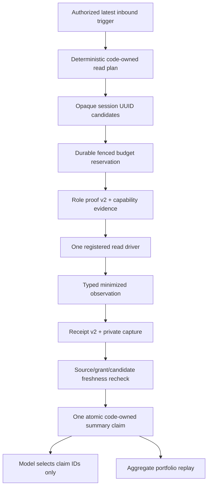

# Phase B Expanded HMS Read Portfolio

Preserve [docs/superpowers/plans/2026-08-04-mail-read-artifact-reservation-chain.md](docs/superpowers/plans/2026-08-04-mail-read-artifact-reservation-chain.md) unchanged as Phase A/G1 evidence. First implementation step creates `docs/superpowers/plans/2026-08-05-phase-b-hms-read-expansion.md` from this reviewed plan. New release manifests bind both plan digests; no Phase A allowlist, gate, receipt-v1, or role-proof-v1 history is rewritten.

> **Required execution directive:** use `/nava-run` task-by-task with TDD. Live production mail/RDS and HMS reads are authorized for building and validating these tools; production HMS writes remain forbidden. Do not stop at the first negative result, accept fixture success as live proof, or infer “the PMS has no data” from a bounded failed sample. For every unexpected result invoke the `ce-debug` causal-chain workflow; for every decision-critical evidence gap invoke `/95`, then official docs and Exa/independent subagents when local runtime evidence cannot settle it. Continue autonomously through research → reproduce → RCA → failing regression → minimal fix → real re-test until the tool works or a named true blocker is evidenced.

## Outcome

Target eight new production reads plus one upgrade:

1. `mail_read_artifact@2`
2. `hms_quote_stay@2.0.0`
3. `hms_list_documents@1.0.0`
4. `hms_sent_email_audit@1.0.0`
5. `hms_read_folio@1.0.0`
6. `hms_company_account_read@1.0.0`
7. `hms_group_block_read@1.0.0`
8. `hms_event_read@1.0.0`
9. Upgrade `hms_find_reservation@1.2.0`

Candidate toolset starts at `3.0.0` for B1, then increments per released registry shape: B2 `3.1.0`, B3 `3.2.0`, B4 `3.3.0`, B5 `3.4.0`, B6 `3.5.0`. Blocked waves reserve but do not publish a version. A computed registry fingerprint prevents semantic-version reuse with different tool shapes.

This is a target portfolio, not a tool-count promise. Each HMS tool ships independently only after exact tenant entitlement, view-only role, request manifest, no-write proof, fixture gate, live artifact, and shadow replay pass. Unsupported surfaces produce an explicit blocker; no hollow `manual_required` tool is promoted to satisfy count.

Boundary definitions:

- Seven new HMS tools authenticate to Infor HMS and read hotel-system facts: quote, documents, sent-email audit, folio, company account, group block, and event. They require HMS role/request/no-write evidence and browser proof.
- `mail_read_artifact` never logs into HMS. It reads an authorized inbound email PDF from mail storage, extracts bounded text in a sandbox, and may produce a private lookup candidate for `hms_find_reservation`.
- `hms_find_reservation@1.2.0` is an upgrade to the already proven HMS tool, not another new tool.
- Independent proof/release/rollback is deployment safety around every tool, not another tool.
- Measured coverage is the marginal change in materially complete drafts under frozen replay. It prevents overlapping keyword percentages from being falsely added.

## Evidence correction

- Foundation three are useful evidence, not high drafting coverage. The earlier labelled 56-thread baseline estimated only `0–5.4%` materially complete with the foundation.
- Corpus fact signals are large but overlapping: documents `42.2%`, payment/deposit/refund `38.3%`, quote/rate `35.5%`, company/agency `26.9%`, group/allotment `26.6%`, event `12.9%`. Never sum these percentages.
- Official Infor evidence is uneven:
  - `Front Desk > Tax Invoice` is the only researched list explicitly documented as display-only.
  - Sent Email is documented as a view of sent HMS emails, but attachment opening and menu path remain tenant-proof items.
  - Folio, Group Booking, and Event Reservation are mixed read/write screens.
  - Company/agency billing terms lack a verified generic read-only screen. This tool remains blocked until exact tenant fields and path are proven.
- Coverage claims come from frozen workflow replay and marginal `ΔFull`, not regex score or number of tools.

## Release subwaves

- **B0 — Portfolio truth and release kernel:** contracts, capability states, coverage denominator, structural read facades, durable budgets, CLI, per-tool manifests, compatibility, rollback.
- **B1 — Foundation:** find v1.2, artifact v2 chain, quote v2.
- **B2 — Communications:** document metadata plus sent-email audit.
- **B3 — Finance:** folio/deposit summary.
- **B4 — Account:** company/agency billing read.
- **B5 — Group/event:** aggregate group block and event summary.
- **B6 — Portfolio integration:** deterministic multi-read plans and cumulative evals.

Each tool has its own release and rollback; subwaves are ordered batches, not activation units. Do not wait for all eight to deploy already proven tools. Do not call the full Phase B portfolio complete until all eight ship or the user accepts evidence-backed blockers.

## Non-negotiable boundary

- Live production HMS remains read-only. Never save, submit, create, amend, cancel, assign, post, settle, refund, transfer, void, finalize, send, resend, print, export, generate, or trigger CRS Check Availability.
- Purpose-built read-only code may access the live production mail corpus, pilot RDS, stored attachments, and HMS records needed to construct and validate exact candidates. Test runners remain forbidden against pilot RDS. Sensitive values may be processed in memory; diagnostics, prompts, subagent instructions, web queries, SSM output, receipts, and durable proof artifacts retain only approved minimized fields, hashes, counts, or structural fingerprints.
- Search/filter POST is allowed only after exact proof that it is query-only. Unknown request, route, popup, download, WebSocket, autosave, or DOM-triggered action aborts before transmission.
- Keep raw Playwright pages private inside runtime. Production drivers receive tool-specific facades exposing only proven operations such as `searchExactReservation` or `observeEventSummary`. No `goto`, `content`, `postForm`, `click`, `fill`, `press`, locator, arbitrary request, or page evaluation crosses that boundary.
- No Guest Stay detail. No rooming-list identities. No event contacts/notes. No PAN, VCC, last-four, bank, tax identifier, credit limit, address, phone, email address, raw attachment name, or free-text financial description reaches model, logs, receipts, or proof output.
- Tests never use pilot RDS. Before Vitest: `unset DATABASE_URL VITEST_ALLOW_PILOT_RDS`. DB suites require verified disposable `TEST_DATABASE_URL` and `CONFIRM_DISPOSABLE_TEST_DB=1`.

## Overnight Autonomous Execution Mandate

**User granted full autonomy.** No blocking questions overnight. No manual login. No "which approach?" pause.

### Communication

- Orchestrator + every subagent: **Respond `/caveman ultra`. Technical terms exact.**

### AWS / infra (use freely)

| Resource | ID / path |
|----------|-----------|
| EC2 | `i-008f737974a9ba9b3` (`af-south-1`) |
| RDS | `nava-zero-mail-pilot` (Postgres 16) |
| S3 | `nava-zero-mail-845242190536-af-south-1` |
| Repo on EC2 | `/home/ubuntu/repos/zero` |
| **Primary deploy** | `apps/server-pilot/deploy/ops-deploy.sh` (`--migrate` when schema) |
| **Primary app bounce** | `apps/server-pilot/deploy/ops-restart.sh` |
| **Primary box reboot** | `apps/server-pilot/deploy/ops-reboot.sh` |
| Guts (fallback) | `sync-ec2-git-bundle.sh`, `deploy-ec2.sh`, `ssm-run-command.sh` |

**Allowed:** ops wrappers, bundle sync, deploy, migrate (via `ops-deploy --migrate`), seed (no `--rotate` unless fix requires), read-only SSM checks, PM2 logs, health curl, and tests against a disposable non-production database.

**Forbidden:** force-push main, `--no-verify`, destructive git, IT Exchange/VPN/real mail creds, any Vitest/test command pointed at pilot or production RDS, setting `VITEST_ALLOW_PILOT_RDS=1`, or sourcing `.env.production` into a test process.

### Pilot RDS safety (overrides autonomy)

Never run Vitest against `nava-zero-mail-pilot` or any production database. No overnight escape hatch exists.

Before every local or EC2 Vitest command:

```bash
unset DATABASE_URL VITEST_ALLOW_PILOT_RDS
```

If a test requires Postgres, use a disposable test database. If none exists, use read-only SQL/API health checks where they prove the requirement; otherwise report a safety blocker. Never weaken this rule to make a gate green.

### RCA loop (mandatory on any red)

FAIL → reproduce → root cause (file:line) → fix → test → commit → resume. Do not stop at first failure.

### Divergence authority

Better path to done criteria → take it. Log in handoff report.

### Done criteria

- [x] Tasks 1–10 fixture/kernel/portfolio grammar shipped with evidence
- [ ] Live discovery + role-proof-v2 for each fixture_verified HMS tool, **or** named true blockers accepted in handoff
- [ ] Production active-read stays decoupled from blocked surfaces
- [ ] Push `EC2-pilot` + `ops-deploy.sh` when code green
- [ ] Handoff report under `docs/superpowers/plans/handoff-reports/`

## Execution Mode

Autonomous overnight — no user checkpoint. REQUIRED SUB-SKILL: superpowers:subagent-driven-development. Do not ask "which approach?"

## Mandatory autonomous empirical build-debug loop

The plan is not “implement once, trust fixtures.” Every tool repeats this loop until its promotion scorecard passes or a true blocker is proven:

1. **Research before assumption:** read relevant code, matching `docs/solutions/`, current official Infor documentation, and exact tenant discovery evidence. When local evidence and docs conflict, inspect the live read response; never force reality to match the plan. External searches use no private mail, guest data, addresses, credentials, or tenant URLs.
2. **Write the failing contract first:** add or strengthen the smallest fixture/regression test for the expected positive, canonical no-match, ambiguity, malformed/schema-drift, authorization/freshness, size/time, and unsafe-action cases.
3. **Observe real behavior:** run the guarded read against a current exact candidate. Capture private trace/video plus key-only route, request, response-envelope, and field fingerprints. Never log values.
4. **Compare assumption to observation:** verify actual transport, envelope, field aliases, search semantics, date/filter behavior, pagination, and empty-result shape. A visually plausible screen is not parser proof.
5. **On any mismatch, enter `ce-debug` RCA:** reproduce; trace valid state until it becomes invalid; list verified assumptions; form a causal chain with a falsifiable prediction for uncertain links; test one hypothesis; make one minimal fix. No shotgun changes or blind retries.
6. **Lock the learning:** the observed failure must fail a regression test before the fix and pass afterward. Add a sanitized structural fixture or key-only fingerprint and, when non-obvious, a `docs/solutions/` learning.
7. **Re-verify full path:** rerun focused tests, broader scoped gate, real positive/no-match/ambiguity probes, registered-tool proof, receipt validation, shadow replay, rollback drill, and re-promotion.
8. **Repeat:** unexplained `WAIT`, `SCHEMA_DRIFT`, wrong/empty result, partial parse, unsafe event, or coverage regression re-enters RCA. First-pass green is insufficient.

Standing autonomy for plan execution: convergent fixes inside an approved tool contract proceed without pausing. A divergent change that widens data disclosure, adds a PMS action, relaxes exact matching, opens a new surface, or changes product semantics stops that tool and records a named blocker; it never weakens safety to make a test green.

Historical prevention case: the original live reservation tool passed fixture HTML but live OSRESS returned `pageData/GRIDRESULT` JSON; canonical no-match was `grid:null/messages:null`; empty OR fields behaved as wildcards; narrow date windows and one-shot oldest-candidate selection hid valid matches. Real-response RCA produced the JSON parser, exact unused-token filters, bounded real date window, candidate walk, and regression coverage. Every new surface must repeat that evidence-led method rather than reuse fixture assumptions.

The complete historical chain contained multiple independent assumption failures:

- DOM search field was live `ff_confirmationnumber`, not the initially assumed `confirmationnumber`.
- ExtJS search request used `COMPONENT_INFO_TYPE=DATA_ONLY`, `DATASPY_ID=1941`, `GRID_ID=1775`, and a live Dataspy filter chain—not the hard-coded `LIST_VIEW/1001` scaffold.
- Empty OR filter slots were wildcards and returned a broad grid; a failed correlation was not evidence that a candidate was absent.
- Live search returned an XHR `pageData/GRIDRESULT` envelope; fixture HTML parsing could not see its rows.
- A real no-match had a validated null-grid/null-messages envelope; other empty-looking shapes were schema drift.
- A small oldest-candidate batch and narrow date window were sampling assumptions, not proof that production mail had no matching PMS record.

## Negative-result and assumption-challenge gate

No HMS result may be classified as business `not_found`, no-candidate blocked, or “need more email data” until all gates below pass:

1. **Candidate-source truth:** freeze an immutable authorized-source snapshot. Account for every source as zero, one, multiple, truncated, unsupported, or failed; none may disappear as “ineligible.” Require seeded extractor controls plus an independently labelled live control. Prove normalization did not truncate, reformat, or choose quoted history incorrectly. Any gap is `CANDIDATE_EXTRACTION_UNVERIFIED`.
2. **Surface truth:** property, user role, menu, screen, Dataspy/view, and field names match the live tenant.
3. **Native-request differential:** for every request-shape branch capable of emitting a negative, compare safe UI-generated and deterministic-driver wire requests as ordered multimaps: method, path/query, key order and multiplicity, byte encoding, content type, required headers/tokens, cookie/session binding, fixed and candidate-derived values, operators, joiners, parentheses, request count, and trigger sequence. Key-set-only parity never passes. Values remain private or digest-compared.
4. **Response truth:** parser input is the exact body bound by request/response IDs to the certified request. Verify status, original/final route, redirect count, content type/charset, timing, body digest/length, session/property/role fingerprint, and envelope discriminator. URL-substring waits, DOM snapshots, redirects, login/permission shells, cached or pre-submit responses, and body/trace mismatch cannot certify a negative. Empty, populated, partial, timeout, and malformed shapes remain distinct.
5. **Parser conservation truth:** declared rows equal decoded rows plus explicitly rejected rows. A certified negative requires zero rejected, skipped, defaulted, or silently filtered rows. Nonempty decoded data with zero correlation is `CORRELATION_GAP` unless broad-search semantics and complete traversal are independently proven. Catch-to-empty, fallback-to-empty, unknown-alias-to-null, and fixture-only production fallback are forbidden.
6. **Scope completeness truth:** record effective filters, declared total, returned count, page/cursor, page size, cap, sort, has-more, timezone, and status/property partitions. Prove exact singleton semantics or traverse every page/partition with a snapshot-bound cursor. Unknown totals, cap hits, truncation, unvisited pages, or uncertain date/status/currency semantics yield `WINDOW_OR_PAGINATION_MISS`.
7. **Control pair:** positive control is independently oracle-labelled before driver execution; extractor/driver/parser output cannot establish it. Require same build, role, property, surface, candidate kind, request-shape branch, and envelope class. Bracket each negative batch `positive → target(s) → positive`, plus one synthetic/canonical negative. Missing branch control disables that branch as `BLOCKED_NO_POSITIVE_CONTROL`; it never proves PMS absence.
8. **Candidate exhaustion truth:** proof uses bounded resumable batches and a durable cursor, but exhaustion means every source in the frozen authorized snapshot is accounted—not merely every extractor-produced candidate. Exhausting the first `9`, first `30`, oldest `250`, any single batch, or an empty extractor result is not source exhaustion.

Unexpected negatives use exhaustive internal classes:

- `CANDIDATE_EXTRACTION_UNVERIFIED`
- `UNVERIFIED_NEGATIVE`
- `REQUEST_DRIFT`
- `RESPONSE_SCHEMA_DRIFT`
- `PARSER_GAP`
- `CORRELATION_GAP`
- `WINDOW_OR_PAGINATION_MISS`
- `ROLE_OR_PROPERTY_SCOPE`
- `BLOCKED_NO_CANDIDATE_AFTER_VERIFIED_SOURCE_EXHAUSTION`
- `BLOCKED_NO_POSITIVE_CONTROL`
- `BUSINESS_NOT_FOUND` only after all gates pass

The execution agent must actively try to disprove its first explanation. Required alternative hypotheses for repeated negatives: bad candidate, wrong field, wrong screen/Dataspy, wrong request format, wildcard filter, narrow date/status window, paging cap, permission-filtered rows, unexpected response envelope, parser fallback, and correlation bug. “More data may arrive later” is a conclusion only after those alternatives are falsified.

## Research escalation inside the loop

- Start with observed live transport, code, tests, logs, and matching `docs/solutions/`.
- Use `/ce-debug` whenever behavior differs from contract, fixtures, or prior proof. Require full trigger → invalid transition → symptom causal chain before changing code.
- Use `/95` for every unresolved decision-critical claim. Track support, counterevidence, and remaining gap; search for contradiction before accepting the leading explanation.
- Use current official Infor docs next. If they do not settle the observed version/tenant behavior, run 2–3 semantically different Exa searches. Use Exa advanced or explicitly authorized Exa Agent/independent standard subagents for multi-hop gaps.
- Web and remote-agent prompts contain no private values. Local authorized read-only diagnostics may inspect the sensitive source data needed to test the claim.
- Two failed hypotheses force a mental-model reset: recapture the native request/response and re-trace boundaries instead of adding another special case.
- Every `/95` closure links the contradiction test and evidence that falsified alternatives. Confidence prose, repeated agreement, or an executing LLM’s self-attestation cannot satisfy a gate.

Minimum real-example matrix per promoted HMS tool:

- one current exact positive;
- one canonical no-match;
- one ambiguity/conflict case where the surface can produce it;
- one malformed or incomplete structural fixture;
- one stale/revoked/wrong-scope rejection;
- one unsafe-action/request denial;
- a second structurally distinct positive when available;
- one independently labelled positive plus canonical negative for every production request/parser branch. A branch lacking controls remains disabled; an evidence-gap note cannot promote it.

`mail_read_artifact` substitutes authorized PDF cases: embedded-text positive, no usable lookup candidate, encrypted/scanned unsupported, malformed, oversized/page/output/time limit, stale grant/S3 identity, and parser abort.

## Shared architecture



```typescript
type ReadToolId =
  | 'mail_read_artifact'
  | 'hms_find_reservation'
  | 'hms_quote_stay'
  | 'hms_list_documents'
  | 'hms_sent_email_audit'
  | 'hms_read_folio'
  | 'hms_company_account_read'
  | 'hms_group_block_read'
  | 'hms_event_read';

type CandidateReadPlan =
  | { kind: 'reservation'; find: true; followups: Array<'documents' | 'sent_email' | 'folio' | 'company'> }
  | { kind: 'artifact_reservation'; artifacts: number; find: true; followups: Array<'documents' | 'sent_email' | 'folio' | 'company'> }
  | { kind: 'quote'; quote: true }
  | { kind: 'group'; group: true }
  | { kind: 'event'; event: true };
```

- `READ_TOOLS` is the single typed runtime registry. It owns tool/version, candidate schema, operation plan, attempt caps, observation/claim schema, privacy class, renderer, TTL, source URLs, denied actions, promotion evidence, and handler. Capability docs, toolset fingerprint, release checks, and eval membership derive from it; do not duplicate runtime truth in parallel maps.
- Planner parses one authored, unquoted latest-inbound segment only. Its closed Zod union chooses one branch and at most two unique deterministic followups. Model cannot request arbitrary tools.
- Find mints followup child UUIDs server-side. Each child binds session, parent evidence ID, tool, property, scope hash, and expiry. Group/event require exact identifier plus bounded dates; zero, multiple, conflicting, expired, cross-session, swapped-parent, or swapped-tool candidates abstain.
- Before every tool I/O, `reserveReadAttempt(fence, planKind, toolId)` atomically increments typed `metrics.readBudget.total/byTool` under run state, claim owner/token, branch, per-tool cap, total cap, and absolute deadline. No returned row means lease lost and no call starts. Reservations never decrement; crash/retry/reclaim retains them; terminal metrics merge and cannot overwrite `readBudget`.
- Maximum attempts: reservation `3`; artifact-reservation `6` (`3` PDF + `1` find + `2` followups); quote/group/event `1`. Before branch start, worst-case queue wait, login, navigation, reads, capture finalization, and `10 s` cleanup reserve must fit the `150 s` run deadline. Bound session waiters; reject excess with a fixed code. Keep one browser owner until measured evidence supports concurrency.
- All candidate IDs are session-owned UUIDv4 values created after private canonical dedupe. Raw lookup values never enter model prompts.
- `HmsReadRoleProofV2` proves actor digest, property, currency, `view_only` mode, allowed surfaces, denied actions, issue/expiry, and evidence digest. It does not duplicate release/tool metadata. Production file: root-owned, regular, non-symlink, `0444`.
- `HmsBrowserArtifactReceiptV2` binds tool/version, domain-separated candidate/scope/result/source hashes, role/discovery hashes, source revision, and trace/video digests. It contains no guest, mail, rate, account, document, or credential values.
- Closed per-tool Zod schemas replace production `data: unknown`, `value: unknown`, arbitrary tool IDs, and arbitrary claim paths. Each result maps through shared generic envelopes to one typed summary claim with `evidenceIds[]`. Disclosure gate runs before claim creation; reject extra fields. Model receives claim ID/kind/status only.
- `HmsPortfolioToolReleaseV1` is immutable per tool. It binds tool/version, toolset version/fingerprint, source, plan, gate, request-manifest, role, discovery, live-proof, receipt, and shadow digests plus predecessor and rollback action. Wave manifests contain tool-release IDs only. A separate root-owned atomic active registry enables/rolls back one tool without touching others.
- Phase A/G1 keeps receipt v1 and role proof v1. New captures write `receipt.v2.json`; fetch/index/purge accept exactly one valid v1 or v2 receipt and reject dual-file ambiguity. Release manifest selects role-proof schema. Retain predecessor releases.
- Extract shared session/grid parsing only after two proven surfaces share the same transport. No universal HMS scraper.

## Narrow tool contracts

### `hms_find_reservation@1.2.0`

- One exact correlated Guest Stay list row only.
- Return status, dates, guest identity, external reference, room type, and rate plan only when reviewed live aliases prove them.
- Missing columns stay null. Ambiguity returns no identity. Never open detail.

### `mail_read_artifact@2`

- Authorized inbound non-inline PDF only; `%PDF-` magic; `20 MiB`, `50` pages, `256 KiB` text, `10 s`.
- Bounded abortable S3 read plus sandboxed Poppler. No OCR.
- Extracted text remains server-only candidate material; never becomes an `attachment_fact` claim.

### `hms_quote_stay@2.0.0`

- Single `Room Type and Rate Availability` surface, one exact search, contiguous requested nights, no paging/result clicks.
- Return date, room type, available count, rate plan, displayed amount, currency, rate basis, restrictions, and observation time.
- Always `bookable:false`, `stayTotal:null`, `occupancyPriced:false`. Missing nightly semantics returns `manual_required`.

### `hms_sent_email_audit@1.0.0`

- Exact reservation/account-bound Sent Email search.
- Return send timestamp, type, subject class, attachment-present flag, report code, error class, and evidence time.
- Match recipient server-side; never return address or attachment filename. Never open attachment or resend.

### `hms_list_documents@1.0.0`

- Read metadata only from proven sources:
  - finalized Tax Invoice display-only list;
  - sent-document metadata observed on Sent Email.
- Return document type, status, generated/sent time, source surface, attachment-present, and `retrievable:false`.
- Do not claim a complete reservation document inventory. Confirmation/pro-forma bytes, preview, print, email, resend, or generation remain blocked until a separate exact no-side-effect retrieval path is proven.

### `hms_read_folio@1.0.0`

- Exact reservation-linked folio/deposit summary only.
- Return currency, total balance, deposit summary, due/paid/refunded/forfeited/transfer status, and observed time when exact fields are proven.
- No card/payment credentials, transaction free text, line-item export, posting, transfer, settlement, refund, void, email, print, or report execution.

### `hms_company_account_read@1.0.0`

- Exact organization/booking-agency link from a previously validated reservation only; no arbitrary company search.
- Return only proven billing mode/eligibility, approved payment-term class, contract status, and observed time.
- Do not infer bill-to, A/R eligibility, rate entitlement, credit terms, or account status from profile existence. If tenant does not expose exact view-only fields, tool does not ship.

### `hms_group_block_read@1.0.0`

- Exact group reference plus bounded date range.
- Return group status, dates, room-type/date block counts, pickup/remaining/release values only when semantics are proven, and restriction indicators.
- No delegate identities, rooming list, notes, rates, billing instructions, quick entry, room assignment, release, or save.

### `hms_event_read@1.0.0`

- Exact event confirmation/reference only.
- Return event status/type, dates, layout, attendee count, setup/teardown, approved item summary, currency/totals, linked group/account class, deposit status, and observed time only when proven.
- No contact data, notes, create/change/copy/cancel, calculate, post, BEO/pro-forma generation, print, or save.

## Task 1: Freeze portfolio truth and promotion gates

Files: [contracts.ts](apps/server-pilot/src/hms/contracts.ts), [capability-matrix.md](docs/infor-hms/capability-matrix.md), existing v1 eval compatibility readers, [analyse-centurion-pms-tools.mjs](scripts/analyse-centurion-pms-tools.mjs), plus one new `evals/hms/portfolio-cases.v3.json`.

- RED: typed registry rejects unproven production tools; every tool has exact version, closed contracts, source URLs, privacy class, denied actions, candidate requirement, caps, and promotion evidence.
- Capability state derives from present, valid evidence refs: `planned -> fixture_verified -> discovery_verified -> live_verified -> shadow_enabled`. Only final state enters active shadow registry.
- Keep raw corpus private. Analyzer emits non-overlapping aggregate intent/fact memberships and opaque thread IDs only.
- Migrate the frozen 56-thread IDs, requirements, adjudicated labels, and ablation expectations into one case file without message text. Placeholder labels do not score. Until labels are complete, report raw eligible/attempted/exact/partial/manual counts only.
- Add ablation replay: baseline, then each tool in release order. Report numerator, denominator, `ΔFull`, and one-sided 95% interval only at `n>=30`; never pre-credit unbuilt tools.

## Task 1B: Build read-only and operator release kernel

Files: [runtime.ts](apps/server-pilot/src/hms/runtime.ts), [run-ledger.ts](apps/server-pilot/src/ai/run-ledger.ts), [draft-evidence.ts](apps/server-pilot/src/ai/draft-evidence.ts), [production-boundary.ts](apps/server-pilot/src/hms/production-boundary.ts), browser artifact/fetch/purge modules, [ops-hms-proof.sh](apps/server-pilot/deploy/ops-hms-proof.sh), [hms-read-gate.sh](apps/server-pilot/deploy/hms-read-gate.sh), deploy tests, and new portfolio operator runbook.

- Refactor find through a tool-specific facade first. Add syntax-aware import/API tests plus abort-before-transmission fixtures. No new live driver starts until low-level browser methods are unreachable from production driver modules.
- Implement atomic `reserveReadAttempt`, candidate parent/child graph, typed claim envelopes, deadline admission, bounded semaphore queue, and metrics-merge tests: concurrent owners, stale token, crash after reservation, reclaim, exhausted branch, terminal merge, cross-session child, changed thread/grant, expired child.
- Implement per-tool release manifests, wave reference manifests, atomic active registry, predecessor retention, v1/v2 receipt and role-proof compatibility, protected artifact index, idempotent promotion/rollback/resume, and interrupted-activation tests.
- `read-wave` quiesces the HMS lane, rejects nonterminal runs, proves tools, and never implicitly promotes. `read-promote` health-checks then atomically activates one tool; any failure restores predecessor and relatches. Upgrade rollback selects retained predecessor; new-tool rollback disables it; shared-runtime failure rolls back source release.
- Build runbook golden path from Windows Git Bash in a repo path containing spaces and Linux Bash on EC2. Raw SSM commands live in debug appendix.
- Add a reusable RCA dossier format per tool: symptom, real structural observation, assumptions verified/invalidated, causal chain, prediction, failing test, minimal fix, verification commands, live artifact IDs, and unresolved gaps. Dossiers contain no private values.
- Add a native-request differential report and negative-result certificate to every HMS dossier. Promotion tooling rejects `not_found`/`WAIT` evidence lacking all eight assumption-challenge gates.
- **Negative quarantine:** parsers and drivers emit only `UNVERIFIED_NEGATIVE`. Only `validateNegativeResultCertificate` may construct `BUSINESS_NOT_FOUND`, no-candidate blocked status, receipt terminal state, or model-visible negative claim. Missing, unknown, stale, or failed evidence returns its specific diagnostic class. Import-boundary tests prove no parser, driver, worker, proof CLI, or alternate branch can bypass this validator.
- Define `NegativeResultCertificateV1` as a closed schema containing verifier version plus immutable evidence IDs/digests for all eight gates—no free-form pass booleans. Independent gate code recomputes invariants from private artifacts; the function under test cannot produce and verify its own evidence.

## Task 2: Upgrade exact reservation list evidence

Files: [live-guest-stay-driver.ts](apps/server-pilot/src/hms/live-guest-stay-driver.ts), [adapter.ts](apps/server-pilot/src/hms/adapter.ts), [draft-evidence.ts](apps/server-pilot/src/ai/draft-evidence.ts), [candidate-draft-agent.ts](apps/server-pilot/src/ai/candidate-draft-agent.ts), matching tests, and new key-only `live-guest-stay-row-fingerprint.v2.json`.

- RED: one correlated row; reviewed aliases only; key names captured without values; lookalikes rejected; absent room/rate null; no detail route/request/click; driver cannot import raw `HmsPage`.
- Extend one atomic reservation-summary claim. No split-field cherry-picking.
- Set `HMS_FIND_RESERVATION_TOOL_VERSION='1.2.0'`; produce fresh registered-tool trace/video.

## Task 3: Harden artifact v2 and durable artifact-to-find chain

Files: [read-artifact.ts](apps/server-pilot/src/mail/artifacts/read-artifact.ts), [s3.ts](apps/server-pilot/src/storage/s3.ts), [run-ledger.ts](apps/server-pilot/src/ai/run-ledger.ts), [thread-context.ts](apps/server-pilot/src/ai/thread-context.ts), [worker.ts](apps/server-pilot/src/ai/worker.ts), [reservation-candidate-session.ts](apps/server-pilot/src/hms/reservation-candidate-session.ts), [mail-artifact-backtest.ts](apps/server-pilot/src/ops/mail-artifact-backtest.ts), and matching tests.

- RED: authorization/grant/S3 identity drift, PDF bounds, abort propagation, parser failure, max three PDFs, exact-candidate dedupe, zero/multiple lookup candidates, atomic concurrent budget, stale fence, crash/retry/reclaim consumption, terminal metrics merge.
- Snapshot authorization before and after extraction. Extracted text never reaches model/logs.
- Set `MAIL_READ_ARTIFACT_TOOL_VERSION='2'`; keep aggregate backtest private and PII-free.

## Task 4: Ship quote v2

Create contract and fixtures first. Run abort-first tenant discovery and freeze role/request/evidence digests. Only then create [live-quote-stay-driver.ts](apps/server-pilot/src/hms/live-quote-stay-driver.ts), its tests, and key-only live evidence.

- RED candidate parser: one authored segment; explicit unambiguous dates/occupancy; strict bounds; conflict/multiple tuple abstention.
- RED driver: one surface/search; complete requested-night schedule; exact currency/basis/restrictions; no click/paging/CRS route.
- Role proof v2 and discovery must attest exact route/request/date horizon and zero unsafe events.
- Produce one atomic quote evidence pack with mandatory caveat and fresh registered-tool trace/video.

## Task 5: Add communications reads

Create contracts/fixtures first, then run separate abort-first Sent Email and Tax Invoice tenant discovery. Only proven paths get focused drivers/tests. Share immutable session/grid helpers only where observed envelopes match.

- RED `hms_sent_email_audit`: exact scope, redacted recipient, bounded rows/time/bytes, no attachment open, no resend, no raw subject/address leakage.
- RED `hms_list_documents`: explicit source class, finalized-invoice metadata, sent-attachment metadata, `retrievable:false`, no inference of unsent/current artifacts.
- Register separate closed contracts and claim mappers in shared candidate/claim/receipt/release machinery despite shared internals.
- Promotion requires tenant menu/route discovery and zero unsafe counters. Metadata-only tools receive Partial—not Full document-delivery credit.

## Task 6: Add redacted folio/deposit summary

Create closed contract, privacy policy, and fixtures first. Run abort-first Folio/Deposit Ledger discovery; only then create `live-folio-read-driver.ts` and parser tests for proven fields.

- RED: reservation binding, finance-role requirement, VVIP/incognito masking, currency/total consistency, stale source, PCI/VCC/card/transaction-text redaction, row/byte/time caps.
- Prefer display/list observations. No Advance Deposit form, report execution, email/print, or transaction actions.
- Claims are recipient-class gated. Existing balance/deposit status can earn Full only for a labelled narrow status inquiry; refund/settlement/invoice requests remain Partial.

## Task 7: Discover then add company/agency billing read

Create contract/fixtures first; do not create a production driver until exact tenant evidence exists.

- RED: candidate must originate from exact reservation link; arbitrary/fuzzy profile search rejected; account identifiers/contact/credit data suppressed.
- Discovery must identify exact view-only fields for billing mode/terms and prove opening them does not autosave.
- Booking-agency contract availability fields are not billing terms. Do not substitute them.
- If evidence is absent, record `BLOCKED_COMPANY_READ_SURFACE_UNPROVEN` and stop this subwave. Other subwaves continue.

## Task 8: Add aggregate group-block read

Create aggregate contract/fixtures, run abort-first tenant discovery, and freeze proven semantics first. Only then create `live-group-block-driver.ts` and parser tests.

- RED: exact group reference; bounded dates; CON/BLK/pickup/remaining semantics individually proven; restriction parsing; no rooming-list identity; no edit focus/input/change/blur.
- Production facade can open/search/observe only. Block tab direct-entry, Quick Entry, Save, assignment, and document tabs are structurally absent.
- Existing group-status queries may earn Full; create/amend/allocation-action requests remain Partial.

## Task 9: Add event-summary read

Create minimized contract/fixtures and run list-only tenant discovery first. Only then create `live-event-read-driver.ts` and parser tests for a proven inert path.

- RED: exact event reference; status/date/count/total consistency; private fields absent; no double-click/detail path until no-write proof; no calculate/post/copy/cancel/print/save.
- If list rows lack required summary and detail navigation cannot be proven inert, record `BLOCKED_EVENT_READ_SURFACE_UNPROVEN`.
- Existing event-status queries may earn Full; quote/create/amend/BEO/pro-forma workflows remain Partial.

## Task 10: Integrate portfolio plans and cumulative evals

Files: [hms-shadow.ts](apps/server-pilot/src/ai/hms-shadow.ts), [worker.ts](apps/server-pilot/src/ai/worker.ts), candidate planner, registry-derived eval command, and cumulative runbook sections.

- Integrate closed `CandidateReadPlan`; max two reservation followups; no model-driven loops.
- Emit one typed workflow summary claim with evidence IDs; model selects whole claim IDs only.
- Run cumulative ablation and load/capacity replay across currently promoted releases. Never couple a proven tool to blocked company/group/event surfaces.
- Run per-task correctness review, ponytail simplicity review, and final CE code review before each live promotion.

## Public operator contract

Registry-driven dispatcher; no per-tool shell branches:

```text
ops-hms-proof.sh --help
ops-hms-proof.sh doctor [--json]
ops-hms-proof.sh status [--tool <tool-id>|--wave <subwave-id>] [--json]
ops-hms-proof.sh read-discovery <tool-id> [--json]
ops-hms-proof.sh read-proof <tool-id> [--json]
ops-hms-proof.sh read-wave <subwave-id> [--resume] [--json]
ops-hms-proof.sh artifacts <tool-id> [--latest] [--json]
ops-hms-proof.sh fetch-artifact <uuid> <receipt|video>
ops-hms-proof.sh fetch-artifact <uuid> trace --confirm-sensitive
ops-hms-proof.sh read-promote <tool-id> [--json]
ops-hms-proof.sh read-rollback <tool-id> [--json]
ops-hms-proof.sh rearm
```

- Help and grammar errors perform no AWS call. Unknown IDs, unsupported tool/action pairs, missing/extra/repeated args exit `2`. `read-discovery` rejects `mail_read_artifact`.
- Keep Phase A actions compatible. Unscoped `hms-read-gate.sh --fixture-only|--full` preserves Phase A behavior; Phase B adds optional exact `--tool` or `--wave` scope.
- One terminal record only. JSON fields: schema version, outcome, command, stage, code, exit code, tool/version, subwave, release, artifact ID, expiry, retryable, next command. Text mode preserves fixed `HMS_WAIT`/`HMS_FAIL`; no free-form runtime error or private value. Preserve exits `0|2|3|10|20|70`; rollback failure wins with `20`.
- Protected atomic artifact index records IDs, tool/version, release, artifact kinds, receipt schema, timestamps, and expiry only. `artifacts --latest` recovers proof IDs after terminal loss.
- Runbook path: help → doctor → scoped fixture gate → discovery → proof → artifact lookup → promotion → status → rollback drill → status. Targets: local grammar `<1 s`; doctor `<60 s`; warm scoped fixture gate `<5 m`; warm proof `<15 m`; cold proof `<30 m`; rollback `<5 m`. Record PII-free duration/outcome/retry counts.

## Promotion scorecard

- Hard invariants at every sample: zero PMS mutation, unknown request, popup, unexpected WebSocket, unauthorized download, restricted-data leak, cross-property/thread binding, or wrong-record result.
- `live_verified` requires one current registered-tool proof plus all fixtures.
- `live_verified` also requires the tool’s real-example matrix and RCA dossier to contain no unexplained parser/search failures. “Worked once” does not qualify.
- Any repeated negative across real candidates triggers RCA before more candidates are consumed. Candidate-batch exhaustion without a positive control cannot advance capability state.
- `shadow_enabled` requires at least 30 adjudicated eligible outcomes, zero material factual errors/stale use/privacy leaks, useful-result rate at least 70%, availability at least 97%, and p95 within allocated branch deadline. Publish numerator, denominator, point estimate, and one-sided 95% interval.
- Thirty clean samples do not prove 98% production accuracy. Shadow status authorizes evidence collection only, never writes, sends, automatic persistence, or an `enabled` mode. Higher-confidence production gates belong to Phase C.
- Measure queue wait, tool latency, end-to-end latency, memory, capture bytes, context closure, and deadline aborts at 1/5/20 queued runs.

## Verification contract

1. Before every Vitest: `unset DATABASE_URL VITEST_ALLOW_PILOT_RDS`.
2. Run affected unit/fixture suites RED then GREEN, one DB worker where applicable.
3. Run script typecheck, shell `bash -n`, Node syntax checks, server build, `eval:hms-candidate-v3`, portfolio ablation replay, and shadow eval.
4. Run `hms-read-gate.sh --fixture-only`.
5. Require verified disposable `TEST_DATABASE_URL`; run `CONFIRM_DISPOSABLE_TEST_DB=1 bash apps/server-pilot/deploy/hms-read-gate.sh --full`. Missing DB blocks; never substitute pilot RDS.
6. For each HMS tool: run allowlisted discovery, registered-tool proof, artifact lookup, explicit promotion, status, rollback drill, and re-promotion. Require exact release/role/evidence/source digests, private trace/video, zero unsafe counters, and valid receipt.
7. Exercise each real-example matrix. Any wrong/empty/partial/unexplained result runs the full RCA → failing regression → minimal fix → re-verification loop before promotion.
8. For every negative path, validate and archive the structural negative-result certificate, then fault-inject: candidate truncation/zero extraction; duplicate/order/header/token request drift; stale, redirected, login, permission, or cross-request response; parser alias/count/drop failure; ignored filter/pagination/timezone boundary; circular/stale positive control; and durable-cursor source skip. Every fault must produce its specific diagnostic class—never `BUSINESS_NOT_FOUND`, generic `WAIT`, or “need more email data.”
9. Run each subwave live wave, then stop/re-latch. Fetch sensitive artifacts privately and explicitly.
10. Run cumulative shadow and 1/5/20 queue replay. Publish raw counts and measured `ΔFull`; do not publish additive keyword coverage.

## Definition of done

- Eight target tools and find v1.2 have exact contracts, fixtures, candidate rules, claim rules, versions, privacy limits, and capability states.
- Every promoted HMS tool has current tenant-specific view-only evidence, registered-tool trace/video, receipt v2, immutable release, and rollback.
- Every promoted tool has a completed real-example matrix; every encountered deterministic failure has a causal-chain RCA, failing regression, minimal fix, and fresh end-to-end proof.
- No unexplained `WAIT`, `SCHEMA_DRIFT`, empty parse, wrong-record match, or unsafe event is relabelled as success.
- No business `not_found` or “wait for more data” conclusion exists without native-request parity, known-positive control, recognized empty envelope, parser/correlation proof, scope proof, and full resumable candidate-set accounting.
- Negative results remain quarantined from receipts, model claims, terminal business status, and coverage scoring until independent certificate validation passes.
- No production HMS mutation occurred.
- Every tool activates and rolls back independently; blocked later surfaces do not regress earlier ones.
- Full Phase B portfolio is complete only when all eight new tools are promoted, or user explicitly accepts named blockers and revised scope.
- Read portfolio does not claim 100% drafting. Fixture-only disabled writes—create, confirmation/pro-forma generation/send, amend, cancel—remain a separate Phase C plan with human-supervised live validation.

## True blockers

- Missing disposable non-production DB.
- Missing HMS entitlement or view-only role for a target surface.
- No exact safe tenant route/request/field semantics.
- Autosave, mutation, download, report generation, popup, unknown request, or sensitive-field leakage.
- No current exact candidate after independently verified frozen-source accounting: return `BLOCKED_NO_CANDIDATE_AFTER_VERIFIED_SOURCE_EXHAUSTION`, never generic `WAIT`, weaken matching, or claim more mail is needed.
- No known positive after full authorized-corpus candidate derivation: `BLOCKED_NO_POSITIVE_CONTROL`, not tool success and not evidence that PMS data is absent.
- RCA cannot explain or safely correct a repeatable real-example failure within the approved tool contract.
- Company billing fields unproven; group/event summary requires unsafe detail.
- Missing/stale/mutable/symlinked/digest-mismatched role proof, discovery evidence, source revision, or private artifact storage.

## NOT in scope

- PMS writes, send/resend, generation, print/export, settlement, refund, or CRS availability.
- Guest Stay detail, rooming-list identities, event contacts/notes, arbitrary profile search, document bytes, OCR.
- Literal production `enabled` mode, automatic draft persistence, or automatic send.
- Native PowerShell/WSL tooling, horizontal browser scaling, additional properties, public SDK/API.
- Phase C fixture write adapters and human-supervised live write validation.

## Sources

- [Centurion demand handoff](docs/infor-hms/centurion-email-tool-demand-handoff-2026-08-03.md)
- [PMS demand analysis](docs/infor-hms/centurion-pms-tool-demand-2026-08-04.md)
- [Full portfolio roadmap](docs/superpowers/plans/2026-07-29-infor-hms-full-tool-portfolio-roadmap.md)
- [Capability matrix](docs/infor-hms/capability-matrix.md)
- [Infor Room Type and Rate Availability](https://docs.infor.com/hms/3.8.x/en-us/useradminlist/HMS%203.8.4%20User%20Guide_70179.pdf), pp. 62–63
- [Infor Sent Email](https://docs.infor.com/hms/2025.x/en-us/hmsolh/pages/pssnel_help.html)
- [Infor Tax Invoice](https://docs.infor.com/hms/3.8/en-us/hmsolh/s_t1424428580083.html)
- [Infor Working with Folios](https://docs.infor.com/hms/3.8/en-us/hmsolh/s_t1424428571861.html)
- [Infor Deposit Ledger](https://docs.infor.com/hms/3.8/en-us/hmsolh/s_t1424428579271.html)
- [Infor Group Booking](https://docs.infor.com/hms/3.8/en-us/hmsolh/pages/groupbooking_help.html)
- [Infor Subgroup Room Blocks](https://docs.infor.com/hms/2025.x/en-us/hmsolh/s_t1424428588367.html)
- [Infor Event Reservations](https://docs.infor.com/hms/3.8/en-us/hmsolh/s_t1424428591097.html)
- [Infor Booking Agency Contracts](https://docs.infor.com/hms/2024.x/en-us/hmsolh/s_t1424428594638.html)
- [Live OSRESS GRIDRESULT RCA](docs/solutions/integration-issues/live-osress-gridresult-parse-canary-row-ok.md)

## GSTACK REVIEW REPORT

- Engineering review: 3 P0 and 5 P1 findings; all folded into B0 release kernel, typed candidate/claim contracts, discovery-first order, promotion scorecard, and capacity gates.
- DevEx review: HOLD resolved by preserving Phase A, adding per-tool manifests/rollback, v1/v2 compatibility, exact CLI/status/artifact contracts, runbook, and timing targets.
- Ponytail review: registry derives plans/caps/fingerprint/eval views; shared envelopes replace per-tool claim/receipt stacks; no universal scraper or cloned shell branches.
- Outside challenge retained: no additive coverage claim, no pre-credit, and no fake company/document capability when tenant proof is absent.
- What already exists: Guest Stay v1.1 live driver/proof, PDF parser sandbox, generic runtime/request policy/capture, candidate session, run ledger, proof wrapper, fixture/full gates.
- Failure modes covered: stale lease, crash after reservation, candidate drift, role/release/source mismatch, unsafe request, sensitive leakage, partial activation, terminal loss, rollback failure, deadline/queue exhaustion.
- Empirical loop: every tool must prove real positive/no-match/ambiguity behavior and route any mismatch through reproduce → causal-chain RCA → failing regression → minimal fix → full live re-proof.
- Assumption challenge: negative results need native-request parity, response/parser/scope proof, positive/negative controls, and resumable whole-candidate-set accounting; bounded batch failure never means “no PMS data.”
- Parallelization: contracts/fixtures/docs may run in parallel; all shared-kernel changes serialize first; live discovery/proof/promotion serialize through one HMS owner.
- Review verdict: **CLEARED FOR IMPLEMENTATION after user starts execution.**

