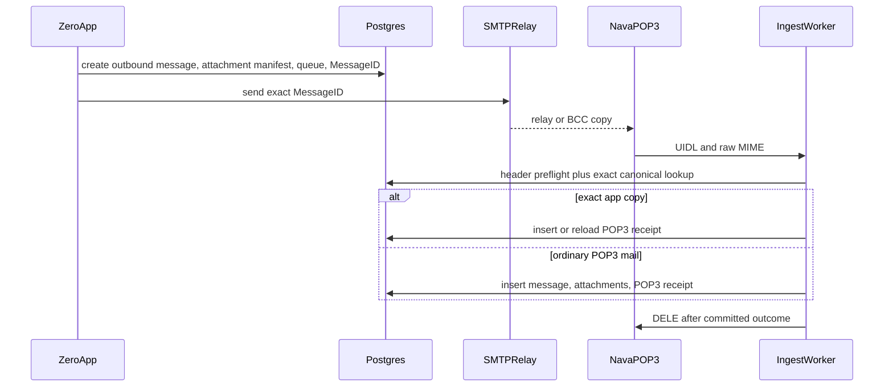

# Centurion POP3 Copy Deduplication Implementation Plan

> **For agentic workers:** REQUIRED SUB-SKILL: Use `superpowers:subagent-driven-development` or `superpowers:executing-plans` task-by-task. Track every checklist item.

**Goal:** Preserve one canonical app-created Centurion outbound message when relay/BCC traffic reaches Nava POP3, retaining raw-MIME/UIDL evidence without a duplicate message or thread.

**Architecture:** Zero assigns one stable Message-ID before SMTP. POP3 ingestion reads routing and identity headers before attachment parsing; an exact same-transport match to an in-flight or sent app outbound message writes an append-only receipt only. Normal POP3 mail retains the current message path and adds the same receipt record atomically, so every new UIDL is globally replay-safe per ingest mailbox.

**Tech stack:** TypeScript, Drizzle/Postgres, Nodemailer, MailParser, S3, Vitest.

## Global constraints

- Never run Vitest with `DATABASE_URL` pointing to pilot/production RDS. Before every Vitest command, run `unset DATABASE_URL VITEST_ALLOW_PILOT_RDS`.
- DB integration tests require `CONFIRM_DISPOSABLE_TEST_DB=1` and a disposable `TEST_DATABASE_URL`; missing database is a safety blocker, not permission to use pilot RDS.
- Preserve historic `message` rows and current provenance columns. Migration is additive only: no automatic historical merge, delete, or thread rewrite.
- Do not treat visible `Bcc:` as evidence. SMTP strips it, and relay copying exists when `MAIL_SELF_BCC` is disabled.
- No global Message-ID unique constraint and no fuzzy subject/recipient/time matching.

---

## Requirements and decisions

### R1. Canonical outbound identity

`mailRouter.send` creates a valid unbracketed RFC Message-ID before its message/queue transaction. `OutboundMailPayload` gains `messageId: string`; fake and real SMTP transports send it unchanged. Queue reclaim considers a message delivered only when `sentAt` is non-null, never merely because `messageIdHeader` exists.

### R2. POP3 receipt evidence

Add `mail_message_receipt` with `id`, `message_id`, `ingest_mailbox_id`, `pop3_uidl`, `raw_mime_s3_key`, `observed_at`, and `created_at`. It has a unique `(ingest_mailbox_id, pop3_uidl)` constraint, a canonical-message index, and a raw-MIME-key index.

### R3. Exact copy claim

A POP3 message becomes a receipt only when header preflight resolves a routed transport and finds exactly one app-created outbound message where all of these hold:

- same transport;
- `direction = 'outbound'`;
- `ingestMailboxId IS NULL`;
- exact normalized Message-ID;
- message queue state is `sending` or `sent`;
- parsed sender is a configured transport identity.

The claim never depends on self-BCC. A missing, malformed, cross-transport, wrong-sender, pending-queue, or ambiguous match follows normal ingest/quarantine behavior.

### R4. Attachment integrity

Persist outgoing attachments as canonical `attachment` rows before SMTP, using the canonical message ID and existing S3 key convention. A receipt-only POP3 copy never contributes received attachment bytes to its canonical message. This prevents forged/replayed MIME from changing user-downloadable app attachments.

### R5. Database claim and no side effects

Receipt insert is the database claim point: insert with conflict handling, then reload authoritative state. On success or already-recorded UIDL, worker can safely `DELE` only after the relevant database transaction completed. Receipt-only paths must not create/update a message or thread, refresh search, mark read/unread, enqueue AI, change draft freshness, or affect message metrics.

### R6. Safe recovery

Rehydrate and quarantine promotion use the same receipt classifier. A receipt-owned raw-MIME key/UIDL is already represented. Promotion atomically removes quarantine only when its normal-message or receipt persistence transaction succeeds.

### Scope boundaries

- Includes: future dedupe, outgoing attachment persistence, POP3 replay handling, recovery compatibility, disposable-DB tests, and count-only pilot proof.
- Excludes: relay configuration, receipt UI, global provenance framework, and external SMTP exactly-once delivery after process failure.
- Deferred: historic duplicate audit/repair. It requires separate explicit approval and no silent destructive mutation.

---

## High-level flow



---

## Task 1: Add receipt and attachment constraints

**Files:**
- Modify: `apps/server-pilot/src/db/schema/mail.ts`
- Create: `apps/server-pilot/drizzle/0016_mail_message_receipt.sql`
- Modify: `apps/server-pilot/tests/schema-contract.test.ts`

**Interfaces:**

```ts
type MailMessageReceipt = {
  id: string;
  messageId: string;
  ingestMailboxId: string;
  pop3Uidl: string;
  rawMimeS3Key: string;
  observedAt: Date;
  createdAt: Date;
};
```

- [ ] Write failing schema-contract tests asserting receipt table export, receipt foreign keys, receipt UIDL uniqueness, receipt lookup indexes, and unique `(attachment.messageId, attachment.s3Key)`.
- [ ] Run:

```bash
unset DATABASE_URL VITEST_ALLOW_PILOT_RDS
pnpm --dir apps/server-pilot exec vitest run tests/schema-contract.test.ts
```

Expected: failure because `mailMessageReceipt` and its indexes do not exist.

- [ ] Add the Drizzle table and additive migration. Keep `message.ingestMailboxId`, `message.pop3Uidl`, and `message.rawMimeS3Key`; do not backfill or alter existing data. Add a non-unique partial index for candidate lookup on `(transportId, messageIdHeader)` where app-created outbound rows have `ingestMailboxId IS NULL`.
- [ ] Add the attachment uniqueness guard in schema and migration.
- [ ] Re-run schema-contract test.

Expected: PASS.

**Verification:** Schema migration is additive, legacy provenance columns remain, and only receipt UIDLs are globally unique per ingest mailbox.

---

## Task 2: Persist canonical outbound identity and attachments before SMTP

**Files:**
- Modify: `apps/server-pilot/src/trpc/routes/mail.ts`
- Modify: `apps/server-pilot/src/mail/send/smtp.ts`
- Modify: `apps/server-pilot/src/mail/send/outbound-queue.ts`
- Modify: `apps/server-pilot/tests/mail-send.test.ts`
- Modify: `apps/server-pilot/tests/outbound-queue.test.ts`

**Interfaces:**

```ts
type OutboundMailPayload = {
  messageId: string;
  // existing fields unchanged
};

function hasPersistedSmtpDelivery(row: {
  sentAt: Date | null;
}): boolean;
```

- [ ] Write failing mail-send tests showing a queued app message has a canonical Message-ID and attachment rows/S3 objects before SMTP flush; fake SMTP must receive the exact same Message-ID.
- [ ] Write failing queue tests showing a non-null Message-ID with `sentAt: null` still sends once, while a stale reclaimed row with `sentAt` persists skips SMTP.
- [ ] Run:

```bash
unset DATABASE_URL VITEST_ALLOW_PILOT_RDS
if [ -z "${TEST_DATABASE_URL:-}" ]; then echo "disposable TEST_DATABASE_URL required"; exit 1; fi
CONFIRM_DISPOSABLE_TEST_DB=1 pnpm --dir apps/server-pilot exec vitest run tests/mail-send.test.ts tests/outbound-queue.test.ts
```

Expected: new assertions fail; test helper refuses any pilot host.

- [ ] Generate the stable unbracketed ID in `mailRouter.send` and write it to the app message and serialized queue payload in the existing transaction.
- [ ] Upload outgoing attachment bytes to canonical attachment S3 keys before that transaction, then insert canonical attachment rows during it. Keep the existing queued base64 payload for SMTP delivery.
- [ ] Pass `OutboundMailPayload.messageId` into Nodemailer’s `messageId` option and return/preserve the same normalized ID in fake transport.
- [ ] Change reclaim logic to read `message.sentAt` together with identity, then set `sentAt` only after SMTP accepts.
- [ ] Re-run both test files.

Expected: PASS.

**Verification:** A queued message is discoverable by Message-ID before SMTP, but cannot be incorrectly treated as sent.

---

## Task 3: Claim matching POP3 copies before normal persistence

**Files:**
- Modify: `apps/server-pilot/src/mail/ingest/parse-message.ts`
- Modify: `apps/server-pilot/src/mail/ingest/store.ts`
- Modify: `apps/server-pilot/src/mail/ingest/worker.ts`
- Modify: `apps/server-pilot/tests/ingest-store.test.ts`
- Modify: `apps/server-pilot/tests/pop3-worker.test.ts`
- Modify: `apps/server-pilot/tests/thread-join.test.ts`

**Interfaces:**

```ts
type ParsedInboundHeaders = {
  messageId: string | null;
  fromAddress: string | null;
  toAddresses: string[];
  ccAddresses: string[];
  ownerHeaderValue: string | null;
  receivedAt: Date | null;
};

type PersistReceiptResult = {
  kind: 'receipt' | 'duplicate';
  messageId: string;
  transportId: string;
  rawMimeS3Key: string;
};
```

- [ ] Write failing tests for an app-created standalone outbound message plus an exact POP3 copy: one message, one thread, one receipt, no new AI run, no changed thread timestamp/search/read state, and successful POP3 `DELE`.
- [ ] Add failing cases for: same UIDL replay, two UIDLs of same copied message, concurrent UIDL claim conflict, wrong transport/sender, blank Message-ID, pending queue row, and ambiguous candidate.
- [ ] Run:

```bash
unset DATABASE_URL VITEST_ALLOW_PILOT_RDS
if [ -z "${TEST_DATABASE_URL:-}" ]; then echo "disposable TEST_DATABASE_URL required"; exit 1; fi
CONFIRM_DISPOSABLE_TEST_DB=1 pnpm --dir apps/server-pilot exec vitest run tests/ingest-store.test.ts tests/pop3-worker.test.ts tests/thread-join.test.ts
```

Expected: POP3 copy creates a second message/thread and new receipt tests fail.

- [ ] Add bounded header-only parsing that reuses Message-ID/address normalization but does not stream/upload attachment content.
- [ ] After raw MIME upload, route headers and query one exact eligible app message. Require matching transport, app-created outbound origin, Message-ID, sender identity, and queue state `sending`/`sent`.
- [ ] Insert receipt with `ON CONFLICT DO NOTHING RETURNING`; on conflict reload the receipt/message outcome instead of throwing unique violations or treating mail as poison.
- [ ] On a receipt outcome return before full MIME parse, thread resolution, search update, read-state update, attachment persistence, or AI enqueue.
- [ ] Keep ordinary POP3 flow intact, but insert its receipt in the same transaction as message/attachment persistence. A transaction failure returns no successful drain outcome.
- [ ] Re-run all three test files.

Expected: PASS.

**Verification:** POP3 `DELE` follows only a committed receipt/message outcome. Matching copies cannot alter canonical attachments or any user-visible mailbox state.

---

## Task 4: Make recovery and promotion receipt-aware

**Files:**
- Modify: `apps/server-pilot/src/mail/ingest/rehydrate-raw-mime.ts`
- Modify: `apps/server-pilot/src/mail/ingest/promote-quarantine.ts`
- Modify: `apps/server-pilot/tests/rehydrate-raw-mime.test.ts`
- Modify: `apps/server-pilot/tests/promote-quarantine.test.ts`

**Interfaces:**

```ts
type ExistingRawMimeRepresentation =
  | { kind: 'legacy-message'; messageId: string }
  | { kind: 'receipt'; messageId: string }
  | { kind: 'quarantine'; quarantineId: string };
```

- [ ] Write failing tests for receipt-owned raw-MIME key/UIDL rehydrate skips and for promotion of an exact app copy that inserts a receipt and removes quarantine atomically.
- [ ] Run:

```bash
unset DATABASE_URL VITEST_ALLOW_PILOT_RDS
if [ -z "${TEST_DATABASE_URL:-}" ]; then echo "disposable TEST_DATABASE_URL required"; exit 1; fi
CONFIRM_DISPOSABLE_TEST_DB=1 pnpm --dir apps/server-pilot exec vitest run tests/rehydrate-raw-mime.test.ts tests/promote-quarantine.test.ts
```

Expected: new receipt-owned cases fail because recovery only queries message/quarantine ownership.

- [ ] Extend representation lookup to read receipt raw keys/UIDLs first while preserving legacy message and quarantine fallback.
- [ ] Route promotion and raw rehydrate through header-first classification; only delete quarantine inside the successful receipt or normal message persistence transaction.
- [ ] Re-run both test files.

Expected: PASS.

**Verification:** Recovery never recreates a clone represented by receipt evidence and never removes quarantine after a failed write.

---

## Task 5: Run end-to-end disposable proof and define pilot rollout

**Files:**
- Modify: `apps/server-pilot/tests/fixture-loopback-e2e.test.ts`
- Modify: `apps/server-pilot/tests/mail-wire-e2e.test.ts`
- Modify: `apps/server-pilot/deploy/playwright-real-mail-ui-gate.sh`
- Modify: `apps/server-pilot/deploy/navaai-real-mail-smoke.md`

- [ ] Write failing fixture and wire cases proving send → POP3 copy produces one visible outbound message and receipt evidence, with no inbound-volume/Inbox inflation.
- [ ] Run:

```bash
unset DATABASE_URL VITEST_ALLOW_PILOT_RDS
if [ -z "${TEST_DATABASE_URL:-}" ]; then echo "disposable TEST_DATABASE_URL required"; exit 1; fi
CONFIRM_DISPOSABLE_TEST_DB=1 pnpm --dir apps/server-pilot exec vitest run tests/fixture-loopback-e2e.test.ts tests/mail-wire-e2e.test.ts
```

Expected: duplicate-copy assertions fail before implementation.

- [ ] Implement fixture/wire assertions and count-only receipt checks.
- [ ] Document release order: apply additive migration, deploy app, health check, controlled real-mail/Force Sync gate with zero undo window, read-only aggregate count proof, restore product `UNDO_SEND_SECONDS`.
- [ ] Document rollback: redeploy previous application version while retaining additive receipt table; duplicate prevention stops but no persisted evidence is removed.
- [ ] Re-run the disposable E2E suite, then type check:

```bash
unset DATABASE_URL VITEST_ALLOW_PILOT_RDS
if [ -z "${TEST_DATABASE_URL:-}" ]; then echo "disposable TEST_DATABASE_URL required"; exit 1; fi
CONFIRM_DISPOSABLE_TEST_DB=1 pnpm --dir apps/server-pilot exec vitest run tests/fixture-loopback-e2e.test.ts tests/mail-wire-e2e.test.ts
pnpm --dir apps/server-pilot exec tsc --noEmit
```

Expected: PASS. No Vitest process has a pilot RDS connection.

**Verification:** Pilot verification is limited to purpose-built real-mail flow, health checks, and count-only/read-only evidence; it never runs Vitest against pilot RDS.

---

## Paired review disposition

### Engineering completeness gate

- Accepted: stable Message-ID must not suppress first send; reclaim keys off `sentAt`.
- Accepted: receipt insertion is database conflict claim, not process-local locking.
- Accepted: receipt copies do not materialize attachments; canonical outbound attachments persist before SMTP.
- Accepted: receipt-aware recovery, explicit failure/replay tests, additive migration, and safe rollback.
- Rejected as unnecessary after design correction: receipt lifecycle states. Receipt-only writes have no attachment stage; normal message/attachment/receipt writes share one transaction, so a receipt cannot be committed as “complete” before required materialization.
- Rejected: `sentAt` requirement for receipt claim. It recreates a real POP3-before-post-SMTP-write race. Queue state `sending|sent` proves the outbound attempt was claimed while preserving convergence.

### Simplicity gate

`Lean already. Ship.` Retain one receipt table, one header-preflight path, existing schema patterns, and no new framework, dependency, feature flag, global Message-ID constraint, or historical cleanup.

## Definition of done

- Matching app send and POP3 copy produces one visible message and never a second thread.
- POP3 UIDL/raw MIME are retained as receipt evidence.
- Receipt-only path has zero thread/search/read/AI/attachment side effects.
- Normal inbound and hotel-sent POP3 mail preserve behavior and replay any new UIDL safely.
- All database tests use disposable Postgres; pilot proof is purpose-built and count-only.
