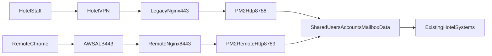

# Remote Admin ALB Access Implementation Plan

> **For agentic workers:** REQUIRED SUB-SKILL: Use `superpowers:subagent-driven-development` to execute task-by-task. Steps use checkboxes for tracking.
>
> **Execution posture:** Autonomous. Continue through implementation, verification, deployment, recovery, and evidence capture without routine user checkpoints. Stop only at a true blocker defined below.

**Goal:** Let any existing Nava account use `https://nava-admin.trynava.io` from ordinary Chrome without the hotel VPN, while preserving every existing LAN/VPN request path, mailbox permission, and long-lived legacy login.

**Architecture:** Keep the current hotel hostname, Nginx listener, shared host-neutral SPA artifact, and `http:8788` process as the legacy plane. Add a `remote-http:8789` process with its own Better Auth session store and an ALB-only Nginx target listener on `:8443`; both Nginx vhosts serve the same SPA files but proxy `/api` to their own HTTP process. Both processes use the existing users, accounts, mailbox permissions, database, and integrations.

**Tech Stack:** AWS ACM, ALB, WAF, S3 access logs, EC2 security groups/UFW, Nginx, PM2, Hono, Better Auth, Drizzle/Postgres, React Router, S3 presigned attachment URLs.

## Global Constraints

- Legacy staff remain on `https://nava.legacyhotels.co.za` through hotel LAN/VPN → `tun0:443` → existing `http:8788`; do not redirect, rehost, or shorten their sessions.
- Remote browser traffic must be `Chrome → ALB → EC2 VPC interface :8443 → remote-http:8789`; it must never traverse `tun0`.
- Network isolation is the accepted privacy boundary. Operators with EC2/SSM/application-log access, and downstream hotel systems reached by the shared backend, remain outside that guarantee.
- Any existing Nava account may sign in from either host. Existing `mailbox_access` remains the only authorization authority; remote access does not add a role or an allowlist.
- Legacy Better Auth policy remains behaviorally exact: 400-day expiry, seven-day rolling refresh, one-hour cookie cache.
- Remote Better Auth policy is fixed 12 hours, no session refresh, no cookie cache, host-only remote cookie, separate signing secret, and separate session table.
- Password-only remote access is an accepted product decision. WAF blocks an IP after 25 `POST /api/auth/sign-in/email` attempts in five minutes and applies a 1,000-request/five-minute remote-plane flood rule; strict host acceptance, bounded sessions, encrypted logs, and explicit revocation are compensating controls.
- Public TLS terminates at ACM/ALB. ALB-to-EC2 uses HTTP only within the VPC and is protected by an ALB-source security-group rule plus a UFW rule scoped to ALB subnet CIDRs on `ens5`; do not introduce self-signed target TLS.
- `remote-http` is a permanent peer of `http` after initial bootstrap. Every normal deploy, restart, and boot refreshes and verifies both processes. The remote runtime environment is mandatory and mode `0600`; missing or malformed remote configuration fails closed before PM2 mutation. Public ALB forwarding remains separately disabled by fixed `404` until cutover gates pass.
- Remote ALB has an HTTPS `:443` listener only. Its default action is fixed `404`; a single exact `Host: nava-admin.trynava.io` rule forwards to the remote target group. Do not add public HTTP `:80`, a wildcard host rule, or a public `/health` route.
- Put ALB access logs in a dedicated same-region S3 bucket using default `AES256` / SSE-S3 only. ALB does not support SSE-KMS for these logs. The bucket is `BucketOwnerEnforced`, Block Public Access, TLS-only, writeable only by ELB log delivery for this account/load-balancer ARN, and expires all log objects after 365 days.
- Preserve private S3 objects and add only the exact remote origin to GET/HEAD CORS. Never use wildcard origins.
- Never run Vitest with Pilot RDS. Before any Vitest command: `unset DATABASE_URL TEST_DATABASE_URL VITEST_ALLOW_PILOT_RDS CONFIRM_DISPOSABLE_TEST_DB HMS_DB_TEST_REQUIRED`. This plan must not start Docker, a local Postgres server, or any disposable database; all automated tests are pure unit/static contract tests with no database connection.
- Never source `.env.production` into a shell that runs Vitest. Never print secrets, database URLs, token values, or PII in SSM output or Git.
- Create a mode-`0700`, timestamped evidence directory outside the repository (for example `~/.nava-evidence/remote-admin/<UTC-ISO>/`); write only sanitized metadata/readbacks there at mode `0600`. It records commit SHA, account/region, resource ARNs, DNS/TLS status, SG/UFW summaries, and pass/fail browser checks—never secrets, cookies, request headers, addresses, or mail data.

## Autonomous Execution Mandate

**User granted full autonomous execution for this plan.** Continue until all done criteria have verified evidence or a true blocker is reached. No blocking questions for routine choices, no “which approach?” handoff, and no manual-login pause except the explicit human gates below.

### Communication

- Orchestrator and every subagent respond `/caveman ultra`; technical terms remain exact.
- Use standard non-fast subagents only. If unavailable, work inline.
- Choose best safe reversible option without asking. A better route to the accepted goal may be taken when logged in the final handoff; preserve requirements and do not silently cut scope.
- Before schema migration or public cutover, identify an authorized human verifier with an existing Nava account, an off-VPN Chrome profile, and a hotel VPN/LAN Chrome profile. The agent never receives credentials. Missing DNS-record access, ACM validation, or this human browser proof is a preflight blocker, not a post-deploy surprise.

### Required human gates — exact actions and timing

These are the only planned user actions. At each gate, agent stops, shows exact values, records only a pass/fail receipt, then continues autonomously. Never provide Lovable credentials, Nava credentials, cookies, secrets, or mail screenshots.

1. **Gate A — Add ACM validation CNAME in Lovable.**
   - **When:** Agent has requested the ACM certificate and reports its exact CNAME record name and value.
   - **You do:** Lovable → Workspace → Domains → `trynava.io` → DNS records → add a `CNAME` with the exact ACM name/value agent provides. Use Lovable’s default TTL. Do not edit apex `trynava.io`, `www`, nameservers, or existing records.
   - **Reply:** “ACM CNAME saved.”
   - **Why:** AWS must see this record before it can issue the trusted browser TLS certificate. No public app traffic is enabled at this point.

2. **Gate B — Add remote-admin CNAME in Lovable.**
   - **When:** ACM reports `ISSUED`; agent has created the ALB and reports its exact DNS name.
   - **You do:** In the same Lovable DNS view, add `CNAME` name `nava-admin` pointing to the exact ALB DNS name agent provides. Enter hostname only—no `https://`, path, IP address, or URL-forwarding rule. Leave existing domain records untouched.
   - **Reply:** “nava-admin CNAME saved.”
   - **Why:** This routes only `nava-admin.trynava.io` to the dedicated ALB. Hotel `nava.legacyhotels.co.za` traffic and the primary `trynava.io` site do not move.

3. **Gate C — Final browser proof.**
   - **When:** ALB target is healthy and the exact ALB host-forward rule is ready; agent instructs the two checks.
   - **You do:** First, off hotel VPN, open `https://nava-admin.trynava.io` in Chrome and sign in with any existing Nava account. Second, from hotel LAN/VPN, open `https://nava.legacyhotels.co.za` using an existing long-lived session. Follow only agent-provided safe checks: load mail, refresh once, open one CID image, and download one attachment.
   - **Reply:** “Remote pass / legacy pass” or a short failure symptom. Do not send account email, password, cookies, mail content, or screenshots.
   - **Why:** Automation proves routing/configuration; these two browser checks prove the real user boundary and that remote traffic did not change hotel workflows.

### AWS / infra (use freely)

- EC2: `i-008f737974a9ba9b3` in `af-south-1`.
- RDS: `nava-zero-mail-pilot` (Postgres 16).
- S3 mail bucket: `nava-zero-mail-845242190536-af-south-1`.
- EC2 repository: `/home/ubuntu/repos/zero`.
- Primary deploy: `apps/server-pilot/deploy/ops-deploy.sh` (`--migrate` when schema changes).
- Primary app bounce: `apps/server-pilot/deploy/ops-restart.sh`.
- Primary box reboot: `apps/server-pilot/deploy/ops-reboot.sh`.
- Fallbacks: `sync-ec2-git-bundle.sh`, `deploy-ec2.sh`, `ssm-run-command.sh`.

**Allowed:** normal commits; ops wrappers; bundle sync; deploy; migration only through `ops-deploy.sh --migrate`; read-only SSM/schema checks; PM2 logs; health curls; AWS provisioning/rollback defined by this plan; and unit/static tests with no database connection.

**Forbidden:** force-push main; `--no-verify`; destructive Git; IT Exchange/VPN/real-mail credential access; direct production database mutation outside existing migration/deploy flows; any Vitest/test command pointed at Pilot or production RDS; setting `VITEST_ALLOW_PILOT_RDS=1`; or sourcing `.env.production` into a test process.

### Pilot RDS safety (overrides autonomy)

Never run Vitest against `nava-zero-mail-pilot` or any production database. No autonomous escape hatch exists.

Before every local or EC2 Vitest command:

```bash
unset DATABASE_URL TEST_DATABASE_URL VITEST_ALLOW_PILOT_RDS CONFIRM_DISPOSABLE_TEST_DB HMS_DB_TEST_REQUIRED
```

Do not start Docker, a local Postgres server, or a disposable database for this plan. Redesign any proposed DB-backed test as a pure unit/static contract test. Use read-only schema/API health checks after the approved migration flow for database evidence; never weaken this rule to make a gate green.

### Execution and RCA loop

- Resume from the first incomplete task. Inspect current Git/progress state first; preserve unrelated uncommitted work and never discard it to simplify implementation.
- Implement test-first where task calls for it. For each task: focused test → implementation → focused proof → relevant build/lint → task review → commit → continue.
- On any red gate: **FAIL → reproduce minimally → identify root cause and mechanism with file:line evidence → research unfamiliar behavior when useful → smallest correct fix → test → commit → resume.**
- Symptom patches, skipped gates, “user can finish later,” and passing unrelated tests do not complete a task.

### Required subagent-driven development loop

- Before Task 1, scan this plan for conflicts. Resolve any true plan contradiction before implementation.
- Execute tasks sequentially: dispatch one fresh standard non-fast implementer per task with a task brief, require unit/static tests, self-review, and a normal commit. Do not parallelize implementation tasks that may touch shared deployment/auth files.
- After each task, generate a diff package and dispatch a fresh reviewer for both specification compliance and code quality. Critical or Important findings require a fix subagent, covering-test rerun, and re-review before the next task.
- Write each clean task result to `.superpowers/sdd/progress.md`. Completed ledger tasks are never re-dispatched. Finish with one broad whole-branch review and fix/re-review any material finding.

### Cursor execution-backend flake

Exact error: `Execution backend unavailable. Do not retry tool calls — the execution environment is down.`

Treat it as Cursor’s tool bridge, never as an app/AWS/RDS failure or human gate. Follow `docs/solutions/workflow-issues/cursor-execution-backend-unavailable.md`: retry Shell/Write/StrReplace after about 5s, 15s, and 45s until `echo shell_ok` succeeds; on recovery run `git status`, read `.superpowers/sdd/*progress*`, and resume current task. Record an evidence-backed blocker only after retries exhaust and the environment remains unavailable.

### Deployment and verification loop

Implement → focused tests → relevant broader tests/build/lint → independent task review → normal commit → deploy through the approved wrapper → read-only SSM/health evidence → browser/route proof → inspect evidence → fix any red → repeat.

Use the plan’s staged order: additive schema first, legacy-session compatibility canary before remote DNS cutover, remote readiness/ALB health before external traffic, then remote and legacy browser proofs. If a rollback trigger occurs, remove only the remote ALB host-forward rule; keep both loopback HTTP processes, target registration, remote ingress, legacy route, and additive database table intact.

### Done criteria

- [ ] Remote `https://nava-admin.trynava.io` reaches full application from off-VPN Chrome through ACM/ALB/WAF and never through `tun0`.
- [ ] Legacy `https://nava.legacyhotels.co.za` hostname, `:443 → :8788` path, UI/API/mail behavior, and 400-day rolling session remain verified unchanged.
- [ ] Remote email/password auth uses host-only secret/cookie, `remote_session`, 12-hour no-refresh/no-cache policy, and same `mailbox_access` authorization; password rotation revokes both planes and explicit remote revocation leaves legacy sessions intact.
- [ ] EC2 exposes no direct browser path to `:8788`/`:8789`; `:8443` accepts only ALB traffic; health turns unhealthy when `remote-http` is unavailable; unknown hosts are rejected.
- [ ] WAF rate controls, S3 exact-origin CORS, no-index response header, encrypted/private ALB logging, and remote-mode readiness all have recorded evidence.
- [ ] Shared SPA artifact, host-derived auth redirects, tRPC calls, CID images, and presigned attachments work from each serving host.
- [ ] All implementation units, acceptance criteria, task reviews, pure unit/static tests, local builds, and safe live checks pass with no test runner or local/disposable database touching Pilot RDS.
- [ ] No unresolved blocker affects plan goal.

### True blockers

Stop only for a missing credential/access entitlement that cannot be safely obtained, required human-only DNS/ACM/browser interaction, destructive ambiguity, a safety-policy conflict, or an external outage that prevents required proof. A database test is never a blocker for this plan: redesign it as a pure unit/static contract test.

## Product Contract

- **R1:** Existing hotel staff keep their current hostname, VPN route, frontend behavior, backend port, and long-lived sessions.
- **R2:** Remote Chrome clients reach the full application on `nava-admin.trynava.io` without hotel VPN.
- **R3:** Both hosts use same-origin browser calls; auth, tRPC custom headers, CID inline images, and presigned attachment downloads work on each host.
- **R4:** Remote sessions cannot collide with, extend, or revoke legacy sessions accidentally.
- **R5:** Remote entry is public at the ALB only. Direct EC2 target access, public target port, ALB bypass, broad host acceptance, indexing, and wildcard S3 CORS are forbidden.
- **R6:** Remote request path and deployment lifecycle are independently observable; legacy checks remain independently valid while remote ALB forwarding is disabled or rolled back.
- **R7:** Rollback disables only public remote ALB forwarding without changing hotel VPN ingress, target-only controls, or legacy users/data.

## Data Flow and Boundary



Remote traffic ends at the ALB, crosses only VPC-private networking to `:8443`, then reaches `remote-http`. Calls from either HTTP process to existing hotel systems retain their present routing, including VPN paths where those integrations require them.

## Existing Evidence and Decisions

- `apps/server-pilot/deploy/nginx.conf` is strict legacy-only `443 → 8788`; preserve those blocks byte-for-byte in behavior.
- `apps/server-pilot/src/main.ts` already chooses its port from `PORT`, so one additional HTTP fork is sufficient. It does not start workers.
- `apps/server-pilot/deploy/pm2.config.cjs` owns all process definitions; `deploy-ec2.sh`, `pm2-boot.sh`, and `ops-restart.sh` currently delete/restart an exact process set, so all three must include `remote-http`.
- `apps/server-pilot/src/lib/auth.ts` hard-codes a single 400-day session policy. Local Better Auth is `1.3.7`, which lacks the current fixed-session configuration used here; upgrade to `^1.6.26` before adding remote profile support.
- `apps/server-pilot/src/lib/auth.ts` already has a pure trusted-origin helper but `createAuth()` currently creates the DB adapter directly and `main.ts` builds public provider output directly. Profile/session/provider policy must move into pure exported builders so all new automated assertions run without constructing an auth instance, server, or database connection.
- `apps/server-pilot/src/main.ts` currently binds `0.0.0.0`; change its Hono `serve` options to bind `127.0.0.1` before any remote network work.
- `apps/mail` currently embeds `VITE_PUBLIC_APP_URL` in redirects, canonical metadata, and URL validation. Remove this build-time host dependency: client-only React Router loaders derive origin from `request.url`, navigation derives it from the browser, and no static bundle contains either hostname.
- CID projection uses `BETTER_AUTH_URL` in `apps/server-pilot/src/trpc/routes/mail.ts`; one static origin per HTTP process produces correct host-local inline URLs without client changes.
- Existing S3 CORS permits legacy/local origins only. Remote attachment fetches need `https://nava-admin.trynava.io` added to the same GET/HEAD rule.
- Live capacity evidence on 2026-08-10: `nava-zero-mail-pilot` is `db.t4g.medium`, reports `max_connections=400`, 15 total active connections (7 for `zero`), a 24-hour `DatabaseConnections` peak of 8, and 24-hour RDS CPU peak of 6.04%. Keep remote pool maximum at the user-approved 3, but re-run this read-only preflight before activation and refuse enable if the configured pool budget plus 20 operational connections is above 50% of live `max_connections`, or the preceding 24-hour connection peak is at least 25% of that limit.
- `docs/solutions/architecture-patterns/nava-internal-https-hostname-cutover.md` describes the legacy no-public-ingress plane. Preserve it as legacy guidance and add remote companion guidance; do not reinterpret it as permission to expose legacy `:443`.

## Implementation Units

### Task 1: Isolate remote Better Auth sessions without changing legacy sessions

**Files:**
- Modify: `pnpm-workspace.yaml`
- Modify: `pnpm-lock.yaml`
- Modify: `apps/server-pilot/src/db/schema/auth.ts`
- Modify: `apps/server-pilot/src/db/client.ts`
- Modify: `apps/server-pilot/src/lib/auth.ts`
- Modify: `apps/server-pilot/src/lib/auth-providers.ts`
- Modify: `apps/server-pilot/src/main.ts`
- Modify: `apps/server-pilot/src/db/seed.ts`
- Create: `apps/server-pilot/src/lib/auth-profile.ts`
- Create: `apps/server-pilot/drizzle/0017_remote_auth_session.sql`
- Modify: `apps/server-pilot/drizzle/meta/_journal.json`
- Create: `apps/server-pilot/scripts/revoke-remote-sessions.ts`
- Modify: `apps/server-pilot/tests/auth-session-ttl.test.ts`
- Modify: `apps/server-pilot/tests/auth-trusted-origins.test.ts`
- Create: `apps/server-pilot/tests/auth-session-profile.test.ts`
- Create: `apps/server-pilot/tests/remote-session-revocation.test.ts`
- Create: `apps/server-pilot/tests/remote-auth-data-safety.test.ts`

**Interfaces:**

```ts
export type AuthSessionProfile = 'legacy' | 'remote';
export function resolveAuthSessionProfile(
  env?: Record<string, string | undefined>,
): AuthSessionProfile;
export function resolveAuthProfilePolicy(
  env?: Record<string, string | undefined>,
): AuthProfilePolicy;
export function resolveDatabasePoolMax(
  profile: AuthSessionProfile,
): 3 | 10;
export function createAuth(): ReturnType<typeof betterAuth>;
```

```ts
export const remoteSession = pgTable('remote_session', { /* same columns as session */ });
export function getPublicAuthProviders(
  env: Record<string, string | undefined>,
  profile: AuthSessionProfile,
): PublicAuthProvider[];
```

`AuthProfilePolicy` is an exported pure object with `baseURL`, `trustedOrigins`,
`cookiePrefix`, `sessionModelName`, `expiresIn`, `updateAge`,
`disableSessionRefresh`, and `cookieCache`. `createAuth()` consumes this
policy plus the live adapter; neither the profile policy nor public-provider
view may import `getDb()` or start Hono.

- [ ] **Step 1: Add profile-characterization tests before changing auth code.**
  - Exercise only `resolveAuthProfilePolicy`, `resolveDatabasePoolMax`, and
    `getPublicAuthProviders` with literal environment maps; these tests must
    not call `createAuth()`, `getDb()`, `serve()`, or a database adapter.
  - Assert legacy profile emits `expiresIn = 400 days`, `updateAge = 7 days`, cookie cache enabled with one-hour maximum age, legacy cookie prefix, and only legacy origin.
  - Assert remote profile emits `expiresIn = 43_200`, `disableSessionRefresh = true`, cookie cache disabled, `better-auth-remote` cookie prefix, exact remote origin, and no shared cookie domain.
  - Assert an unknown `NAVA_AUTH_SESSION_PROFILE` fails closed.
  - Assert remote profile omits Google from both Better Auth social providers and `/api/public/providers`, even when inherited Google credentials exist; legacy behavior remains unchanged.
  - Assert remote profile uses a fixed database connection maximum of 3 while legacy/worker processes retain 10.
  - Add static data-safety contract coverage proving migration `0017` has only additive `remote_session`/index DDL; it must reject `DROP`, `TRUNCATE`, `DELETE`, `UPDATE`, mutation of existing auth tables, and any non-remote table creation.
  - Add unit/static seed and script contract coverage: session deletion source exists only below `shouldRotate`, targets legacy `session` plus `remote_session` for the same user, and emergency revoke targets only `remote_session` after exact-email + confirmation validation. It must never emit token/secret values.

- [ ] **Step 2: Run focused tests to establish red state.**

```bash
cd apps/server-pilot
unset DATABASE_URL TEST_DATABASE_URL VITEST_ALLOW_PILOT_RDS CONFIRM_DISPOSABLE_TEST_DB HMS_DB_TEST_REQUIRED
pnpm exec vitest run tests/auth-session-ttl.test.ts tests/auth-trusted-origins.test.ts tests/auth-session-profile.test.ts tests/remote-session-revocation.test.ts tests/remote-auth-data-safety.test.ts
```

Expected: new profile and static-revocation assertions fail because only legacy constants and `session` table exist; the migration-safety test fails because `0017` does not yet exist.

- [ ] **Step 3: Upgrade Better Auth and add remote session schema.**
  - Pin the workspace catalog version to `better-auth: 1.6.26` and regenerate `pnpm-lock.yaml` with pnpm; do not accept a floating minor upgrade in this compatibility-sensitive change.
  - Add `remoteSession` with the same core columns, foreign key, unique token, user index, and expiry index as `session`, but map it to physical table `remote_session`.
  - Add additive migration `0017_remote_auth_session.sql` creating only `remote_session` and its indexes; do not alter existing `session`, `user`, `account`, or mailbox tables.
  - Select Better Auth’s `session.modelName` per profile so legacy maps to `session` and remote maps to `remoteSession`. Better Auth 1.6.26 documents `modelName`, `expiresIn`, `updateAge`, `disableSessionRefresh`, and `cookieCache`; pin exactly `1.6.26`, then let TypeScript reject any API mismatch.
  - Build fixed profile-selected options internally before passing them to `betterAuth`; remove the unused optional override argument so callers cannot erase a profile’s session policy with a shallow merge.
  - Legacy process receives only `BETTER_AUTH_URL` and `BETTER_AUTH_SECRET` from `.env.production`. Remote process receives normal `BETTER_AUTH_URL` and `BETTER_AUTH_SECRET` only from `.env.remote-admin`, after the isolated `.env.remote-common` allowlist; PM2 does not map or inherit any `REMOTE_BETTER_AUTH_*` variables.
  - Keep cookies host-only. Do not enable `crossSubDomainCookies`, set a cookie domain, or add either origin as a trusted origin of the other process.
  - Profile-gate providers in both server registration and public provider listing: remote is email/password only even if Google credentials are present; legacy keeps existing optional Google behavior.
  - Replace the literal Postgres pool maximum with fixed profile behavior: `remote` process uses the user-approved 3; legacy and workers remain 10. Do not add a general `DATABASE_POOL_MAX` parser/config surface.
  - Bind Hono HTTP servers to `127.0.0.1`, not `0.0.0.0`; Nginx is the only EC2 listener exposed through either plane.

- [ ] **Step 4: Revoke both plane-specific sessions on deliberate password rotation.**
  - In the existing account/password rotation transaction, delete rows from both `session` and `remoteSession` for `actualUserId` only when `shouldRotate` is true.
  - Preserve the current non-rotation idempotency behavior. Remote sessions are checked from the database on every request and are invalid immediately. Legacy cookie-cache behavior stays unchanged by product decision: a deleted legacy session is rechecked and rejected within its existing one-hour cache maximum, not immediately.
  - Add `revoke-remote-sessions.ts` for emergency offboarding: require one exact target email and an explicit confirmation flag, delete only that account’s `remote_session` rows, and print only deletion count/status. It must never touch legacy sessions.

- [ ] **Step 5: Verify Better Auth upgrade compatibility before remote activation.**
  - Compare generated Drizzle migration content against the intended additive `remote_session` migration; any proposed mutation to existing Better Auth tables blocks deployment.
  - Before production deploy, keep an existing legacy browser session open. After code/package deployment but before ALB DNS cutover, prove that legacy session still loads `/mail` without signing in again.
  - If the legacy canary fails, restore the prior reviewed package revision and restart both HTTP processes; retain the unused additive `remote_session` table and do not run a destructive schema rollback.

- [ ] **Step 6: Run focused proof.**

```bash
cd apps/server-pilot
unset DATABASE_URL TEST_DATABASE_URL VITEST_ALLOW_PILOT_RDS CONFIRM_DISPOSABLE_TEST_DB HMS_DB_TEST_REQUIRED
pnpm exec vitest run tests/auth-session-ttl.test.ts tests/auth-trusted-origins.test.ts tests/auth-session-profile.test.ts tests/remote-session-revocation.test.ts tests/remote-auth-data-safety.test.ts
pnpm build
```

Expected: legacy assertions remain exact; remote profile is fixed at 12 hours; source/migration contracts reject destructive database behavior; TypeScript build passes. `DATABASE_URL`, `TEST_DATABASE_URL`, and Docker remain unused.

### Task 2: Run a second HTTP process and deploy one host-neutral SPA artifact

**Files:**
- Modify: `apps/server-pilot/deploy/pm2.config.cjs`
- Create: `apps/server-pilot/deploy/write-ec2-remote-env.sh`
- Modify: `apps/server-pilot/deploy/deploy-ec2.sh`
- Modify: `apps/server-pilot/deploy/ops-deploy.sh`
- Modify: `apps/server-pilot/deploy/ops-restart.sh`
- Modify: `apps/server-pilot/deploy/ops-reboot.sh`
- Modify: `apps/server-pilot/deploy/pm2-boot.sh`
- Modify: `apps/server-pilot/deploy/post-boot-smoke.sh`
- Modify: `apps/server-pilot/tests/deploy-config.test.ts`
- Modify: `apps/mail/app/routes.ts`
- Modify: `apps/mail/app/(routes)/mail/layout.tsx`
- Modify: `apps/mail/app/(routes)/mail/page.tsx`
- Modify: `apps/mail/app/(routes)/mail/[folder]/page.tsx`
- Modify: `apps/mail/app/(routes)/mail/create/page.tsx`
- Modify: `apps/mail/app/(routes)/mail/compose/page.tsx`
- Modify: `apps/mail/app/(routes)/settings/layout.tsx`
- Modify: `apps/mail/app/mailto-handler.ts`
- Modify: `apps/mail/lib/constants.tsx`
- Modify: `apps/mail/lib/site-config.ts`
- Modify: `apps/mail/components/ui/nav-main.tsx`
- Modify: `apps/mail/worker-configuration.d.ts`
- Create: `apps/mail/tests/remote-host-build.test.ts`

**Interfaces:**

```text
PM2 http        PORT=8788  NAVA_AUTH_SESSION_PROFILE=legacy
PM2 remote-http PORT=8789  NAVA_AUTH_SESSION_PROFILE=remote  DB pool=3

/var/www/nava-mail   one SPA built with VITE_PUBLIC_BACKEND_URL=""
                    and no VITE_PUBLIC_APP_URL host value

/home/ubuntu/repos/zero/apps/server-pilot/.env.production
                    legacy-compatible runtime values, including legacy Better Auth
/home/ubuntu/repos/zero/apps/server-pilot/.env.remote-common
                    explicit HTTP runtime allowlist, excluding legacy Better Auth,
                    POP3, HMS, and Google-provider credentials; mode 0600
/home/ubuntu/repos/zero/apps/server-pilot/.env.remote-admin
                    remote BETTER_AUTH_URL + BETTER_AUTH_SECRET; mode 0600;
                    mandatory for every normal deploy, restart, and boot
```

- [ ] **Step 1: Add deploy contract tests first.**
  - Assert one `http` process on `8788` and one `remote-http` process on `8789`.
  - Assert neither process definition starts worker, AI worker, or HMS worker code.
  - Assert one artifact is built once with `VITE_PUBLIC_BACKEND_URL=""`, copied once to `/var/www/nava-mail`, and contains neither legacy nor remote hostname.
  - Assert client loaders derive redirects from `request.url`, navigation validation uses current browser origin, and metadata does not set a baked canonical/OG host.
  - Assert `/mailto-handler` is a frontend route outside proxied `/api/`; legacy `/api/mailto-handler` direct links redirect host-locally to it before generic `/api/` proxying.
  - Assert every deploy, restart, and boot path validates `.env.remote-common` and `.env.remote-admin` before PM2 mutation, then starts `remote-http` exactly once beside `http`. Missing, insecure, or malformed remote files fail the operation without changing a running process set. Preserve existing worker behavior by mail transport mode and still forbid generic HMS worker startup.
  - Assert `write-ec2-remote-env.sh` creates both remote files. Remote start happens in a subshell that sources only `.env.remote-common` then `.env.remote-admin`; it must never source `.env.production`. Its explicit allowlist contains only HTTP-required shared runtime settings (database, S3, region, mail-send, app/AI controls) and excludes legacy Better Auth, POP3, HMS, and Google-provider credentials. Assert the remote secret's JSON shape is exactly `{"BETTER_AUTH_SECRET":"<non-empty>"}` and no source/log command prints it.
  - Assert smoke probes both loopback APIs and both Nginx vhosts on every normal deploy, restart, and boot without `curl -k`.

- [ ] **Step 2: Run deploy contract test to establish red state.**

```bash
cd apps/server-pilot
unset DATABASE_URL TEST_DATABASE_URL VITEST_ALLOW_PILOT_RDS CONFIRM_DISPOSABLE_TEST_DB HMS_DB_TEST_REQUIRED
pnpm exec vitest run tests/deploy-config.test.ts
```

Expected: new remote-process and host-neutral-artifact assertions fail.

- [ ] **Step 3: Add remote process, secret loading, and deterministic asset deployment.**
  - Add `remote-http` to PM2 with exactly one fork of `dist/main.js`, `PORT=8789`, remote profile, remote URL, and remote signing secret. The profile itself fixes its database pool at 3; every existing process retains pool maximum 10.
  - Preserve `.env.production` as the legacy-compatible environment. Add `write-ec2-remote-env.sh`; initial provisioning runs it immediately after code sync and before the first normal deploy. In its short-lived bootstrap shell it reads the established legacy runtime file only to render an explicit allowlisted `.env.remote-common`; it never copies or prints legacy Better Auth, POP3, HMS, or Google-provider credentials. It retrieves only `BETTER_AUTH_SECRET` from the dedicated Secrets Manager JSON secret `nava-zero/server-pilot/remote-auth`, validates a non-empty string without echoing it, and atomically writes `.env.remote-admin` owner `ubuntu`, mode `0600`, containing the fixed remote URL and secret. Fetch failure or a malformed secret aborts before replacing either remote env file.
  - In each deploy/restart/boot path, source `.env.production` only for legacy processes. Start `remote-http` from a subshell which sources `.env.remote-common` then `.env.remote-admin`; PM2's remote entry sets `PORT=8789` and `NAVA_AUTH_SESSION_PROFILE=remote`. Legacy `http`, `worker`, `ai-worker`, and `hms-ai-worker` never source either remote file. Missing/insecure remote files stop the operation before PM2 mutation.
  - Do not add a normal deploy/reboot disable path. Emergency remote rollback removes only the ALB host-forward rule; `remote-http` stays loopback-only and continues to be refreshed beside legacy `http`.
  - Remove `VITE_PUBLIC_APP_URL` from browser runtime behavior. Build absolute redirect URLs from each client loader’s `request.url`; use browser origin for navigation validation; omit baked canonical/OG host metadata; and remove the obsolete public-env declaration.
  - Move frontend mailto handler to `/mailto-handler`. Preserve legacy direct `/api/mailto-handler` links with an exact host-local Nginx redirect before generic `/api/` proxying, so no frontend route is swallowed by Hono.
  - Build SPA once with explicit empty `VITE_PUBLIC_BACKEND_URL`, then copy it once to `/var/www/nava-mail`. Both Nginx vhosts serve this root, preserving same-origin `/api`, auth cookies, and tRPC custom-header behavior without runtime config injection.
  - Add `remote-http` to PM2 delete/start/save lists in every normal deploy, fixture/real mode, restart, and boot. Do not add it to worker or HMS lifecycle functions.
  - Require both `:8788` and `:8789` loopback health for every deploy. Preserve existing VPN hard assertion and assert neither raw HTTP process listens on `ens5`.
  - Make `ops-reboot.sh` invoke `pm2-boot.sh` after SSM returns Online and before `post-boot-smoke.sh`. `pm2-boot.sh` validates both remote env files, starts/saves both HTTP processes from current deployed code, and `post-boot-smoke.sh` proves both loops are healthy. PM2 resurrection is only interim startup, never the final reboot gate.

- [ ] **Step 4: Run focused proof.**

```bash
cd apps/server-pilot
unset DATABASE_URL TEST_DATABASE_URL VITEST_ALLOW_PILOT_RDS CONFIRM_DISPOSABLE_TEST_DB HMS_DB_TEST_REQUIRED
pnpm exec vitest run tests/deploy-config.test.ts
pnpm --filter @zero/mail build
pnpm --filter @zero/server build
```

Expected: static contract checks prove one shared web root, both HTTP processes, host-neutral browser URLs, and singleton workers; both packages build with no API CORS dependency.

### Task 3: Add ALB-only remote Nginx target without changing legacy listener

**Files:**
- Modify: `apps/server-pilot/deploy/nginx.conf`
- Modify: `apps/server-pilot/deploy/deploy-ec2.sh`
- Modify: `apps/server-pilot/tests/deploy-config.test.ts`

**Interfaces:**

```text
Legacy: nava.legacyhotels.co.za :443 → 127.0.0.1:8788, unchanged
Remote health: :8443 /health → 127.0.0.1:8789/health only for ALB Host: 172.31.12.112:8443
Remote app: nava-admin.trynava.io :8443 → /var/www/nava-mail and 127.0.0.1:8789 for /api only
```

- [ ] **Step 1: Add Nginx contract tests first.**
  - Keep assertions that legacy `:80`/`:443`, certificate paths, host rejection, CSP, and `:8788` proxy remain present.
  - Assert a dedicated `:8443` default vhost returns `444`; a separate exact `server_name 172.31.12.112` health vhost proxies only `/health` to `127.0.0.1:8789/health` for ALB’s private-IP Host header; every other host/path returns `444`.
  - Assert exact remote-host vhost uses shared `/var/www/nava-mail`, redirects legacy `/api/mailto-handler` before generic API proxying, proxies remaining `/api/` to `127.0.0.1:8789`, sets `Host`, `X-Forwarded-For`, and `X-Forwarded-Proto https`, includes existing browser security headers, and always sends `X-Robots-Tag: noindex, nofollow, noarchive`. It must return `404` for public `/health`; ALB health exists only on the private-IP default vhost.
  - Assert remote listener has no public certificate/key configuration and does not modify legacy blocks.

- [ ] **Step 2: Run Nginx contract test to establish red state.**

```bash
cd apps/server-pilot
unset DATABASE_URL TEST_DATABASE_URL VITEST_ALLOW_PILOT_RDS CONFIRM_DISPOSABLE_TEST_DB HMS_DB_TEST_REQUIRED
pnpm exec vitest run tests/deploy-config.test.ts
```

Expected: remote target vhost assertions fail before configuration exists.

- [ ] **Step 3: Add host-safe ALB target configuration.**
  - Retain deploy script’s transactional Nginx backup, validation, reload, signal rollback, and permission behavior.
  - Add a `default_server` on `:8443` that returns `444`. Add a separate exact `server_name 172.31.12.112` virtual host whose only successful route is `/health`, proxied to `remote-http`; ALB health checks send this target private-IP Host header. Verify the configured private IP equals the primary `ens5` address before Nginx reload. A stopped `remote-http` must make target health fail; arbitrary Host values must not receive health.
  - Add a separate named remote server for `nava-admin.trynava.io`; reject unexpected request hosts before SPA/API routing.
  - Use HTTP between ALB and target. The remote vhost sets the forwarded protocol to `https` because only the ALB HTTPS listener reaches this target.
  - Keep the remote listener and `remote-http` permanently healthy on loopback. The remote ALB target remains unregistered and its public listener returns fixed `404` until AWS cutover gates pass.

- [ ] **Step 4: Run focused proof.**

```bash
cd apps/server-pilot
unset DATABASE_URL TEST_DATABASE_URL VITEST_ALLOW_PILOT_RDS CONFIRM_DISPOSABLE_TEST_DB HMS_DB_TEST_REQUIRED
pnpm exec vitest run tests/deploy-config.test.ts
bash -n deploy/deploy-ec2.sh
```

Expected: Nginx install rollback tests stay green and remote listener contract is enforced by static tests.

### Task 4: Provision public AWS edge and restricted target path

**Files:**
- Modify: `apps/server-pilot/deploy/aws-resources.md`
- Modify: `apps/server-pilot/deploy/launch-readiness.sh`
- Modify: `apps/server-pilot/tests/deploy-config.test.ts`
- Modify: `docs/runbooks/centurion-day-one-operations.md`
- Modify: `docs/solutions/architecture-patterns/nava-internal-https-hostname-cutover.md`
- Create: `docs/solutions/architecture-patterns/nava-remote-admin-alb-companion.md`

**AWS resources:**

```text
Lovable DNS:
  ACM validation CNAME
  nava-admin.trynava.io CNAME → ALB DNS name

ALB:
  public HTTPS :443 only; default fixed 404, exact host rule forwards
  ACM certificate for nava-admin.trynava.io
  target group HTTP :8443, path /health, matcher 200
  WAF managed rules + rate rules: 25 POST /api/auth/sign-in/email and 1,000 total requests per IP per 5 minutes
  dedicated access-log S3 bucket: AES256/SSE-S3, 365-day expiry, Block Public Access, BucketOwnerEnforced, TLS-only deny, and least-privilege ALB log-delivery policy

EC2:
  existing security groups remain attached
  new target security group: inbound TCP/8443 only from ALB security group
  UFW: default deny; tun0 TCP/443 unchanged; ens5 TCP/8443 only from ALB subnet CIDRs
```

- [ ] **Step 1: Extend readiness tests before implementation.**
  - Preserve legacy-mode requirement for no public ingress and tunnel-only `443`.
  - Add explicit remote-admin mode assertions: remote host/ALB target group/WAF identifiers required; require the ALB target to be healthy only when `REMOTE_TARGET_HEALTH_REQUIRED=1`; its HTTPS listener default is fixed `404` and only exact remote Host forwards; every SG attached to EC2 permits `8443` only from the ALB SG; no direct public IPv4/IPv6 target path; UFW retains exact `tun0:443` and adds only ALB-subnet CIDRs on `ens5:8443`; remote S3 CORS exists with no wildcard; ALB logging is `AES256` / SSE-S3 only, Block Public Access, BucketOwnerEnforced, TLS-only bucket policy, 365-day lifecycle, and only the ELB log-delivery write permission.
  - Assert the WAF scopes one 25-attempt/five-minute rule to `POST /api/auth/sign-in/email` and a second 1,000-request/five-minute rule to the remote plane.
  - Assert remote mode still runs `vpn-health-assert.sh` and fails if default route changes to `tun0`.

- [ ] **Step 2: Run focused readiness contract tests to establish red state.**

```bash
cd apps/server-pilot
unset DATABASE_URL TEST_DATABASE_URL VITEST_ALLOW_PILOT_RDS CONFIRM_DISPOSABLE_TEST_DB HMS_DB_TEST_REQUIRED
pnpm exec vitest run tests/deploy-config.test.ts
```

Expected: remote-admin readiness and CORS assertions fail before AWS-edge contract exists.

- [ ] **Step 3: Document and provision edge resources.**
  - Begin the remote-admin runbook with a read-only preflight that pins `AWS_REGION=af-south-1`, account `845242190536`, VPC `vpc-0f078e17a5f0f8599`, EC2 `i-008f737974a9ba9b3`, its ENI and all attached SGs, ALB subnets `subnet-0e6446aaaeaa8762e` / `subnet-094bf8643d98c22f6`, and the required IAM actions. Record IDs/ARNs to the sanitized evidence manifest. Refuse mutation if account, region, VPC, DNS control, existing target ingress, or prerequisite permissions differ.
  - Request the ACM certificate first, then stop at **Gate A** with its exact validation CNAME. After the user replies “ACM CNAME saved,” poll for `ISSUED` for at most 45 minutes. Do not create the HTTPS listener or request the public `nava-admin` DNS record until issuance succeeds.
  - Create a mode-`0600` local JSON file for one remote secret key only: `{"BETTER_AUTH_SECRET":"<48-byte base64url>"}`. Use `aws secretsmanager create-secret --name nava-zero/server-pilot/remote-auth --secret-string file://...` or an explicit guarded rotate path; erase the local temporary file. Extend only `NavaZeroSecretsRead` with `GetSecretValue`/`DescribeSecret` on this exact secret ARN. Verify EC2 retrieval by JSON key name and string length only, never value output. Document secret rotation: create new value, write remote env, restart only `remote-http`, validate remote login, then retire the old version.
  - Add executable, idempotent CLI/runbook steps for ACM request/wait, target group, ALB, listener, host rule, target registration, two exclusive SGs, attached-EC2-SG readback, UFW, WAF, logs, CORS, and readiness. Use deterministic names: `nava-remote-admin`, `nava-remote-http-8443`, `nava-remote-admin-alb`, `nava-remote-admin-target`, `nava-remote-admin-waf`, and `nava-zero-remote-alb-logs-845242190536-af-south-1`. Commands accept only resource IDs/ARNs as operator inputs and never print secrets.
  - Create an internet-facing ALB in the two named public subnets with a dedicated ALB SG: inbound TCP/443 from `0.0.0.0/0`, outbound TCP/8443 only to the dedicated EC2-target SG. Create a target group on HTTP/8443 `/health`, matcher 200, 30-second deregistration delay. Create its HTTPS listener with default fixed `404` only; do not register the target or create the priority-10 exact host-forward rule until Task 5 remote readiness is green. No port-80 listener.
  - Create a dedicated EC2 target SG with only inbound TCP/8443 from the ALB SG, attach it without replacing existing groups, then read all attached SGs and fail if any has an IPv4/IPv6/CIDR ingress or a non-ALB SG source to TCP/8443. Add UFW allow rules only for `172.31.0.0/20` and `172.31.32.0/20` on `ens5:8443`; preserve `tun0:443`; collect `ufw status numbered`, listener addresses, and VPN route as sanitized readback.
  - Create the same-region log bucket with default `AES256` / SSE-S3—never SSE-KMS—Block Public Access, BucketOwnerEnforced, TLS-only bucket policy, 365-day object-expiry lifecycle, and an ELB service-principal write policy restricted by `aws:SourceAccount=845242190536`, `aws:SourceArn` for the named load balancer, and the exact `AWSLogs/845242190536/*` prefix. Enable logs and prove delivery of an object after a harmless remote-host request within 15 minutes.
  - Configure AWS managed WAF baseline rules plus a source-IP `25`/five-minute rule scoped to `POST /api/auth/sign-in/email` and source-IP `1,000`/five-minute remote-plane rule. Attach it only to the remote ALB. SNS, CloudWatch alarm resources, and alert routing are explicitly out of scope for this MVP.
  - After the ALB DNS name is available, stop at **Gate B**. After the user replies “nava-admin CNAME saved,” poll DNS for at most 45 minutes; stop with recorded evidence if it does not settle. Add the remote origin to existing S3 GET/HEAD CORS only through established read-before-write, semantic readback, and compare-before-rollback protocol.
  - Extend `launch-readiness.sh` with a `REMOTE_ADMIN_MODE=1` branch that resolves the fixed-name remote ALB/target/WAF/SG/log resources. `REMOTE_TARGET_HEALTH_REQUIRED=0` validates all pre-registration controls without requiring a registered target; `=1` additionally requires a healthy target. Absent remote mode remains available only for legacy-only recovery diagnostics. Add static tests for all three paths. Every normal `ops-deploy.sh` invokes the exact SSM pre-registration command `cd /home/ubuntu/repos/zero && REMOTE_ADMIN_MODE=1 REMOTE_TARGET_HEALTH_REQUIRED=0 bash apps/server-pilot/deploy/launch-readiness.sh` after both loopback/Nginx health checks.
  - Add companion documentation stating that ALB exposure applies only to the new host/target SG; legacy hostname remains internal DNS + `tun0:443` with zero legacy SG ingress.

- [ ] **Step 4: Run non-mutating local validation.**

```bash
cd apps/server-pilot
unset DATABASE_URL TEST_DATABASE_URL VITEST_ALLOW_PILOT_RDS CONFIRM_DISPOSABLE_TEST_DB HMS_DB_TEST_REQUIRED
pnpm exec vitest run tests/deploy-config.test.ts
bash -n deploy/launch-readiness.sh deploy/post-boot-smoke.sh deploy/ops-deploy.sh deploy/ops-restart.sh deploy/ops-reboot.sh deploy/pm2-boot.sh
```

Expected: legacy and remote readiness contracts coexist; scripts pass shell syntax checks without contacting AWS or RDS.

### Task 5: Verify dual-host auth, inline media, and rollback with unit/local surfaces

**Files:**
- Modify: `apps/server-pilot/tests/cid-images.test.ts`
- Modify: `apps/server-pilot/tests/process-email-content.test.ts`
- Modify: `apps/server-pilot/tests/inline-attachment-http.test.ts`
- Modify: `apps/mail/tests/` host-specific redirect coverage or create `apps/mail/tests/remote-host-build.test.ts`
- Modify: `apps/server-pilot/deploy/post-boot-smoke.sh`
- Modify: `apps/server-pilot/deploy/launch-readiness.sh`

**Verification cases:**

- [ ] **Step 1: Run distributed unit/static compatibility proof.**
  - Task 1 owns profile/cookie/provider/session-table/revocation characterization; Task 2 owns host-neutral SPA and process lifecycle tests; Task 3 owns Nginx host/health/loopback tests; Task 4 owns CORS/WAF/SG/readiness tests. Do not create a second aggregate configuration suite.
  - Keep Task 5 focused on non-overlapping existing mail behavior: legacy and remote `BETTER_AUTH_URL` inputs produce their own CID inline URLs; inline attachments preserve cookie/mailbox authorization; and build output remains host-neutral. Database-backed assertions of `mailbox_access` are deliberately excluded by the no-database rule and instead receive live browser proof in Step 3.

- [ ] **Step 2: Run pure tests only; never start a database.**

```bash
cd apps/server-pilot
unset DATABASE_URL TEST_DATABASE_URL VITEST_ALLOW_PILOT_RDS CONFIRM_DISPOSABLE_TEST_DB HMS_DB_TEST_REQUIRED
pnpm exec vitest run tests/cid-images.test.ts tests/process-email-content.test.ts tests/inline-attachment-http.test.ts tests/auth-session-profile.test.ts tests/deploy-config.test.ts
```

Expected: every listed test passes with no database connection. Do not set `TEST_DATABASE_URL`; database-backed integration cases are out of scope for this plan.

- [ ] **Step 3: Execute staged deployment and live proofs.**
  - Complete ACM/DNS, ALB, WAF, logging, SG/UFW, secret, and target-group provisioning while the HTTPS listener remains its fixed default `404` and no target is registered. Capture preflight evidence and confirm the human verifier/device availability before migration.
  - Pin the reviewed commit SHA and additive migration SHA-256 in the evidence manifest. Apply migration exactly once through `bash apps/server-pilot/deploy/ops-deploy.sh --migrate`; do not run Vitest, seed, Docker, or any local/disposable database during deployment. Before migration, verify the reviewed SQL is additive-only. After migration, use a read-only schema query to prove `remote_session` and its indexes exist and the existing `session` table columns/indexes remain unchanged. Do not roll back schema DDL.
  - Sync the reviewed code bundle, run `write-ec2-remote-env.sh` through SSM to create both mandatory remote env files, then run the normal `bash apps/server-pilot/deploy/ops-deploy.sh --migrate`. It updates and verifies both `http` and `remote-http` while the ALB remains fixed `404` and no target is registered.
  - Prove an already-open legacy browser session loads `/mail` without reauthentication, then run legacy readiness. If it fails, restore the prior reviewed package revision and restart both HTTP processes while retaining the unused additive table.
  - Register the already-healthy remote process as ALB target, wait for `healthy`, run the exact full gate `REMOTE_ADMIN_MODE=1 REMOTE_TARGET_HEALTH_REQUIRED=1 bash apps/server-pilot/deploy/launch-readiness.sh` through SSM, then create the exact HTTPS host-forward rule. Record command exit codes and sanitized readbacks.
  - Verify ALB target health is `healthy`; remote external Chrome login, page refresh, tRPC request, CID image, and attachment download work with an existing account.
  - Verify legacy LAN/VPN Chrome login, long-lived existing session, mail flow, CID image, and attachment download remain unchanged.
  - Before cutover, run `sudo -n /usr/sbin/tcpdump --version >/dev/null` over SSM and record only success/failure. Lack of non-interactive capture privilege is a preflight blocker for the packet proof. Verify network separation with: unchanged `vpn-health-assert.sh` host-route proof; target SG/UFW readback; bounded metadata-only `sudo -n timeout 15 /usr/sbin/tcpdump -nn -i ens5 -c 4 'tcp dst port 8443'` packet-summary during an authorized remote request; and no `tun0:8443` listener or route. Never capture payload, headers, cookies, or mail content.

- [ ] **Step 4: Prove rollback is legacy-safe.**
  - Immediate rollback order: delete the exact HTTPS host-forward rule so the listener’s default fixed `404` stops remote traffic; prove the remote host returns `404`. Keep target registration, `ens5:8443` UFW, target-SG ingress, and `remote-http` healthy and included in normal PM2 deploy/reboot state. Retain ALB/DNS/ACM as a deliberate `404` safety state until a separate teardown decision.
  - Restore order: confirm the existing target remains healthy, run full remote readiness, then recreate the exact host-forward rule. Never recreate it before readiness passes.
  - Retain the additive `remote_session` table and shared SPA files; they are unused data/artifacts, not a reason to risk a destructive migration rollback.
  - Confirm `nava.legacyhotels.co.za:443 → http:8788` and VPN hard health remain green throughout rollback.

## Acceptance Criteria

- `https://nava-admin.trynava.io` loads from off-VPN Chrome with trusted ACM TLS.
- Existing hotel hostname, Nginx `:443`, frontend artifact, backend `:8788`, and 400-day rolling session behavior remain unchanged.
- Every existing Nava account can use either host; mailbox visibility remains exactly controlled by existing `mailbox_access`.
- Remote sessions exist only in `remote_session`, expire at 12 hours without refresh/cache, use a remote-only host cookie/signing secret, and cannot authenticate legacy routes. An explicit remote-session revoke leaves legacy sessions untouched; password rotation revokes remote sessions immediately and legacy sessions no later than their preserved one-hour cookie-cache revalidation.
- Remote SPA/API, CID inline images, auth redirects, tRPC custom-header requests, and S3 attachment downloads remain same-origin/host-correct.
- Public access reaches ALB only. EC2 `:8443` accepts only ALB-originated VPC traffic; `:8788` and `:8789` remain direct-browser-inaccessible.
- Legacy VPN traffic and remote browser/ALB traffic remain separate; `vpn-health-assert.sh` still proves host default route is not `tun0`.
- Every normal deploy/restart/boot validates remote runtime files and starts exactly one isolated `remote-http` process beside legacy `http`; ALB forwarding remains independently controllable.
- WAF rate limit, AES256/SSE-S3 ALB logs with 365-day retention, strict ALB/Nginx host rejection, no-index header, no wildcard S3 CORS, and remote-mode readiness all have sanitized evidence.
- All automated checks use no database. No Docker/local Postgres/disposable database starts, and no test runner contacts Pilot RDS.

## Acceptance-to-evidence trace

- **Legacy plane unchanged — Tasks 1–3:** auth-profile and deploy-config tests plus mail/server builds; an existing legacy session reaches `/mail` and VPN readiness stays green. Any failure triggers package/PM2 rollback before remote cutover.
- **Remote auth isolation — Task 1:** pure profile/provider/revocation and additive-DDL tests; remote login/revoke works with an existing account. If a legacy cookie authenticates remotely or a remote cookie authenticates legacy, remove the ALB host rule.
- **Single host-neutral SPA — Tasks 2 and 5:** host-build/deploy-config/CID tests; both hosts complete login, navigation, CID, and attachment checks. Any baked hostname or wrong-origin redirect stops cutover.
- **Public edge has no bypass — Tasks 3 and 4:** Nginx/readiness static contracts; ALB rule/default, all EC2 SGs, UFW, listener-address, and `vpn-health-assert` readbacks. Any public target path removes the host rule; target ingress remains ALB-only.
- **Edge resilience and observability — Task 4:** static WAF/logging contract; healthy target, WAF association, log delivery, and CORS semantic readback. Missing log delivery retains ALB fixed `404`.
- **Legacy-safe remote rollback — Task 5:** script/config contract; remove only the ALB host-forward rule to fixed `404`, while target registration, ALB-only ingress, both HTTP processes, and legacy health remain green.

