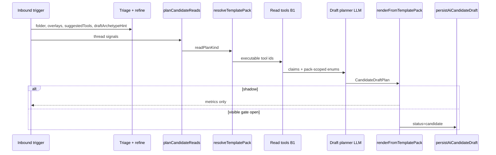

# AI Drafting Tool Portfolio — Template-Routing Plan

> **For agentic workers:** REQUIRED SUB-SKILL: Use superpowers:subagent-driven-development (recommended) or superpowers:executing-plans to implement this plan task-by-task. Steps use checkbox (`- [ ]`) syntax for tracking.

**Goal:** Lock which **read tools** to build/activate and how **template routing** (not a compose tool) produces claim-safe HITL drafts for Centurion v1, grounded in Aug-30 corpus reanalysis.

**Architecture:** Triage → shadow ledger (folder, tools, diagnostic archetype) → **`planCandidateReads()`** picks read archetype → **`resolveTemplatePack(readPlanKind)`** picks template pack → read tools → claims → draft planner picks **closed enums + claim IDs only** → **`renderFromTemplatePack()`** (deterministic) → optional `persistAiCandidateDraft(status=candidate)` under HITL promotion ladder. No `draft_mail_compose` registry tool. No free-form `bodyMarkdown`. Writes deferred Wave 3.

**Tech Stack:** TypeScript, Zod, `candidate-read-plan.ts`, `draft-evidence.ts`, `candidate-draft-agent.ts`, disposable DB for Vitest (never pilot RDS).

## Global Constraints

- Pilot-RDS safety: never Vitest against production pilot DB; never `VITEST_ALLOW_PILOT_RDS=1`.
- `HMS_DRAFT_ENRICHMENT_MODE`: `off` | `shadow` only.
- All external sends HITL; no autonomous send.
- Tool coverage thread counts overlap — never sum to 100%.
- Template pack strings are **static code**; no thread-text interpolation into pack prose.
- **`CandidateReadPlan.kind` is canonical** for template pack + read tools. Triage `draftArchetypeHint` is diagnostic only; read plan wins on mismatch (`router_mismatch` metric).

---

## Architecture pivot (replaces compose-tool plan)

| Old (rejected) | New (this plan) |
| --- | --- |
| `draft_mail_compose` HMS/registry tool | No compose tool |
| LLM outputs `bodyMarkdown` | LLM outputs `CandidateDraftPlan` enums + claim IDs |
| Compose as 5th registry entry | `resolveTemplatePack()` + `renderFromTemplatePack()` in `draft-evidence.ts` |
| Triage picks template directly | Read plan kind → pack (single router) |

Existing code already implements the core pattern:

```1:4:apps/server-pilot/src/ai/candidate-draft-agent.ts
/**
 * Claim-safe HMS candidate draft generation.
 * Tools are read-only; claims are code-owned; model picks templates + claim IDs only.
 */
```

---

## Evidence base (Aug-30)

| Measure | Value |
| --- | ---: |
| Threads | 2,810 |
| Draft-target threads | 1,393 (49.6%) |
| Unanswered external (forward KPI) | 865 (30.8%) |
| Human-gold backfill | 87 msgs / 73 threads |
| Full read+compose (quote archetype) | 264 (18.95% of draft targets) |
| Partial needs write | 939 (67.4%) |
| Live tools today | 0% |

Source: `.private/connected-mailbox-corpus/follow-up/_work/corpus-tool-rediscovery-2026-09-01.json`

Corpus draft archetypes → template packs (v1 subset):

| Corpus archetype | Threads | v1 pack | Read plan kind |
| --- | ---: | --- | --- |
| `quote_draft` | 264 | `quote` | `quote` |
| `booking_reconcile_draft` | 267 | `reservation` | `reservation` |
| `payment_draft` | 120 | `folio` | `reservation` + folio followup (Tier B) |
| `documents_draft` | 76 | `documents` | `reservation` + documents followup (Tier C) |
| `internal_handoff_note` | 497 | `reservation` | `reservation` (status prose, no create) |
| `guest_service_draft` | 61 | `reservation` | `reservation` (Tier B.5 prefs deferred) |
| `group_status_draft` | 50 | `reservation` | `group` (defer until B5) |

**v1 packs (4):** `quote` | `reservation` | `artifact_reservation` | `clarification`

---

## Read tools: build / defer / skip

| Tool | Verdict | Phase B | Draft-target threads | Notes |
| --- | --- | --- | ---: | --- |
| **`hms_find_reservation`** | **BUILD B1** | B1 | 1,120 | Identity spine |
| **`hms_quote_stay`** | **BUILD B1** | B1 | 264 | Only full draft archetype |
| **`mail_read_artifact`** | **BUILD B1** | B1 | 524 | Dual evidence path |
| **`hms_read_folio`** | **BUILD Tier B** | B3 | 169 | After gold eval; enables `folio` pack |
| **`hms_list_documents`** | **BUILD Tier C** | B2 | 76 | Enables `documents` pack |
| **`hms_guest_preferences_read`** | **DEFER** | — | 61 | Post gold-eval if guest_service fails |
| **`hms_sent_email_audit`** | **DEFER** | B2 | 76 | Wave 3 send path |
| **`hms_company_account_read`** | **DEFER** | B4 | 120 | Surface blocker |
| **`hms_group_block_read`** | **DEFER** | B5 | 50 | Surface blocker |
| **`hms_event_read`** | **DEFER** | B5 | 50 | Surface blocker |
| **All Wave 3 writes** | **DEFER** | — | — | HITL; v1 = email draft not PMS create |
| **`event_fnb_edit`** | **SKIP** | — | 0 | Zero demand |

**v1 lean stop:** B1 trio + 4 template packs + gold eval gate. Folio pack Tier B. Documents pack Tier C. No corpus RAG v1.

---

## Key Technical Decisions

**KTD1.** No compose registry tool. Renderer stays code-owned in `draft-evidence.ts`.

**KTD2.** Single router: `CandidateReadPlan.kind` → `TemplatePackId` → allowed opening/closing tuples + read tool set. Triage `draftArchetypeHint` optional for shadow eval; never overrides read plan.

**KTD3.** On router mismatch (triage hint ≠ read plan kind): log `router_mismatch`, proceed with read plan, fail closed if pack unresolved.

**KTD4.** `suggestedTools` from triage U5 (`2026-08-31-002`) intersects session `activeToolIds`; does not replace `planCandidateReads()` — both must agree or fail closed.

**KTD5.** Tool budget priority when exhausted: find → quote → artifact → folio → list_documents.

**KTD6.** Visible draft promotion (Task 5) blocks staff-facing Tier A ship; shadow metrics OK before that.

**KTD7.** Subject line: pack default string per `TemplatePackId` for v1 (not LLM-generated).

---

## Data flow



---

## File map

| File | Change |
| --- | --- |
| `apps/server-pilot/src/ai/draft-template-registry.ts` | NEW — `TemplatePackId`, `resolveTemplatePack`, pack→template tuples |
| `apps/server-pilot/src/ai/draft-evidence.ts` | MODIFY — `renderFromTemplatePack`, pack-scoped validation |
| `apps/server-pilot/src/ai/candidate-draft-agent.ts` | MODIFY — wire pack into plan gen + render |
| `apps/server-pilot/src/hms/candidate-read-plan.ts` | REFERENCE — canonical read plan kind |
| `apps/server-pilot/src/ai/workflow-triage-contract.ts` | MODIFY (U2 triage) — add optional `draftArchetypeHint` |
| `apps/server-pilot/src/ai/suggested-tools.ts` | NEW (U5 triage) — folder→tools; no pack duplication |
| `apps/server-pilot/tests/draft-template-registry.test.ts` | NEW |
| `apps/server-pilot/tests/draft-evidence.test.ts` | MODIFY — per-pack render cases |
| `apps/server-pilot/scripts/run-centurion-draft-backtest.ts` | Gold eval gate |

---

### Task 1: Template pack registry

**Files:**
- Create: `apps/server-pilot/src/ai/draft-template-registry.ts`
- Test: `apps/server-pilot/tests/draft-template-registry.test.ts`
- Reference: `apps/server-pilot/src/hms/candidate-read-plan.ts` (`CandidateReadPlan` kinds)

**Interfaces:**
- Produces: `TemplatePackId`, `resolveTemplatePack(kind: CandidateReadPlan['kind']): TemplatePackId | null`, `templatePackSchema`, `allowedTemplateTuples(packId)`

- [ ] **Step 1: Write failing test**

```typescript
import { describe, expect, it } from 'vitest';
import {
  resolveTemplatePack,
  allowedTemplateTuples,
} from '../src/ai/draft-template-registry.js';

describe('resolveTemplatePack', () => {
  it('maps quote read plan to quote pack', () => {
    expect(resolveTemplatePack('quote')).toBe('quote');
  });

  it('maps reservation to reservation pack', () => {
    expect(resolveTemplatePack('reservation')).toBe('reservation');
  });

  it('returns null for unknown kinds until pack exists', () => {
    expect(resolveTemplatePack('group')).toBeNull();
  });

  it('returns allowed opening/closing tuples per pack', () => {
    const tuples = allowedTemplateTuples('quote');
    expect(tuples).toContainEqual({
      openingTemplate: 'acknowledge_request',
      closingTemplate: 'await_confirmation',
    });
  });
});
```

- [ ] **Step 2: Run test — expect FAIL**

Run: `cd apps/server-pilot && unset DATABASE_URL VITEST_ALLOW_PILOT_RDS && pnpm exec vitest run tests/draft-template-registry.test.ts -v`

Expected: FAIL — module not found

- [ ] **Step 3: Implement registry**

```typescript
import type { CandidateReadPlan } from '../hms/candidate-read-plan.js';

export const TEMPLATE_PACK_IDS = [
  'quote',
  'reservation',
  'artifact_reservation',
  'clarification',
] as const;

export type TemplatePackId = (typeof TEMPLATE_PACK_IDS)[number];

const READ_PLAN_TO_PACK: Partial<
  Record<CandidateReadPlan['kind'], TemplatePackId>
> = {
  quote: 'quote',
  reservation: 'reservation',
  artifact_reservation: 'artifact_reservation',
};

export function resolveTemplatePack(
  kind: CandidateReadPlan['kind'],
): TemplatePackId | null {
  return READ_PLAN_TO_PACK[kind] ?? null;
}

export function allowedTemplateTuples(packId: TemplatePackId) {
  // v1: quote uses await_confirmation; reservation uses invite_questions
  if (packId === 'quote') {
    return [
      {
        openingTemplate: 'acknowledge_request' as const,
        closingTemplate: 'await_confirmation' as const,
      },
      {
        openingTemplate: 'thanks_for_details' as const,
        closingTemplate: 'await_confirmation' as const,
      },
    ];
  }
  return [
    {
      openingTemplate: 'acknowledge_request' as const,
      closingTemplate: 'invite_questions' as const,
    },
    {
      openingTemplate: 'thanks_for_details' as const,
      closingTemplate: 'invite_questions' as const,
    },
  ];
}

export function defaultSubjectForPack(packId: TemplatePackId): string {
  switch (packId) {
    case 'quote':
      return 'Re: Your stay enquiry';
    case 'artifact_reservation':
      return 'Re: Your reservation';
    case 'clarification':
      return 'Re: Additional information required';
    default:
      return 'Re: Your request';
  }
}
```

- [ ] **Step 4: Run test — expect PASS**

- [ ] **Step 5: Commit**

```bash
git add apps/server-pilot/src/ai/draft-template-registry.ts apps/server-pilot/tests/draft-template-registry.test.ts
git commit -m "feat(ai): add draft template pack registry from read plan kind"
```

---

### Task 2: Pack-aware render

**Files:**
- Modify: `apps/server-pilot/src/ai/draft-evidence.ts`
- Modify: `apps/server-pilot/src/ai/draft-template-registry.ts`
- Test: `apps/server-pilot/tests/draft-evidence.test.ts` (create if missing)

**Interfaces:**
- Consumes: `TemplatePackId`, existing `renderCandidate`, `CandidateDraftPlan`
- Produces: `renderFromTemplatePack(packId, plan, claims)`, `assertPlanMatchesPack(packId, plan)`

- [ ] **Step 1: Write failing test**

```typescript
import { describe, expect, it } from 'vitest';
import {
  renderFromTemplatePack,
  assertPlanMatchesPack,
} from '../src/ai/draft-evidence.js';

describe('renderFromTemplatePack', () => {
  it('rejects opening/closing tuple not allowed for pack', () => {
    expect(() =>
      assertPlanMatchesPack('quote', {
        outcome: 'candidate',
        salutation: 'generic',
        openingTemplate: 'acknowledge_request',
        closingTemplate: 'invite_questions',
        selectedClaimIds: ['c1'],
      }),
    ).toThrow(/closingTemplate/);
  });
});
```

- [ ] **Step 2: Run — expect FAIL**

- [ ] **Step 3: Implement `assertPlanMatchesPack` + `renderFromTemplatePack`** delegating to `renderCandidate` after validation

- [ ] **Step 4: Run — expect PASS**

- [ ] **Step 5: Commit** — `feat(ai): pack-aware candidate draft render`

---

### Task 3: Wire pack into claim-safe draft agent

**Files:**
- Modify: `apps/server-pilot/src/ai/candidate-draft-agent.ts`
- Test: `apps/server-pilot/tests/hms-candidate-agent.test.ts`

**Interfaces:**
- Consumes: `resolveTemplatePack`, `renderFromTemplatePack`
- Produces: pack id threaded through `runClaimSafeCandidateDraft` result metadata

- [ ] **Step 1: Write failing test** — quote thread fixture yields `templatePackId: 'quote'` in result

- [ ] **Step 2: Run — expect FAIL**

- [ ] **Step 3: After `planCandidateReads`, resolve pack; null pack → `insufficient_evidence`; validate plan against pack before render**

- [ ] **Step 4: Run — expect PASS**

- [ ] **Step 5: Commit** — `feat(ai): wire template pack into claim-safe draft path`

---

### Task 4: Regression — no compose tool in registry

**Files:**
- Test: `apps/server-pilot/tests/read-tools-registry.test.ts` (new small test)

- [ ] **Step 1: Write failing test**

```typescript
import { READ_TOOL_IDS } from '../src/hms/read-tools.js';

it('READ_TOOL_IDS contains reads only', () => {
  for (const id of READ_TOOL_IDS) {
    expect(id).not.toMatch(/compose|send|create|attach/);
  }
});
```

- [ ] **Step 2–4: Run — PASS**

- [ ] **Step 5: Commit** — `test(hms): registry has no compose or write tools`

---

### Task 5: Gold eval gate (shadow-only)

**Files:**
- `apps/server-pilot/scripts/run-centurion-draft-backtest.ts`
- Scorecard output: `docs/infor-hms/draft-template-gold-eval-2026-09-01.json` (aggregates only)

- [ ] **Step 1: Run backtest on fixtures**

Run: `cd apps/server-pilot && unset DATABASE_URL VITEST_ALLOW_PILOT_RDS && pnpm exec tsx scripts/run-centurion-draft-backtest.ts --draft claim-safe-stub --sample gold-pairs --limit 10`

Expected: exit 0; scorecard includes pack id column

- [ ] **Step 2: Record pass bar** — document in scorecard JSON: pack resolution accuracy, render success rate on 73-thread gold set

- [ ] **Step 3: Gate** — Tier B (folio pack + `hms_read_folio` activation) blocked until baseline committed

---

### Task 6: Visible-draft promotion ladder (execution blocker)

**Files:** `apps/server-pilot/src/ai/worker.ts`, `apps/server-pilot/src/env.ts`, tests

- [ ] **Step 1: Document current behavior** — shadow discards bodies; `off` mode persists skeleton only

- [ ] **Step 2: Design + TDD** new promotion flag/mode for claim-safe visible persist (no forbidden `enabled` mode)

- [ ] **Gate:** staff-visible HMS-enriched candidates require Task 6

---

### Task 7 (conditional): Folio + documents packs

**Trigger:** Task 5 gold eval pass + Phase B tool live proof

- Enable `folio` pack when `hms_read_folio` active
- Enable `documents` pack when `hms_list_documents` active
- Extend `READ_PLAN_TO_PACK` + `allowedTemplateTuples` accordingly

---

### Task 8 (conditional): Triage `draftArchetypeHint`

**Trigger:** U2 workflow triage schema lands (`2026-08-31-002`)

- Add optional `draftArchetypeHint` to triage output for shadow eval
- Emit `router_mismatch` metric when hint ≠ `planCandidateReads` kind
- Do **not** let hint override read plan

---

## gstack-plan-eng-review (executed 2026-09-01)

**Verdict: PASS-with-gaps** — pivot accepted; gaps folded into tasks above.

| Finding | Disposition |
| --- | --- |
| Stale compose-tool plan on disk | **Fixed** — this artifact |
| Triage not wired to draft | **Task 8** — hint only; read plan canonical (KTD2) |
| Triple-router drift | **Resolved** — single router via read plan kind |
| Pack ↔ enum validation | **Task 2** |
| Subject line gap | **KTD7** — pack defaults |
| Gold eval dimensions | **Task 5** |
| HITL promotion | **Task 6** |
| Performance SLO | **Ops follow-up** |

---

## ponytail-review (executed 2026-09-01)

**Verdict: PASS** — leaner than compose-registry plan.

| Finding | Disposition |
| --- | --- |
| Delete draft_mail_compose entirely | **Done** |
| Cap packs at ~4 v1 | **Done** |
| No dual triage/read routing | **KTD2** read plan wins |
| No corpus RAG v1 | **Deferred** post gold-eval failure |
| Inline registry in draft-evidence if small | **Separate file OK** — pack count will grow Tier B/C |
| sent_email_audit / guest_prefs cut | **Kept deferred** |

**net:** ~220 lines removed vs compose plan; ~80 lines net-new for registry + wiring.

---

## Review reconciliation

| Eng vs Ponytail | Resolution |
| --- | --- |
| Eng: triage outputs templatePackId | Ponytail: dual router yagni → **derived from read plan**; triage hint diagnostic only |
| Eng: extend many per-pack CandidateDraftPlan unions | Ponytail: shrink → **validate tuples against pack**, single plan shape |
| Eng: guest_prefs integration | **Deferred** conditional |

---

## Expected coverage (unchanged)

| Denominator | Full draft | Partial |
| --- | ---: | ---: |
| 1,393 draft targets | ~264 (19%) | ~1,120 (80%) |
| 865 unanswered | ~254 (29%) | ~611 (71%) |

---

## Sources

- `.private/connected-mailbox-corpus/follow-up/_work/corpus-tool-rediscovery-2026-09-01.json`
- `docs/plans/2026-09-01-001-feat-corpus-tool-rediscovery-plan.md`
- `docs/plans/2026-08-31-002-feat-centurion-workflow-triage-plan.md`
- `apps/server-pilot/src/ai/candidate-draft-agent.ts`, `draft-evidence.ts`, `candidate-read-plan.ts`

---

## GSTACK REVIEW REPORT

| Review | Result |
| --- | --- |
| gstack-plan-eng-review | **PASS-with-gaps** (folded) |
| ponytail-review | **PASS** |
| gstack-plan-design-review | N/A |
| gstack-plan-devex-review | N/A |

**Planning blockers:** none.

**Execution blockers:** Task 5 gold baseline; Task 6 visible persist.

**Decisions locked:** No compose tool; template packs from read plan kind; B1 trio v1; 4 packs; writes Wave 3; no corpus RAG v1.

**Next:** `/nava-run` Task 1 when ready.
