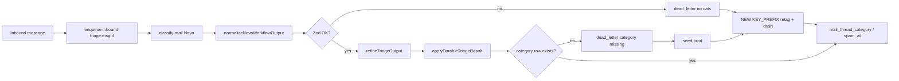

# Complete AI Triage (EOTriage) Implementation Plan

> **For agentic workers:** REQUIRED SUB-SKILL: Use superpowers:subagent-driven-development (recommended) or executing-plans to implement this plan task-by-task. Steps use checkbox (`- [ ]`) syntax for tracking. **Execution posture:** test-first (TDD) for code tasks; canary-then-full for pilot repair.

**Goal:** Finish Centurion EOTriage so every eligible inbound thread in store gets durable triage tags (folder and/or spam), with no silent untagged backlog from Nova dialect Zod dead-letters or missing category rows.

**Architecture:** Keep Zod fail-closed. Normalize only observed Nova dialect before validation. Seed workflow categories on every active transport. Repair stuck `inbound-triage:{messageId}` dead-letters with a **new** retag `KEY_PREFIX` + bound `--targets` manifest (ingest keys never resume). Gate ops on actionable inbound-untagged count (exclude outbound-only and `RUN_DEADLINE`-only noise).

**Tech Stack:** `apps/server-pilot` triage v6 (Mastra mail-triage, Drizzle/Postgres), Centurion snapshot/retag/audit scripts, pilot EC2 SSM ops, Vitest (disposable DB only).

## Global Constraints

- Never run Vitest against pilot RDS. Always `unset DATABASE_URL VITEST_ALLOW_PILOT_RDS` before tests. Never set `VITEST_ALLOW_PILOT_RDS=1`.
- Never source `.env.production` into a test process.
- Keep never-spam and staff-outbound not-spam behavior intact.
- Keep Zod fail-closed for unknown model output after normalize.
- No topic-specific spam fingerprints (no POPIA/Daisy one-offs). Spam quality = model + existing general `salesSignal` / refine after triage succeeds.
- Retag/seed/ops may use pilot `DATABASE_URL` on EC2 only; Vitest never does.
- Do not implement Outlook sent-copy ingest in this plan (known gap; out of store → cannot triage).

## Evidence Baseline (/95)

**Verdict:** Actionable missing badges = durable apply never ran after `inbound_triage` dead_letter (mainly Nova dialect Zod; one nava category-missing). Not UI hide. Not “succeeded but forgot cats” (0 cases).

**Evidence:**

- Live: ~77 `inbound-triage:%` dead_letter + untagged clear; screenshot cohort (POPIA, bed bugs, CTI cancel, tours FW) all in that set.
- Worker log: `automationState: excluded_external` ZodError for POPIA; residual unmapped dialect (`confirm`, `manual_review`, `external_guest`, `primaryFolder=spam`).
- `enqueueAiRun` uses `onConflictDoNothing` on `inbound-triage:{id}` — dead_letter not resumed by ingest replay (`apps/server-pilot/src/ai/run-ledger.ts`, `apps/server-pilot/src/mail/ingest/store.ts`).
- Retag resumes only `retry_wait`/`dead_letter` under **same** `{KEY_PREFIX}:{messageId}` (`apps/server-pilot/scripts/retag-centurion-triage.mjs`).
- `transport-nava` missing 10/11 workflow primaries; apply throws `AI category missing` (`apps/server-pilot/src/ai/triage.ts` ~1252).
- Quality retag `RUN_DEADLINE` ~241 mostly already tagged (~9 still untagged) — separate from live ingest-key wound.
- Wave B compound: `docs/solutions/logic-errors/centurion-triage-quality-wave-b-nova-domain-retag.md`.

**Counterevidence checked:** Untagged “no run” ~493 → 479 outbound-only (expected). Succeeded+untagged = 0.

**95 threshold:** met for repair strategy. Remaining: exact fixture allowlist IDs at execution time (re-query July fixtures).

**Route:** local code + pilot read-only SQL/logs. No web.



## Scope

### In scope

1. Expand Nova dialect normalize + contract tests.
2. Ensure/seed workflow categories on all active transports + readiness/audit gate.
3. Actionable inbound-untagged audit gate (with `RUN_DEADLINE` noise handling).
4. Bound-manifest repair of actionable dead-letter cohort (canary → full) + rollback.
5. Quality closeout (`--quality` + real `--q11-volume`).

### Out of scope

- Outlook From `centurion@` → external sent-copy ingest (never hits `navaai@`).
- HMS write tools, draft activation, urgent-model redesign.
- Soft-skipping missing categories in apply.

## Locked Decisions

1. Unknown values after normalize stay fail-closed.
2. Canonical residual mappings (implement in `normalizeNovaWorkflowOutput` / early `parseWorkflowModelOutput`):

| Field | Nova value | Canonical |
|-------|------------|-----------|
| `automationState` | `excluded_external`, `manual_review`, `manual-review`, `manual_review_required` | `unknown` |
| `humanAction` | `confirm`, `manual_review`, `manual-review`, `manual_review_required`, `mark_as_spam`, `mark-as-spam` | `review_required` |
| `sourceScope` | `external_guest` | `external` |
| `primaryFolder` | `spam` | set `isSpam=true`, set `primaryFolder=unknown-review` |
| `suggestedTools` | `mark_as_spam`, `mark-as-spam` | drop via `NOVA_TOOL_MARKERS_TO_DROP` |

3. Repair mechanism for ingest-key dead-letters: **new** `KEY_PREFIX` + `--targets` only (never depend on re-ingest).
4. Category-missing stays hard fail; fix with `CONFIRM_PILOT_SEED=1 pnpm seed:prod`.
5. Deploy order: **code deploy → seed:prod → repair retag**.
6. Abort spam spike = gold `spam-fp=0` and `neverSpamNegatives` recall fail, or post-canary spam delta > +5 unlocked vs pre-snapshot on canary set.

## File Map

| File | Responsibility |
|------|----------------|
| `apps/server-pilot/src/ai/workflows/mail-triage.ts` | Nova alias maps + `primaryFolder:spam` coercion |
| `apps/server-pilot/tests/ai-triage-contract.test.ts` | Dialect normalize + fail-closed tests |
| `apps/server-pilot/src/db/seed.ts` / `src/ai/categories.ts` | Workflow category seed rows (already present; ensure used) |
| `apps/server-pilot/deploy/launch-readiness.sh` | Workflow-slug completeness for **all active transports** |
| `apps/server-pilot/src/ops/centurion-triage-quality-audit.ts` | Actionable untagged gate + DL reason buckets |
| `apps/server-pilot/scripts/emit-centurion-actionable-untagged-manifest.mjs` | **Create:** SQL cohort → bound targets manifest |
| `apps/server-pilot/scripts/retag-centurion-triage.mjs` | Apply repair (existing) |
| `apps/server-pilot/scripts/snapshot-centurion-triage.mjs` | Pre-repair snapshot (existing) |
| `apps/server-pilot/scripts/restore-centurion-triage-snapshot.mjs` | Abort rollback (existing) |
| `apps/server-pilot/tests/` for emit + audit gate | Unit tests for cohort predicate / manifest shape |

## Autonomous Execution Mandate

**User granted full autonomy.** No blocking questions overnight. No manual login. No "which approach?" pause.

### Communication

- Orchestrator + every subagent: **Respond `/caveman ultra`. Technical terms exact.**

### Decision authority

- Choose best safe reversible option without asking.
- Better route to accepted goal may be taken; log what changed and why.
- Preserve requirements. Do not silently cut scope.
- Use standard non-fast subagents only; otherwise work inline.

### AWS / infra (use freely)

| Resource | ID / path |
|----------|-----------|
| EC2 | `i-008f737974a9ba9b3` (`af-south-1`) |
| RDS | `nava-zero-mail-pilot` (Postgres 16) |
| S3 | `nava-zero-mail-845242190536-af-south-1` |
| Repo on EC2 | `/home/ubuntu/repos/zero` |
| **Primary deploy** | `apps/server-pilot/deploy/ops-deploy.sh` |
| **Primary app bounce** | `apps/server-pilot/deploy/ops-restart.sh` |
| Guts (fallback) | `sync-ec2-git-bundle.sh`, `deploy-ec2.sh`, `ssm-run-command.sh` |

**Allowed:** ops wrappers, bundle sync, deploy, seed (`CONFIRM_PILOT_SEED=1`, no `--rotate` unless fix requires), read-only SSM checks, PM2 logs, health curl, tests against disposable non-production database, pilot retag/audit/restore with new KEY_PREFIX.

**Forbidden:** force-push main, `--no-verify`, destructive git, IT Exchange/VPN/real mail creds, any Vitest pointed at pilot/production RDS, `VITEST_ALLOW_PILOT_RDS=1`, sourcing `.env.production` into a test process.

### Pilot RDS safety (overrides autonomy)

Before every Vitest:

```bash
unset DATABASE_URL VITEST_ALLOW_PILOT_RDS
```

Missing disposable DB is a safety blocker. Pilot verification = read-only SQL/API, health, or purpose-built ops scripts — never Vitest on pilot.

### RCA loop

FAIL → reproduce minimally → root cause (file:line) → smallest correct fix → test → resume. No symptom patches. No “user can finish later.”

### Cursor execution-backend flake

Exact string `Execution backend unavailable...` → backoff-retry Shell/Write/StrReplace; see `docs/solutions/workflow-issues/cursor-execution-backend-unavailable.md`. Not an app RCA.

### Done criteria (binary)

- [ ] Dialect residual mappings above pass contract tests; unknown alias still fails closed
- [ ] Every active transport has active rows for all 11 `AI_WORKFLOW_PRIMARY_SLUGS` + `urgent`
- [ ] Launch-readiness (or equivalent gate) fails if any active transport missing a workflow slug
- [ ] Actionable inbound untagged count = 0 (exclude fixture allowlist; exclude outbound-only; do not fail solely on tagged `RUN_DEADLINE` rows)
- [ ] Screenshot cohort threads (POPIA, bed bugs, CTI cancel, tours FW) have durable cats and/or `spam_at` as appropriate
- [ ] Repair KEY_PREFIX drained; no post-seed `AI category missing` on centurion/nava
- [ ] `--quality` audit `ok: true` with real `--q11-volume`
- [ ] Handoff report under `docs/superpowers/plans/handoff-reports/` with SQL proof
- [ ] No unresolved true blocker affecting goal

### True blockers

Stop only for missing credentials/access, human-only interaction, destructive ambiguity, safety-policy conflict, or external outage preventing required proof.

## Execution Mode

Autonomous. Resume from first incomplete task. REQUIRED SUB-SKILL: superpowers:subagent-driven-development. Next entry after plan approval in chat history: `/nava-run` (or continue-autonomously / overnight). No routine checkpoints.

---

### Task 1: Nova dialect normalize + contract tests

**Files:**
- Modify: `apps/server-pilot/src/ai/workflows/mail-triage.ts` (`NOVA_*_ALIASES`, `NOVA_TOOL_MARKERS_TO_DROP`, `normalizeNovaWorkflowOutput` / `parseWorkflowModelOutput`)
- Test: `apps/server-pilot/tests/ai-triage-contract.test.ts`
- Note: update existing `rejects spam as a primary folder` schema test if coercion moves rejection to pre-validate path — assert parse accepts dialect `primaryFolder:'spam'` → `unknown-review` + `isSpam:true`, and raw `validateWorkflowTriageOutput({ primaryFolder:'spam' })` still throws

**Interfaces:**
- Consumes: existing `classifyWorkflowMailTriage` adapter mock pattern in contract tests
- Produces: normalized `WorkflowTriageOutput` for residual dialect values listed in Locked Decisions

- [ ] **Step 1: Write failing tests** for each residual mapping (one focused `it` or one table-driven `it` covering automationState/humanAction/sourceScope/spam-folder/mark_as_spam tool drop)
- [ ] **Step 2: Write failing negative test** — `automationState: 'totally_unknown_xyz'` still rejects
- [ ] **Step 3: Run** `unset DATABASE_URL VITEST_ALLOW_PILOT_RDS && pnpm vitest apps/server-pilot/tests/ai-triage-contract.test.ts` — expect FAIL on new cases
- [ ] **Step 4: Implement** minimal alias + `primaryFolder:spam` coercion only
- [ ] **Step 5: Re-run** same Vitest — expect PASS
- [ ] **Step 6: Commit** with message focused on why (Nova dialect dead-letters)

---

### Task 2: Category seed completeness + readiness gate

**Files:**
- Verify: `apps/server-pilot/src/db/seed.ts` (`seedAiManagedCategories` / `AI_MANAGED_CATEGORY_SEED_ROWS`)
- Verify: `apps/server-pilot/tests/seed-contract.test.ts`, `apps/server-pilot/tests/categories-contract.test.ts`
- Modify: `apps/server-pilot/deploy/launch-readiness.sh` — replace legacy-5 centurion-only count with: every **active** transport has all 11 workflow primaries + `urgent` active
- Ops: `apps/server-pilot/scripts/seed-prod.ts` (`CONFIRM_PILOT_SEED=1 pnpm seed:prod`)

**Interfaces:**
- Consumes: `AI_WORKFLOW_PRIMARY_SLUGS` + `urgent` from `apps/server-pilot/src/ai/categories.ts`
- Produces: readiness check that fails when `transport-nava` (or any active transport) missing a workflow slug

- [ ] **Step 1: Confirm seed-contract already asserts both transports**; if gap, add failing assertion for workflow primaries on `transport-nava`
- [ ] **Step 2: Write failing readiness check** (shell snippet or test harness matching launch-readiness SQL) for missing nava slugs
- [ ] **Step 3: Update launch-readiness.sh** to workflow-slug completeness across active transports
- [ ] **Step 4: Local verify** seed-contract Vitest with `unset DATABASE_URL VITEST_ALLOW_PILOT_RDS`
- [ ] **Step 5: Commit** readiness gate
- [ ] **Step 6 (pilot, after code deploy):** `CONFIRM_PILOT_SEED=1 pnpm seed:prod` then SQL prove zero missing workflow slugs on active transports

---

### Task 3: Actionable inbound-untagged audit gate

**Files:**
- Modify: `apps/server-pilot/src/ops/centurion-triage-quality-audit.ts`
- Modify: `apps/server-pilot/scripts/audit-centurion-triage-retag.mjs` and/or `run-centurion-triage-quality-audit.mjs` as needed to surface gate
- Test: existing quality/audit test file(s) under `apps/server-pilot/tests/` (extend; create only if no home)

**Predicate (authoritative):**

```sql
-- actionable_inbound_untagged
mail_thread.spam_at IS NULL
AND EXISTS (inbound message on thread)
AND NOT EXISTS (mail_thread_category row)
AND thread_id NOT IN (:fixture_allowlist)
```

Fixture allowlist (re-verify at run time; baseline from corpus): July test threads with `guest@example.com` / `aroransh17@gmail.com` / OVN-* navaai fixtures without production value — export IDs via SQL before gate lands.

DL reason buckets (observability, not false-fail):

- `workflow failed` (`last_error = 'mail triage workflow failed: failed'`)
- `category missing` (`last_error LIKE 'AI category missing%'`)
- `RUN_DEADLINE` (`failure_class = 'RUN_DEADLINE'`) — report separately; **do not** count tagged threads with only historical RUN_DEADLINE as actionable untagged

- [ ] **Step 1: Write failing unit test** for gate predicate / classification helper with fixture rows
- [ ] **Step 2: Implement** gate + buckets
- [ ] **Step 3: Vitest** with unset pilot env — PASS
- [ ] **Step 4: Commit**

---

### Task 4: Emit actionable-untagged manifest + live repair

**Files:**
- Create: `apps/server-pilot/scripts/emit-centurion-actionable-untagged-manifest.mjs`
- Test: `apps/server-pilot/tests/emit-centurion-actionable-untagged-manifest.test.ts` (driver-injected; no pilot DB in Vitest)
- Use existing: `snapshot-centurion-triage.mjs`, `retag-centurion-triage.mjs`, `restore-centurion-triage-snapshot.mjs`, `poll-quality-retag-status.mjs`, `inspect-quality-retag-dead-letters.mjs`, `audit-centurion-triage-retag.mjs`

**Interfaces:**
- Consumes: `computeTriggerHash`, `computePreStateHash`, `validateApprovedRolloutManifest`, `computeCanonicalManifestHash` from retag module; Task 3 predicate
- Produces: approved-rollout-manifest JSON (`transportId`, `modelId`, `promptVersion`, `promptHash`, `targets[]` with `threadId`, `triggerMessageId`, `triggerHash`, `preStateHash`) + companion snapshot for restore

**KEY_PREFIX:** `inbound-triage-retag-v6-dl-repair-YYYYMMDDHHMM` (new each attempt; never reuse after successes).

**Abort → rollback:** if canary fails abort thresholds, run `restore-centurion-triage-snapshot.mjs` against pre-canary snapshot for canary thread set; stop full apply.

**Abort thresholds:**

- Any `AI category missing` after Task 2 seed
- New unknown-dialect Zod after Task 1 deploy (inspect DL errors on repair prefix)
- Gold spam-fp / neverSpamNegatives fail, or canary unlocked spam delta > +5 vs snapshot

- [ ] **Step 1: Write failing tests** for emit script: given fake driver rows matching actionable predicate, manifest validates; outbound-only and fixture IDs excluded
- [ ] **Step 2: Implement** emit script
- [ ] **Step 3: Vitest PASS**
- [ ] **Step 4: Commit** emit tool
- [ ] **Step 5: Deploy** tip to EC2 (`GIT_BRANCH=main` only after local `main` FF to tip / `fix/phaseone` synced as needed) via `ops-deploy.sh`
- [ ] **Step 6: Pilot seed** `CONFIRM_PILOT_SEED=1 pnpm seed:prod`; prove nava workflow slugs present
- [ ] **Step 7: Re-query** actionable count; emit manifest + snapshot
- [ ] **Step 8: Canary** — slice first 10 targets; dry-run then `--apply` with new KEY_PREFIX; drain `--drain-prefix` with `--timeout-ms` ≥ 3600000
- [ ] **Step 9: Verify canary** tags written; abort/restore if thresholds hit
- [ ] **Step 10: Full cohort** apply + drain in batches of ≤25 if needed (operational batching; no code batch flag)
- [ ] **Step 11: Audit** `audit-centurion-triage-retag.mjs` + Task 3 gate = 0 actionable
- [ ] **Step 12: Residual quality prefix** — if still-untagged under `inbound-triage-retag-v6-quality-202609030122`, re-apply **same** quality prefix (dead_letter resume) + drain; fold FortiMail donor `--from-domain` + `--include-non-spam` only if spam_at still null on known donors
- [ ] **Step 13: Commit** any script tweaks discovered; handoff SQL proof

---

### Task 5: Quality closeout

**Files:**
- Ops: `apps/server-pilot/scripts/run-centurion-triage-quality-audit.mjs` / `audit-centurion-triage-retag.mjs`
- Spot-check only (not durable gate): POPIA / bed bugs / CTI / tours FW thread IDs from corpus

- [ ] **Step 1: Produce real `--q11-volume` JSON** from live conversation-signals counts (do not omit; fail-closed)
- [ ] **Step 2: Run `--quality`** — require `ok: true`
- [ ] **Step 3: Spot-check** four screenshot threads have cats/`spam_at`; Quarantine/`unknown-review` badge visible only if those threads land Quarantine — no speculative FE change unless gate passes and UI still blank with cats present (then RCA FE path; do not invent badge work)
- [ ] **Step 4: Write handoff report** `docs/superpowers/plans/handoff-reports/2026-09-03-complete-ai-triage.md` with counts + KEY_PREFIX + commit SHAs
- [ ] **Step 5: Compound** only if a one-sentence durable lesson beyond Wave B doc (else skip)

---

## Required Verification

```bash
unset DATABASE_URL VITEST_ALLOW_PILOT_RDS
pnpm vitest apps/server-pilot/tests/ai-triage-contract.test.ts
pnpm vitest apps/server-pilot/tests/seed-contract.test.ts
# plus new emit/audit tests from Tasks 3–4
```

Pilot (ops / read-only SQL via SSM, not Vitest):

- actionable inbound untagged = 0
- missing workflow category rows on active transports = 0
- repair KEY_PREFIX state distribution (succeeded vs dead_letter)
- quality audit ok with `--q11-volume`

## Success Criteria

1. Actionable inbound untagged backlog = 0 (fixture allowlist only).
2. No growth in unknown residual dialect dead-letters after deploy (new aliases covered; novel values still fail closed and get logged).
3. All active transports have workflow slug categories required by apply.
4. Quality audit passes with real Q11 volume.
5. Outlook sent-copy gap remains documented out-of-scope (no silent “100% of Centurion Outlook sent mail” claim).

## Mandatory Review Gate Results

- **gstack-plan-eng-review:** MUST-FIX applied — dead-letter-untagged manifest emitter, deploy→seed→retag order, `primaryFolder:spam`→`unknown-review`, RUN_DEADLINE excluded from actionable count, numeric abort/rollback via snapshot restore, fixture allowlist called out.
- **ponytail-review:** Applied — cut separate Outlook task and duplicate residual runbook (folded into Task 4), drop self-cert theater, keep Quarantine FE as conditional RCA only, single emit script instead of bloating snapshot.

## Conflicts / resolution

- Eng wanted launch-readiness expansion; ponytail preferred audit-only — **resolved:** update launch-readiness (prevents silent nava recur) AND keep audit gate (ops day-to-day).
- Eng wanted screenshot success criterion; ponytail said redundant — **resolved:** spot-check in Task 5, durable gate = actionable count 0.

## Unresolved true blockers

None known for planning. Execution may block on disposable DB absence for Vitest (safety) or Bedrock outage during drain.
