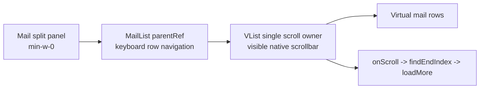

# Outlook-like Mail-List Scrollbar Implementation Plan

> **For agentic workers:** REQUIRED SUB-SKILL: Use superpowers:subagent-driven-development (recommended) or superpowers:executing-plans to implement this plan task-by-task. Steps use checkbox (`- [ ]`) syntax for tracking.

**Goal:** Give Nava's virtualized inbox/message list a visible, native-feeling scrollbar like the one the client highlighted in Outlook, while preserving virtualization, keyboard navigation, infinite paging, and horizontal containment.

**Architecture:** Keep `virtua`'s `VList` as the only scroll owner for the message-list column. Remove the list-only `scrollbar-none` suppression and apply the existing `tailwind-scrollbar` utility pattern already used by the app sidebar. Do not introduce a second Radix scroll owner, a custom ARIA scrollbar, or a global scrollbar rule.

**Tech Stack:** React 19, TypeScript, `virtua` `VList`, Tailwind CSS 4, `tailwind-scrollbar`, Vitest, Playwright read-only UI gate.

## Global Constraints

- FE-only change in `apps/mail`; no server, API, database, or persistence changes.
- Preserve `VList`, its `onScroll` callback, `findEndIndex()` threshold, and `loadMore()` pagination behavior.
- Preserve `parentRef`, `useMailNavigation`, row focus, `min-w-0`, and `overflow-x-hidden` containment.
- Keep one vertical list scroll owner; do not wrap `VList` in Radix `ScrollArea`.
- Do not change `thread-display.tsx`, `scroll-area.tsx`, `mail-content.tsx`, or global `.no-scrollbar` / `style-scrollbar` rules; the selected-message body is a separate scope.
- Do not add dependencies, feature flags, a new scrollbar component, or a new user setting.
- Before Vitest, always run `unset DATABASE_URL VITEST_ALLOW_PILOT_RDS`; never point tests at pilot/prod RDS.
- Never run project-wide `pnpm check`, `pnpm lint`, or formatting commands; use targeted commands only.
- Native scrollbar visibility is platform-dependent: overlay-scrollbar systems may auto-hide the thumb. The contract is usable native scrolling and a visible styled thumb/track where the platform renders scrollbars, not a JavaScript-drawn control.
- All paths in this plan are repository-relative.

---

## Goal Capsule

- **Customer outcome:** A staff member can see and use the vertical scrollbar alongside the inbox/message list to move through emails more easily, as in the supplied Outlook comparison.
- **Scope decision:** The local screenshot alignment and code evidence point to the scrollbar at the message-list/reading-pane boundary: `mail-list.tsx` currently applies `scrollbar-none` to the virtualized list. This plan therefore targets the inbox/message-list column. If the client meant the selected email body's far-right scrollbar instead, stop before implementation and create a body-scroll plan; do not broaden this change silently.
- **Stop when:** the overflowing `VList` has the existing visible scrollbar style; wheel, drag, touch, and keyboard-driven row navigation still move the list; near-end scrolling still requests the next page; narrow/dark layouts remain contained; and targeted tests plus the read-only visual check pass.
- **Execution profile:** one small FE change plus a source-contract test; no data migration or rollout flag.

## Product Contract

### Problem Frame

Outlook documents this interaction as a constrained Reading Pane/message-list layout, not as a separate product feature. Its official guidance describes previewing a selected message in a right, bottom, fill, or pop-out Reading Pane ([Microsoft Reading Pane](https://support.microsoft.com/en-us/outlook/use-and-configure-the-reading-pane-to-preview-messages-in-outlook)), paging with Spacebar and opening the next item at the end ([Microsoft next/previous item](https://support.microsoft.com/en-us/outlook/go-to-the-next-or-previous-item-in-email)), and `Home`, `End`, `Page Up`, and `Page Down` shortcuts in the reading list ([Microsoft keyboard shortcuts](https://support.microsoft.com/en-us/accessibility/outlook/keyboard-shortcuts-for-outlook)). Microsoft does not specify a custom DOM scrollbar implementation, so Nava should match the behavior with a native CSS scrollport rather than inventing a JavaScript control.

### Requirements

- R1. The message-list `VList` must no longer hide its native scrollbar with `scrollbar-none`.
- R2. The `VList` must use the app's existing visible scrollbar utility pattern: `scrollbar`, `scrollbar-w-1`, `scrollbar-thumb-accent/40`, `scrollbar-track-transparent`, `hover:scrollbar-thumb-accent`, and `scrollbar-thumb-rounded-full`.
- R3. The list remains vertically scrollable only through the existing `VList`; no wrapper or Radix component may become a competing scroll owner.
- R4. `VList` virtualization and infinite pagination remain unchanged: `onScroll` still calls `findEndIndex()` and loads another page in the existing near-end window.
- R5. Existing keyboard row navigation (`ArrowUp`, `ArrowDown`, `j`, `k`, `Enter`, `Escape`) and `scrollIntoView({ block: 'nearest' })` behavior remain intact. Do not add a new tab stop to the list merely to style the scrollbar.
- R6. Horizontal containment remains intact at narrow split widths: retain `flex-1`, `overflow-x-hidden`, the parent `min-w-0` contracts, and the existing `parentRef` relationship.
- R7. The scrollbar thumb/track is distinguishable in light and dark themes, responds to hover and pointer/touch scrolling, and does not create horizontal overflow. Empty, loading, and short lists do not gain a misleading always-present control.
- R8. The selected-message reading pane and HTML email-body scrollbar behavior are unchanged in this slice.

### Acceptance Examples

- **Long inbox:** With enough rows to overflow, the list column shows the styled vertical track/thumb; dragging the thumb, using the wheel, and using touch scrolling move virtualized rows without moving the page or thread panel.
- **Near-end paging:** Scrolling the list close to the end still invokes the existing `findEndIndex()`/`loadMore()` path once per page; the scrollbar does not bypass virtualization.
- **Keyboard:** Focusing a row and using ArrowUp/ArrowDown or `j`/`k` moves the focused thread and keeps it in view. The list's native scrollport still responds to standard page/home/end scrolling when the browser gives it focus; no extra focus trap is introduced.
- **Responsive/dark:** At the smallest supported split and in dark mode, the thumb remains usable and no horizontal page or panel shift appears. The existing `min-w-0`/`overflow-x-hidden` contracts still hold.
- **Non-overflow states:** Empty, loading, and short lists retain their current empty/loading layout; no custom scrollbar markup is rendered.
- **Scope guard:** Opening a thread does not gain a second list scrollbar, and the selected message's existing `ScrollArea` remains the only thread-level owner.

### Scope Boundaries

In scope: the `VList` class contract and targeted regression/visual verification. Out of scope: email-body scrollbar styling, thread `ScrollArea` redesign, scrollbar persistence across OS overlay settings, list sorting/grouping, scroll-position persistence, a scrollbar preference, and any custom ARIA scrollbar widget. Native CSS is deliberate: MDN recommends native scrollbars and explains that `overflow: auto`/`scroll` provide the platform scroll container ([MDN overflow](https://developer.mozilla.org/en-US/docs/Web/CSS/Reference/Properties/overflow)); a custom control would add `role="scrollbar"`, value management, and equivalent mouse/touch/keyboard/voice handling ([MDN scrollbar role](https://developer.mozilla.org/en-US/docs/Web/Accessibility/ARIA/Reference/Roles/scrollbar_role)).

### Evidence and Sources

| Evidence | Planning consequence |
|---|---|
| Outlook Reading Pane layout and message preview ([Microsoft](https://support.microsoft.com/en-us/outlook/use-and-configure-the-reading-pane-to-preview-messages-in-outlook)) | Emulate a constrained pane/list scrollport, not a new feature surface. |
| Outlook paging and next-item behavior ([Microsoft](https://support.microsoft.com/en-us/outlook/go-to-the-next-or-previous-item-in-email)) | Preserve normal page/wheel behavior and existing row navigation; do not replace it with bespoke scroll logic. |
| Outlook `Home`/`End`/`Page Up`/`Page Down` shortcuts ([Microsoft](https://support.microsoft.com/en-us/accessibility/outlook/keyboard-shortcuts-for-outlook)) | Include keyboard scrolling in acceptance checks while keeping the current focus model. |
| Native scrollbars and overflow semantics ([MDN](https://developer.mozilla.org/en-US/docs/Web/CSS/Reference/Properties/overflow)) | Prefer `VList` plus native CSS scrollbar utilities over a custom widget. |
| Keyboard access for scrollable content ([W3C ACT 0ssw9k](https://www.w3.org/WAI/standards-guidelines/act/rules/0ssw9k/)) | Verify that existing focusable rows and the native scrollport remain reachable by keyboard. |
| Platform/browser variation is reported for Outlook scrollbar visibility ([Microsoft Q&A](https://learn.microsoft.com/en-us/answers/questions/4602200/scroll-bar-missing-in-outlook-only)) | Do not promise a permanently painted thumb on overlay-scrollbar platforms; verify behavior on the supported browser/OS matrix. |

### Outstanding Questions

There is no implementation-blocking question for the list interpretation. The only deferred product fork is whether the supplied screenshot was intended to show the selected email body rather than the list; that fork changes the target component and must be confirmed before implementing a body-scroll variant.

---

## Planning Contract

### Current Code Map

- `apps/mail/components/mail/mail-list.tsx:939-969` creates `parentRef` for `useMailNavigation` and `vListRef` for `virtua`.
- `apps/mail/components/mail/mail-list.tsx:1277-1299` renders the `#mail-list-scroll` marker and `VList`; the current class is `scrollbar-none flex-1 overflow-x-hidden`, and the same opening tag owns the pagination `onScroll` callback.
- `apps/mail/components/ui/app-sidebar.tsx:151` is the established visible style to reuse: `scrollbar scrollbar-w-1 scrollbar-thumb-accent/40 scrollbar-track-transparent hover:scrollbar-thumb-accent scrollbar-thumb-rounded-full`.
- `apps/mail/app/globals.css:13-16` enables `tailwind-scrollbar` with pseudo-element output; `style-scrollbar` at `:239-241` intentionally uses width zero for the document and must not be repurposed.
- `apps/mail/components/mail/thread-display.tsx:1247-1332` already owns the thread-level Radix `ScrollArea`; `apps/mail/components/mail/mail-content.tsx:464` hides the HTML host scrollbar intentionally and is not this feature's target.
- `apps/mail/tests/mail-shell-overflow-contract.test.ts` demonstrates the repository's source-contract testing style for load-bearing Tailwind classes. `apps/mail/tests/e2e/real-mail-launch-readonly.spec.ts` already proves the inbox marker and read-only list scrolling without mail mutations.

### Key Technical Decisions

- KTD1. **Style the existing `VList`, do not add a scroll component.** Removing one suppression and reusing the sidebar's utility classes is the smallest change that produces the requested affordance without breaking `virtua` measurement or pagination.
- KTD2. **Leave vertical overflow ownership with `VList`.** A Radix wrapper would create two scrollports, interfere with `findEndIndex()` and `scrollIntoView`, and make the stable `parentRef` contract ambiguous.
- KTD3. **Do not alter global scrollbar utilities.** `style-scrollbar` and `.no-scrollbar` serve document/body and email-HTML cases; changing them would expose unrelated scrollbars and regress existing dark-theme/layout behavior.
- KTD4. **Do not add `tabIndex`, ARIA scrollbar state, or a new keyboard handler in v1.** Existing focusable mail rows and `useMailNavigation` already provide keyboard access. Add no new tab stop unless a browser verification demonstrates that the native scrollport cannot be reached; that would be a separate accessibility follow-up with its own design review.
- KTD5. **Use the app's thin visible style, not a new width/color token.** This keeps the affordance consistent with the sidebar and avoids speculative theming. Verify light/dark contrast and pointer usability in the browser gate.

### High-Level Design



The implementation changes only the `className` on `VList`. The wrapper id remains a stable test marker, `parentRef` remains on the navigation container, and the existing `onScroll` callback remains attached to `VList`. The native scrollbar is therefore a presentation change on the already-correct scroll owner.

### Risks and Mitigations

| Risk | Mitigation |
|---|---|
| A second scroll owner is accidentally introduced | Source contract checks the target opening tag and the plan forbids Radix wrapping. |
| Scrollbar styling creates horizontal shift | Keep `overflow-x-hidden`, `flex-1`, and all existing `min-w-0` ancestors; verify narrow geometry. |
| Thin/dark thumb is hard to see | Reuse the existing sidebar tokens, then run light/dark visual checks; adjust only the same class tokens if the supported browser shows insufficient contrast. |
| Virtual pagination stops firing | Preserve the `onScroll` body verbatim and assert `findEndIndex()` remains in source; run the existing performance/list test slice. |
| Overlay scrollbars hide the thumb | Treat platform auto-hide as expected; verify wheel/touch/keyboard access and do not build a custom ARIA widget to fight OS settings. |
| Screenshot actually targets the email body | Keep body/thread files out of the diff and redirect to a separate plan before implementation if the client confirms that interpretation. |

### Sequencing

1. Add the failing source-contract test for the `VList` class and pagination owner.
2. Replace only the `VList` `scrollbar-none` token with the existing visible utility pattern.
3. Run targeted Vitest and ESLint checks, then perform the read-only/browser and manual visual checks.

---

## Implementation Units

### U1. Lock the visible list-scrollbar contract (Task 1)

**Goal:** Make the intended scroll owner and non-hidden style regression-testable before changing production code.

**Files:**

- Create: `apps/mail/tests/mail-list-scrollbar-contract.test.ts`
- Read only: `apps/mail/components/mail/mail-list.tsx`

**Interfaces:**

- Consumes: the literal `VList` opening tag in `MailList`.
- Produces: a DB-free Vitest contract that fails while the target still has `scrollbar-none`, and protects `overflow-x-hidden`, `flex-1`, `onScroll`, and `findEndIndex()`.

- [ ] **Step 1: Write the failing source-contract test**

Create the file with this exact structure:

```typescript
import { readFileSync } from 'node:fs';
import { describe, expect, it } from 'vitest';

const source = readFileSync(
  new URL('../components/mail/mail-list.tsx', import.meta.url),
  'utf8',
);

const vListStart = source.indexOf('<VList');
const vListEnd = source.indexOf('>', vListStart);
if (vListStart < 0 || vListEnd < vListStart) {
  throw new Error('Could not locate the inbox VList opening tag');
}

const vListOpeningTag = source.slice(vListStart, vListEnd + 1);
const className = vListOpeningTag.match(/className="([^"]+)"/)?.[1] ?? '';
const classTokens = className.split(/\s+/).filter(Boolean);

describe('mail list scrollbar contract', () => {
  it('keeps the virtualized inbox list visible and horizontally contained', () => {
    expect(source).toContain('id="mail-list-scroll"');
    expect(classTokens).toEqual(
      expect.arrayContaining([
        'scrollbar',
        'scrollbar-w-1',
        'scrollbar-thumb-accent/40',
        'scrollbar-track-transparent',
        'hover:scrollbar-thumb-accent',
        'scrollbar-thumb-rounded-full',
        'flex-1',
        'overflow-x-hidden',
      ]),
    );
    expect(classTokens).not.toContain('scrollbar-none');
  });

  it('keeps pagination attached to the same VList scroll owner', () => {
    expect(source).toContain('onScroll={() => {');
    expect(source).toContain('const endIndex = vListRef.current.findEndIndex();');
    expect(source).toContain('void loadMore();');
  });
});
```

- [ ] **Step 2: Run the new test and verify it fails for the current implementation**

Run:

```bash
cd apps/mail
unset DATABASE_URL VITEST_ALLOW_PILOT_RDS
pnpm exec vitest run tests/mail-list-scrollbar-contract.test.ts
```

Expected before the production change: FAIL in `keeps the virtualized inbox list visible...` because the current `VList` opening tag contains `scrollbar-none` and none of the visible `scrollbar-*` tokens.

- [ ] **Step 3: Commit the red test**

```bash
git add apps/mail/tests/mail-list-scrollbar-contract.test.ts
git commit -m "test(mail): require visible inbox list scrollbar"
```

### U2. Show the existing native scrollbar on `VList` (Task 2)

**Goal:** Make the already-virtualized inbox list visibly scrollable without changing its data flow or scroll ownership.

**Files:**

- Modify: `apps/mail/components/mail/mail-list.tsx:1278-1299`
- Test: `apps/mail/tests/mail-list-scrollbar-contract.test.ts`

**Interfaces:**

- Consumes: `VList`, `vListRef`, `parentRef`, `onScroll`, `findEndIndex()`, and `loadMore()` as they exist today.
- Produces: the same `VList` behavior with visible scrollbar utility classes and unchanged pagination/navigation contracts.

- [ ] **Step 1: Replace only the hidden scrollbar class**

Change the `VList` class from:

```tsx
className="scrollbar-none flex-1 overflow-x-hidden"
```

to:

```tsx
className="scrollbar scrollbar-w-1 scrollbar-thumb-accent/40 scrollbar-track-transparent hover:scrollbar-thumb-accent scrollbar-thumb-rounded-full flex-1 overflow-x-hidden"
```

Do not move `id="mail-list-scroll"`, change the `ref`, add `overflow-y-auto`, alter `overscan`, or edit the `onScroll` callback. Do not touch the thread `ScrollArea`, email-body classes, or global CSS.

- [ ] **Step 2: Inspect the focused diff and class ownership**

Run:

```bash
git diff -- apps/mail/components/mail/mail-list.tsx
rg -n "scrollbar-none|scrollbar-w-1|findEndIndex|onScroll" \
  apps/mail/components/mail/mail-list.tsx \
  apps/mail/components/ui/app-sidebar.tsx
```

Expected: the mail-list `VList` has the visible utility sequence and no `scrollbar-none`; `findEndIndex()` and `void loadMore()` are unchanged; the sidebar may continue to use its own existing visible style.

- [ ] **Step 3: Run the contract and existing DB-free list tests**

Run:

```bash
cd apps/mail
unset DATABASE_URL VITEST_ALLOW_PILOT_RDS
pnpm exec vitest run \
  tests/mail-list-scrollbar-contract.test.ts \
  tests/demo-mail-list-perf-guards.test.ts \
  tests/mail-shell-overflow-contract.test.ts
```

Expected: PASS with no database connection. The source contract proves the visible class and pagination owner; the existing suites prove rendering/performance guards and horizontal shell containment.

- [ ] **Step 4: Run targeted lint only**

Run:

```bash
cd apps/mail
pnpm exec eslint components/mail/mail-list.tsx tests/mail-list-scrollbar-contract.test.ts
```

Expected: PASS with no project-wide formatting or lint changes.

- [ ] **Step 5: Commit the production change**

```bash
git add apps/mail/components/mail/mail-list.tsx apps/mail/tests/mail-list-scrollbar-contract.test.ts
git commit -m "feat(mail): show inbox list scrollbar"
```

### U3. Browser and interaction verification (Task 3)

**Goal:** Prove the CSS affordance is usable in a real browser and did not regress virtual-list, keyboard, theme, or split-panel behavior.

**Files:**

- No additional product files are required.
- Existing read-only proof: `apps/mail/tests/e2e/real-mail-launch-readonly.spec.ts`.

**Interfaces:**

- Consumes: the `VList` class contract from U2 and the existing read-only UI gate.
- Produces: verification evidence only; no new runtime abstraction or test fixture.

- [ ] **Step 1: Run the approved read-only UI gate when a configured browser runner is available**

Run only from the approved operator/EC2 environment with the repository's canonical origin and read-only credentials already provisioned:

```bash
unset DATABASE_URL VITEST_ALLOW_PILOT_RDS
bash apps/server-pilot/deploy/playwright-real-mail-ui-gate.sh --read-only
```

Expected: the existing launch proof passes without mail mutations. While reviewing the run, confirm the descendant `VList` (the element carrying the `scrollbar` class) is the element whose `scrollTop` changes; do not treat the `#mail-list-scroll` wrapper marker as a second scroll owner.

- [ ] **Step 2: Complete the visual/interaction checklist in light and dark themes**

1. Load an inbox with enough rows to overflow the list. Confirm a vertical thumb/track is visible where the supported browser paints native scrollbars; on overlay-scrollbar platforms, confirm it appears during interaction.
2. Drag the thumb, wheel-scroll, and touch-scroll the list. Rows move inside the list column and the thread panel/page does not move horizontally.
3. Focus a row and exercise ArrowUp/ArrowDown and `j`/`k`; the focused row remains visible and the existing navigation still opens the expected thread.
4. Use the browser's native PageUp/PageDown/Home/End behavior while the list/row has focus; scrolling stays in the list rather than the document. Do not add a new tab stop just to make this pass.
5. Scroll close to the end of a paginated list. Confirm the existing spinner/next-page behavior still occurs and no duplicate request loop appears.
6. Repeat at a narrow desktop split and in dark mode. Confirm thumb contrast is usable, the list still honors `min-w-0`, and no sender/thread content shifts sideways.
7. Check loading, empty, and short-list states. Confirm no custom scrollbar markup or misleading permanent control appears.
8. Open a thread and verify the existing thread `ScrollArea` and email HTML scrollbar behavior are unchanged.

- [ ] **Step 3: Record verification without customer data**

Record pass/fail and viewport/theme only. Do not capture email subjects, bodies, recipient addresses, credentials, or pilot database output in the plan or repository.

---

## Verification Contract

| Check | Command / procedure | Expected result |
|---|---|---|
| Source contract | `cd apps/mail && unset DATABASE_URL VITEST_ALLOW_PILOT_RDS && pnpm exec vitest run tests/mail-list-scrollbar-contract.test.ts` | PASS; visible class tokens present, `scrollbar-none` absent on target, pagination strings retained. |
| Existing list guards | Same environment; `pnpm exec vitest run tests/demo-mail-list-perf-guards.test.ts tests/mail-shell-overflow-contract.test.ts` | PASS without DB access; virtualization/rendering and horizontal containment remain green. |
| Targeted lint | `cd apps/mail && pnpm exec eslint components/mail/mail-list.tsx tests/mail-list-scrollbar-contract.test.ts` | PASS; no unrelated files changed. |
| Read-only browser gate | `unset DATABASE_URL VITEST_ALLOW_PILOT_RDS && bash apps/server-pilot/deploy/playwright-real-mail-ui-gate.sh --read-only` from an approved runner | Existing real-mail launch proof passes with no mail mutations; list viewport is the scroll owner. |
| Manual UI | U3 checklist in light/dark and narrow/normal split states | Thumb/track usable, keyboard/paging intact, no horizontal shift, body/thread scroll unchanged. |

No project-wide `pnpm check`, `pnpm lint`, `pnpm format`, or `pnpm check:format` is part of this plan.

## Definition of Done

- [ ] R1-R3: `VList` no longer hides its scrollbar and remains the single vertical list scroll owner.
- [ ] R4-R6: Virtualization, `findEndIndex()` pagination, row keyboard navigation, `parentRef`, and horizontal containment are unchanged and covered by tests.
- [ ] R7: Light/dark, narrow/normal, overflow/non-overflow, pointer/touch, and keyboard checks pass; overlay auto-hide is documented as platform behavior.
- [ ] R8: No thread/body/global scrollbar files were changed.
- [ ] U1 source-contract test is committed and fails against the old hidden class.
- [ ] U2 production class change and targeted tests/lint are green.
- [ ] U3 approved read-only/manual browser verification is recorded without PII or mail mutations.
- [ ] No abandoned custom scrollbar, wrapper, dependency, feature flag, or temporary probe remains in the diff.

## GSTACK REVIEW REPORT

| Review | Result | Applied disposition |
|---|---|---|
| Eng completeness | Approve with fixes (inline) | Added exact files/commands, single-owner architecture, pagination and keyboard contracts, platform/empty-state risks, and read-only verification. |
| Ponytail simplicity | Approve (inline; ponytail runtime skill unavailable) | Kept the change to one class replacement and one source contract; rejected custom scrollbar, Radix wrapper, new dependency, ARIA widget, and feature flag. |
| Design | Approve with edits (inline) | Reused the sidebar thumb/track pattern; added dark-mode, hover, narrow split, overlay-scrollbar, focus, and non-overflow acceptance checks. |
| DevEx | Not applicable | No API, SDK, CLI, integration, or onboarding surface changes. |

The repository has the GStack plan-review skill files but no runnable ponytail asset/runtime in this workspace, so the required completeness, simplicity, and UI reviews were performed inline and their findings are recorded above.

## Appendix: Research notes

- Outlook's official material describes Reading Pane placement and keyboard/paging behavior, but not a bespoke scrollbar API. This supports using the existing browser scrollport rather than implementing a `role="scrollbar"` widget.
- MDN notes that `overflow: auto` shows a scroll mechanism when content overflows and that native scrollbars are preferable to custom controls. The app's `VList` already supplies the vertical overflow behavior; this slice only removes its explicit visual suppression.
- The independent research pass found conflicting platform/version reports about whether Outlook scrollbars remain painted or auto-hide. The plan therefore promises usable native scrolling and app styling where the platform exposes it, not a cross-OS guarantee that a thumb is always visible.
- Local code is the deciding evidence for the target: `mail-list.tsx` explicitly hides the virtualized inbox scrollbar, while the thread has an existing Radix `ScrollArea`. This plan changes the former and leaves the latter alone.
