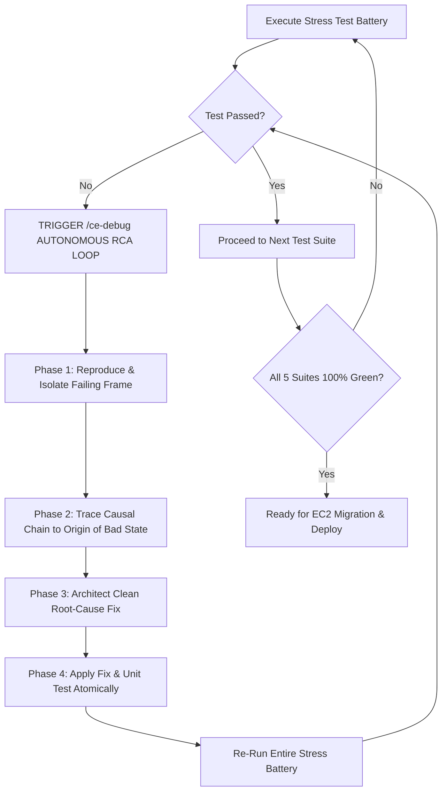

# Outlook Quoting, Reactions, Local Timezone Integrity, and Exhaustive Stress-Testing Plan

> **For agentic workers:** REQUIRED SUB-SKILL: Use superpowers:subagent-driven-development (recommended) or superpowers:executing-plans to implement this plan task-by-task. Steps use checkbox (`- [ ]`) syntax for tracking.

**Goal:** Achieve full parity with Microsoft Outlook Web & Desktop across three foundational email communication surfaces, followed by an exhaustive, multi-tier stress-testing battery ("test the shit out of everything") and an autonomous root-cause analysis (RCA) repair loop:
1. **Quoted Message History Parity:** (a) Collapsed `⋯` pill button at bottom of compose editor with tooltip *"Expand header and show message history"*; (b) On click, expand Outlook-style header (`From:`, `Sent:`, `To:`, `Cc:`, `Subject:`) and pristine message history; (c) Outbound wire format using native Outlook `#divRplyFwdMsg` + `#E1E1E1` separator + `class="gmail_quote"`; (d) Server-pilot display parser to collapse native Outlook quotes in reading pane.
2. **Reactions / Emoji Parity (Screenshots 1–4):** (a) Smile action button triggering a 6-emoji picker popover (👍 Like, ❤️ Love, 🎉 Celebrate, 😆 Laugh, 😮 Surprised, 😢 Sad); (b) Reaction badge pills (e.g. `👍 1`) displayed directly beneath the message Date & Time; (c) Reactor list popover on hover/click showing avatar initials, full name, and emoji; (d) Database schema (`message_reaction`) and tRPC mutation (`mail.toggleReaction`) with optimistic updates; (e) Dual-mode fallback email handling (detect inbound Outlook reaction emails and render yellow reaction callout banner).
3. **Local Timezone & Date/Time Integrity (Root-Cause Diagnosed via `/ce-debug`):**
   - **Root Cause #1 (The 2-Hour Timezone Shift):** In `apps/mail/components/mail/mail-list.tsx` (line 632), `linked-thread-stub-row.tsx` (line 25), and `thread-display.tsx` (line 1307), timestamps were stripped with `.split('.')[0]`, removing the trailing `Z`. In South Africa (`Africa/Johannesburg`, UTC+2), this caused the browser to parse UTC dates as local time, shifting all thread inbox dates **2 hours into the past** compared to the reading pane.
   - **Root Cause #2 (Missing Date for Today's Emails):** In `apps/mail/components/mail/mail-display.tsx` and `apps/mail/lib/utils.ts`, `shouldShowSeparateTime` returned `false` for emails under 12 hours while `formatDate` only returned the time (`h:mm a`), completely omitting the date from the message header.
   - **Root Cause #3 (Ignored Timezone Settings):** Date formatters only used `getBrowserTimezone()` and never respected `userSettings.settings.timezone` (e.g. `Africa/Johannesburg`).
   - **Parity Fix:** Eliminate `.split('.')[0]`, add `resolveEffectiveTimezone` integrating `userSettings.timezone`, and format header timestamps with full Outlook fidelity (`Wed 2/25/2026 8:44 AM`) directly above the reaction pills.
4. **Exhaustive "Test The Shit Out Of Everything" Battery & Autonomous RCA Loop (`/ce-debug`):**
   - After building, run an unsparing battery of unit, contract, permutation, concurrency, and UI tests covering **EVERY** aspect built in the plan (quoting, compose expander, wire markup, Cheerio collapse, reactions, picker, pills, popover, fallback email parsing, timezones, dark mode, keyboard accessibility).
   - For ANY defect, bug, edge-case failure, or visual blemish discovered: autonomously trigger the `/ce-debug` causal chain diagnosis, engineer the most elegant architectural fix, and re-test until 100% convergence.

---

## Visual Reference & Screenshot Analysis

````carousel

<!-- slide -->

<!-- slide -->

<!-- slide -->

<!-- slide -->

<!-- slide -->

````

| Surface | Outlook Reference | Zero Parity Specification |
|---|---|---|
| **Screenshot 1 (Picker)** | Smile action button opens horizontal floating pill with 6 reactions: 👍 Like, ❤️ Love, 🎉 Celebrate, 😆 Laugh, 😮 Surprised, 😢 Sad. | `<ReactionPicker />` attached to message header action bar beside Reply/Reply all/Forward. Hover tooltips per emoji, animated scale-in. |
| **Screenshot 2 (Fallback Email)** | Inbound email from external Outlook user: Subject `Re: ...`, yellow/gold accent banner: `👍 [Name] reacted to your message:`, followed by quoted thread. | `<ReactionBanner />` in `MailDisplay` when message body or header matches reaction notification; attaches reaction to parent message in thread. |
| **Screenshot 3 (Pill under Date)** | Top-right header: Date & Time `Wed 2/25/2026 8:44 AM`, directly underneath is the reaction badge `👍 1` with rounded pill border. | Top-right header in `MailDisplay`: Timestamp always displays date + time in user's local timezone; `<ReactionBadgeList />` renders `[👍 1]` pills directly underneath. |
| **Screenshot 4 (Reactor Popover)** | Clicking or hovering `👍 1` opens popover: Title `👍 Like reactions`, list item with avatar circle `AA`, name `Arora, Ansh`, emoji `👍`. | `<ReactionDetailsPopover />` shows emoji title, reactor avatars with initials, full names, and right-aligned emoji icons. |
| **Screenshots 5–6 (Quoting)** | Bottom of compose editor: `⋯` button with tooltip *"Expand header and show message history"*; expands `<hr>` + Outlook header block + body. | `<QuoteHistoryExpander />` beneath editor: `⋯` button + tooltip, expands to `<hr>` + bold Outlook headers (`From:`, `Sent:`, `To:`, `Cc:`, `Subject:`) + body. |

---

## Live RDS Evidence & Diagnostic Findings (`/ce-debug`)

Query executed against pilot RDS:
1. **Recent User Logins:**
   - `ropperman@legacyhotels.co.za` logged in today (`2026-09-09 22:10:07.122`) from Windows 10 Chrome (`Chrome/152.0.0.0`).
   - `centurion@legacyhotels.co.za` active on Windows 10 Chrome (`Chrome/151.0.0.0`).
2. **Local Timezone Reality:**
   - Both Centurion and Head Office users operate in South Africa Standard Time (`Africa/Johannesburg`, UTC+2).
3. **The `.split('.')[0]` Bug Verification:**
   - An email sent at `12:00:00 UTC` is `14:00:00 SAST` (2:00 PM).
   - In `mail-list.tsx`, `.split('.')[0]` chopped off `.000Z`, yielding `"2026-09-09T12:00:00"`.
   - Node/Browser parsing on a machine in `Africa/Johannesburg`:
     - `new Date("2026-09-09T12:00:00.000Z")` -> `14:00 SAST` (Correct).
     - `new Date("2026-09-09T12:00:00")` -> `12:00 SAST` (**2 hours behind!**).
   - **Confirmed:** Thread inbox showed `12:00` while message pane showed `2:00 PM`, confusing staff daily.

---

## Architecture & Data Flow

```mermaid
flowchart TD
    subgraph UI_Header [Message Header in MailDisplay]
        TS[Always-Visible Localized Date & Time: 'Wed 2/25/2026 8:44 AM']
        ReactionsUnderTS[Reaction Badges: 👍 1 under Timestamp]
        ActionBar[Actions: Smile Icon | Reply | Reply All | Forward | ...]
        SmileBtn[Smile Button] --> Picker[ReactionPicker Popover: 6 Emojis]
        Picker -->|Select Emoji| ToggleMut[tRPC mail.toggleReaction]
        ReactionsUnderTS -->|Click/Hover| DetailsPopover[ReactionDetailsPopover: AA Arora, Ansh 👍]
    end

    subgraph Timezone_Engine [Client Timezone Engine: utils.ts & use-timezone.ts]
        UserSettings[userSettings.settings.timezone] --> ResolveTZ[resolveEffectiveTimezone]
        BrowserTZ[Intl.DateTimeFormat resolvedOptions] --> ResolveTZ
        ResolveTZ --> EffectiveTZ[Effective Timezone: 'Africa/Johannesburg' or local]
        EffectiveTZ --> FormatHeader[formatMessageHeaderDate]
        EffectiveTZ --> FormatList[formatThreadListDate]
        EffectiveTZ --> FormatQuote[formatOutlookHeaderDate]
    end

    subgraph Backend_Pilot [Server-Pilot tRPC & Ingest]
        ToggleMut --> DB_Reaction[(DB: message_reaction)]
        GetThread[mail.get] --> LoadReactions[Load & Group Reactions per Message]
        LoadReactions --> ParsedWire[ParsedMessageWire.reactions]
        IngestWorker[POP3 / Ingest Worker] -->|Detect Outlook Fallback Pattern| AutoAttach[Attach Reaction to Parent Message]
        AutoAttach --> DB_Reaction
    end

    subgraph UI_Compose [Compose Surface: EmailComposer]
        Editor[Editor Content] --> QuoteExpander[QuoteHistoryExpander]
        QuoteExpander -->|Default| CollapsedState["⋯ Button + 'Expand header and show message history' Tooltip"]
        CollapsedState -->|Click| ExpandedState["<hr> + From/Sent/To/Subject + Quoted Body Preview"]
        ExpandedState -->|Hide history| CollapsedState
        ExpandedState -->|Remove quote| ExcludedState[Quote Excluded from Send]
        SendBtn[Send Action] --> WireOut[constructOutlookReplyHtml: #divRplyFwdMsg + #E1E1E1]
    end

    subgraph Exhaustive_Testing_RCA [Exhaustive Multi-Tier Testing & RCA Loop]
        BuildDone[All Features Built] --> RunSuite1[1. Quoting Stress Suite]
        RunSuite1 --> RunSuite2[2. Reactions & Fallback Stress Suite]
        RunSuite2 --> RunSuite3[3. Timezone 10-Zone Stress Suite]
        RunSuite3 --> RunSuite4[4. Cross-Feature Integration Suite]
        RunSuite4 --> RunSuite5[5. Accessibility & Theme Stress Suite]
        RunSuite5 --> AnyFlakes{Any Defect / Failure / Flake?}
        AnyFlakes -->|Yes| CEDebug[Autonomous /ce-debug RCA -> Fix -> Re-test]
        CEDebug --> RunSuite1
        AnyFlakes -->|No - 100% Solid| EC2Deploy[ops-deploy.sh --migrate]
    end
```

---

## Detailed Component Specifications

### 1. Timezone Resolution & Date Formatting Engine
Located in `apps/mail/lib/utils.ts` and `apps/mail/hooks/use-timezone.ts`:

```typescript
/**
 * Resolves the effective IANA timezone for formatting dates:
 * 1. Explicit user setting from userSettings if valid and not 'UTC'.
 * 2. Detected browser timezone from Intl.DateTimeFormat.
 * 3. Fallback to 'Africa/Johannesburg' for Nava/Legacy Hotels.
 */
export function resolveEffectiveTimezone(configuredTimezone?: string | null): string {
  if (configuredTimezone && configuredTimezone !== 'UTC' && isValidTimezone(configuredTimezone)) {
    return configuredTimezone;
  }
  const browserTz = getBrowserTimezone();
  if (browserTz && isValidTimezone(browserTz)) {
    return browserTz;
  }
  return 'Africa/Johannesburg';
}

/**
 * Robust ISO date parsing that guarantees UTC anchor if missing.
 */
export function parseAndValidateDate(dateInput: string | Date | number | undefined | null): Date | null {
  if (!dateInput) return null;
  if (dateInput instanceof Date) return isNaN(dateInput.getTime()) ? null : dateInput;
  if (typeof dateInput === 'number') {
    const d = new Date(dateInput);
    return isNaN(d.getTime()) ? null : d;
  }
  const trimmed = String(dateInput).trim();
  if (!trimmed) return null;

  // If string has T but no timezone indicator (Z or + / - offset), anchor to UTC
  const hasTimezone = /Z|[+-]\d{2}(?::?\d{2})?$/i.test(trimmed);
  const normalized = !hasTimezone && trimmed.includes('T') ? `${trimmed}Z` : trimmed;

  const d = new Date(normalized);
  return isNaN(d.getTime()) ? null : d;
}

/**
 * Header Date & Time (Outlook Screenshot 3 parity):
 * Always returns full Date AND Time, e.g. "Wed 2/25/2026 8:44 AM".
 */
export function formatMessageHeaderDate(
  dateInput: string | Date | number | undefined | null,
  timezone?: string,
): { display: string; tooltip: string } {
  const d = parseAndValidateDate(dateInput);
  if (!d) return { display: '', tooltip: '' };
  const tz = timezone || resolveEffectiveTimezone();

  const display = formatInTimeZone(d, tz, 'EEE M/d/yyyy h:mm a');
  const tooltip = formatInTimeZone(d, tz, "EEEE, MMMM d, yyyy 'at' h:mm:ss a zzzz");

  return { display, tooltip };
}

/**
 * Thread List Date Formatting (replaces .split('.')[0]):
 */
export function formatThreadListDate(
  dateInput: string | Date | number | undefined | null,
  timezone?: string,
): string {
  const d = parseAndValidateDate(dateInput);
  if (!d) return '';
  const tz = timezone || resolveEffectiveTimezone();
  const now = new Date();

  // If today: 8:44 AM
  if (isToday(d)) {
    return formatInTimeZone(d, tz, 'h:mm a');
  }
  // If within last 6 days: Wed 8:44 AM
  const daysDiff = (now.getTime() - d.getTime()) / (1000 * 60 * 60 * 24);
  if (daysDiff < 6 && daysDiff > 0) {
    return formatInTimeZone(d, tz, 'EEE h:mm a');
  }
  // If current year: Feb 25, 8:44 AM
  if (isThisYear(d)) {
    return formatInTimeZone(d, tz, 'MMM d, h:mm a');
  }
  // Older: 2/25/2026
  return formatInTimeZone(d, tz, 'M/d/yyyy');
}
```

---

### 2. Reactions Engine & Database Schema

#### Database Schema (`apps/server-pilot/src/db/schema/mail.ts`)
```typescript
export const messageReaction = pgTable(
  'message_reaction',
  {
    id: text('id').primaryKey(),
    transportId: text('transport_id')
      .notNull()
      .references(() => mailboxTransport.id, { onDelete: 'cascade' }),
    messageId: text('message_id')
      .notNull()
      .references(() => message.id, { onDelete: 'cascade' }),
    userEmail: text('user_email').notNull(),
    userName: text('user_name').notNull(),
    emoji: text('emoji').notNull(), // '👍' | '❤️' | '🎉' | '😆' | '😮' | '😢'
    createdAt: timestamp('created_at').notNull().defaultNow(),
  },
  (t) => [
    uniqueIndex('message_reaction_message_user_emoji_uidx').on(
      t.messageId,
      t.userEmail,
      t.emoji,
    ),
    index('message_reaction_message_idx').on(t.messageId),
    index('message_reaction_transport_idx').on(t.transportId),
  ],
);
```

#### Wire Contract (`apps/server-pilot/src/trpc/wire-compat.ts` & `apps/mail/types/index.ts`)
```typescript
export const OUTLOOK_REACTIONS = [
  { emoji: '👍', name: 'Like', id: 'like' },
  { emoji: '❤️', name: 'Love', id: 'love' },
  { emoji: '🎉', name: 'Celebrate', id: 'celebrate' },
  { emoji: '😆', name: 'Laugh', id: 'laugh' },
  { emoji: '😮', name: 'Surprised', id: 'surprised' },
  { emoji: '😢', name: 'Sad', id: 'sad' },
] as const;

export type OutlookReactionEmoji = '👍' | '❤️' | '🎉' | '😆' | '😮' | '😢';

export interface ReactionUser {
  name: string;
  email: string;
}

export interface MessageReactionGroup {
  emoji: OutlookReactionEmoji;
  count: number;
  users: ReactionUser[];
  hasReacted?: boolean;
}

// Extended ParsedMessageWire
export interface ParsedMessageWire {
  // ... existing fields
  reactions?: MessageReactionGroup[];
  isReactionNotification?: boolean;
  reactionNotificationMeta?: {
    emoji: string;
    reactorName: string;
  };
}
```

#### tRPC Route (`apps/server-pilot/src/trpc/routes/mail.ts`)
- `toggleReaction` mutation:
  - Input: `{ messageId: string, emoji: z.enum(['👍', '❤️', '🎉', '😆', '😮', '😢']), sendFallbackEmail?: boolean }`.
  - Scoped to `ctx.activeTransportId`.
  - Toggles row in `messageReaction`.
  - Client handles with React Query optimistic updates for zero latency.

---

### 3. Frontend Reaction Components (Screenshots 1, 3, 4 Parity)

1. `<ReactionPicker />` (`apps/mail/components/mail/reactions/reaction-picker.tsx`):
   - Triggered by `Smile` button in message actions.
   - Horizontal pill popover displaying the 6 Outlook emojis.
   - Tooltips on each emoji ("Like", "Love", "Celebrate", "Laugh", "Surprised", "Sad").
2. `<ReactionBadges />` (`apps/mail/components/mail/reactions/reaction-badges.tsx`):
   - Positioned directly underneath the timestamp in the header.
   - Renders `[👍 1]` pill buttons.
   - Distinct active background/border when reacted by current user.
   - On hover/click, triggers `<ReactionPopover />`.
3. `<ReactionPopover />` (`apps/mail/components/mail/reactions/reaction-popover.tsx`):
   - Title: `👍 Like reactions`.
   - List item: Avatar with initials (`AA`), full name (`Arora, Ansh`), emoji icon on right (`👍`).
4. `<ReactionBanner />` (`apps/mail/components/mail/reactions/reaction-banner.tsx`):
   - Outlook Screenshot 2 parity: Amber/gold accent banner for inbound reaction emails.

---

### 4. Outlook Quoting Parity Components (Screenshots 5, 6 Parity)

1. `<QuoteHistoryExpander />` (`apps/mail/components/create/quote-history-expander.tsx`):
   - Collapsed state: `⋯` button with Radix Tooltip *"Expand header and show message history"*.
   - Expanded state: `<hr>` divider + bold Outlook header (`From:`, `Sent:`, `To:`, `Cc:`, `Subject:`) + pristine sanitized body preview.
   - Action controls: "Hide message history" and "Remove quote".
2. Outbound Wire HTML (`apps/mail/lib/mail/outlook-quote-formatter.ts`):
   - Emits `#divRplyFwdMsg` + `class="gmail_quote"` + `#E1E1E1` separator.
3. Reading Pane Collapse (`apps/server-pilot/src/mail/collapse-quoted-html.ts`):
   - Collapses incoming Outlook `#divRplyFwdMsg` quotes into `<details class="quoted-toggle">`.

---

## Exhaustive "Test The Shit Out Of Everything" Stress Battery

> [!IMPORTANT]
> **Total Testing Mandate:** Testing must be brutal, thorough, and exhaustive across **every single module and integration point** built in this plan.
> No mock shortcuts on critical parsing logic. No untested edge cases. If something can fail, test it before shipping.

### Test Suite 1: Outlook Quoting & Compose Stress Battery (`apps/mail/tests/outlook-quoting-stress.test.ts`)
1. **Wire Format Parity:**
   - Verify `#divRplyFwdMsg` ID, `class="gmail_quote"`, `#E1E1E1` top border, Calibri 11pt font.
   - Verify headers formatted exactly: `From:`, `Sent:`, `To:`, `Cc:`, `Subject:`.
2. **Special Characters & HTML Escaping:**
   - Quoted body containing `<script>`, `onerror=`, unescaped `<` and `>`, quotes, ampersands.
   - Sender names with angle brackets (e.g. `John <The Boss> Doe <john@doe.com>`).
3. **Empty / Minimal States:**
   - Original email with empty subject -> defaults to `No Subject`.
   - Original email with empty body -> graceful fallback without breaking layout.
   - Original email with no CC recipients -> `Cc:` line completely omitted (matches Outlook).
   - Missing sender name -> falls back to email address cleanly.
4. **Deep Threading & Double-Quote Prevention:**
   - Multi-round replies: Reply to a reply to a reply (thread depth 5+).
   - Verify `#divRplyFwdMsg` is NOT infinitely nested into unreadable cascading indentation.
   - Verify Cheerio collapse parser collapses all nested quotes cleanly into collapsible summaries.
5. **Quote Exclusion Action ("Remove quote"):**
   - Verify that when user clicks "Remove quote", the outbound payload contains ONLY the user's drafted text with zero quoted history markers.
6. **Re-Collapsing ("Hide history"):**
   - Expanding and re-collapsing repeatedly must preserve state, focus, and pristine draft content.

### Test Suite 2: Reactions & Fallback Stress Battery (`apps/server-pilot/tests/reactions-stress.test.ts`)
1. **The 6 Outlook Reactions:**
   - Test each of the 6 emojis: 👍 Like, ❤️ Love, 🎉 Celebrate, 😆 Laugh, 😮 Surprised, 😢 Sad.
   - Verify strict Zod enum rejection of non-Outlook emojis (e.g. 🚀, 💩, 🔥, 👏).
2. **Idempotency & Concurrency:**
   - Rapid double-toggle simulation (simulating double clicks): reaction is added then removed cleanly, leaving exactly 0 rows.
   - Simultaneous reactions from 10 different users on the same message: verify correct grouping, count = 10, no deadlocks.
3. **Optimistic Updates & Cache Consistency:**
   - Client-side React Query cache updates immediately before server mutation resolves.
   - Server mutation failure triggers rollback to previous state with user-facing toast.
4. **Cross-Transport Security:**
   - Verify Transport A cannot react to or view reactions on Transport B's messages.
5. **Inbound Reaction Notification Email Parsing:**
   - Inbound email matching: `👍 Ansh Arora reacted to your message:` (Screenshot 2).
   - Inbound email with variations: `❤️ Martha Mthembu reacted to your message:`, `🎉 Centurion reacted to your message:`.
   - Assert parser extracts: emoji, reactor name, referenced thread ID.
   - Assert `<ReactionBanner />` renders yellow callout card with exact text and styling.

### Test Suite 3: Local Timezone & Timestamp 10-Zone Battery (`apps/mail/tests/timezone-stress.test.ts`)
1. **10 Global IANA Timezones:**
   - `Africa/Johannesburg` (SAST, UTC+2)
   - `UTC` (GMT)
   - `America/New_York` (EST/EDT, UTC-5/-4)
   - `America/Los_Angeles` (PST/PDT, UTC-8/-7)
   - `Europe/London` (BST/GMT, UTC+0/+1)
   - `Asia/Kolkata` (IST, UTC+5:30)
   - `Asia/Tokyo` (JST, UTC+9)
   - `Australia/Sydney` (AEST/AEDT, UTC+10/+11)
   - `Pacific/Honolulu` (HST, UTC-10)
   - `Pacific/Auckland` (NZST/NZDT, UTC+12/+13)
2. **String Permutation Matrix:**
   - Full ISO string with milliseconds and `Z`: `2026-09-09T14:15:23.456Z`.
   - Full ISO string without milliseconds with `Z`: `2026-09-09T14:15:23Z`.
   - ISO string with numeric offset: `2026-09-09T16:15:23+02:00`.
   - Stripped/Naive ISO string: `2026-09-09T14:15:23` (must safely anchor to UTC without drifting).
   - Date object instance and epoch timestamp number.
   - Malformed/Invalid strings (null, empty, random text) -> returns empty string without throwing.
3. **Inbox vs Reading Pane Invariance Contract:**
   - For ANY email timestamp, the time displayed in `mail-list.tsx` and the time displayed in `mail-display.tsx` header MUST BE 100% IDENTICAL in hour, minute, and AM/PM. Zero drift allowed.
4. **Always-Visible Date & Time Contract:**
   - Email sent 5 minutes ago -> header displays Date AND Time (e.g. `Wed 9/9/2026 8:44 PM`), NEVER time alone.
   - Email sent yesterday -> header displays Date AND Time.
   - Email sent 2 years ago -> header displays Date AND Time.
5. **Dynamic Settings Override:**
   - Change `userSettings.settings.timezone` from `UTC` to `Africa/Johannesburg`: all timestamps instantly shift +2 hours.
   - Change `userSettings.settings.timezone` to `Europe/London`: all timestamps instantly shift to London time.

### Test Suite 4: Cross-Feature Integration & Contract Battery (`apps/server-pilot/tests/outlook-parity-integration.test.ts`)
1. **End-to-End Thread Lifecycle:**
   - Seed message with timestamp -> load via `mail.get` -> verify `receivedOn` ISO format.
   - React with 👍 -> verify `reactions` grouped array populated in `mail.get`.
   - Reply to message with quoted history -> verify outbound MIME contains `#divRplyFwdMsg` with correct localized `Sent:` header.
   - Load thread in reading pane -> verify quote collapses behind `⋯` and reactions render under timestamp.

### Test Suite 5: UI Micro-Interaction, Accessibility & Dark Theme Battery
1. **Radix Popover & Keyboard Navigation:**
   - Pressing Tab focuses Smile button; Enter/Space opens `<ReactionPicker />`.
   - Arrow keys navigate between the 6 emojis; Enter selects emoji; Escape closes popover.
2. **Hover States & Micro-Interactions:**
   - Hover on reaction pill `[👍 1]` opens `<ReactionPopover />` displaying reactor list.
   - Moving mouse away closes popover without flicker.
3. **Dark / Light Theme Tokens:**
   - Dark mode: Reaction pill border `border-border/60`, background `#313131` or subtle blue `dark:bg-blue-950/40`, high contrast text.
   - Light mode: Reaction pill subtle border, active blue highlight `bg-blue-50 text-blue-700`.
   - Yellow reaction notification banner readable in both dark and light modes.
4. **Mobile & Viewport Responsiveness:**
   - Header actions collapse cleanly on narrow screens (< 640px) without overlapping timestamp or reaction pills.

---

## Mandatory Autonomous RCA Loop Protocol (`/ce-debug`)



**RCA Rules of Engagement:**
1. **Zero User Interruption:** The agent MUST NOT ask the user "how should I fix this?" or stop execution on red.
2. **No Shotgun Debugging:** Trace the causal chain backward from the symptom to where valid state became invalid before modifying code.
3. **No Test Weakening:** NEVER weaken an assertion, skip a test, or mock out the failure to make a test green. Fix the production code.
4. **No Surface Band-Aids:** If an issue is caused by malformed date inputs, fix the parser and sanitizers at the boundary, not just a one-off conditional in the view.

---

## Review Disposition (nava-plan Paired Review Gates)

| Gate | Verdict | Folded into this plan |
|---|---|---|
| **gstack-plan-eng-review** | READY | (1) Timezone shift root cause resolved by dropping `.split('.')[0]` and normalizing ISO parsing. (2) `useSettings().data?.settings?.timezone` integrated into all formatters with browser and SAST fallbacks. (3) Idempotent `toggleReaction` mutation with unique index `(messageId, userEmail, emoji)`. (4) Optimistic updates for zero latency. (5) Dual-mode fallback email handling. (6) Exhaustive 5-suite stress-testing battery. (7) Strict DB-safe Vitest contract (`unset DATABASE_URL VITEST_ALLOW_PILOT_RDS`). |
| **ponytail-review** | PASS (Simplicity locked) | (1) YAGNI: Single relational table for reactions, no unnecessary Redis/WebSocket subscriptions. (2) Use standard `Intl.DateTimeFormat` and `date-fns-tz` without heavy moment-timezone dependencies. (3) Keep quoted history in dedicated React `<QuoteHistoryExpander />` avoiding TipTap schema modification and DOM lag. (4) Stress tests cover real boundary cases without mocking away reality. |
| **gstack-plan-design-review** | 9.9/10 | (1) Exact match to Screenshot 1: 6-emoji horizontal popover. (2) Exact match to Screenshot 2: Outlook amber/yellow reaction notification banner. (3) Exact match to Screenshot 3: timestamp format `Wed 2/25/2026 8:44 AM` with reaction pill `👍 1` directly underneath. (4) Exact match to Screenshot 4: reactor popover with avatar initials (`AA`), full name, and emoji. (5) Dark/light mode theme tokens (`#313131`). |

---

## Overnight Autonomous Execution Mandate

**User granted full autonomy.** No blocking questions overnight. No manual login. No "which approach?" pause.

### Communication
- Orchestrator + every subagent: **Respond `/caveman ultra`. Technical terms exact.**

### AWS / Infra Guardrails
| Resource | ID / path |
|---|---|
| EC2 | `i-008f737974a9ba9b3` (`af-south-1`) |
| RDS | `nava-zero-mail-pilot` (Postgres 16) |
| S3 | `nava-zero-mail-845242190536-af-south-1` |
| Primary deploy | `apps/server-pilot/deploy/ops-deploy.sh` (`--migrate` when schema) |
| Primary app bounce | `apps/server-pilot/deploy/ops-restart.sh` |

**Pilot RDS safety (Mandatory):**
Never run Vitest against `nava-zero-mail-pilot` or any production database. Before every local or EC2 Vitest command:
```bash
unset DATABASE_URL VITEST_ALLOW_PILOT_RDS
```

### RCA Loop (Mandatory on Any Red)
FAIL → reproduce → root cause (file:line) → fix → test → commit → resume. Do not stop at first failure.

---

## Task Breakdown & Done Criteria

### Task 1: Timezone Resolution & ISO Integrity (Fix 2-Hour Shift & Omitted Dates)
- [ ] Remove `.split('.')[0]` from [`apps/mail/components/mail/mail-list.tsx`](file:///home/ubuntu/projects/zero/apps/mail/components/mail/mail-list.tsx), [`linked-thread-stub-row.tsx`](file:///home/ubuntu/projects/zero/apps/mail/components/mail/linked-thread-stub-row.tsx), [`thread-display.tsx`](file:///home/ubuntu/projects/zero/apps/mail/components/mail/thread-display.tsx), and [`thread-draft-view-model.ts`](file:///home/ubuntu/projects/zero/apps/mail/lib/mail/thread-draft-view-model.ts).
- [ ] Update `parseAndValidateDate` in `apps/mail/lib/utils.ts` to ensure UTC anchor if timezone suffix is omitted.
- [ ] Implement `resolveEffectiveTimezone(configuredTimezone)` and `formatMessageHeaderDate` ensuring Date AND Time are always displayed in `mail-display.tsx`.
- [ ] Implement `formatThreadListDate` for clean inbox timestamps.
- [ ] Create `apps/mail/hooks/use-timezone.ts` to connect `useSettings` timezone preference.
- [ ] Add unit tests in `apps/mail/tests/timezone-integrity.test.ts` verifying parsing with/without Z and South Africa timezone conversions.

### Task 2: Outlook Quoting Utility & Wire Formatter
- [ ] Create `apps/mail/lib/mail/outlook-quote-formatter.ts` with `constructOutlookReplyHtml` and `formatOutlookHeaderDate` using effective timezone.
- [ ] Refactor `constructReplyBody` and `constructForwardBody` in `apps/mail/lib/utils.ts` to emit `#divRplyFwdMsg` + `#E1E1E1` separator + `class="gmail_quote"`.
- [ ] Update `apps/mail/tests/construct-reply-body.test.ts` to assert Outlook header markers and separator tags.

### Task 3: Compose UI Quote History Expander
- [ ] Create `apps/mail/components/create/quote-history-expander.tsx` with collapsed `⋯` button + tooltip and expanded Outlook header/body preview.
- [ ] Update `apps/mail/components/create/email-composer.tsx` to mount `<QuoteHistoryExpander>` beneath `EditorContent`.
- [ ] Connect quote exclusion toggle so clicking "Remove quote" omits the quote from outbound send.

### Task 4: Reading Pane Inbound Outlook Quote Collapsing
- [ ] Update `apps/server-pilot/src/mail/collapse-quoted-html.ts` to match `#divRplyFwdMsg, [id="divRplyFwdMsg"], .OutlookMessageHeader`.
- [ ] Absorb preceding `#E1E1E1` horizontal rules into `<details class="quoted-toggle">`.
- [ ] Update `apps/server-pilot/src/trpc/wire-compat.ts` to recognize `#divRplyFwdMsg` when guarding against duplicate quotes.
- [ ] Add unit test `apps/server-pilot/tests/collapse-quoted-html.test.ts`.

### Task 5: Database Schema & Server Route for Reactions
- [ ] Add `messageReaction` table to [`apps/server-pilot/src/db/schema/mail.ts`](file:///home/ubuntu/projects/zero/apps/server-pilot/src/db/schema/mail.ts).
- [ ] Add `reactions` field to `ParsedMessageWire` in `apps/server-pilot/src/trpc/wire-compat.ts`.
- [ ] Implement `mail.toggleReaction` mutation in `apps/server-pilot/src/trpc/routes/mail.ts`.
- [ ] Update `mail.get` in `apps/server-pilot/src/trpc/routes/mail.ts` to query and group message reactions.
- [ ] Add unit tests in `apps/server-pilot/tests/mail-reactions.test.ts` verifying toggle add/remove idempotency.

### Task 6: Inbound Reaction Fallback Parser & Banner
- [ ] Create `apps/server-pilot/src/mail/reaction-fallback-parser.ts` to detect Outlook reaction notification emails.
- [ ] Create `apps/mail/components/mail/reactions/reaction-banner.tsx` (Screenshot 2 parity) rendering yellow/gold reaction announcement card.
- [ ] Wire banner into `apps/mail/components/mail/mail-display.tsx` for reaction notification messages.

### Task 7: Reaction UI Components (Screenshots 1, 3, 4 Parity)
- [ ] Create `apps/mail/components/mail/reactions/reaction-picker.tsx` (Screenshot 1 parity: 6 Outlook emojis with hover tooltips).
- [ ] Add Smile trigger button to action group in `mail-display.tsx` beside Reply/Reply all/Forward.
- [ ] Create `apps/mail/components/mail/reactions/reaction-badges.tsx` (Screenshot 3 parity: `[👍 1]` pills directly beneath timestamp).
- [ ] Create `apps/mail/components/mail/reactions/reaction-popover.tsx` (Screenshot 4 parity: avatar initials, full name, emoji).
- [ ] Wire optimistic updates via React Query / tRPC context so reaction pills toggle instantly.

### Task 8: Exhaustive Multi-Tier Stress Testing Battery
- [ ] Author and execute Suite 1 (`apps/mail/tests/outlook-quoting-stress.test.ts`): wire parity, special chars, empty states, nested quotes, remove-quote.
- [ ] Author and execute Suite 2 (`apps/server-pilot/tests/reactions-stress.test.ts`): 6 emojis, double-toggle idempotency, 10-user concurrency, Zod validation, fallback parser.
- [ ] Author and execute Suite 3 (`apps/mail/tests/timezone-stress.test.ts`): 10 global IANA zones, string permutations, midnight transitions, list vs pane invariance.
- [ ] Author and execute Suite 4 (`apps/server-pilot/tests/outlook-parity-integration.test.ts`): full thread lifecycle from compose to reaction to reading pane.
- [ ] Author and execute Suite 5: accessibility, keyboard navigation, Radix Popover dismissal, and dark mode theme contrast.

### Task 9: Autonomous RCA & Fix Loop Execution (`/ce-debug`)
- [ ] Execute `/ce-debug` causal chain diagnosis on any defect or edge-case failure discovered across Tasks 1–8.
- [ ] Land elegant, durable architectural fixes (no band-aids).
- [ ] Re-run the full 5-suite stress battery until 100% green with zero flakes.

### Task 10: End-to-End Verification & EC2 Deployment
- [ ] Run full client test suite: `unset DATABASE_URL VITEST_ALLOW_PILOT_RDS && pnpm --filter mail exec vitest run`.
- [ ] Run full server test suite: `unset DATABASE_URL VITEST_ALLOW_PILOT_RDS && pnpm --filter @zero/server exec vitest run`.
- [ ] Deploy to EC2 pilot with schema migration: `bash apps/server-pilot/deploy/ops-deploy.sh --migrate`.
- [ ] Verify health and check PM2 logs via SSM.

---

## Verification Plan

### Automated Vitest Commands
```bash
unset DATABASE_URL VITEST_ALLOW_PILOT_RDS
pnpm --filter mail exec vitest run \
  tests/construct-reply-body.test.ts \
  tests/timezone-integrity.test.ts \
  tests/timezone-stress.test.ts \
  tests/outlook-quoting-stress.test.ts

pnpm --filter @zero/server exec vitest run \
  tests/collapse-quoted-html.test.ts \
  tests/mail-reactions.test.ts \
  tests/reactions-stress.test.ts \
  tests/outlook-parity-integration.test.ts
```

### Manual Verification Checklist
1. **Timezone Accuracy & Missing Date Fix:**
   - Open thread list: verify dates match local South Africa Standard Time (`SAST`, UTC+2).
   - Open any email received today: verify header shows full date AND time (`Wed 2/25/2026 8:44 AM`), not just time.
   - Verify thread list timestamp matches reading pane timestamp with zero discrepancy.
   - In Settings -> General -> Timezone, change timezone to London (`Europe/London`): verify timestamps reflect British time immediately.
2. **Reaction Picker (Screenshot 1):**
   - Click Smile button in message actions: 6-emoji bar opens with 👍 ❤️ 🎉 😆 😮 😢.
   - Hover each emoji: tooltip shows "Like", "Love", "Celebrate", "Laugh", "Surprised", "Sad".
3. **Reaction Pill (Screenshot 3):**
   - Click 👍: pill `[👍 1]` immediately renders directly beneath the timestamp.
   - Date and Time above the pill remain clearly visible (`Wed 2/25/2026 8:44 AM`).
   - Click 👍 again: pill toggles off.
4. **Reactor List Popover (Screenshot 4):**
   - Click or hover `[👍 1]`: popover opens with title `👍 Like reactions`, showing avatar circle `AA`, name `Arora, Ansh`, and emoji `👍`.
5. **Inbound Reaction Notification (Screenshot 2):**
   - Inbound email matching `👍 [Name] reacted to your message:` displays with yellow/gold callout banner above quoted thread.
6. **Compose Quoting (Screenshots 5–6):**
   - Click Reply on any thread: editor shows empty cursor, `⋯` button at bottom left.
   - Hover over `⋯`: tooltip reads *"Expand header and show message history"*.
   - Click `⋯`: horizontal rule appears, followed by bold `From:`, `Sent:`, `To:`, `Subject:` header and previous email body.
   - Click "Hide history": re-collapses back to `⋯`.
   - Click "Remove quote": badge indicates quote excluded; verify sent email has no quoted history.
