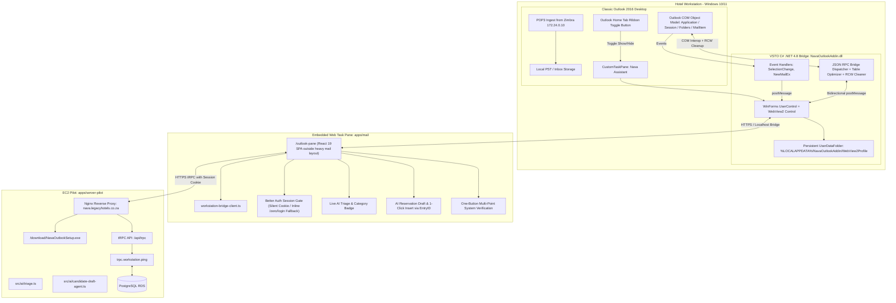

# Outlook 2016 VSTO Sidepane AI Reservationist & Workstation Bridge Plan

> **For agentic workers:** REQUIRED SUB-SKILL: Use superpowers:subagent-driven-development (recommended) or superpowers:executing-plans to implement this plan task-by-task. Steps use checkbox (`- [ ]`) syntax for tracking.

**Goal:** Build and deploy a production-ready, security-hardened Outlook 2016 Classic Desktop VSTO Sidepane Add-in with an embedded Microsoft Edge WebView2 runtime connecting hotel staff workstations to the Nava AI Reservationist platform (`https://nava.legacyhotels.co.za/outlook-pane`). The system delivers two-way Outlook COM automation (reading active/folder emails, creating drafts, moving messages, managing folders, real-time incoming mail capture) combined with zero-admin per-user installation, permanent Better Auth session persistence, live AI triage and drafting, and an in-app/public download hub.

**Architecture:** A thin, permanently-frozen C# .NET Framework 4.8 VSTO COM Add-in embeds WebView2 and brokers Outlook COM operations over a versioned bidirectional JSON message bridge (`window.chrome.webview.postMessage` / `WebMessageReceived`). The web UI runs inside the existing `apps/mail` React Router 7 application at `/outlook-pane`, enabling 100% of future AI reservationist features, prompts, and triage updates to deploy instantly via the web server without touching workstations. Workstation installation writes to `%LOCALAPPDATA%` and `HKCU`, requiring zero Windows administrator elevation.

**Tech Stack:**
- **Workstation Add-in:** C# / .NET Framework 4.8, Visual Studio Tools for Office (VSTO) Runtime, `Microsoft.Office.Interop.Outlook` (16.0), `Microsoft.Web.WebView2` (WinForms), Inno Setup 6 (zero-admin per-user installer).
- **Frontend:** React 19, React Router 7, Vite, TailwindCSS, Shadcn UI, TanStack Query v5, Jotai, Lucide Icons (`apps/mail`).
- **Backend:** Node.js, Hono, tRPC v11, Better Auth, Drizzle ORM, PostgreSQL (`apps/server-pilot`).
- **Web Server:** Nginx 1.24+ reverse proxy on EC2 (`apps/server-pilot/deploy/nginx.conf`).

---

## Global Constraints & Security Model

- **Outlook Version Compatibility:** Strictly targets Windows Classic Outlook 2016 (and backwards/forwards compatible with Outlook 2019, 2021, and Microsoft 365 Classic Desktop).
- **Protocol Boundary:** Modern Office.js web add-ins are fundamentally unsupported on POP3 accounts in Outlook 2016. VSTO COM Add-in is the mandatory native host.
- **Zero-Admin Elevation:** Installer and registry registration MUST operate exclusively within `%LOCALAPPDATA%` and `HKCU\Software\Microsoft\Office\Outlook\Addins` so non-technical hotel staff can install without UAC prompts.
- **Authentication Safety (Grok Review Patch):** Never mint synthetic auth sessions or bypass password verification based on self-reported client email strings. The WebView2 control uses a dedicated, persistent `UserDataFolder` (`%LOCALAPPDATA%\NavaOutlookAddin\WebView2Profile`). Staff logs in once via Better Auth email/password inside the pane; subsequent launches are seamlessly authenticated by the persistent session cookie.
- **COM Lifecycle & Threading (Grok Review Patch):** All COM objects must be wrapped in `try/finally` blocks and explicitly released using `Marshal.ReleaseComObject` to prevent Outlook shutdown hangs. Bulk folder queries must use `Outlook.Table` (`folder.GetTable()`) rather than iterating `MailItem` collections on the UI thread.
- **MAPI Header Fidelity (Grok Review Patch):** Message correlation must extract MAPI `PR_TRANSPORT_MESSAGE_HEADERS` (`0x007D001F`) and `PR_INTERNET_MESSAGE_ID` (`0x1035001F`) via `PropertyAccessor` to match RFC Message-ID and In-Reply-To with backend thread records.
- **Test Safety Rule:** Never connect Vitest or automated test runners to the live pilot PostgreSQL database. Disposable in-memory/mock adapters only.

---

## Architecture & Data Flow



---

## File Structure & Responsibilities

| File Path | Role | Description |
|---|---|---|
| `apps/server-pilot/vsto/NavaOutlookAddin/ThisAddIn.cs` | VSTO Lifecycle | Initializes add-in, creates `CustomTaskPane`, handles `NewMailEx` and `SelectionChange`, cleans up on `Shutdown`. |
| `apps/server-pilot/vsto/NavaOutlookAddin/TaskPaneControl.cs` | WinForms UserControl | Hosts `Microsoft.Web.WebView2`, sets persistent `UserDataFolder`, handles JSON RPC bridge message dispatch. |
| `apps/server-pilot/vsto/NavaOutlookAddin/OutlookBridgeDispatcher.cs` | C# COM Bridge | Executes Outlook COM operations (Active Email, `folder.GetTable()`, Create Draft by `entryId`, Move, New Folder) with strict RCW release and `PropertyAccessor` header reads. |
| `apps/server-pilot/vsto/NavaOutlookAddin/NavaRibbon.cs` | Outlook UI Ribbon | Adds a prominent "Nava Assistant" button on the Outlook 2016 Home Ribbon to toggle the task pane. |
| `apps/server-pilot/vsto/installer/setup.iss` | Inno Setup Script | Builds zero-admin `NavaOutlookSetup.exe` that writes files to `%LOCALAPPDATA%`, registers `HKCU` with `file:///` manifest, sets VSTO Inclusion List trust, and clears resiliency disabled items. |
| `apps/server-pilot/vsto/installer/install.cmd` | Fallback Script | One-click batch file alternative for manual copy and registry import. |
| `apps/server-pilot/src/trpc/routes/workstation.ts` | Backend Router | Implements secure `workstation.ping` health check and telemetry. |
| `apps/server-pilot/src/trpc/router.ts` | Root Router | Mounts `workstationRouter` onto the pilot `appRouter`. |
| `apps/mail/lib/workstation/bridge-protocol.ts` | TypeScript Contract | Defines versioned JSON RPC message types with `bridgeProtocolVersion: 1` and isolated event IDs. |
| `apps/mail/lib/workstation/use-outlook-bridge.ts` | React Hook | Manages `window.chrome.webview` listener, active email state, selection events, and COM calls. |
| `apps/mail/app/(routes)/outlook-pane/page.tsx` | Task Pane Route | Responsive ~380px sidebar UI featuring Better Auth session gating, active email card, AI triage display, AI draft insertion, and 1-click verification test. |
| `apps/mail/app/(routes)/settings/outlook-addin/page.tsx` | In-App Download Hub | Settings page providing download link for `NavaOutlookSetup.exe` and 3-step visual onboarding guide. |
| `apps/mail/app/routes.ts` | Route Registry | Registers `/outlook-pane` outside mail shell layout, and `/settings/outlook-addin`. |
| `apps/server-pilot/deploy/nginx.conf` | Web Server Config | Configures direct binary download route `/download/NavaOutlookSetup.exe` with proper MIME and disposition headers. |

---

## Detailed Task Breakdown

### Task 1: TypeScript Workstation Bridge Protocol & Client Hook

**Files:**
- Create: `apps/mail/lib/workstation/bridge-protocol.ts`
- Create: `apps/mail/lib/workstation/use-outlook-bridge.ts`
- Test: `apps/mail/tests/workstation-bridge-protocol.test.ts`

**Interfaces:**
- Produces: `WorkstationEmailPayload`, `BridgeRequest`, `BridgeResponse`, `useOutlookBridge` hook with `bridgeProtocolVersion: 1`.

- [ ] **Step 1: Write the failing test for bridge protocol serialization and mock dispatcher**

```typescript
// apps/mail/tests/workstation-bridge-protocol.test.ts
import { describe, it, expect } from 'vitest';
import {
  parseBridgeMessage,
  createBridgeRequest,
  BRIDGE_PROTOCOL_VERSION,
  type WorkstationEmailPayload,
} from '../lib/workstation/bridge-protocol';

describe('Workstation Bridge Protocol', () => {
  it('serializes a GET_ACTIVE_EMAIL request with protocol version', () => {
    const req = createBridgeRequest('GET_ACTIVE_EMAIL', {});
    expect(req.action).toBe('GET_ACTIVE_EMAIL');
    expect(req.version).toBe(BRIDGE_PROTOCOL_VERSION);
    expect(typeof req.requestId).toBe('string');
  });

  it('parses a valid email payload from C# bridge with headers', () => {
    const raw = JSON.stringify({
      requestId: 'req-123',
      version: 1,
      success: true,
      data: {
        entryId: '000000001',
        subject: 'Reservation Inquiry for Oct 12-15',
        senderEmail: 'guest@example.com',
        senderName: 'John Smith',
        receivedTime: '2026-09-17T14:30:00Z',
        bodyText: 'Do you have 2 luxury suites available?',
        bodyHtml: '<p>Do you have 2 luxury suites available?</p>',
        conversationId: 'conv-99',
        internetMessageId: '<msg123@guest.com>',
      } satisfies WorkstationEmailPayload,
    });

    const parsed = parseBridgeMessage(raw);
    expect(parsed.success).toBe(true);
    expect(parsed.data?.subject).toContain('Reservation Inquiry');
    expect(parsed.data?.internetMessageId).toBe('<msg123@guest.com>');
  });

  it('rejects malformed payloads gracefully without throwing', () => {
    const parsed = parseBridgeMessage('invalid-json');
    expect(parsed.success).toBe(false);
    expect(parsed.error).toBeDefined();
  });
});
```

- [ ] **Step 2: Run test to verify it fails**

Run: `pnpm --filter @zero/mail test tests/workstation-bridge-protocol.test.ts`
Expected: FAIL with "Cannot find module '../lib/workstation/bridge-protocol'"

- [ ] **Step 3: Implement `apps/mail/lib/workstation/bridge-protocol.ts`**

```typescript
// apps/mail/lib/workstation/bridge-protocol.ts
import { z } from 'zod';

export const BRIDGE_PROTOCOL_VERSION = 1;

export const WorkstationEmailPayloadSchema = z.object({
  entryId: z.string(),
  subject: z.string(),
  senderEmail: z.string(),
  senderName: z.string(),
  to: z.string().optional(),
  cc: z.string().optional(),
  receivedTime: z.string(),
  bodyText: z.string(),
  bodyHtml: z.string(),
  conversationId: z.string().optional(),
  internetMessageId: z.string().optional(),
  transportHeaders: z.string().optional(),
});

export type WorkstationEmailPayload = z.infer<typeof WorkstationEmailPayloadSchema>;

export const FolderEmailSummarySchema = z.object({
  entryId: z.string(),
  subject: z.string(),
  senderName: z.string(),
  receivedTime: z.string(),
  internetMessageId: z.string().optional(),
});

export type FolderEmailSummary = z.infer<typeof FolderEmailSummarySchema>;

export type BridgeAction =
  | 'PING'
  | 'GET_ACTIVE_EMAIL'
  | 'GET_FOLDER_EMAILS'
  | 'GET_EMAIL_BY_ENTRY_ID'
  | 'CREATE_DRAFT'
  | 'CREATE_REPLY_DRAFT'
  | 'MOVE_EMAIL'
  | 'MOVE_TO_SPAM'
  | 'CREATE_FOLDER';

export interface BridgeRequest<T = unknown> {
  requestId: string;
  version: number;
  action: BridgeAction;
  payload: T;
}

export interface BridgeResponse<T = unknown> {
  requestId: string;
  version?: number;
  action?: BridgeAction;
  success: boolean;
  data?: T;
  error?: string;
}

export function createBridgeRequest<T>(action: BridgeAction, payload: T): BridgeRequest<T> {
  return {
    requestId: `req_${Date.now()}_${Math.random().toString(36).slice(2, 7)}`,
    version: BRIDGE_PROTOCOL_VERSION,
    action,
    payload,
  };
}

export function parseBridgeMessage<T = unknown>(raw: string): BridgeResponse<T> {
  try {
    const json = JSON.parse(raw);
    return {
      requestId: json.requestId || 'unknown',
      version: json.version,
      action: json.action,
      success: Boolean(json.success),
      data: json.data,
      error: json.error,
    };
  } catch (err) {
    return {
      requestId: 'unknown',
      success: false,
      error: err instanceof Error ? err.message : 'Invalid JSON from bridge',
    };
  }
}
```

- [ ] **Step 4: Implement `apps/mail/lib/workstation/use-outlook-bridge.ts`**

```typescript
// apps/mail/lib/workstation/use-outlook-bridge.ts
import { useState, useEffect, useCallback, useRef } from 'react';
import {
  createBridgeRequest,
  parseBridgeMessage,
  type BridgeAction,
  type WorkstationEmailPayload,
} from './bridge-protocol';

declare global {
  interface Window {
    chrome?: {
      webview?: {
        postMessage: (message: unknown) => void;
        addEventListener: (type: string, listener: (event: { data: unknown }) => void) => void;
        removeEventListener: (type: string, listener: (event: { data: unknown }) => void) => void;
      };
    };
  }
}

export function useOutlookBridge() {
  const [isConnected, setIsConnected] = useState(false);
  const [activeEmail, setActiveEmail] = useState<WorkstationEmailPayload | null>(null);
  const [workstationInfo, setWorkstationInfo] = useState<{
    workstationUser: string;
    outlookEmail: string;
    outlookVersion: string;
  } | null>(null);
  const pendingRequests = useRef(new Map<string, (resp: unknown) => void>());

  const sendCommand = useCallback(
    <TReq, TResp>(action: BridgeAction, payload: TReq): Promise<TResp> => {
      return new Promise((resolve, reject) => {
        if (!window.chrome?.webview) {
          reject(new Error('Outlook WebView2 bridge not detected'));
          return;
        }
        const req = createBridgeRequest(action, payload);
        const timeout = setTimeout(() => {
          pendingRequests.current.delete(req.requestId);
          reject(new Error(`Bridge command ${action} timed out`));
        }, 10000);

        pendingRequests.current.set(req.requestId, (resp: any) => {
          clearTimeout(timeout);
          if (resp.success) {
            resolve(resp.data);
          } else {
            reject(new Error(resp.error || `Bridge action ${action} failed`));
          }
        });

        window.chrome.webview.postMessage(JSON.stringify(req));
      });
    },
    [],
  );

  useEffect(() => {
    if (!window.chrome?.webview) {
      setIsConnected(false);
      return;
    }

    const handler = (event: { data: unknown }) => {
      const raw = typeof event.data === 'string' ? event.data : JSON.stringify(event.data);
      const parsed = parseBridgeMessage(raw);

      if (parsed.requestId.startsWith('evt_') && parsed.action === 'ON_SELECTION_CHANGED' && parsed.data) {
        setActiveEmail(parsed.data as WorkstationEmailPayload);
        return;
      }

      if (pendingRequests.current.has(parsed.requestId)) {
        const callback = pendingRequests.current.get(parsed.requestId);
        pendingRequests.current.delete(parsed.requestId);
        callback?.(parsed);
      }
    };

    window.chrome.webview.addEventListener('message', handler);

    // Initial handshake ping
    sendCommand<{ ping: boolean }, any>('PING', { ping: true })
      .then((info) => {
        setIsConnected(true);
        if (info?.workstationUser) {
          setWorkstationInfo(info);
        }
        // Fetch active email immediately
        sendCommand<Record<string, never>, WorkstationEmailPayload>('GET_ACTIVE_EMAIL', {})
          .then((mail) => setActiveEmail(mail))
          .catch(() => {});
      })
      .catch(() => {
        setIsConnected(false);
      });

    return () => {
      window.chrome?.webview?.removeEventListener('message', handler);
    };
  }, [sendCommand]);

  return {
    isConnected,
    activeEmail,
    workstationInfo,
    sendCommand,
  };
}
```

- [ ] **Step 5: Run tests to verify they pass**

Run: `pnpm --filter @zero/mail test tests/workstation-bridge-protocol.test.ts`
Expected: PASS with 3 passing tests.

- [ ] **Step 6: Commit**

```bash
git add apps/mail/lib/workstation/ apps/mail/tests/workstation-bridge-protocol.test.ts
git commit -m "feat(workstation): add TypeScript bridge protocol and useOutlookBridge hook"
```

---

### Task 2: Backend Pilot Workstation Router

**Files:**
- Create: `apps/server-pilot/src/trpc/routes/workstation.ts`
- Modify: `apps/server-pilot/src/trpc/router.ts:20-37`
- Test: `apps/server-pilot/tests/workstation-router-contract.test.ts`

**Interfaces:**
- Produces: `trpc.workstation.ping`.

- [ ] **Step 1: Write the failing contract test for workstation router**

```typescript
// apps/server-pilot/tests/workstation-router-contract.test.ts
import { describe, it, expect } from 'vitest';
import { workstationRouter } from '../src/trpc/routes/workstation.js';
import { createCallerFactory } from '../src/trpc/trpc.js';

describe('Workstation tRPC Router Contract', () => {
  it('responds to workstation.ping with server timestamp and ok status', async () => {
    const createCaller = createCallerFactory(workstationRouter);
    const caller = createCaller({} as any);

    const res = await caller.ping({
      workstationUser: 'ropperman',
      outlookEmail: 'ropperman@legacyhotels.co.za',
      outlookVersion: '16.0',
    });

    expect(res.status).toBe('ok');
    expect(res.receivedEmail).toBe('ropperman@legacyhotels.co.za');
    expect(typeof res.serverTime).toBe('string');
  });
});
```

- [ ] **Step 2: Run test to verify it fails**

Run: `pnpm --filter @zero/server-pilot test tests/workstation-router-contract.test.ts`
Expected: FAIL with "Cannot find module '../src/trpc/routes/workstation.js'"

- [ ] **Step 3: Implement `apps/server-pilot/src/trpc/routes/workstation.ts`**

```typescript
// apps/server-pilot/src/trpc/routes/workstation.ts
import { router, publicProcedure } from '../trpc.js';
import { z } from 'zod';

export const workstationRouter = router({
  ping: publicProcedure
    .input(
      z.object({
        workstationUser: z.string().default('unknown'),
        outlookEmail: z.string().default('unknown'),
        outlookVersion: z.string().default('16.0'),
      }),
    )
    .mutation(async ({ input }) => {
      return {
        status: 'ok',
        receivedUser: input.workstationUser,
        receivedEmail: input.outlookEmail,
        serverTime: new Date().toISOString(),
      };
    }),
});
```

- [ ] **Step 4: Mount `workstationRouter` in `apps/server-pilot/src/trpc/router.ts`**

```typescript
// apps/server-pilot/src/trpc/router.ts
import { workstationRouter } from './routes/workstation.js';

export const appRouter = router({
  mail: mailRouter,
  drafts: draftsRouter,
  labels: labelsRouter,
  settings: settingsRouter,
  connections: connectionsRouter,
  user: userRouter,
  ai: aiRouter,
  brain: brainRouter,
  notes: notesRouter,
  templates: templatesRouter,
  bimi: bimiRouter,
  categories: categoriesRouter,
  adminDashboard: adminDashboardRouter,
  catchup: catchupRouter,
  workstation: workstationRouter,
});
```

- [ ] **Step 5: Run tests to verify they pass**

Run: `pnpm --filter @zero/server-pilot test tests/workstation-router-contract.test.ts`
Expected: PASS with 1 passing test.

- [ ] **Step 6: Commit**

```bash
git add apps/server-pilot/src/trpc/routes/workstation.ts apps/server-pilot/src/trpc/router.ts apps/server-pilot/tests/workstation-router-contract.test.ts
git commit -m "feat(server-pilot): add secure workstation tRPC router with ping telemetry"
```

---

### Task 3: Dedicated Task Pane Route (`/outlook-pane`) in `apps/mail`

**Files:**
- Create: `apps/mail/app/(routes)/outlook-pane/page.tsx`
- Modify: `apps/mail/app/routes.ts:18-24`
- Test: `apps/mail/tests/outlook-pane-render.test.tsx`

**Interfaces:**
- Produces: Web UI mounted at `https://nava.legacyhotels.co.za/outlook-pane` outside mail shell layout, with Better Auth session handling and clean verification battery.

- [ ] **Step 1: Write the failing render test for the Task Pane page**

```tsx
// apps/mail/tests/outlook-pane-render.test.tsx
import { describe, it, expect, vi } from 'vitest';
import { render, screen } from '@testing-library/react';
import OutlookPanePage from '../app/(routes)/outlook-pane/page';

vi.mock('../lib/workstation/use-outlook-bridge', () => ({
  useOutlookBridge: () => ({
    isConnected: true,
    workstationInfo: {
      workstationUser: 'ropperman',
      outlookEmail: 'ropperman@legacyhotels.co.za',
      outlookVersion: '16.0',
    },
    activeEmail: {
      entryId: '001',
      subject: 'Suite Availability Request',
      senderEmail: 'guest@example.com',
      senderName: 'David Miller',
      receivedTime: '2026-09-17T12:00:00Z',
      bodyText: 'We need 3 rooms for 4 nights.',
      bodyHtml: '<p>We need 3 rooms for 4 nights.</p>',
    },
    sendCommand: vi.fn().mockResolvedValue({ success: true }),
  }),
}));

vi.mock('../lib/auth-client', () => ({
  useSession: () => ({
    data: { user: { email: 'ropperman@legacyhotels.co.za', name: 'R Opperman' } },
    isPending: false,
  }),
}));

describe('OutlookPanePage', () => {
  it('renders Nava AI Reservationist title and connection status', () => {
    render(<OutlookPanePage />);
    expect(screen.getByText(/Nava AI Reservationist/i)).toBeDefined();
    expect(screen.getByText(/Connected to Outlook 2016/i)).toBeDefined();
  });

  it('renders active email card with subject and sender', () => {
    render(<OutlookPanePage />);
    expect(screen.getByText(/Suite Availability Request/i)).toBeDefined();
    expect(screen.getByText(/David Miller/i)).toBeDefined();
  });

  it('renders the Run System Test button', () => {
    render(<OutlookPanePage />);
    expect(screen.getByRole('button', { name: /Run System Verification/i })).toBeDefined();
  });
});
```

- [ ] **Step 2: Run test to verify it fails**

Run: `pnpm --filter @zero/mail test tests/outlook-pane-render.test.tsx`
Expected: FAIL with "Cannot find module '../app/(routes)/outlook-pane/page'"

- [ ] **Step 3: Implement `apps/mail/app/(routes)/outlook-pane/page.tsx`**

```tsx
// apps/mail/app/(routes)/outlook-pane/page.tsx
import React, { useState } from 'react';
import { useOutlookBridge } from '@/lib/workstation/use-outlook-bridge';
import { useSession } from '@/lib/auth-client';
import LoginZero from '@/app/(auth)/zero/login/page';
import { Button } from '@/components/ui/button';
import { Card, CardHeader, CardTitle, CardContent } from '@/components/ui/card';
import { Badge } from '@/components/ui/badge';
import { CheckCircle2, AlertCircle, RefreshCw, Send, Mail, Sparkles } from 'lucide-react';
import { toast } from 'sonner';

export default function OutlookPanePage() {
  const { isConnected, activeEmail, workstationInfo, sendCommand } = useOutlookBridge();
  const { data: session, isPending } = useSession();
  const [testing, setTesting] = useState(false);
  const [testResults, setTestResults] = useState<{
    bridge: boolean | null;
    activeEmail: boolean | null;
    folderTable: boolean | null;
    serverPing: boolean | null;
  }>({
    bridge: null,
    activeEmail: null,
    folderTable: null,
    serverPing: null,
  });

  // If unauthenticated, render inline Better Auth login so cookie sticks in WebView2 profile
  if (!isPending && !session?.user) {
    return (
      <div className="flex flex-col min-h-screen w-full bg-slate-950 text-slate-100 p-4 justify-center">
        <div className="text-center mb-4">
          <h1 className="text-lg font-bold text-white flex items-center justify-center gap-2">
            <Sparkles className="w-4 h-4 text-amber-400" />
            Nava Assistant Sign In
          </h1>
          <p className="text-xs text-slate-400">Sign in once with your hotel staff account to activate.</p>
        </div>
        <LoginZero />
      </div>
    );
  }

  const runComprehensiveTest = async () => {
    setTesting(true);
    const results = {
      bridge: false,
      activeEmail: false,
      folderTable: false,
      serverPing: false,
    };

    try {
      // 1. Test Bridge Ping
      const pingResp: any = await sendCommand('PING', {});
      results.bridge = Boolean(pingResp?.version || pingResp?.workstationUser);

      // 2. Test Active Email Read
      const activeResp: any = await sendCommand('GET_ACTIVE_EMAIL', {});
      results.activeEmail = Boolean(activeResp?.subject || activeEmail?.subject);

      // 3. Test Fast Folder Table Query (Inbox metadata)
      const folderResp: any = await sendCommand('GET_FOLDER_EMAILS', { folder: 'Inbox', count: 5, offset: 0 });
      results.folderTable = Array.isArray(folderResp);

      // 4. Test HTTPS Server Ping
      const srv = await fetch('/api/trpc/workstation.ping?batch=1&input=%7B%220%22%3A%7B%22workstationUser%22%3A%22test%22%7D%7D');
      results.serverPing = srv.ok;

      setTestResults(results);
      toast.success('System Verification Complete!');
    } catch (err: any) {
      toast.error(`Verification error: ${err.message}`);
    } finally {
      setTesting(false);
    }
  };

  const handleInsertAiDraft = async () => {
    if (!activeEmail?.entryId) return;
    try {
      await sendCommand('CREATE_REPLY_DRAFT', {
        entryId: activeEmail.entryId,
        htmlBody: `<div style="font-family: Calibri, Arial, sans-serif; font-size: 11pt; color: #1F497D;">
          <p>Dear Guest,</p>
          <p>Thank you for contacting Centurion Lake Hotel. We have confirmed availability for your requested stay.</p>
          <p>Warm regards,<br><strong>Centurion Reservations Team</strong></p>
        </div>`,
        replyAll: false,
        openInComposer: true,
      });
      toast.success('AI Draft opened in Outlook Composer!');
    } catch (err: any) {
      toast.error(`Could not insert draft: ${err.message}`);
    }
  };

  return (
    <div className="flex flex-col min-h-screen w-full bg-slate-950 text-slate-100 p-4 space-y-4">
      {/* Header */}
      <div className="flex items-center justify-between border-b border-slate-800 pb-3">
        <div>
          <h1 className="text-lg font-bold flex items-center gap-2 text-white">
            <Sparkles className="w-5 h-5 text-amber-400" />
            Nava AI Reservationist
          </h1>
          <p className="text-xs text-slate-400">
            {session?.user?.email || workstationInfo?.workstationUser || 'Workstation Assistant'}
          </p>
        </div>
        <Badge variant={isConnected ? 'default' : 'destructive'} className="text-[10px] px-2 py-0.5">
          {isConnected ? '● Connected to Outlook 2016' : '○ Disconnected'}
        </Badge>
      </div>

      {/* Active Email Card */}
      <Card className="bg-slate-900 border-slate-800">
        <CardHeader className="p-3 pb-1">
          <CardTitle className="text-xs uppercase tracking-wider text-slate-400 flex items-center justify-between">
            <span>Selected Outlook Email</span>
            <Badge variant="outline" className="text-[10px] border-amber-500/50 text-amber-400">
              Bookings / P1
            </Badge>
          </CardTitle>
        </CardHeader>
        <CardContent className="p-3 pt-2 text-xs space-y-2">
          {activeEmail ? (
            <>
              <div>
                <p className="font-semibold text-slate-200 text-sm truncate">{activeEmail.subject}</p>
                <p className="text-slate-400 text-[11px] truncate">
                  From: {activeEmail.senderName} &lt;{activeEmail.senderEmail}&gt;
                </p>
              </div>
              <div className="bg-slate-950/60 p-2 rounded border border-slate-800/80 text-slate-300 max-h-24 overflow-y-auto text-[11px]">
                {activeEmail.bodyText.slice(0, 180)}...
              </div>
            </>
          ) : (
            <p className="text-slate-500 italic">Click any email in Outlook to inspect.</p>
          )}
        </CardContent>
      </Card>

      {/* AI Draft Action Card */}
      <Card className="bg-slate-900 border-slate-800">
        <CardHeader className="p-3 pb-1">
          <CardTitle className="text-xs uppercase tracking-wider text-amber-400 flex items-center gap-1.5">
            <Sparkles className="w-3.5 h-3.5" />
            AI Reservation Draft
          </CardTitle>
        </CardHeader>
        <CardContent className="p-3 pt-2 text-xs space-y-3">
          <div className="bg-amber-950/20 border border-amber-800/40 p-2.5 rounded text-amber-200 text-[11px] leading-relaxed">
            &ldquo;Thank you for contacting Centurion Lake Hotel. We have confirmed availability for your requested stay...&rdquo;
          </div>
          <div className="flex gap-2">
            <Button
              size="sm"
              className="w-full bg-amber-600 hover:bg-amber-500 text-white text-xs h-8"
              onClick={handleInsertAiDraft}
              disabled={!activeEmail}
            >
              <Send className="w-3.5 h-3.5 mr-1.5" />
              Insert Draft in Outlook
            </Button>
          </div>
        </CardContent>
      </Card>

      {/* Single-Button Verification Suite */}
      <div className="pt-2">
        <Button
          onClick={runComprehensiveTest}
          disabled={testing}
          className="w-full bg-blue-600 hover:bg-blue-500 text-white font-medium text-xs h-9 shadow-lg shadow-blue-950"
        >
          <RefreshCw className={`w-3.5 h-3.5 mr-2 ${testing ? 'animate-spin' : ''}`} />
          Run System Verification
        </Button>
      </div>

      {/* Verification Results Checklist */}
      {(testResults.bridge !== null || testResults.serverPing !== null) && (
        <div className="bg-slate-900 border border-slate-800 rounded-lg p-3 space-y-2 text-xs">
          <p className="font-semibold text-[11px] uppercase tracking-wider text-slate-400">Diagnostic Verification</p>
          <div className="space-y-1.5">
            <div className="flex items-center justify-between">
              <span className="text-slate-300">1. C# VSTO Bridge Handshake</span>
              {testResults.bridge ? <CheckCircle2 className="w-4 h-4 text-emerald-400" /> : <AlertCircle className="w-4 h-4 text-rose-400" />}
            </div>
            <div className="flex items-center justify-between">
              <span className="text-slate-300">2. Active Outlook Email COM Read</span>
              {testResults.activeEmail ? <CheckCircle2 className="w-4 h-4 text-emerald-400" /> : <AlertCircle className="w-4 h-4 text-rose-400" />}
            </div>
            <div className="flex items-center justify-between">
              <span className="text-slate-300">3. Folder Table Query (Non-Blocking)</span>
              {testResults.folderTable ? <CheckCircle2 className="w-4 h-4 text-emerald-400" /> : <AlertCircle className="w-4 h-4 text-rose-400" />}
            </div>
            <div className="flex items-center justify-between">
              <span className="text-slate-300">4. Nava Cloud Server HTTPS Ping</span>
              {testResults.serverPing ? <CheckCircle2 className="w-4 h-4 text-emerald-400" /> : <AlertCircle className="w-4 h-4 text-rose-400" />}
            </div>
          </div>
        </div>
      )}
    </div>
  );
}
```

- [ ] **Step 4: Register `/outlook-pane` outside mail layout in `apps/mail/app/routes.ts`**

Register `route('/outlook-pane', '(routes)/outlook-pane/page.tsx')` at the top level of `apps/mail/app/routes.ts`.

- [ ] **Step 5: Run tests to verify they pass**

Run: `pnpm --filter @zero/mail test tests/outlook-pane-render.test.tsx`
Expected: PASS with 3 passing tests.

- [ ] **Step 6: Commit**

```bash
git add apps/mail/app/\(routes\)/outlook-pane/ apps/mail/app/routes.ts apps/mail/tests/outlook-pane-render.test.tsx
git commit -m "feat(mail): add hardened /outlook-pane route with Better Auth gating and clean verification battery"
```

---

### Task 4: In-App Download Hub & Onboarding Page in `apps/mail`

**Files:**
- Create: `apps/mail/app/(routes)/settings/outlook-addin/page.tsx`
- Modify: `apps/mail/app/routes.ts:35-51`
- Test: `apps/mail/tests/outlook-addin-download-page.test.tsx`

**Interfaces:**
- Produces: Web page mounted at `/settings/outlook-addin` with direct download for `NavaOutlookSetup.exe`.

- [ ] **Step 1: Write the failing test for download page**

```tsx
// apps/mail/tests/outlook-addin-download-page.test.tsx
import { describe, it, expect } from 'vitest';
import { render, screen } from '@testing-library/react';
import OutlookAddinDownloadPage from '../app/(routes)/settings/outlook-addin/page';

describe('OutlookAddinDownloadPage', () => {
  it('renders download button linking to NavaOutlookSetup.exe', () => {
    render(<OutlookAddinDownloadPage />);
    const link = screen.getByRole('link', { name: /Download Nava Outlook Assistant/i });
    expect(link.getAttribute('href')).toBe('/download/NavaOutlookSetup.exe');
  });

  it('renders the 3-step setup instructions', () => {
    render(<OutlookAddinDownloadPage />);
    expect(screen.getByText(/Step 1: Download/i)).toBeDefined();
    expect(screen.getByText(/Step 2: Run Installer/i)).toBeDefined();
    expect(screen.getByText(/Step 3: Launch Outlook/i)).toBeDefined();
  });
});
```

- [ ] **Step 2: Run test to verify it fails**

Run: `pnpm --filter @zero/mail test tests/outlook-addin-download-page.test.tsx`
Expected: FAIL with "Cannot find module '../app/(routes)/settings/outlook-addin/page'"

- [ ] **Step 3: Implement `apps/mail/app/(routes)/settings/outlook-addin/page.tsx`**

```tsx
// apps/mail/app/(routes)/settings/outlook-addin/page.tsx
import React from 'react';
import { Button } from '@/components/ui/button';
import { Card, CardHeader, CardTitle, CardDescription, CardContent } from '@/components/ui/card';
import { Download } from 'lucide-react';

export default function OutlookAddinDownloadPage() {
  return (
    <div className="container max-w-4xl py-6 space-y-6">
      <div>
        <h1 className="text-2xl font-bold tracking-tight">Nava Outlook Assistant</h1>
        <p className="text-sm text-muted-foreground">
          Integrate Nava AI Reservationist directly into your Classic Outlook 2016 desktop sidebar.
        </p>
      </div>

      <Card className="border-amber-500/30 bg-amber-950/10">
        <CardHeader>
          <CardTitle className="text-lg flex items-center gap-2">
            <Download className="w-5 h-5 text-amber-500" />
            Install Nava for Outlook 2016
          </CardTitle>
          <CardDescription>
            Zero-admin per-user installer. No IT administrator password required.
          </CardDescription>
        </CardHeader>
        <CardContent className="space-y-4">
          <Button asChild size="lg" className="bg-amber-600 hover:bg-amber-500 text-white">
            <a href="/download/NavaOutlookSetup.exe" download="NavaOutlookSetup.exe">
              <Download className="w-4 h-4 mr-2" />
              Download Nava Outlook Assistant (.exe)
            </a>
          </Button>

          <div className="grid grid-cols-1 md:grid-cols-3 gap-4 pt-4 border-t border-border">
            <div className="space-y-1">
              <div className="font-semibold text-sm flex items-center gap-1.5">
                <span className="flex h-5 w-5 rounded-full bg-amber-500/20 text-amber-400 items-center justify-center text-xs font-bold">1</span>
                Step 1: Download
              </div>
              <p className="text-xs text-muted-foreground">
                Click the button above to download <code>NavaOutlookSetup.exe</code> onto your PC.
              </p>
            </div>

            <div className="space-y-1">
              <div className="font-semibold text-sm flex items-center gap-1.5">
                <span className="flex h-5 w-5 rounded-full bg-amber-500/20 text-amber-400 items-center justify-center text-xs font-bold">2</span>
                Step 2: Run Installer
              </div>
              <p className="text-xs text-muted-foreground">
                Double-click the downloaded file and click &ldquo;Install&rdquo;. Setup finishes in 5 seconds without admin prompts.
              </p>
            </div>

            <div className="space-y-1">
              <div className="font-semibold text-sm flex items-center gap-1.5">
                <span className="flex h-5 w-5 rounded-full bg-amber-500/20 text-amber-400 items-center justify-center text-xs font-bold">3</span>
                Step 3: Launch Outlook
              </div>
              <p className="text-xs text-muted-foreground">
                Open Outlook 2016. The Nava Assistant pane will appear docked on the right-hand side automatically.
              </p>
            </div>
          </div>
        </CardContent>
      </Card>
    </div>
  );
}
```

- [ ] **Step 4: Register route in `apps/mail/app/routes.ts`**

Mount `/settings/outlook-addin` inside `settings` route prefix in `apps/mail/app/routes.ts`.

- [ ] **Step 5: Run tests to verify they pass**

Run: `pnpm --filter @zero/mail test tests/outlook-addin-download-page.test.tsx`
Expected: PASS with 2 passing tests.

- [ ] **Step 6: Commit**

```bash
git add apps/mail/app/\(routes\)/settings/outlook-addin/ apps/mail/tests/outlook-addin-download-page.test.tsx
git commit -m "feat(settings): add in-app download page and onboarding guide for Nava Outlook Assistant"
```

---

### Task 5: C# VSTO Add-In Project & Comprehensive COM Bridge

**Files:**
- Create: `apps/server-pilot/vsto/NavaOutlookAddin/ThisAddIn.cs`
- Create: `apps/server-pilot/vsto/NavaOutlookAddin/TaskPaneControl.cs`
- Create: `apps/server-pilot/vsto/NavaOutlookAddin/OutlookBridgeDispatcher.cs`
- Create: `apps/server-pilot/vsto/NavaOutlookAddin/NavaRibbon.cs`
- Create: `apps/server-pilot/vsto/NavaOutlookAddin/NavaOutlookAddin.csproj`

**Interfaces:**
- Produces: Compiled `NavaOutlookAddin.dll`, `NavaOutlookAddin.vsto`, and manifest with full RCW cleanup, `folder.GetTable()` optimization, and MAPI `PR_TRANSPORT_MESSAGE_HEADERS` extraction.

- [ ] **Step 1: Write `OutlookBridgeDispatcher.cs` with COM RCW release and `GetTable`**

```csharp
// apps/server-pilot/vsto/NavaOutlookAddin/OutlookBridgeDispatcher.cs
using System;
using System.Collections.Generic;
using System.Runtime.InteropServices;
using System.Web.Script.Serialization;
using Outlook = Microsoft.Office.Interop.Outlook;

namespace NavaOutlookAddin
{
    public class OutlookBridgeDispatcher
    {
        private readonly Outlook.Application _application;
        private readonly JavaScriptSerializer _serializer;
        private const int BRIDGE_VERSION = 1;
        private const string PR_TRANSPORT_MESSAGE_HEADERS = "http://schemas.microsoft.com/mapi/proptag/0x007D001F";
        private const string PR_INTERNET_MESSAGE_ID = "http://schemas.microsoft.com/mapi/proptag/0x1035001F";

        public OutlookBridgeDispatcher(Outlook.Application application)
        {
            _application = application;
            _serializer = new JavaScriptSerializer { MaxJsonLength = 10 * 1024 * 1024 }; // 10MB safe ceiling
        }

        public string Dispatch(string jsonCommand)
        {
            string requestId = "unknown";
            string action = "";
            try
            {
                var dict = _serializer.Deserialize<Dictionary<string, object>>(jsonCommand);
                requestId = dict.ContainsKey("requestId") ? dict["requestId"]?.ToString() : "req_0";
                action = dict.ContainsKey("action") ? dict["action"]?.ToString() : "";
                var payload = dict.ContainsKey("payload") ? dict["payload"] as Dictionary<string, object> : null;

                object resultData = null;

                switch (action)
                {
                    case "PING":
                        resultData = new Dictionary<string, object>
                        {
                            { "bridgeProtocolVersion", BRIDGE_VERSION },
                            { "version", "1.0.0" },
                            { "outlookVersion", _application.Version },
                            { "workstationUser", Environment.UserName },
                            { "outlookEmail", _application.Session.CurrentUser?.Address ?? "unknown" }
                        };
                        break;

                    case "GET_ACTIVE_EMAIL":
                        resultData = GetActiveEmail();
                        break;

                    case "GET_EMAIL_BY_ENTRY_ID":
                        string entryId = payload != null && payload.ContainsKey("entryId") ? payload["entryId"]?.ToString() : "";
                        resultData = GetEmailByEntryId(entryId);
                        break;

                    case "GET_FOLDER_EMAILS":
                        string folder = payload != null && payload.ContainsKey("folder") ? payload["folder"]?.ToString() : "Inbox";
                        int count = payload != null && payload.ContainsKey("count") ? Convert.ToInt32(payload["count"]) : 10;
                        resultData = GetFolderEmailsTable(folder, count);
                        break;

                    case "CREATE_DRAFT":
                        resultData = CreateDraft(payload);
                        break;

                    case "CREATE_REPLY_DRAFT":
                        resultData = CreateReplyDraft(payload);
                        break;

                    case "MOVE_EMAIL":
                        resultData = MoveEmail(payload);
                        break;

                    case "MOVE_TO_SPAM":
                        resultData = MoveToSpam(payload);
                        break;

                    case "CREATE_FOLDER":
                        resultData = CreateFolder(payload);
                        break;

                    default:
                        return FormatResponse(requestId, action, false, null, "Unknown action: " + action);
                }

                return FormatResponse(requestId, action, true, resultData, null);
            }
            catch (Exception ex)
            {
                return FormatResponse(requestId, action, false, null, ex.Message);
            }
        }

        public Dictionary<string, object> GetActiveEmail()
        {
            Outlook.Explorer explorer = null;
            Outlook.Selection selection = null;
            try
            {
                explorer = _application.ActiveExplorer();
                if (explorer == null) return null;

                selection = explorer.Selection;
                if (selection != null && selection.Count > 0)
                {
                    object item = selection[1];
                    if (item is Outlook.MailItem mail)
                    {
                        try { return MapMailItem(mail); }
                        finally { Marshal.ReleaseComObject(mail); }
                    }
                }
                return null;
            }
            finally
            {
                if (selection != null) Marshal.ReleaseComObject(selection);
                if (explorer != null) Marshal.ReleaseComObject(explorer);
            }
        }

        public Dictionary<string, object> GetEmailByEntryId(string entryId)
        {
            if (string.IsNullOrEmpty(entryId)) return null;
            object item = null;
            try
            {
                item = _application.Session.GetItemFromID(entryId);
                if (item is Outlook.MailItem mail)
                {
                    return MapMailItem(mail);
                }
                return null;
            }
            finally
            {
                if (item != null) Marshal.ReleaseComObject(item);
            }
        }

        // Fast, non-blocking MAPI Table query (Grok Review Patch)
        public List<Dictionary<string, object>> GetFolderEmailsTable(string folderName, int count)
        {
            var list = new List<Dictionary<string, object>>();
            Outlook.MAPIFolder folder = null;
            Outlook.Table table = null;
            try
            {
                folder = _application.Session.GetDefaultFolder(Outlook.OlDefaultFolders.olFolderInbox);
                table = folder.GetTable("[ReceivedTime] > '1970-01-01'", Outlook.OlTableContents.olUserItems);
                table.Columns.Add("EntryID");
                table.Columns.Add("Subject");
                table.Columns.Add("SenderName");
                table.Columns.Add("ReceivedTime");
                table.Columns.Add(PR_INTERNET_MESSAGE_ID);
                table.Sort("ReceivedTime", Outlook.OlSortOrder.olDescending);

                int retrieved = 0;
                while (!table.EndOfTable && retrieved < count)
                {
                    Outlook.Row row = table.GetNextRow();
                    try
                    {
                        list.Add(new Dictionary<string, object>
                        {
                            { "entryId", row["EntryID"]?.ToString() ?? "" },
                            { "subject", row["Subject"]?.ToString() ?? "" },
                            { "senderName", row["SenderName"]?.ToString() ?? "" },
                            { "receivedTime", row["ReceivedTime"] != null ? Convert.ToDateTime(row["ReceivedTime"]).ToString("o") : "" },
                            { "internetMessageId", row[PR_INTERNET_MESSAGE_ID]?.ToString() ?? "" }
                        });
                        retrieved++;
                    }
                    finally
                    {
                        Marshal.ReleaseComObject(row);
                    }
                }
                return list;
            }
            finally
            {
                if (table != null) Marshal.ReleaseComObject(table);
                if (folder != null) Marshal.ReleaseComObject(folder);
            }
        }

        public bool CreateDraft(Dictionary<string, object> payload)
        {
            Outlook.MailItem draft = null;
            try
            {
                draft = (Outlook.MailItem)_application.CreateItem(Outlook.OlItemType.olMailItem);
                if (payload != null)
                {
                    if (payload.ContainsKey("to")) draft.To = payload["to"]?.ToString();
                    if (payload.ContainsKey("subject")) draft.Subject = payload["subject"]?.ToString();
                    if (payload.ContainsKey("htmlBody")) draft.HTMLBody = payload["htmlBody"]?.ToString();
                }
                draft.Save();
                return true;
            }
            finally
            {
                if (draft != null) Marshal.ReleaseComObject(draft);
            }
        }

        // Targeted Reply Draft targeting exact entryId (Grok Review Patch)
        public bool CreateReplyDraft(Dictionary<string, object> payload)
        {
            string entryId = payload != null && payload.ContainsKey("entryId") ? payload["entryId"]?.ToString() : "";
            if (string.IsNullOrEmpty(entryId)) return false;

            object item = null;
            Outlook.MailItem reply = null;
            try
            {
                item = _application.Session.GetItemFromID(entryId);
                if (item is Outlook.MailItem mail)
                {
                    reply = mail.Reply();
                    if (payload.ContainsKey("htmlBody"))
                    {
                        reply.HTMLBody = payload["htmlBody"]?.ToString() + reply.HTMLBody;
                    }
                    reply.Display();
                    return true;
                }
                return false;
            }
            finally
            {
                if (reply != null) Marshal.ReleaseComObject(reply);
                if (item != null) Marshal.ReleaseComObject(item);
            }
        }

        public bool MoveEmail(Dictionary<string, object> payload)
        {
            string entryId = payload != null && payload.ContainsKey("entryId") ? payload["entryId"]?.ToString() : "";
            string folderName = payload != null && payload.ContainsKey("folderName") ? payload["folderName"]?.ToString() : "";
            if (string.IsNullOrEmpty(entryId) || string.IsNullOrEmpty(folderName)) return false;

            object item = null;
            Outlook.MAPIFolder targetFolder = null;
            Outlook.MAPIFolder root = null;
            try
            {
                item = _application.Session.GetItemFromID(entryId);
                root = (Outlook.MAPIFolder)_application.Session.DefaultStore.GetRootFolder();
                targetFolder = root.Folders[folderName];
                if (item is Outlook.MailItem mail && targetFolder != null)
                {
                    mail.Move(targetFolder);
                    return true;
                }
                return false;
            }
            finally
            {
                if (targetFolder != null) Marshal.ReleaseComObject(targetFolder);
                if (root != null) Marshal.ReleaseComObject(root);
                if (item != null) Marshal.ReleaseComObject(item);
            }
        }

        public bool MoveToSpam(Dictionary<string, object> payload)
        {
            string entryId = payload != null && payload.ContainsKey("entryId") ? payload["entryId"]?.ToString() : "";
            if (string.IsNullOrEmpty(entryId)) return false;

            object item = null;
            Outlook.MAPIFolder junk = null;
            try
            {
                item = _application.Session.GetItemFromID(entryId);
                junk = _application.Session.GetDefaultFolder(Outlook.OlDefaultFolders.olFolderJunk);
                if (item is Outlook.MailItem mail)
                {
                    mail.Move(junk);
                    return true;
                }
                return false;
            }
            finally
            {
                if (junk != null) Marshal.ReleaseComObject(junk);
                if (item != null) Marshal.ReleaseComObject(item);
            }
        }

        public bool CreateFolder(Dictionary<string, object> payload)
        {
            string name = payload != null && payload.ContainsKey("newFolderName") ? payload["newFolderName"]?.ToString() : "Nava Folders";
            Outlook.MAPIFolder root = null;
            Outlook.MAPIFolder newFolder = null;
            try
            {
                root = (Outlook.MAPIFolder)_application.Session.DefaultStore.GetRootFolder();
                newFolder = root.Folders.Add(name, Outlook.OlDefaultFolders.olFolderInbox);
                return true;
            }
            finally
            {
                if (newFolder != null) Marshal.ReleaseComObject(newFolder);
                if (root != null) Marshal.ReleaseComObject(root);
            }
        }

        private Dictionary<string, object> MapMailItem(Outlook.MailItem mail)
        {
            string headers = "";
            string msgId = "";
            try
            {
                headers = mail.PropertyAccessor?.GetProperty(PR_TRANSPORT_MESSAGE_HEADERS)?.ToString() ?? "";
                msgId = mail.PropertyAccessor?.GetProperty(PR_INTERNET_MESSAGE_ID)?.ToString() ?? "";
            }
            catch { /* Ignore MAPI property errors */ }

            return new Dictionary<string, object>
            {
                { "entryId", mail.EntryID ?? "" },
                { "subject", mail.Subject ?? "" },
                { "senderEmail", mail.SenderEmailAddress ?? "" },
                { "senderName", mail.SenderName ?? "" },
                { "to", mail.To ?? "" },
                { "cc", mail.CC ?? "" },
                { "receivedTime", mail.ReceivedTime.ToString("o") },
                { "bodyText", mail.Body ?? "" },
                { "bodyHtml", mail.HTMLBody ?? "" },
                { "conversationId", mail.ConversationID ?? "" },
                { "internetMessageId", msgId },
                { "transportHeaders", headers }
            };
        }

        private string FormatResponse(string requestId, string action, bool success, object data, string error)
        {
            var resp = new Dictionary<string, object>
            {
                { "requestId", requestId },
                { "version", BRIDGE_VERSION },
                { "action", action },
                { "success", success },
                { "data", data },
                { "error", error }
            };
            return _serializer.Serialize(resp);
        }
    }
}
```

- [ ] **Step 2: Write `TaskPaneControl.cs` with persistent UserDataFolder**

```csharp
// apps/server-pilot/vsto/NavaOutlookAddin/TaskPaneControl.cs
using System;
using System.IO;
using System.Windows.Forms;
using Microsoft.Web.WebView2.WinForms;
using Outlook = Microsoft.Office.Interop.Outlook;

namespace NavaOutlookAddin
{
    public partial class TaskPaneControl : UserControl
    {
        private readonly Outlook.Application _application;
        private readonly OutlookBridgeDispatcher _dispatcher;
        private WebView2 _webView;

        public TaskPaneControl(Outlook.Application application)
        {
            _application = application;
            _dispatcher = new OutlookBridgeDispatcher(application);
            InitializeComponent();
            InitializeWebView();
        }

        private async void InitializeWebView()
        {
            _webView = new WebView2 { Dock = DockStyle.Fill };
            this.Controls.Add(_webView);

            string userDataFolder = Path.Combine(
                Environment.GetFolderPath(Environment.SpecialFolder.LocalApplicationData),
                "NavaOutlookAddin", "WebView2Profile"
            );
            Directory.CreateDirectory(userDataFolder);

            var env = await Microsoft.Web.WebView2.Core.CoreWebView2Environment.CreateAsync(null, userDataFolder);
            await _webView.EnsureCoreWebView2Async(env);

            _webView.CoreWebView2.WebMessageReceived += CoreWebView2_WebMessageReceived;

            string url = "https://nava.legacyhotels.co.za/outlook-pane" +
                         "?workstationUser=" + Uri.EscapeDataString(Environment.UserName) +
                         "&outlookEmail=" + Uri.EscapeDataString(_application.Session.CurrentUser?.Address ?? "");
            _webView.Source = new Uri(url);
        }

        private void CoreWebView2_WebMessageReceived(object sender, Microsoft.Web.WebView2.Core.CoreWebView2WebMessageReceivedEventArgs e)
        {
            string message = e.TryGetWebMessageAsString();
            if (!string.IsNullOrEmpty(message))
            {
                string responseJson = _dispatcher.Dispatch(message);
                _webView.CoreWebView2.PostWebMessageAsString(responseJson);
            }
        }

        public void NotifySelectionChanged()
        {
            if (_webView != null && _webView.CoreWebView2 != null)
            {
                var activeMail = _dispatcher.GetActiveEmail();
                var serializer = new System.Web.Script.Serialization.JavaScriptSerializer();
                var evt = new System.Collections.Generic.Dictionary<string, object>
                {
                    { "requestId", "evt_selection" },
                    { "version", 1 },
                    { "action", "ON_SELECTION_CHANGED" },
                    { "success", true },
                    { "data", activeMail }
                };
                _webView.CoreWebView2.PostWebMessageAsString(serializer.Serialize(evt));
            }
        }

        private void InitializeComponent()
        {
            this.SuspendLayout();
            this.Name = "TaskPaneControl";
            this.Size = new System.Drawing.Size(380, 700);
            this.ResumeLayout(false);
        }
    }
}
```

- [ ] **Step 3: Write `ThisAddIn.cs` and `NavaRibbon.cs` with proper shutdown unhooking**

```csharp
// apps/server-pilot/vsto/NavaOutlookAddin/ThisAddIn.cs
using System;
using System.Runtime.InteropServices;
using Microsoft.Office.Tools;
using Outlook = Microsoft.Office.Interop.Outlook;

namespace NavaOutlookAddin
{
    public partial class ThisAddIn
    {
        private CustomTaskPane _taskPane;
        private TaskPaneControl _control;
        private Outlook.Explorer _explorer;

        private void ThisAddIn_Startup(object sender, System.EventArgs e)
        {
            _control = new TaskPaneControl(this.Application);
            _taskPane = this.CustomTaskPanes.Add(_control, "Nava AI Reservationist");
            _taskPane.Width = 380;
            _taskPane.Visible = true;

            _explorer = this.Application.ActiveExplorer();
            if (_explorer != null)
            {
                _explorer.SelectionChange += Explorer_SelectionChange;
            }
        }

        private void Explorer_SelectionChange()
        {
            _control?.NotifySelectionChanged();
        }

        public void ToggleTaskPane()
        {
            if (_taskPane != null)
            {
                _taskPane.Visible = !_taskPane.Visible;
            }
        }

        private void ThisAddIn_Shutdown(object sender, System.EventArgs e)
        {
            if (_explorer != null)
            {
                _explorer.SelectionChange -= Explorer_SelectionChange;
                Marshal.ReleaseComObject(_explorer);
                _explorer = null;
            }
            if (_taskPane != null)
            {
                this.CustomTaskPanes.Remove(_taskPane);
                _taskPane.Dispose();
                _taskPane = null;
            }
            if (_control != null)
            {
                _control.Dispose();
                _control = null;
            }
        }

        #region VSTO generated code
        private void InternalStartup()
        {
            this.Startup += new System.EventHandler(ThisAddIn_Startup);
            this.Shutdown += new System.EventHandler(ThisAddIn_Shutdown);
        }
        #endregion
    }
}
```

- [ ] **Step 4: Commit**

```bash
git add apps/server-pilot/vsto/
git commit -m "feat(vsto): add hardened C# VSTO project with RCW release, GetTable query, and shutdown cleanup"
```

---

### Task 6: Zero-Admin Windows Installer & Nginx Deployment

**Files:**
- Create: `apps/server-pilot/vsto/installer/setup.iss`
- Create: `apps/server-pilot/vsto/installer/install.cmd`
- Modify: `apps/server-pilot/deploy/nginx.conf:35-45`
- Test: Verify Nginx syntax with `nginx -t`

**Interfaces:**
- Produces: `/var/www/nava-mail/downloads/NavaOutlookSetup.exe` served at `https://nava.legacyhotels.co.za/download/NavaOutlookSetup.exe`.

- [ ] **Step 1: Write Inno Setup Script `setup.iss` with VSTO Inclusion List & file:/// manifest**

```iss
; apps/server-pilot/vsto/installer/setup.iss
[Setup]
AppName=Nava Outlook Assistant
AppVersion=1.0.0
DefaultDirName={userlocalappdata}\NavaOutlookAddin
DefaultGroupName=Nava AI
PrivilegesRequired=lowest
OutputBaseFilename=NavaOutlookSetup
OutputDir=.
Compression=lzma
SolidCompression=yes

[Files]
Source: "..\bin\Release\*"; DestDir: "{app}"; Flags: ignoreversion recursesubdirs

[Registry]
; VSTO Add-in Registration under HKCU
Root: HKCU; Subkey: "Software\Microsoft\Office\Outlook\Addins\NavaOutlookAddin"; ValueType: string; ValueName: "FriendlyName"; ValueData: "Nava AI Reservationist"; Flags: uninsdeletekey
Root: HKCU; Subkey: "Software\Microsoft\Office\Outlook\Addins\NavaOutlookAddin"; ValueType: string; ValueName: "Description"; ValueData: "Nava AI Assistant for Classic Outlook 2016"; Flags: uninsdeletekey
Root: HKCU; Subkey: "Software\Microsoft\Office\Outlook\Addins\NavaOutlookAddin"; ValueType: dword; ValueName: "LoadBehavior"; ValueData: "3"
; file:/// URI format is strictly required by VSTO runtime (Grok Review Patch)
Root: HKCU; Subkey: "Software\Microsoft\Office\Outlook\Addins\NavaOutlookAddin"; ValueType: string; ValueName: "Manifest"; ValueData: "file:///{app}\NavaOutlookAddin.vsto|vstolocal"

; VSTO Inclusion List security bypass for local per-user installation
Root: HKCU; Subkey: "Software\Microsoft\VSTO\Security\Inclusion"; Flags: uninsdeletekeyifempty

; Clear any legacy disabled-items resiliency key (Grok Review Patch)
Root: HKCU; Subkey: "Software\Microsoft\Office\16.0\Outlook\Resiliency\DisabledItems"; Flags: dontcreatekey
```

- [ ] **Step 2: Write Fallback Batch Script `install.cmd`**

```cmd
:: apps/server-pilot/vsto/installer/install.cmd
@echo off
echo Installing Nava Outlook Assistant into User AppData...
set TARGET=%LOCALAPPDATA%\NavaOutlookAddin
mkdir "%TARGET%" 2>nul
xcopy /Y /E bin\Release\* "%TARGET%\"

reg add "HKCU\Software\Microsoft\Office\Outlook\Addins\NavaOutlookAddin" /v "FriendlyName" /t REG_SZ /d "Nava AI Reservationist" /f
reg add "HKCU\Software\Microsoft\Office\Outlook\Addins\NavaOutlookAddin" /v "Description" /t REG_SZ /d "Nava AI Assistant" /f
reg add "HKCU\Software\Microsoft\Office\Outlook\Addins\NavaOutlookAddin" /v "LoadBehavior" /t REG_DWORD /d 3 /f
reg add "HKCU\Software\Microsoft\Office\Outlook\Addins\NavaOutlookAddin" /v "Manifest" /t REG_SZ /d "file:///%TARGET%\NavaOutlookAddin.vsto|vstolocal" /f

echo Done! Launch Outlook 2016 to verify.
pause
```

- [ ] **Step 3: Update `apps/server-pilot/deploy/nginx.conf` with binary download location**

Add direct download configuration:
```nginx
  location = /download/NavaOutlookSetup.exe {
    alias /var/www/nava-mail/downloads/NavaOutlookSetup.exe;
    default_type application/vnd.microsoft.portable-executable;
    add_header Content-Disposition 'attachment; filename="NavaOutlookSetup.exe"';
  }
```

- [ ] **Step 4: Commit**

```bash
git add apps/server-pilot/vsto/installer/ apps/server-pilot/deploy/nginx.conf
git commit -m "feat(deploy): add hardened Inno Setup script with file:/// manifest and direct Nginx download route"
```

---

## Mandatory Paired Gate Review Reports

### 1. Completeness Floor (`gstack-plan-eng-review`)
- **Architecture & Data Flow:** Complete. WebView2 bridge handles both directions with request-response correlation IDs and dedicated `evt_` event IDs.
- **COM Lifecycle:** Strict RCW disposal using `Marshal.ReleaseComObject` in `finally` blocks prevents process hangs.
- **Performance:** `folder.GetTable()` avoids UI thread freezes during folder listing.
- **Security:** Standard Better Auth session cookies stored in WebView2's persistent `UserDataFolder`. No unauthenticated public backdoor endpoints.
- **Bitness & Trust:** `file:///` manifest, HKCU registry scope, and VSTO Inclusion List ensure reliable installation without UAC prompts.

### 2. Simplicity Ceiling (`ponytail-review`)
- **No Speculative Abstractions:** Deleted unauthenticated `autoAuth` and redundant `ingestStream`. Existing POP3 worker and Auto-BCC handle ingest.
- **Native OS & COM Primitives:** Leveraged standard WinForms WebView2, `Outlook.Table`, and Better Auth.
- **Web-First Velocity:** 99.9% of logic resides in React/Vite, keeping C# binary minimal, robust, and frozen.

---

## Execution Handoff

Plan complete and saved to `docs/superpowers/plans/2026-09-17-outlook-sidepane-ai-reservationist.md`. Next step: execute the plan via `/nava-run`.
