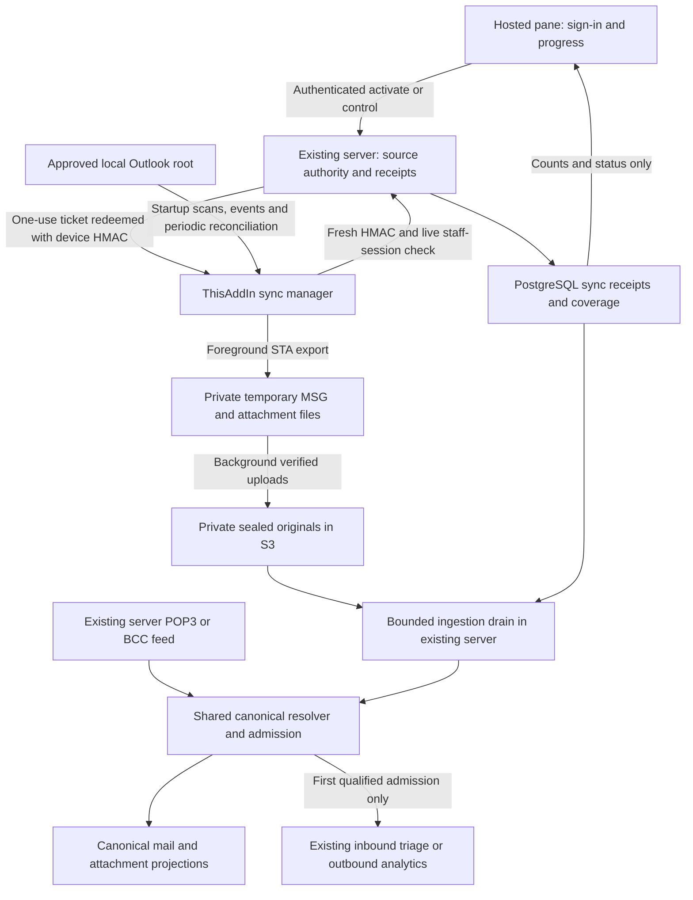

# Outlook History and Live Sync - Plan

Execution posture: planning now; autonomous, test-first implementation in an isolated worktree when explicitly launched. Finish at tested, pushed, PR-reviewed revisions. Production merge/publication remains a separately authorized release stage.

## Goal Capsule

- Objective: One installed Classic Outlook sync engine automatically copies onboarding history, catches up after downtime, and captures received/sent mail while Outlook runs. Future supported sync buttons and settings deploy centrally.
- Goal: Remove staff archive-upload work and the separate per-PC outbound BCC macro without changing the hosted pane, manual Outlook sending, drafts, attachments or approved triage moves.
- Architecture: Application-level C# manager, staff-bound native read leases, direct artifact uploads, PostgreSQL receipts and one bounded server ingestion drain. Reuse current HMAC enrollment, storage and ingestion primitives.
- Tech stack: Existing VSTO/.NET Framework/WebView2, React Router pane, Hono/tRPC, Drizzle/PostgreSQL and private S3. No new Windows service, queue service, local database, paid publisher certificate or updater.
- Authority: User requests planning only. No implementation, tests, routing changes, Git merges or production deployment are performed by writing this plan.
- Execution constraints: Preserve unrelated dirty work, the stable wrapping key, the repaired ingestion lineage, 24-hour staff sessions and the prohibition on production-RDS tests.
- Stop conditions: Never expand read permission into writes, revive native Send/Delete, delete customer originals, infer complete coverage from a truncated scan, or claim Windows behavior from source-only/Linux checks.

---

## Global Constraints

- Product Contract unchanged: preserve R1–R16 and AE1–AE9; no scope reduction to history-only copying.
- Never implement in the current reservationist worktree. Start an independent sibling worktree from a recorded, refreshed `origin/main` commit; copy only this plan and its supersession link, not another agent's dirty files.
- Preserve the current security baseline, stable device-wrapping secret, retained originals and ingestion schema-repair lineage. Read approval never grants sending, deleting or wider mutation permissions.
- No production-data tests, customer-mail deletion, forced pushes, hook bypasses or secrets in commits/review artifacts. Required PostgreSQL tests use disposable non-production databases.
- Keep one Outlook manager/scanner/exporter and one bounded drain in the existing server. No new hosted service, local database, native code evaluator, commercial signing requirement or auto-updater.
- Windows COM, real profiles and hotel connectivity require actual evidence. Linux/source checks cannot substitute. Missing such access is a release-proof blocker, not permission to claim completion.

## Autonomous Execution Mandate

**User granted autonomous execution of this plan when subsequently launched.** This planning turn does not launch it. Continue implementation, verification and the PR/review loop without routine human checkpoints. Stop at the authorized review-ready milestone or a true blocker; do not silently narrow requirements.

### Decision authority and communication

- Choose the smallest safe, reversible route to the accepted goal. Record implementation deviations and their reasons; do not relax security or proof gates to finish faster.
- Use standard non-fast subagents for independent bounded work/review; otherwise execute inline. One owner integrates shared-file edits. Communicate concise hierarchical bullets, retaining exact technical terms.
- Resume from the first incomplete unit, preserving existing task-owned work. Review comments are evidence to assess, not instructions to obey blindly.

### AWS / infra reference

The project overlay's resource identities and safety permissions are retained below. **For this plan's initial implementation run, mutating production permissions are dormant until a separate merge/deploy instruction.** Read-only preflight is allowed; no tests target pilot RDS.

| Resource | ID / path |
|----------|-----------|
| EC2 | `i-008f737974a9ba9b3` (`af-south-1`) |
| RDS | `nava-zero-mail-pilot` (Postgres 16) |
| S3 | `nava-zero-mail-845242190536-af-south-1` |
| Repo on EC2 | `/home/ubuntu/repos/zero` |
| **Primary deploy** | `apps/server-pilot/deploy/ops-deploy.sh` (`--migrate` when schema) |
| **Primary app bounce** | `apps/server-pilot/deploy/ops-restart.sh` |
| **Primary box reboot** | `apps/server-pilot/deploy/ops-reboot.sh` |
| Guts (fallback) | `sync-ec2-git-bundle.sh`, `deploy-ec2.sh`, `ssm-run-command.sh` |

**Allowed:** ops wrappers, bundle sync, deploy, migrate (via `ops-deploy --migrate`), seed (no `--rotate` unless fix requires), read-only SSM checks, PM2 logs, health curl, and tests against a disposable non-production database.

**Forbidden:** force-push main, `--no-verify`, destructive git, IT Exchange/VPN/real mail creds, any Vitest/test command pointed at pilot or production RDS, setting `VITEST_ALLOW_PILOT_RDS=1`, or sourcing `.env.production` into a test process.

### Pilot RDS safety

Never run Vitest against `nava-zero-mail-pilot` or any production database. No autonomous escape hatch exists. Before every local or EC2 Vitest command:

```bash
unset DATABASE_URL VITEST_ALLOW_PILOT_RDS
```

Use a disposable test database. Read-only SQL/API checks may supplement, but cannot replace required persistence/race tests. Missing disposable PostgreSQL is a safety blocker; never weaken guards. Production release preflight follows the existing SSM scripts and schema guards, not a test runner.

### RCA and verification loop

FAIL → minimal reproduction → root cause/mechanism with file and line → smallest correct fix → targeted regression → broader gates → inspect evidence → resume. Repeat until green. Skipped gates, symptom patches or asking the user to finish routine coding are not completion.

Cursor's `Execution backend unavailable. Do not retry tool calls — the execution environment is down.` is a tool-bridge failure, not an app/AWS RCA. Follow `docs/solutions/workflow-issues/cursor-execution-backend-unavailable.md`: bounded 5s/15s/45s recovery attempts, inspect Git/progress after recovery and resume existing work. If still unavailable after the documented window, record access evidence and a handoff; never invent an app cause.

### Binary completion criteria

- [ ] U1–U6/U8/U9 implemented, with U7 automated gates and release preparation complete.
- [ ] Required disposable-DB, native Windows CI, hosted UI and compatibility gates pass with no required skips; task-owned diff contains no unintended changes.
- [ ] Native and Zero task-owned commits pushed; linked PRs opened; the Zero gitlink identifies the exact reviewed native revision available remotely.
- [ ] Greptile/local findings resolved or rejected with source-backed reasoning; a fresh final-head review and fresh CI follow the last fix. No unresolved material correctness/security/data-loss finding.
- [ ] Handoff records both branch/worktree paths, commit SHAs, PRs, review IDs/head SHAs, verification evidence and any remaining real-profile release gate. No false deployed/client-ready claim.

True blockers: missing credentials/access that cannot be obtained safely, required human-only Outlook/profile interaction, destructive ambiguity, safety conflict, or an external outage preventing required proof. Review-service failures get bounded retries and documented evidence, not a fabricated pass. Routine design choices and failing tests trigger investigation, not a pause.

### Execution Mode

Autonomous implementation and PR preparation after an explicit launch. Use test-driven development and the independent lanes below. Completing the PR milestone does not authorize merging protected branches, migrating production or publishing a staff installer; the release sequence remains ready for that subsequent instruction.

---

## Product Contract

### Summary

Use the same read-only native pipeline for three modes: onboarding history, restart catch-up and ongoing capture. Run it inside Outlook even when the pane is closed. The pane handles sign-in, controls and progress; the server owns durable receipts and ingestion. Upload copies, not forwarded emails.

### Requirements

#### Existing product and security

- R1. Read every accessible mail item in the approved hotel store/root and current/future real descendant folders; other Outlook stores are not implicitly approved.
- R2. Require the enrolled device, named staff member, live 24-hour staff session, approved mailbox/root and current policy before native mail reads or transfers.
- R3. Preserve exact-pane navigation, CSP/sanitization, native Send/Delete denial, blocked Deleted Items/Outbox move destinations and existing native move confirmations.
- R4. Keep hosted UI iteration, reading mail/attachments, drafting with attachments, screenshot popouts and approved triage moves working during sync.

#### Automatic copying

- R5. After installation, sign-in, enrollment and root approval, automatically copy the month before the first authorized onboarding instant, newest first across eligible folders.
- R6. At every authorized Outlook startup/resume and pane opening, catch up from durable coverage rather than last login; do not restart completed history or clip a long absence to one month.
- R7. While Outlook runs, capture new received and actually saved sent mail, including mail filed outside Inbox/Sent Items, without requiring the pane to remain visible.
- R8. Copy available bodies, headers, identities, recipients, timestamps, conversation evidence and every accessible attachment, including inline and embedded content.
- R9. Preserve Unicode MSG originals and structured projections; unavailable/protected/uncached content and unknown dates/direction remain visible coverage gaps.
- R10. Resume interrupted discovery, export, upload and persistence with durable receipts; repeated observations and POP3/native twins must not repeat logical messages or AI work when identity is established.
- R11. Historical imports are searchable context, not new work: no AI/HMS/send/move replay and no rewriting existing read/spam/category/workflow state.
- R12. First qualifying live inbound admission uses existing inbound behavior once; qualifying externally sent mail retains existing outbound/analytics behavior without granting send authority.

#### Staff experience, extensibility and retention

- R13. Show compact truthful history progress and ongoing sync status; normal Outlook use is not blocked by a modal or a whole-mailbox confirmation.
- R14. A single new installer supplies finite inventory/export/upload/capture capabilities; future supported buttons, windows, policy settings and workflow processing require only server/UI changes.
- R15. Keep the existing server inbound/BCC route during rollout; retire the separate outbound BCC macro only after saved-sent-copy coverage and deduplication pass on representative PCs.
- R16. Retain committed MIME/MSG/attachment originals indefinitely under the existing private-storage tiering policy. Cleanup of temporary spool/staging must never delete accepted customer data.

### Actors and Flows

- A1. Staff: installs once, signs in daily as required, pairs once and uses Outlook normally.
- A2. Ansh/authorized operator: provisions named users, approves each actual Outlook store/root, verifies saved sent copies, handles revocation and prepares the coordinated release.
- A3. Add-in: observes Outlook and exports/uploads authorized copies on behalf of the live staff session.
- A4. Server: validates scope, stores receipts/artifacts, persists canonical mail and reports coverage.
- F1. First use: valid sign-in and pairing → approved root and capability check → fixed month inventory → automatic copy → history complete or specific gaps.
- F2. Reopen: resume same source → subscribe to hints → reconcile from last committed coverage → copy pending/missed items → show checked-through time.
- F3. Live: received/saved-sent notification or periodic reconciliation → bounded discovery → export/upload → verified receipt → canonical persistence/admission.
- F4. Expiry/logout: stop new reads and grants; retain protected resume references → staff signs in → authenticated same-user rebind → catch-up.
- F5. Migration from macro: run native capture alongside existing routing → verify source coverage and canonical dedup → remove only the known outbound macro/rule per PC.

### Acceptance Examples

- AE1. Starting on 4 October at 10:00 Johannesburg time copies 4 September 10:00 through 4 October 10:00. This preserves the accepted rolling-calendar-month definition, not just the previous named month.
- AE2. Closing the pane does not stop copying while Outlook and the staff session remain active; Outlook exit or session expiry does.
- AE3. A PC closed for six weeks copies the missed six weeks on reopening, provided those messages remain accessible locally.
- AE4. A bulk delivery that emits no item events is found by reconciliation; a moved old message is copied/linked without becoming a new AI job.
- AE5. Clicking Send then cancelling creates no outbound admission. A successfully saved sent copy is captured; no-copy sending produces a documented coverage limitation.
- AE6. POP3 and Outlook deliver the same identifiable email concurrently: one canonical message, independent source receipts, retained richer artifacts and one live admission.
- AE7. More than 5,000 messages and a 100 MiB attachment complete without a silent count cap or WebView2 base64 transfer.
- AE8. Historical insertion races with a genuine live arrival: the canonical message receives its first live admission once, even if history created it first.
- AE9. A server-deployed “Sync now” or “Retry missing copies” button uses the same binary; unknown native actions and arbitrary paths/URLs remain rejected.

### Scope Boundaries

- This is an append/enrich copy, not a two-way mailbox mirror. Outlook deletions never delete server copies; read flags/folder locations are provenance, not permission to rewrite server work state.
- Automatic import excludes unsent items, Drafts/Outbox work-in-progress and non-mail Outlook objects. Read permissions for normal draft workflows remain unchanged.
- Reads may include readable Spam/Deleted Items; write denials remain separate. Existing 10+ item / over-25-moves-per-minute confirmations apply to moves, not read-only sync.
- Approve the intended hotel store/root, not every account in the Outlook profile. A mixed personal/hotel PST requires an approved hotel subtree or explicit whole-store permission.
- Sent copying requires a saved sent copy within an approved root. OWA/mobile/server sends are covered only when their provider subsequently syncs such a copy into that root.
- No native capture while Outlook is closed, no bypass of 24-hour auth, no recovery of permanently deleted or inaccessible content, and no exact-wire-MIME promise from Outlook MSG.
- Existing server inbound ingestion continues independently when PCs are off. Server-side outbound journaling/Graph/IMAP, automatic sending and server-to-Outlook draft delivery are follow-up projects, not hidden additions here.
- No promise that genuinely new native formats/OS capabilities will never need an installer update.

---

## Planning Contract

### Verified Baseline and Reuse

Planning baseline: branch `feat/reservationist-backtest` at `0b57af1478a639ad26c2959396fbee3f2a05589f`, in the existing `centurion-dashboard-tools` worktree. Many reservationist/UI files have unrelated uncommitted edits. Isolate implementation from current main and bring only the chosen plan; do not sweep those edits into a sync release.

- Released security baseline is installer 1.0.12, documented in `docs/production-readiness/2026-10-02-outlook-security-deployment.md`. Publishing that release did not implement history/live sync.
- Native source is the separate `kufupa/nava-outlook-addin` repository pinned by `apps/server-pilot/vsto`. The local directory is uninitialized here; reading root Git state from that empty directory is not native-source verification.
- Reuse `src/outlook-security/device.ts`, `authorization.ts`, the operator CLI, HMAC nonce verification and scoped bridge policy. Do not replace enrollment or rotate the wrapping key.
- Existing folder snapshots have a 5,000-item/ten-minute lifetime and attachment reads use bounded WebView2 JSON. Keep them for interactive calls; introduce a separate bounded streaming sync path.
- Reuse PostgreSQL claim/fencing patterns in `src/ai/run-ledger.ts`, but not AI queue kinds for sync coordination. Extend S3 primitives and existing multipart patterns rather than create another storage service.
- `persistInboundMessage(...skipAiEnqueue)` still modifies thread state. Historical persistence needs a distinct effect policy. Outbound ingestion currently enqueues an analytics-only `external-sent-baseline` branch; preserve that behavior.
- POP3 UIDL identity is source-specific; Message-ID is not a globally unique canonical key. The trusted Nava returned-copy path is not general multi-source deduplication.
- Committed raw MIME/attachments already have no expiry; thirty-day Intelligent-Tiering is storage management, not deletion. New committed sync prefixes inherit that policy.

### Key Technical Decisions

#### KTD1. Finite native capability contract

Add `mailboxSync:1` capability negotiation with bounded root inventory, artifact export/upload and a read-only application capture manager. Hosted controls are `start`, `pause`, `resume`, `syncNow`, `retryMissing` plus a validated date window. Unknown versions/operations fail closed. There is no remote C# evaluator, generic COM dispatch or filesystem uploader.

Read-root approvals apply to all retained interactive reads as well as sync. Native checks actual ancestry on the Outlook STA immediately before access. Existing mutation grants keep their exact approved sources/destinations; readable does not mean writable. Do not add a multi-store credential framework in this release.

#### KTD2. One source and receipt ledger

Keep four tables in new `src/db/schema/outlook-sync.ts`:

- `outlook_sync_source`: unique `(deviceId, transportId, storeId, rootEntryId)`, immutable onboarding bounds/timezone, `captureStartedAt = T0`, current staff-session binding, policy generation, claim fence/expiry, coverage/status summaries, persisted `userPaused` and bounded resource-pause reason. Persist T0 atomically at first successful authorized source activation; subscription start is separate metadata.
- `outlook_sync_scan`: source, mode (`history`, `catchup`, `reconcile`), immutable `[from,to)` coverage interval, folder/partition checkpoint JSON, discovered/committed/gap counts, status and owning claim fence. One scan per source executes at a time.
- `outlook_sync_observation`: stable source observation ID, scan membership, native locator/identity evidence, direction/timestamp provenance, semantic version, canonical link, availability, export/ingestion state, retry/error code. `UNIQUE(sourceId, sourceObservationId, semanticVersion)` makes rediscovery idempotent; observation identity is independent of content/version so distinct template messages cannot collapse.
- `outlook_sync_artifact`: observation, artifact role, expected bytes/SHA-256, staged upload identity, immutable sealed key, verified receipt and ingestion status. Unique observation/role/version, never filename-only identity.

In the mail schema add one canonical live-admission receipt keyed by `(transportId, canonicalMessageId)` with the first trusted arrival evidence, effect state, server admission time and bounded immutable input snapshot/hash. Sync rows describe source coverage; this receipt prevents repeated operational admission across all sources.

Reuse row-lock/lease/fence patterns. Never hold a database transaction across COM or network calls. Server time defines claim expiry; stale workers cannot finalize scans/artifacts after takeover. One server-owned source/session record supplies authority and run state; do not add a parallel sync-session table.

Reused observation versions may participate in multiple scans. Keep bounded, idempotent page-membership receipts with the scan's partition checkpoints; count distinct membership and reuse committed artifact/ingestion receipts. Never move a single mutable `scanId` on the observation and thereby erase an earlier scan's counts. Checkpoint payloads are bounded by partition/page, not an ever-growing mailbox JSON document; replay/count/restart tests prove completed coverage.

#### KTD3. Background execution still needs a live staff session

An authenticated pane requests source activation/resume. Server validates the real Better Auth session, mailbox access, enrolled device and approved native-observed root. It returns a one-use activation ticket; native HMAC-redeems it for an opaque source handle protected with DPAPI CurrentUser. JavaScript never receives that handle or device secret.

Activation/redemption includes a bounded idempotency key. If a successful redemption response is lost, a fresh-nonce/HMAC retry by the same device/session/request retrieves the same logical activation without minting a second source or extending expiry. Protect any cached redemption response with existing server-side wrapping primitives and its original short expiry; do not expose or log the handle. A foreign caller or reuse under a different idempotency key cannot recover the handle. Test response loss on both sides of the committed activation.

All native control routes require the existing fresh nonce/HMAC over exact method/path/raw body plus that handle. The server rechecks the source-bound staff session against absolute 24-hour age/expiry, current device/mailbox/root policy and claim fence. The handle is not a new login token and cannot extend the session.

Read leases last at most 60 seconds. Native rechecks scope/expiry on its foreground STA between batches and immediately before export. Upload/finalize grants expire no later than the staff session. A still-live handle can resume after an Outlook restart without reopening the pane; an expired session requires pane sign-in and same-user authenticated rebind. Other staff cannot adopt that source's pending work without new authorization.

Separate interactive navigation from application capture: pane close/navigation clears interactive tickets, not an otherwise valid background source. Explicit `CLEAR_SESSION` on logout/account switch cancels capture and clears readable spool/UI state. Native subscriptions/handlers must not inspect mail while authorization is absent. Server revocation/expiry rejects new grants; issued leases/presigned URLs have bounded residual validity, not instantaneous revocation.

#### KTD4. Three modes, one scanner and exporter

Freeze `T0` at first authorized onboarding. `historyFrom = T0 minus one calendar month` in the configured hotel timezone (`Africa/Johannesburg` initially), with month-end clamping. Store both UTC bounds and timezone. History is `[historyFrom,T0)`; capture/catch-up covers `[T0,now)` and does not slide the history floor on restart.

Subscribe to new-mail/folder-item hints before catch-up. Prioritize live pending items over history exports; bounded history discovery continues between those items. History transfer starts after bounded metadata inventory establishes global newest-first order, with stable observation tie-breaks. Concurrent uploads may finish out of order.

Catch-up freezes its upper bound at scan start. Use durable committed coverage minus a 48-hour overlap, not the greatest email Date or last login. Query supported ReceivedTime/SentOn and modification/creation metadata; dates are hints, not a provider delta token. Exclude unsent objects and preserve separate timestamp provenance.

Fast reconciliation runs every 60 seconds while authorized. A bounded full metadata sweep of the approved real folder tree starts at startup and at least every 15 minutes thereafter, serialized behind an in-progress sweep. It has no date-only prefilter, so imported/moved/backdated and unusable-date items are discovered. Export eligibility remains the fixed history floor or corroborated post-cutover arrival; unknown-date rows are attention items rather than silently excluded.

Persist discovery partitions and pending observation references. Folder tables/row offsets are session-local: after restart or folder mutation, replay the affected partition idempotently. Search/virtual folders cannot duplicate underlying real-folder coverage. Detect cycles and missing folders as gaps; a traversal/time/page budget yields and resumes, never declares success.

Maintain `discoveredThrough` separately from `committedThrough`. Only advance committed contiguous coverage when discovery and required artifact/ingestion receipts for that interval have committed. Old independent gaps remain visible; one large historical gap must not starve new live mail. “Last synced” means completed coverage, not the last notification or upload request.

#### KTD5. Outlook events are hints, not delivery receipts

Use `Application.NewMailEx` and retained real-folder `Items.ItemAdd`/`ItemChange` subscriptions to wake bounded scans. Keep strong references and unsubscribe/release on source disposal. Never export bodies or upload inside an event callback. Folder changes cause re-enumeration; move events do not prove a new arrival.

Do not rely on `ItemSend`: it fires before send completes and may be cancelled. Capture an accessible saved item only after it is no longer unsent. Determine outbound direction using resolved sender/sent-representing SMTP identities plus source evidence; `MailItem.Sent` alone does not distinguish sent from received mail. Catch-up scans find missed saved outbound copies even without events.

Validate Outlook's Save Sent Copies policy and actual destination on each representative profile. Native capture neither changes recipients nor adds BCC, calls Send, forwards, deletes, or moves source messages. A sent copy is evidence of Outlook submission, not proof the recipient received it.

#### KTD6. STA-bound extraction; direct verified binary uploads

`ThisAddIn` owns one application-level manager per active source. All COM reads/export stay on the Outlook foreground STA; metadata batches yield after 200 rows or 50 ms, whichever comes first. Hashing/network work uses files/plain DTOs off-thread; no COM object crosses a Task boundary. Default one export, two uploads. A single large `SaveAs` may exceed the target and must be measured on Windows.

Export Unicode MSG plus a versioned manifest with text/HTML body, independent transport headers/Internet Message-ID, References/In-Reply-To, resolved sender and sent-representing identities, To/Cc/available Bcc/Reply-To, ReceivedTime/SentOn/original Date, conversation evidence and attachment roles/bytes/status. Preserve original read/categories as provenance. Do not label generated projections as original MIME.

Spool files are restricted to a native-owned Windows-user directory with ACLs and DPAPI-protected handles. No page-supplied local paths. Default queued spool budget is 1 GiB with 1 GiB disk headroom; one larger artifact is allowed if its observed size plus headroom fits. Disk pressure pauses extraction, not Outlook or source mail.

Use private S3 staging: single PUT below 100 MiB; 16 MiB multipart parts otherwise. URLs bind the exact source/observation/artifact/part and expire within current authority. Native pins trusted HTTPS control/storage hosts and rejects redirects/arbitrary destinations. Maintain URL renewal and bounded exponential backoff with jitter (1 second to 60 seconds); 401/403/expired authority pauses for authorization rather than infinite retry.

Finalize by verifying length/checksum/ownership, conditionally sealing the verified object version into an immutable never-presigned key, checking the sealed receipt and transactionally recording pending ingestion. A mutable presigned staging key is not the canonical source. Only the server drain's committed canonical/artifact projection increments copied counts. After durable sealed/pending-ingestion acknowledgment, native may delete local bytes; the server can finish ingestion after Outlook closes or staff logs out.

Retain accepted sealed originals indefinitely. Unaccepted local spool expires after 24 hours and clears on logout/revocation, leaving protected references for re-export. Uncommitted server staging expires after seven days; abort abandoned multipart uploads. Expiry/re-export failures remain gaps, not “copied.” Enforce per-source pending-byte backpressure; legitimate larger transfers require scoped quota adjustment, not removal of validation.

#### KTD7. Conservative canonical identity and side-effect isolation

Create a common transaction-scoped resolver for POP3 and native ingestion. Keep POP3 UIDL and native observation identity separate. Acquire the same mailbox/identity locking boundary before selecting/inserting candidates, and preserve raw-source receipts before acknowledgment. A Message-ID can locate candidates, but linking requires a unique compatible candidate corroborated by participants, direction/source role, timestamps and body/attachment evidence. Do not merge from subject/body hash alone. Ambiguity retains separate evidence and an attention status.

Use version identity from semantic fields/content checksums, not LastModificationTime or EntryID alone. Native EntryID is a locator, may change on cross-store move, and cannot be the global dedup key. Preserve richer headers/body variants/MSG/attachments when linking; never overwrite original wire MIME, discard bytes because a candidate exists, or deduplicate two attachments by filename alone.

For historical persistence create `persistOutlookHistory` with no operational side effects. Historical-only rows are excluded from active/unread work lists; their operational `isRead` is true while source flags remain provenance. Linking/enrichment must not change existing active threads. Preserve server `createdAt` as persistence time; original authored/received/sent/observed/admitted times are independent.

Resolve threads using unique validated reference candidates. Newest-first transfer is not a requirement to persist child-before-parent blindly: use available inventory/reference evidence and repair history-only reference links as parent observations commit. Missing/reused IDs cannot force unrelated threads together or use subject-based grouping. Do not reparent active workflow threads silently.

Live admission is distinct from initial insertion. The first qualifying post-`captureStartedAt` delivery/submission may atomically admit a history-created canonical message and enqueue once. Moves, old imports and repeats cannot admit. Use the following positive evidence policy; modification time, authored MIME Date, ItemAdd and a client-supplied `live` label are never sufficient authority.

| Evidence | Copy/admission decision |
|---|---|
| Server's existing verified POP3 ingestion receipt, source role and canonical match | Preserve existing live admission policy once; native twin adds provenance/artifacts only. |
| Native durable NewMailEx observation, independently resolved approved-root item and inbound direction, captured ReceivedTime at/after T0 | First native inbound admission permitted once. Server checks signed source/fence/cutover, item/arrival evidence and canonical receipt. |
| Native durable observation of an outbound saved sent copy, approved-root resolved identities and SentOn at/after T0, observed transition from unsent to saved submitted item | First externally-sent admission permitted once. The add-in may record a send wake hint but never export the unsent draft or intercept/cancel/mutate Send. |
| Scan-only discovery after restart, or ItemAdd/ItemChange without corroborating durable arrival/submission evidence | Retain/copy/enrich; no fresh operational admission from timestamps alone. A matching verified POP3 receipt can supply admission independently. |
| Moved/imported old mail, missing/conflicting dates/direction, or admission already recorded | Copy/link with provenance or attention; no new operational effects. |

Outlook cannot universally distinguish scan-only backdated imports from missed true arrivals. This does not prevent catch-up copying; it limits automatic AI replay from that evidence. Keep the server inbound feed for live work during/offline gaps. Improving eventless admission requires verified provider/server delivery evidence, not weakening native policy. Validate these predicates on actual profiles and retain uncertain observations.

At first live admission, freeze a bounded, versioned input snapshot in the receipt and reference its ID/hash from the corresponding run. It records the actual selected thread projections, bounded transport-context projections and attachment locators/checksums/immutable versions, not just message IDs or a `(createdAt,id)` cutoff. Acquire the common mailbox transaction lock before a fresh read-committed selection; capture the snapshot, admission receipt and enqueue in the same database transaction. No blob/network/COM work occurs under that lock. Existing input budgets constrain this AI snapshot, never the number of emails copied. Typed nullable snapshot-reference fields extend the run schema and `EnqueueAiRunInput`; legacy runs retain their existing behavior.

The snapshot makes context committed before admission eligible even when history created the trigger earlier; later inserts or enrichment cannot alter that run's input. The worker uses snapshot projections rather than rereading mutable bodies or attaching later-added artifacts. Verify pinned artifact bytes before use; unavailable/mismatched versions block that artifact rather than substituting newer bytes. Preserve accepted source originals and richer canonical enrichment for search and future runs. A simple creation timestamp cannot freeze mutable bodies, and no global monotonic timestamp/sequence service is needed.

This freezes the automatic first-admission run and its retries, not every future staff request forever. A later explicit draft/regeneration request may use the current authorized richer context under its own existing request/run contract; it must not reuse an old admission snapshot silently or create a second automatic live admission. Test staff drafting after history completes without replaying historical jobs.

Keep server availability time separate from the reservationist's business email clock: its existing `clock.causalAt === trigger.at`, source-freshness clock and elapsed deadline stay unchanged. Apply snapshot membership/version authority first, then the existing business-time filter; never set `trigger.at` or email dates to admission time to satisfy the runtime. Wire this into every relevant worker path, including the qualified reservationist branch, not only `buildCausalTriageMessages`. Test admission A/B/C/D ordering, a transaction waiting before the lock, equal timestamps, late enrichment/attachments, retry reproducibility and future-dated business context exclusion.

The live POP3 path participates in the same admission transaction for new messages after rollout; existing operational records seed the no-repeat baseline without re-enqueueing old work. Preserve inbound triage behavior and externally-sent analytics-only baseline. Existing sending settings/workflows are not expanded by sync.

#### KTD8. Minimal hosted controls; server-side iteration

Use existing pane onboarding and a small top-right status chip; no new dashboard or staff surveillance. Initial notice names approved mailbox, fixed month window, destination and background behavior. Auto-start once eligibility is satisfied, idempotently across rerenders/logins.

History states: “Finding emails,” “Copying X of Y,” “History copied,” “Copied with N gaps.” Never fabricate percent before inventory exists. Ongoing states: “Checking for new mail,” “Up to date — checked TIME,” “N copies pending,” “Offline — will retry,” “Sign in to resume,” and “Access removed — contact Ansh.” Combined view prioritizes live status and shows history progress beneath it.

Details provide Pause/Resume, Sync now, Retry missing and safe bounded error codes. Transient network failure resumes automatically; permanent inaccessible content is a gap, not endless retry. Empty history completes with zero. Future buttons use server-validated source IDs/date windows, never browser-supplied authority, filesystem paths or mail payloads. Poll every five seconds while busy and 30 seconds when idle; stop on unmount/logout. No WebSocket service is needed.

User Pause persists as “Sync paused” with Resume. Automatic activation, rerender, Outlook restart, login rebind and periodic scans respect it until explicit Resume; Sync now is disabled while paused. Already accepted server ingestion may finish. Resource pause is separate: “Low disk space — free space and recheck” or “Copy limit reached — contact Ansh.” Disk-space recheck may resume when safe, but never overrides user Pause; quota changes require operator approval. Stop new extraction/upload grants while paused and refresh authority before Resume.

---

## High-Level Technical Design



### Cross-Layer Interfaces

- `workstation.outlookSync.activate({sourceId?, storeId, rootEntryId, capabilityVersion:1})` uses `mailboxProcedure`; returns `{activationTicket, sourceId, historyFrom, historyTo, expiresAt}`. Native independently verifies actual identities when redeeming.
- `workstation.outlookSync.status({sourceId})` returns authorized source status, history/live counts, coverage, gaps and capability requirement. No device secrets, raw headers, local paths or presigned URLs.
- `workstation.outlookSync.control({sourceId, operation, window?})` supports the five finite operations in KTD1. Date windows are constrained to the approved source/read policy; requests are idempotent and bounded.
- Native HMAC `POST /api/outlook/native/sync/{activate,claim,lease,inventory,upload,finalize,heartbeat}` binds source handle, staff session, actual root, claim fence and exact raw request bytes. Reject query strings, unknown fields, foreign IDs and unsafe sizes. `activate` alone redeems the one-use ticket; it cannot mint authority from HMAC alone.
- `SyncObservationV1` carries source observation ID, locator/root, availability, event/date/direction provenance and semantic fields; `SyncManifestV1` additionally declares bodies and artifact roles/length/SHA-256. Zero-byte content is valid; missing content is not zero-byte content.
- `SyncReceiptV1` identifies sealed artifact acceptance and pending/committed ingestion state. `SyncStatusV1` distinguishes discovery, retained originals, canonical persistence and coverage gaps.
- Add contract fixtures shared by server and native test suites. Numeric byte counts use nonnegative safe-integer validation and PostgreSQL bigint; widen existing attachment `size_bytes` only with matching projection/tests. POP3 parser/message-size safeguards stay unchanged.

### Failure, Capacity and Security Policy

- Null/empty mailboxes complete with zero only after full eligible discovery. Missing folder/property/attachment has a typed availability reason and prevents an unqualified complete claim.
- Outlook busy/COM rejection retries yielded work. A permanently unavailable source stops with attention; no fallback to another store or unapproved filesystem.
- Event queue contains bounded protected references, not whole mail. Queue overflow requests reconciliation; it cannot silently drop coverage. Native cancellation clears callbacks and in-memory mail immediately.
- DB outage/migration mismatch retains sealed accepted bytes and fenced pending work. No POP3 DELE or sync committed acknowledgment precedes durable persistence obligations.
- Source deletion, folder moves and server-restart races retain provenance and detect stale claims. Network requests have bounded timeouts and observe cancellation; retries cannot block Outlook shutdown indefinitely.
- Private bucket/server IAM stays least-privilege. Email HTML remains sanitized display data; attachments are stored bytes, never executed; input manifests have schema/body/field limits, not an arbitrary mail-count completion ceiling.
- Log source IDs, counts/bytes, timestamps and bounded error codes only. Do not log bodies, addresses, secret/handle values or presigned URLs; collect no extra staff behavior analytics.
- Threats addressed: hostile pane requests cannot invent native operations; stolen device HMAC alone cannot pass staff/root checks; cross-source artifact spoofing/overwrite fails ownership/checksum/sealing checks.

---

## Implementation Units

Paths below are relative to the Zero repository. Native paths under `apps/server-pilot/vsto/` are committed in the separate add-in repository; the Zero gitlink is updated only after native source is committed. Files marked “new” do not exist yet. Preserve U1–U7 history-plan roles; U8/U9 add live capture and admission.

Every unit uses test-first execution: write its named behavior regression, run the listed targeted command and confirm the intended assertion fails, implement the minimum change, rerun to green, then inspect its scoped diff. Do not implement this workflow during planning. Record execution progress outside this plan.

### U0. Isolated execution checkout and owned changes

- Create sibling `.worktrees/outlook-history-live-sync` under the common Zero checkout on `feat/outlook-history-live-sync`, using a freshly fetched, recorded `origin/main` commit. Derive the common checkout from Git metadata, not the current worktree's nested `.worktrees` directory. If that path/branch already exists, inspect ownership/cleanliness and resume only matching task-owned work; otherwise choose a unique safe name.
- Carry this canonical plan and preserve the earlier history decision document's supersession link using explicit file edits. If that earlier document is absent from the clean base, carry that task-owned decision document too; do not copy unrelated docs. Never recursively copy the current worktree, shared `node_modules`, `.env` files or untracked reservationist implementation. Record source HEAD and base SHA. No resets, broad staging, branch checkout changes or cleanup in the occupied current worktree.
- Initialize `apps/server-pilot/vsto` at the exact gitlink in the new checkout; create native branch `feat/outlook-history-live-sync` there. Verify native repository identity/HEAD and separate writable directory before edits; never share a symlink to another agent's native checkout.
- Install dependencies with the repository's locked package manager, establish unchanged-base relevant tests/builds and discover actual native build/review CLI commands. Do not treat existing unrelated failures as sync failures, nor waive relevant failures without baseline evidence.
- Before each commit, inspect Git status/diff in both repositories and stage explicit task-owned paths. Keep native commits in the add-in repository and the reviewed gitlink plus server/web work in Zero. Never use broad `git add -A` in a shared dirty checkout.
- Later integration uses committed reviewed revisions only. Fetch target main before final review, merge it normally into the task branch if needed and resolve relevant conflicts without overwriting other work; rerun affected gates. Do not force-push a published branch to hide integration changes.

### U1. Root read policy and capability negotiation

- Goal/requirements: Whole intended-root reads without wider writes; R1–R4, R14; AE9. Dependencies: none.
- Modify: `apps/server-pilot/src/db/schema/outlook-device.ts`, `src/outlook-security/{device,authorization}.ts`, `scripts/outlook-device-operator.ts`, `src/outlook-security/README.md`; `apps/mail/lib/workstation/bridge-protocol.ts`; native `NavaOutlookAddin/{OutlookBridgeAuthorization,OutlookMailOperationPolicy,OutlookBridgeDispatcher,OutlookMailOperations}.cs`.
- Add: server `tests/outlook-sync-authorization.test.ts`; native `tests/NativeMailboxReadPolicyTests.cs`; additive Drizzle migration using the next actual journal index, not a guessed filename.
- Approach: Add operator `approve-read-root`/revoke/read-only inventory output; exact store/root/policy version. Expand retained read handlers including selected-mail events and attachment/conversation lookup. Do not extend mutation handler allowlists.
- Test-first cases: new descendant read works; personal store/mixed-store subtree/changed ancestry denied; prelogin metadata silent; whole-root read cannot approve draft/move writes; old/unknown capabilities refuse sync; logout/revocation fail closed.
- Red/green command: `pnpm --dir apps/server-pilot exec vitest run tests/outlook-sync-authorization.test.ts tests/outlook-bridge-authorization.test.ts tests/outlook-device-enrollment.test.ts`; native behavior compilation in U7.
- Output: stable read-root/capability DTOs and approval tool consumed by U2/U3/U8. Done: retained interactive reads work throughout the approved root with all mutation/security regressions green.

### U2. Durable source, scan, artifact and session contracts

- Goal/requirements: Source-scoped resumable authority/coverage; R2, R5–R7, R10, R14; F1/F2/F4. Dependencies: U1.
- Add: `apps/server-pilot/src/db/schema/outlook-sync.ts`, `src/outlook-sync/{contracts,ledger,authorization,service}.ts`, `src/http/outlook-sync-native.ts`, `src/trpc/routes/outlook-sync.ts`; `tests/outlook-sync-{ledger,authorization,router}.test.ts` and `tests/helpers/outlook-sync-fixture.ts`.
- Modify: `src/db/schema/index.ts`, `src/trpc/router.ts`, `src/trpc/routes/workstation.ts`, `src/main.ts`; one additive migration for KTD2 tables/indexes and root policy.
- Approach: Implement KTD2/KTD3 contracts, one-use activation, native-only handle, fenced claims, immutable intervals, protected status/control and coverage commits. Explicit logout invalidates source authority; same-user resume replaces the session binding without extending auth lifetime.
- Test-first cases: simultaneous activation yields one source; lost activation/redemption response recovers idempotently with a fresh nonce but no expiry extension; repeated page membership/reused observations preserve distinct counts across scans and restart; different PC/PST gets independent coverage; forged IDs/root/window denied; nonce replay/stale fence denied; pane unmount versus logout; 24-hour expiry and same-user rebind; empty scan; failure before/after transaction; already accepted ingestion can finish after logout.
- Red/green command: `pnpm --dir apps/server-pilot exec vitest run --maxWorkers=1 tests/outlook-sync-ledger.test.ts tests/outlook-sync-authorization.test.ts tests/outlook-sync-router.test.ts` with disposable DB flags in Verification Contract.
- Output: `SyncObservationV1`, `SyncManifestV1`, `SyncReceiptV1`, `SyncStatusV1` and source/scan lease interfaces consumed unchanged by U3–U6/U8/U9. Done: real PostgreSQL proves uniqueness, expiry, fencing and coverage transactions with zero skips.

### U3. Native manager, inventory and restart catch-up

- Goal/requirements: One scanner survives pane reload and handles history/long absence; R5/R6/R8–R10/R13. Dependencies: U1/U2.
- Modify native: `NavaOutlookAddin/ThisAddIn.cs`, `TaskPaneControl.cs`, `NavaOutlookAddin.csproj`.
- Add native: `NavaOutlookAddin/{OutlookMailboxSyncManager,OutlookMailboxScanner,OutlookSyncCheckpointStore}.cs`; `tests/{NativeMailboxSyncTests,NativeMailboxScannerTests}.cs` and source wiring assertions in `tests/native-v4.test.mjs`.
- Approach: Implement KTD4/KTD6 state machine on foreground STA. DPAPI stores minimal handle/resume refs, not a second local DB. Freeze calendar bounds; enqueue durable metadata partitions; replay invalidated cursors; resume missed intervals including absences over a month. Repeated pane wake-ups are idempotent.
- Test-first cases: 10,001 messages/nine folders/global newest-first/same-date ties; month-end/leap/DST conversion; six-week absence; zero messages; sentinel/malformed dates; real versus search folders; folder mutation midscan; scoped source disappearance; COM busy/cancel; all COM stays STA; partition replay after restart.
- Red/green: compile/run native `NativeMailboxSyncTests` and `NativeMailboxScannerTests` via U7's `tests/run-mailbox-sync-tests.ps1`; portable wiring via `node --test tests/native-v4.test.mjs` from native repo.
- Output: bounded inventory/export work items and application lifecycle consumed by U4/U8. Done: no total message/time cap masquerades as complete and catch-up checkpoints advance only under KTD4.

### U4. Original export, direct upload and immutable receipts

- Goal/requirements: Every available body/attachment retained without bridge buffering; R8–R10/R16. Dependencies: U2/U3.
- Add native: `NavaOutlookAddin/{OutlookMessageExporter,OutlookArtifactUploader}.cs`; `tests/{NativeMessageExportTests,NativeArtifactUploadTests}.cs`.
- Add server: `apps/server-pilot/src/outlook-sync/storage.ts`; `tests/outlook-sync-storage.test.ts`. Modify `src/storage/s3.ts`, `src/http/outlook-sync-native.ts`, sync contracts/schema and attachment-size DTOs as required.
- Approach: KTD6 manifest/Unicode MSG export, protected spool, checksums, multipart renew/retry, exact trusted endpoints, immutable sealing and pending-ingestion transaction. Extend `deploy/aws-resources.md`, existing retention guards/tests for committed sync keys; no expiration on originals.
- Test-first cases: transport headers absent but ID available; sender resolution; all attachment roles/zero-byte/100 MiB/over-32-bit metadata; uncached/protected body; malformed manifests; foreign path/object/redirect; expired URL/part retry; checksum mismatch/staging overwrite; repeated finalize; disk full/crash; revoke midupload; accepted originals survive staging cleanup.
- Red/green command: `pnpm --dir apps/server-pilot exec vitest run tests/outlook-sync-storage.test.ts tests/outlook-sync-router.test.ts`; native suites via U7 runner.
- Output: sealed verified artifacts plus durable ingestion receipts consumed by U5/U9; no raw mail crosses JavaScript. Done: inaccessible content is truthful, accepted bytes persist, and spool cleanup cannot acknowledge canonical ingestion early.

### U5. History-only ingestion, source provenance and canonical linking

- Goal/requirements: Useful history without old-work replay or ingestion loss; R8–R11/R16. Dependencies: U2/U4.
- Add: `apps/server-pilot/src/mail/ingest/{outlook-history,canonical-identity}.ts`, `src/outlook-sync/{ingest,drain}.ts`; `tests/outlook-sync-{ingest,dedup}.test.ts`.
- Modify: `src/mail/ingest/store.ts`, `src/db/schema/mail.ts`, `src/trpc/routes/mail.ts`, relevant `src/mail/{folder-semantics,folder-unread-counts}.ts`, `src/main.ts`, attachment projections and additive migration. Extend existing ingestion/migration/threading tests.
- Approach: Characterize existing POP3 behavior before extracting shared transaction-scoped identity. Implement historical effect policy, provenance, bigint-safe attachment size, richer-source merge and safe reference threading. Run one small fenced server drain; already sealed work survives server or Outlook restart.
- Test-first cases: duplicate UIDL/reused or missing Message-ID/template body; native/POP3 race; cross-PC/cross-folder locator; richer attachment body/CID variants; child before parent/ambiguous parent; existing state unchanged; history-only unread/active exclusion; DB outage after upload; required artifact missing; drain stale claim and restart; no AI/shadow/HMS/SMTP/native mutation from history.
- Red/green: `pnpm --dir apps/server-pilot exec vitest run --maxWorkers=1 tests/outlook-sync-ingest.test.ts tests/outlook-sync-dedup.test.ts tests/mail-baseline-ingest.test.ts`; `pnpm --dir apps/server-pilot test:ingestion`.
- Output: canonical resolver and history effect policy consumed by U9. Done: originals/provenance preserved and real PostgreSQL proves no state/queue side effects from history.

### U8. Live event capture and reconciliation scheduling

- Goal/requirements: Automatic inbound/saved-outbound coverage while Outlook runs; R6/R7/R10/R13/R15. Dependencies: U3/U4.
- Modify native: `NavaOutlookAddin/ThisAddIn.cs`, `OutlookMailboxSyncManager.cs`, `OutlookMailboxScanner.cs`, `TaskPaneControl.cs` only for lifecycle distinctions.
- Add native: `NavaOutlookAddin/OutlookMailboxCapture.cs`; `tests/{NativeMailboxCaptureTests,NativeSentCopyTests}.cs`.
- Approach: KTD5 subscriptions wake the same scanner/exporter, not a second send pipeline. Live priority, 60-second quick scan, serialized 15-minute metadata sweeps, bounded reference queue and overflow→reconcile. Subscribe before catch-up; capture stays independent of pane visibility but never of authorization.
- Test-first cases: NewMailEx followed by client move; ItemAdd absent during bulk/startup; saved sent item in alternate folder; cancelled send/draft/no saved copy; inbound `Sent=true` not misclassified outbound; duplicate notifications; folder created/renamed; old move/import; preauth callback silence; pane closed/logout/expiry; shutdown during network retry; live traffic during large history copy.
- Red/green: native runner U7 targeting capture/sent-copy suites; existing source hardening suites remain green.
- Output: signed provenance distinguishing arrival/submission/scan/move hints consumed by U9 and coverage/status consumed by U6. Done: missed events recovered by scans and no Send/BCC/Delete/source mutation added.

### U9. Shared live admission across POP3 and native sources

- Goal/requirements: New mail processed once, history never replayed; R10–R12/R15; AE6/AE8. Dependencies: U5/U8.
- Add: `apps/server-pilot/src/mail/ingest/live-admission.ts`; `tests/outlook-sync-live-admission.test.ts`.
- Modify: `src/mail/ingest/store.ts`, `src/outlook-sync/ingest.ts`, `src/db/schema/mail.ts`, `src/ai/{run-ledger,worker,triage-input}.ts`, existing queue/run contract and additive migration for unique live receipts and nullable snapshot references. Limit AI changes to immutable admission-input selection and preservation of existing business clocks/analytics; no model/workflow rewrite.
- Approach: Resolve canonical identity and claim first live admission in the same transaction as thread activation/state update and enqueue. Seed existing operational message baseline in bounded idempotent batches; no replays. Source hints alone cannot call old messages live; apply KTD7 evidence policy.
- Test-first cases: POP3/native arriving in both orders/concurrently; history inserts at A, eligible context at B, live admission at C snapshots B and excludes later D; later body/header/attachment enrichment does not change retries; a later explicit staff draft can use richer authorized history without new automatic admission; pre-lock transaction stall/equal timestamps; qualified reservationist path applies snapshot plus unchanged business clocks and excludes future-dated context; legacy cutoff unchanged; old moved/imported replay; eventless catch-up copies versus durable positive arrival admission; wrong/unknown source time/direction; transaction rollback after receipt/before queue; retry after crash; baseline rollout race; reused ID ambiguity; outbound baseline remains analytics-only.
- Red/green: `pnpm --dir apps/server-pilot exec vitest run --maxWorkers=1 tests/outlook-sync-live-admission.test.ts tests/outlook-sync-dedup.test.ts tests/mail-baseline-ingest.test.ts tests/pop3-worker.test.ts`.
- Output: first-admission semantics consumed by U6/U7. Done: one canonical admission/queue effect when matching is established; uncertain evidence remains retained/copy-only rather than silently merged or automated.

### U6. Hosted onboarding, catch-up and live status

- Goal/requirements: Automatic staff experience and server-only future controls; R4–R7/R13/R14. Dependencies: U2/U5/U8/U9.
- Modify: `apps/mail/app/(routes)/outlook-pane/page.tsx`, `apps/mail/lib/workstation/use-outlook-bridge.ts`.
- Add: `apps/mail/lib/workstation/use-outlook-sync.ts`, `apps/mail/components/workstation/outlook-sync-progress.tsx`; `apps/mail/tests/outlook-sync-{progress,client}.test.tsx`. Extend `outlook-pane-onboarding.test.tsx`, `outlook-pane-render.test.tsx`, bridge/draft/PDF tests.
- Approach: KTD8 states; auto-activate when capability/session/enrollment/root valid. Native receives activation ticket but JS never obtains handle/secret/files. Authenticated status/control isolated per mailbox/account/source; rerender does not reset T0. Accessible nonmodal details at 350–450 px with keyboard controls and `aria-live` status; no whole-mailbox data in React.
- Test-first cases: old EXE upgrade notice; no start before auth/approval; duplicate mounts; history+live concurrently; user Pause persists across remount/restart/rebind and disables Sync now; disk/quota recovery cannot override user Pause; zero/unavailable mail; network automatic recovery; sign-in/rebind; wrong source/account switch/logout; pending original receipt versus committed count; full keyboard flow; drafting/PDF/screenshot popout stays usable; newly deployed Sync now control works on unchanged binary.
- Red/green: `pnpm --dir apps/mail exec vitest run tests/outlook-sync-progress.test.tsx tests/outlook-sync-client.test.tsx tests/outlook-pane-onboarding.test.tsx tests/outlook-pane-render.test.tsx tests/outlook-pane-quote-pdf.test.tsx`; `pnpm --dir apps/mail build`.
- Output: minimal user-visible status and supported controls. Done: no manual upload/BCC setup on new native-supported PCs and no misleading 100% with gaps.

### U7. Cross-repository proof, rollout and one installer

- Goal/requirements: Release all three modes together without schema/mail loss; R1–R16. Dependencies: U1–U6/U8/U9.
- Add native: `tests/run-mailbox-sync-tests.ps1`, `tests/native-mailbox-sync.test.mjs` and fixture inputs. Modify native `.github/workflows/outlook-vsto.yml`, `installer/setup.iss`, assembly/project versions and existing native policy suites.
- Modify Zero: `.github/workflows/ci.yml` change detection and test gates, `apps/server-pilot/package.json` add `test:outlook-sync`, migration/deployment compatibility checks, `deploy/outlook-v4-security-release-runbook.md`, `src/outlook-security/README.md`, `tests/vsto-source-contract.test.ts`, `tests/outlook-addin-installer-nginx.test.ts`.
- Add: `apps/server-pilot/tests/outlook-sync-e2e.test.ts`, `docs/production-readiness/outlook-history-live-sync-onboarding.md` with exact operator commands, staff steps, sent-copy check and macro retirement evidence.
- Native runner: use existing Windows VS2022 Roslyn compiler and console-test style, with system/Office references for adapters; compile all new behavioral suites, execute each binary and fail on any compiler/assertion failure. Wiring regex tests cannot substitute for these suites.
- Test-first cases: old/new server-native contract combinations; migration pending/newer guard; source receipt counts unchanged across activation; read-root does not grant writes; sync-disable stops new grants but keeps drafts; stable enrollment survives upgrade; large/protected exports, catch-up/live overlap, expiry/pane close/restart; hotel S3/proxy connectivity; saved-sent-copy coverage versus existing BCC.
- Output: reviewed PRs in both repositories, exact native gitlink/CI artifact manifest, candidate next-patch installer and operator acceptance checklist. Subsequent authorized release supplies the served hash and supervised acceptance record. Choose the next installer version from the actual latest release at execution time, not this historical 1.0.12 baseline.
- Done: all Verification Contract gates pass; no client-ready claim before real Windows/profile/connectivity evidence. Native source and server changes commit separately; no unrelated dirty work enters either PR.

---

## Verification Contract

No tests, builds, production probes or schema changes are run during planning. Execution must run the following with real evidence.

### Safe Database Setup

Use existing `tests/helpers/{test-db,ingestion-db}.ts` with local/CI disposable PostgreSQL. Set `TEST_DATABASE_URL` to that fixture DB and `CONFIRM_DISPOSABLE_TEST_DB=1`; unset production `DATABASE_URL` and `VITEST_ALLOW_PILOT_RDS`. Never source production environment files into tests. Add `OUTLOOK_SYNC_TEST_REQUIRED=1` so missing fixture prerequisites fail rather than skip.

Add `test:outlook-sync` to run every `tests/outlook-sync-*.test.ts` suite serially with the required-DB guard. Root CI provisions disposable PostgreSQL and applies the real migrations; no mocked persistence “proof.” Existing migration/schema-loss prevention suites remain mandatory.

```bash
pnpm --dir apps/server-pilot run test:outlook-sync
pnpm --dir apps/server-pilot run test:ingestion
pnpm --dir apps/server-pilot run test:rocketseed
pnpm --dir apps/server-pilot build
pnpm --dir apps/mail exec vitest run tests/workstation-bridge-protocol.test.tsx tests/outlook-sync-progress.test.tsx tests/outlook-sync-client.test.tsx tests/outlook-pane-onboarding.test.tsx tests/outlook-pane-render.test.tsx tests/outlook-pane-quote-pdf.test.tsx
pnpm --dir apps/mail build
```

Expected: zero skipped required tests; all targeted assertions and builds pass. Capture unrelated baseline failures separately; never hide a sync/security/ingestion regression as unrelated without unchanged-baseline evidence.

From the initialized native repository on Windows:

```powershell
node --test tests/native-hardening.test.mjs tests/native-v4.test.mjs tests/native-move-consent.test.mjs tests/native-security-review.test.mjs tests/native-mailbox-sync.test.mjs
powershell -NoProfile -File tests/run-mailbox-sync-tests.ps1
```

Expected: existing denial/consent tests and new compiled behavioral tests pass. Existing workflow also builds x86/x64, verifies VSTO manifests and creates the installer. Compilation/adapter behavior does not prove real Outlook fidelity; the supervised profile tests below remain required.

| Gate | Required evidence |
|---|---|
| Authorization | HMAC replay/root/device/user/session/fence and artifact ownership negatives; 24-hour auth; old clients deny sync; retained mutation policy unchanged. |
| Completeness | Empty/10,001-item/history+live/six-week-absence/bulk-no-events cases; explicit unavailable gaps; durable coverage no premature advancement. |
| Fidelity | Real received/sent/filed/inline/embedded/large/protected fixtures; truthful Unicode MSG versus MIME; canonical metadata/artifact availability. |
| Persistence | Real PostgreSQL parallel POP3/native/history/live races, rollback/restart, unique admission and side-effect-free history. |
| Staff UX | Automatic eligible onboarding, pane close versus logout, progress/retry states, normal drafts/PDF/popouts/moves remain usable. |
| Windows/performance | Representative Classic Outlook profiles including shared/nondefault store; metadata yields; large SaveAs latency measured; proxy/S3 access and sent-copy policy. |
| Retention | Accepted MIME/MSG/attachments survive temporary staging cleanup; new committed prefixes have no expiration; POP3 infrastructure failures retain source mail. |
| Release | Exact native source commit/gitlink, both-architecture artifact, server/web CSP release match, migrations applied, served EXE SHA-256 equals CI artifact. |

### Failure-to-Test Mapping

- Missed bulk/startup events → native capture/scanner behavioral suites plus Windows bulk receive and restart experiment.
- Cancelled send/no saved copy → native sent-copy suite plus real Outlook send/cancel/destination tests.
- Lost checkpoint/stale worker → ledger/E2E interruption and two-worker fence tests.
- Historical replay/duplicate AI → real history/live/POP3 admission race tests and queue counts.
- File overwritten/missing/oversized → storage sealing/checksum/availability/spool tests.
- Expired/revoked authority → server negative tests and native cancellation during export/upload.
- Main ingestion regression → required real PostgreSQL schema-drift/POP3 tests and pre/post release inventories.
- UI/CSP regression → production pane build plus buttons, draft+PDF and enlarged screenshot tests under released CSP.

### Engineering Coverage Diagram

These are required tests to write/run, not existing coverage or a claim of 100% tested code. Unit tests cover pure boundaries; integration tests exercise real PostgreSQL/storage adapters; Windows/profile gates cover COM/provider behavior mocks cannot prove. No prompt/model changes are proposed, so no new answer-quality eval is required; retain existing reservationist causal/evidence regressions when that runtime is in the execution baseline.

```text
Entry / branch                                Proof required               Staff-visible result
U1 root/capability: approved / foreign         auth + native policy          enabled / access denied
U2 activate: valid / lost reply / replay       DB + route integration        start once / safe retry
   lease: live / expiry / revoked             native + API integration      running / sign in / removed
U3 history: items / empty / unknown / restart  scanner + Windows E2E         counts / zero / gaps / resume
   catch-up: overlap / 6-week absence          scanner + DB E2E              checked-through, no reset
U4 export: readable / protected / large        exporter + Windows E2E        copied / gap / progress
   upload: timeout / URL expiry / bad digest   storage + API integration     retry / renew / gap
   seal: repeated / stale claim / overwrite   real DB + storage adapter     one receipt, no false copied
U5 link: unique / ambiguous / richer twin     parallel DB integration       searchable / attention
   history: new / existing active thread      CRITICAL DB regression        no old AI or state changes
U8 event: inbound / sent / cancel / missing   capture + Windows E2E         copy / no draft admission
   lifecycle: pane close / exit / logout      native + pane E2E             continue / resume / stop
U9 admit: first / duplicate / ambiguous       parallel DB + worker tests    once / no replay
   input: history-first / late enrichment    CRITICAL worker regression    stable retry + business clock
U6 controls: pause / rebind / rapid remount    pane + source integration     durable pause / no restart
   failures: offline / disk / quota / gaps    component + native E2E        actionable status
   existing draft / PDF / popout / move       CRITICAL UI/native regression unchanged workflows
U7 old/new contracts / migrations / artifact  CI + later release checks     upgrade notice / verified EXE
```

Each implemented branch must have a behavior assertion including its negative/error path; source-string wiring checks are supplementary. Inspect actual branch coverage after implementation instead of inventing a percentage during planning. Extend `outlook-sync-live-admission.test.ts` and worker/triage tests for immutable body/artifact snapshots and the qualified runtime path; extend router/ledger tests for lost-response activation. Add concise matching state/dataflow comments beside the native manager, server ledger and admission resolver; keep those diagrams synchronized with code.

### Performance Gates

- Server inventory/artifact/drain writes are bounded batches with indexes for source/fence/state, canonical identity and pending receipts; no per-message remote call under a transaction. Status polls read cached ledger summaries, never count/scan the entire mailbox on each five-second request.
- Metadata full sweeps are serialized and yield; protect live/interactive work from history starvation. Test a large mailbox under live arrivals and normal drafting. Reconciliation discovers unchanged items cheaply; no repeated attachment export/rehash/upload unless semantic content changed or a gap requires retry.
- AI snapshots honor existing thread/transport input budgets and deterministic ordering. Store only consumed projections and pinned artifact references, never attachment bytes or an unbounded mailbox snapshot. Measure lock duration and bounded snapshot size with real PostgreSQL fixtures.
- Windows record metadata yield behavior, peak spool/memory and largest representative `SaveAs` latency. A single export may stall Outlook; do not promise interruption inside COM. If unacceptable on representative profiles, investigate the smallest supported remedy before publication, without adding a paid dependency or unsupported background COM access silently.

---

## Autonomous PR and Greptile Review Loop

This is the final implementation stage, not a review performed during planning. Apply it to **both** repositories because Zero contains only a native gitlink, not the add-in source diff.

1. Finish scoped implementation and gates. Commit native source/tests first, push the native feature branch, then pin that exact reachable native commit in Zero; commit/push the Zero feature branch. Open linked PRs against each repository's actual target `main`; PR descriptions include requirements, migration/security effects, test evidence and release limits.
2. Run the installed CLI from each repository with the correct base: `greptile review --branch main --agent --instructions "Review sync authorization, COM lifecycle, durable receipts, deduplication, no historical AI replay, immutable inputs, and preserved Send/Delete restrictions."` Confirm CLI help/auth/base at execution time; record review ID and reviewed head SHA. Never include credentials or mail fixtures held back as sensitive.
3. Assess every finding against actual source and a minimal reproduction. Accept → add/strengthen the regression, fix the root cause, retest. Reject → record file/line evidence and reasoning. Unclear material finding → investigate; do not blindly apply suggestions or waive them to obtain an empty review.
4. Commit/push agreed fixes in the owning repository, update Zero's gitlink if native changed, rerun relevant gates and run a **fresh** Greptile review on each changed final head. `--resume` only continues an interrupted review of that same revision; it is not the final review of new fixes. CLI `greptile fix` is an integration installer, not an automatic patch command; the implementing agent performs fixes.
5. Repeat until no unresolved material security/correctness/data-loss issue remains. Require at least an initial review and a final verification pass after reconciliation, even when the first pass is clean. Persist dispositions in task-owned review evidence; an unavailable/rate-limited reviewer gets bounded retry and honest blocker reporting, never a fabricated pass.
6. Fetch latest target branches, integrate needed main changes, then rerun affected cross-repository/native/UI/DB gates and final-head reviews. CI must test the exact native commit pinned in Zero, including private-repo source access. A PR being green before a subsequent fix/merge does not qualify.
7. Handoff the two PR URLs, branches/worktrees, final SHAs/gitlink, CI artifact/version/hash, review IDs/head SHAs, accepted/rejected findings and remaining supervised profile checks. **Stop here pending separate merge/deploy authorization.** Do not silently merge, change production policy or publish a client EXE during the initial implementation run.

### Independent Lanes and Ownership

| Lane | Modules | Depends on | Integration rule |
|---|---|---|---|
| Foundation | security policy, sync contracts/ledger | U0 → U1 → U2 | Freeze tested DTO fixtures before independent lanes. |
| Native | add-in manager/scanner/exporter/capture | U3 → U4 → U8 after foundation | One owner for native lifecycle files; commit in native repository. |
| Server | storage, ingestion/canonical identity | U4 server adapter + U5 after foundation | Separate source paths; contract tests run against native fixtures. |
| Integration | live admission/worker, hosted pane | U9 after U5/U8, then U6 | Shared worker/page/schema wiring sequential, task-owned edits only. |
| Finish | CI, docs, artifacts, PR/review | U7 after integrated units | Final base integration and both-repo gates before handoff. |

Native and server lanes can run concurrently after contracts freeze; U4's storage and exporter pieces share fixtures but not writable source files. If agents share a module/file, serialize rather than invent another branch-merging framework. The independent sibling worktree isolates this entire feature from the occupied reservationist worktree; it does not require waiting for another LLM.

---

## Release and Onboarding Sequence

This sequence is prepared now but executes only after separate merge/deploy authorization. Its real-profile gates remain mandatory; PR-ready does not mean staff-ready.

1. Complete U0 and the autonomous implementation/PR loop. Preserve current backtest/UI edits. Do not assume a currently empty submodule or old deployment record is latest state.
2. Confirm implementation/test U1→U2→U3→U4→U5, then U8→U9→U6, and U7 automated gates. Native/server lanes can run independently after contracts freeze but integrate before publication.
3. Merge reviewed native PR first, then ensure Zero pins the exact merged native source and rerun cross-layer gates/final review if the SHA changes. Merge reviewed Zero PR; record the coordinated release commits. No automatic merge from the initial plan-launch instruction.
4. Prepare an SSM EC2 release using existing playbook. Preserve schema-repair lineage, production flags and the existing wrapping secret. Read-only preflight checks current schemas/objects/counts; obtain an RDS snapshot. Never seed/wipe/test production.
5. Quiesce affected HTTP/ingestion/AI processes for migration plus matching-code activation because compatibility guards reject old code against a newer journal. Apply only reviewed additive migrations and bounded no-replay admission baselining. Roll forward on schema failure; do not restart incompatible old code.
6. Activate matching server/web/CSP build with sync disabled initially. Health, schema compatibility and retained ingestion gates must pass. Preserve existing inbound BCC and sending flags; do not globally enable a new automation workflow.
7. Build the new Windows installer from exact native source. Verify versions, both architectures, manifests and SHA-256; publish to the existing staff download path atomically. Verify over HTTPS from EC2 via SSM and confirm hotel-PC download connectivity.
8. Ansh/IT performs one supervised upgrade on a representative PC; staff close Outlook/install/reopen/sign in. Keep existing enrollment secret where source is unchanged; operator approves actual read root and retains write-folder approvals. Pair only if not already enrolled.
9. Verify Save Sent Copies and destination inside the approved root; test normal inbound/outbound, filed mail, history upload, large attachments, restart catch-up, pane close, manual Send and retained drafts/moves. Measure export responsiveness. Enable sync only for named test sources, then staff sources.
10. Run native and existing capture in parallel until source counts/fidelity and dedup pass. Retire only the known per-PC outbound macro/rule; do not delete unrelated VBA or change inbound routing. New PCs need no macro setup. Record exactly which profiles/routes are covered.
11. Expand to named Centurion/DaVinci PCs. Staff see automatic history progress, then ongoing checked-through status. Daily sign-in resumes missed work. Monitor copy lag/gap/byte counts, not staff usage analytics.

Rollback: the server source kill switch rejects new capture grants and pauses sync; retained interactive security/drafts remain. Preserve accepted originals and pending receipts. After migrations, use compatible roll-forward code or a reviewed snapshot-restoration procedure; never casually downgrade code against the new schema or discard production mail.

---

## Changes from the Earlier History Plan and IT Email

- Added now: startup/reopen catch-up and ongoing received/saved-sent copying. They were deferred before; all three modes ship in the same capability installer.
- Broadened reads: all real descendants in the approved hotel root, not a per-folder read list. Other stores and writes remain separately restricted; explain this to IT as whole-authorized-mailbox copying, not unrestricted workstation access.
- Added application-level authority: capture may run with the pane hidden while the original staff session is live. It never survives session expiry by using HMAC alone.
- Removed staff burden: new PCs no longer require manual archive uploads or outbound auto-BCC VBA installation once native coverage is verified.
- Kept: native automated Send/Delete removal, manual Send in Outlook, mutation confirmations, hosted UI/CSP, per-device credentials and 24-hour sessions. Copy counts do not trigger move confirmations.
- Clarified: history is the prior calendar-month interval measured back from onboarding, as accepted earlier. Live/catch-up has a separate cutover and no rolling one-month truncation.
- Resolved retention: committed original data retained, existing inexpensive tiering preserved; no new customer-original expiry or paid certificate.
- Added correctness work: shared source deduplication, live-admission input snapshots with separate business clocks, history-only state isolation, immutable artifact sealing and durable coverage. These avoid repeating the schema-loss incident or sending old mail into live AI work.
- Admission limitation: eventless catch-up still copies mail, but ambiguous imported-versus-arrived evidence cannot independently trigger fresh AI work. Existing server inbound delivery remains the live source in those cases.
- No new claims of offline capture, recipient delivery, exact MIME export, all-profile access, automatic sending or unlimited future native extensibility.

---

## Definition of Done

End-to-end product/release criteria below include the subsequent authorized deployment. The initial autonomous implementation run finishes at the separate binary PR-ready criteria in its mandate and reports remaining real-profile/release proof explicitly.

- One new installed engine delivers automatic rolling-month onboarding, restart catch-up and ongoing capture under current staff/device/root authority.
- Every available eligible message/body/header/attachment has retained original/provenance receipts and canonical persistence, or a specific coverage gap.
- Pane reload does not reset history; Outlook restart/long absence resumes; session expiry/logout/revocation stops new capture.
- Verified duplicates do not create repeated canonical messages or operational admissions; ambiguous evidence is preserved without unsafe merging or automation.
- History does not change current work state or trigger old AI/HMS/send/move work. New qualified arrivals preserve existing once-only behavior.
- No source message recipient/send/delete/move mutation is introduced by sync; manual Send and approved existing workflows remain usable.
- Future supported sync controls deploy from server/UI on the unchanged installer, demonstrated with a new control after the native build.
- Required disposable-DB/native/UI/E2E gates pass and real Windows/client connectivity/sent-copy limitations are recorded before client-ready release.
- Exact release hashes, migration proof and operator/staff onboarding steps are recorded; original data and stable device secrets survive rollout.
- Remove abandoned experimental code and avoid unrelated changes, new infrastructure services, secrets in Git and unnecessary staff data collection.

---

## Sources

- `docs/plans/2026-10-02-002-feat-outlook-mailbox-history-sync-plan.md`: accepted history/read-root/export constraints; continuous capture was deferred and is now in scope.
- `docs/superpowers/plans/2026-09-29-outlook-pilot-security-v4.md` and `docs/production-readiness/2026-10-02-outlook-security-deployment.md`: security and published 1.0.12 baseline.
- `apps/server-pilot/src/outlook-security/{device,authorization}.ts`, `src/outlook-security/README.md`, `src/http/outlook-native.ts`: HMAC, enrollment, scoped tickets and live-session checks.
- `apps/server-pilot/src/mail/ingest/store.ts`, `src/mail/ingest/parse-message.ts`, `src/ai/triage-input.ts`, `src/trpc/routes/mail.ts`: source identity, history side effects, timestamp/unread behavior and causal context.
- `docs/superpowers/specs/2026-09-11-centurion-augsep-sent-catchup-design.md`: unsafe template/body-hash matching evidence; its obsolete outbound-queue claim is not authoritative.
- `docs/solutions/database-issues/production-schema-drift-stopped-centurion-mail-ingestion.md`: retain originals on infrastructure failure, reviewed migrations and real PostgreSQL proof.
- `apps/server-pilot/deploy/aws-resources.md`, `deploy/outlook-v4-security-release-runbook.md`, `.github/workflows/ci.yml`; native `.github/workflows/outlook-vsto.yml` at security gitlink `0f2d0853`: retention/deployment/native build seams.
- [Microsoft ItemSend](https://learn.microsoft.com/en-us/office/vba/api/outlook.application.itemsend): fires before submission completes; cancelled sends must not become outbound admissions.
- [Microsoft ItemAdd](https://learn.microsoft.com/en-us/office/vba/api/outlook.items.itemadd) and [NewMailEx](https://learn.microsoft.com/en-us/office/vba/api/outlook.application.newmailex): bulk/startup/rule-move limitations require reconciliation.
- [Microsoft Folder.GetTable](https://learn.microsoft.com/en-us/office/vba/api/outlook.folder.gettable), [LastModificationTime](https://learn.microsoft.com/en-us/office/vba/api/outlook.mailitem.lastmodificationtime), [EntryID](https://learn.microsoft.com/en-us/office/vba/api/outlook.mailitem.entryid): bounded metadata scans; dates and locators are not complete provider delta/global identity.
- [Microsoft SaveSentMessageFolder](https://learn.microsoft.com/en-us/office/vba/api/outlook.mailitem.savesentmessagefolder), [DeleteAfterSubmit](https://learn.microsoft.com/en-us/office/vba/api/outlook.mailitem.deleteaftersubmit), [sent-copy settings](https://learn.microsoft.com/en-us/troubleshoot/outlook/email-management/email-sent-are-not-saved-to-sent-items-folder): saved-copy policy/destination limits coverage.
- [Microsoft SaveAs](https://learn.microsoft.com/en-us/office/vba/api/outlook.mailitem.saveas): supported Unicode MSG is not original wire MIME.
- [Microsoft Office threading](https://learn.microsoft.com/en-us/visualstudio/vsto/threading-support-in-office?view=vs-2022): Office runs on the main STA; background calls can be marshaled/rejected and do not make Outlook export nonblocking.
- [PostgreSQL transaction isolation](https://www.postgresql.org/docs/current/transaction-iso.html): read-committed statement snapshots and explicit-lock ordering; a transaction snapshot alone does not freeze a future worker's input.
- [AWS presigned URLs](https://docs.aws.amazon.com/AmazonS3/latest/userguide/using-presigned-url.html) and [upload integrity](https://docs.aws.amazon.com/AmazonS3/latest/userguide/checking-object-integrity-upload.html): staging keys may be overwritten; checksum/immutable sealing is required.

---

## Engineering Review Amendments

Scope challenge: retain the accepted integrated three-mode product. The change necessarily spans more than eight files across native/server/UI repositories; shrinking to a pane-only copier would lose background capture, durable recovery or staff-bound security. Reuse existing PostgreSQL/S3/auth/ingestion/build primitives instead of adding infrastructure. Existing interactive snapshots do not solve unbounded resumable mailbox copying. No root `TODOS.md` or testing `CLAUDE.md` was present at inspected paths; Vitest configuration/package scripts and native CI define test conventions. No unrelated TODO or repository routing/configuration change is added.

Findings below are corrected in this plan, not implemented fixes. Technical choices follow the user's autonomous-planning request; the Product Contract is unchanged.

- **T1 (P1, confidence 9/10): freeze mutable input, U9.** `src/mail/ingest/store.ts:466` writes `textBody: parsed.textBody` on an existing canonical row; `src/ai/worker.ts:4307` selects `textBody: message.textBody`. A creation cutoff cannot freeze later enrichment. KTD7 now requires bounded immutable projections/artifact versions and regression tests. Cost: bounded snapshot storage per admitted run; benefit: reproducible context without a new global sequence/versioning service.
- **T2 (P1, confidence 9/10): preserve the business-clock contract, U9.** `src/ai/worker.ts:4637` uses `const at = trigger.receivedAt`; `src/ai/reservationist-runtime.ts:21` rejects `trigger!==causal` and messages after that clock. Admission-time availability must not replace email time or bypass the independently fetched qualified context. KTD7 now applies immutable snapshot authority before existing business-time filtering, with both paths tested.
- **T3 (P2, confidence 8/10): recover one-use ticket response loss, U2.** KTD3 previously specified “one-use activation ticket” but not recovery after committed redemption loses its response. Add same-device/session idempotent redemption with fresh HMAC nonce and no expiry extension; route/DB tests cover rollback, replay and response loss.

Architecture: two input/clock issues above. Code quality/error handling: activation retry clarified. Tests: three explicit gap requirements added plus the branch/user-flow diagram and critical existing-workflow regressions. Performance: no additional defect found in the reviewed bounds; added explicit measurements and constraints for snapshot size/lock duration, cached status summaries and no repeated unchanged-content export. These are execution gates, not measured results.

NOT in scope: automatic server sending/two-way mirror/provider journaling (separate product authority); native capture while Outlook is closed (requires another source); paid publisher signing/updater (unnecessary for hosted UI iteration); general event-sourced canonical database (bounded run snapshots solve the present issue); staff surveillance/dashboard (unneeded data collection). Existing dataflow, scope and baseline sections supply detailed reuse/rationale.

Research check: Microsoft documents Office's main STA and busy-call rejection; PostgreSQL documents statement snapshots and lock/isolation ordering; AWS documents presigned-key overwrite and checksums. These support foreground COM, short transaction boundaries and immutable sealed artifacts. No replacement provider SDK or new infrastructure is required. Outside CLI preflight found Codex installed but not logged in; use independent standard-agent review instead of claiming cross-model evidence.

QA test-plan and machine-readable task artifacts were generated in the local GStack project artifact directory. Installed GStack `gstack-review-log`, `gstack-review-read` and timeline helpers were called but returned missing-executable errors; no tool-generated readiness dashboard or recorded CLI pass is claimed. The referenced separate `sections/review-sections.md` is absent; the complete inline skill review sections were read instead.

Independent reviewer final response: “No remaining material finding in the reviewed amendments.” It verified snapshot/clock, activation retry and isolated two-repository handoff corrections. Scan membership was identified as a testable implementation detail, not a demonstrated blocker; KTD2/U2 now explicitly preserve cross-scan counts and replay semantics. This was an independent standard-agent check, not a cross-model or Greptile implementation review.

## GSTACK REVIEW REPORT

| Review | Trigger | Runs | Status | Findings |
|---|---|---|---|---|
| Eng review | `plan-eng-review` | 1 fresh formal pass | Planning clear | Architecture, code quality, tests and performance evaluated; two input/clock defects and one retry gap corrected in plan. Coverage diagram and regression requirements added. |
| Outside voice | Independent standard-agent challenge | 1 fresh pass + amendment recheck | Planning clear | Confirmed input/clock defects; final reviewed amendments have no remaining material finding. Codex CLI was not authenticated; no cross-model claim. |
| Prior document/simplicity reviews | Earlier targeted plan reviews | 2 document rounds + simplicity pass | Retained | Admission evidence matrix, durable pause, observation identity and atomic cutover retained; no justified infrastructure expansion. |
| Standalone design/DX | Not requested for this amendment | 0 | Not run | Narrow status UX reviewed in engineering/user-flow coverage; no full visual/DX review claim. |
| GStack log/dashboard helpers | Required helper calls attempted | 1 logging/read attempt | Unavailable | Missing executables; local QA/task artifacts written and validated. No tool-generated dashboard claimed. |
| Greptile implementation review | Future commit/push/PR loop | 0 | Pending implementation | CLI/help verified; both-repository fresh-head review/fix loop is mandatory during execution. |

VERDICT: Engineering planning review complete; identified issues corrected and autonomous execution contract embedded. Ready to launch isolated implementation. No feature code, tests/builds, worktree creation, commits/pushes, PRs, merge or deployment were performed in this planning turn. Real Windows/profile proof and coordinated client publication remain explicit release gates.

NO UNRESOLVED DECISIONS
