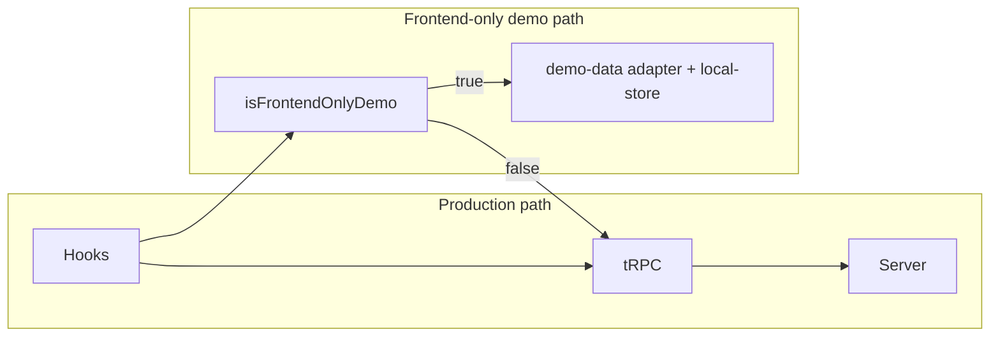

# Minimal branch commit overview
_Exported on 6/30/2026 at 11:11:22 GMT+1 from Cursor (3.9.8)_

---

**User**

in the branch with the word minimal in it how many commits ahead is it off of main and what do the commits do gimme high level overview pls

---

**Cursor**

Searching for branches containing "minimal" and comparing them to main.


**Branch:** `FE-demo-minimal`  
**vs `main`:** **52 commits ahead**, **0 behind** (linear extension from `main` at `8e37edd5`)

---

## High-level overview

This branch turns the mail app into a **frontend-only hotel reservationist demo** branded **Nava**, with mock data, polished inbox UX, and an admin dashboard — mostly without a real backend.

### 1. Frontend-only demo foundation (~10 commits)
- Self-contained demo runtime: mock Centurion inbox corpus, demo session gates, query policy so the app runs without backend deps
- Local store + parsing helpers for in-browser mail actions (send, delete, labels, etc.)
- Demo guards on settings/actions; regression tests to keep it frontend-only
- Docs: feature matrix, roadmap, backend decoupling notes

### 2. Mail UX & Centurion demo polish (~15 commits)
- **Centurion folders** with category chips, colored pills/rows, urgent sidebar stripe, reordered folders
- **Reply/compose workflow**: reply composer, recipient handling, mock composer + hooks
- Thread stability fixes: opening threads, reply state, resizable split pane, empty states
- HTML preservation for rich demo message bodies; plain-text list previews

### 3. Outlook-style drafts & list improvements (~12 commits)
- Draft cards in threads, draft view model, inline draft compose at bottom of thread
- Date-grouped virtual list rows with section headers
- Weekday timestamps in the list
- Demo draft sync (delete, optimistic updates, local store tombstones)

### 4. Admin dashboard (~4 commits)
- Hotel/inbox admin dashboard page with demo data layer
- Access gating + tests
- Nav link in mail sidebar footer for privileged users
- Planning doc for inbound metrics overhaul

### 5. Branding & settings (~6 commits)
- Rebrand **Zero/Lucein → Nava** (onboarding, manifest, site config)
- Hotel count alignment in dropdowns
- Disable delete-account buttons in Security/Danger Zone
- Sanitize `from` param in settings nav back links

### 6. Deployment & tooling (~5 commits)
- Vercel SPA rewrites (fix deep-link 404s) + build output config
- Restore frontend startup dependencies (`pnpm-lock` changes)
- Local dev scripts (frontend runner, process cleanup)
- Cursor/caveman artifacts and debug logs (checkpoint commit)

---

## Shape of the work

| Area | Rough share |
|------|-------------|
| Mail demo UX (folders, threads, compose, drafts) | ~50% |
| Frontend-only infra (local store, guards, tests) | ~25% |
| Admin dashboard | ~10% |
| Branding, settings, Vercel | ~10% |
| Docs & chore | ~5% |

**Bottom line:** `FE-demo-minimal` is a large demo branch — 52 commits that decouple the mail UI from the backend, flesh out a Centurion hotel inbox experience (folders, drafts, reply flow), add an admin dashboard, and rebrand to Nava for client demos.

---

**User**

did we somewhere do a refactor of the code to decouple FE BE?

---

**Cursor**

Searching the repo for frontend/backend decoupling work and related docs.


Yes — there was a deliberate FE/BE decoupling refactor, but it lives on **`FE-demo-minimal`**, not on **`main`**.

## Where it is

| Location | Status |
|----------|--------|
| `FE-demo-minimal` branch | Full decoupling refactor (~8 core commits) |
| `main` | No `apps/mail/lib/demo/`, no `isFrontendOnlyDemo()`, no demo-data adapter |

So the work was done, documented, and tested — it just hasn’t been merged to `main` yet.

## What the refactor does (high level)

It’s a **flag-gated dual path**, not a full architectural split. Production still uses tRPC/backend; demo mode swaps data sources at the hook layer.



### Core pieces (on `FE-demo-minimal`)

1. **Runtime gate** — `apps/mail/lib/demo/runtime.ts`
   - `isFrontendOnlyDemo()` is the single switch (demo mode + frontend-only env, or hardcoded `FORCE_FRONTEND_ONLY_DEMO = true` on that branch).

2. **Local data layer** — `apps/mail/lib/demo-data/` + `apps/mail/lib/demo/local-store.ts`
   - JSON corpus (`centurion-threads.json`) + adapter for `listThreads` / `getThread`
   - In-browser store for drafts, labels, settings, notes, send/delete, etc.

3. **Hook branching** — many hooks check the flag and skip tRPC:
   - `use-threads.ts`, `use-labels.ts`, `use-settings.ts`, `use-connections.ts`, `use-drafts.ts`, `use-templates.ts`, `use-summary.ts`, `use-notes.tsx`, auth proxies, etc.

4. **Query policy** — `apps/mail/lib/demo/query-policy.ts`
   - Disables persisted-query hydration and backend thread invalidation in demo mode.

5. **Dev startup** — `scripts/run-frontend-local.mjs`
   - Skips backend boot when FE-only demo is active (`[local-dev] FE-only demo mode active; skipping backend startup.`).

6. **Regression tests** — `apps/mail/tests/demo-backend-guards.test.ts` (112+ demo tests)
   - Asserts each hook uses local paths in demo mode and backend paths when disabled.

### Key commits (oldest → newest)

| Commit | What |
|--------|------|
| `e6005c21` | Foundation: demo runtime, adapter, query policy, hook stubs |
| `480a6daf` | Local store + parsing for in-browser mail actions |
| `5d41aa6b` | Guards on settings/actions (no destructive backend calls) |
| `9255befd` | Backend guard test suite |
| `be99f39c` | Verification doc: `docs/superpowers/2026-04-11-demo-backend-fix-verification.md` |
| `464ce2f0` / `213a45b2` | Stabilize and finalize frontend-only behavior |

### Planning docs (also on the branch)

- [`docs/superpowers/plans/2026-04-08-fe-only-demo-mode.md`](docs/superpowers/plans/2026-04-08-fe-only-demo-mode.md) — original implementation plan
- [`docs/superpowers/plans/2026-04-09-fe-demo-frontend-only-client-readiness.md`](docs/superpowers/plans/2026-04-09-fe-demo-frontend-only-client-readiness.md) — readiness checklist
- [`docs/superpowers/2026-04-11-demo-backend-fix-verification.md`](docs/superpowers/2026-04-11-demo-backend-fix-verification.md) — smoke test + test pack results

## Bottom line

Yes — there was a structured refactor to **run the mail UI without `apps/server`**, using `isFrontendOnlyDemo()` to route hooks to local mock data instead of tRPC. It’s complete on **`FE-demo-minimal`** (52 commits ahead of `main`), with tests and docs, but **not on `main` yet**.

If you want, I can outline what merging that decoupling into `main` would look like, or how it relates to your EC2 pilot backend plan.

---

**User**

how many commits were before or after it?

---

**Cursor**

Pinpointing where the FE/BE decoupling sits in the branch history and counting commits before and after.


**On `FE-demo-minimal` (52 commits ahead of `main`):**

The decoupling work **starts at commit 1** — there are **0 commits before it** on this branch. The first commit off `main` is the foundation:

`e6005c21` — *feat(mail): deliver frontend-only demo runtime and UI fixes*

---

### If “it” = the core decoupling arc (9 commits)

Commits **1–9**, foundation through verification:

| # | Commit | What |
|---|--------|------|
| 1 | `e6005c21` | Demo runtime, adapter, query policy, hook stubs |
| 2–5 | `7b4a888b` … `d9c2746f` | Stabilization + reply compose (demo support, not architecture) |
| 6 | `480a6daf` | Local store + parsing |
| 7 | `5d41aa6b` | Settings/action guards |
| 8 | `9255befd` | Backend guard tests |
| 9 | `be99f39c` | Decoupling verification doc |

- **Before:** 0  
- **The decoupling block:** 9 commits (or **4 pure architecture** commits if you skip 2–5: `e6005c21`, `480a6daf`, `5d41aa6b`, `9255befd`, `be99f39c` = 5)  
- **After:** **43 commits**

---

### If “it” = decoupling through “finalize frontend-only” (15 commits)

Through `213a45b2` — *finalize frontend-only demo behavior* (includes stabilize/fix commits in between):

- **Before:** 0  
- **Decoupling phase:** 15 commits  
- **After:** **37 commits** (Centurion UI, drafts, admin dashboard, Nava branding, Vercel, etc.)

---

### Quick visual

```
main ──► [15 commits: FE/BE decoupling + stabilize] ──► [37 commits: demo polish, UI, admin, branding]
         ↑ commit 1 starts here                    ↑ commit 16 starts here
```

**Bottom line:** Nothing on this branch predates the decoupling — it’s the opening work. Depending on where you draw the line, **37–43 commits came after it**, mostly demo UX polish, Centurion features, admin dashboard, and deployment/branding — not more architectural FE/BE splitting.

