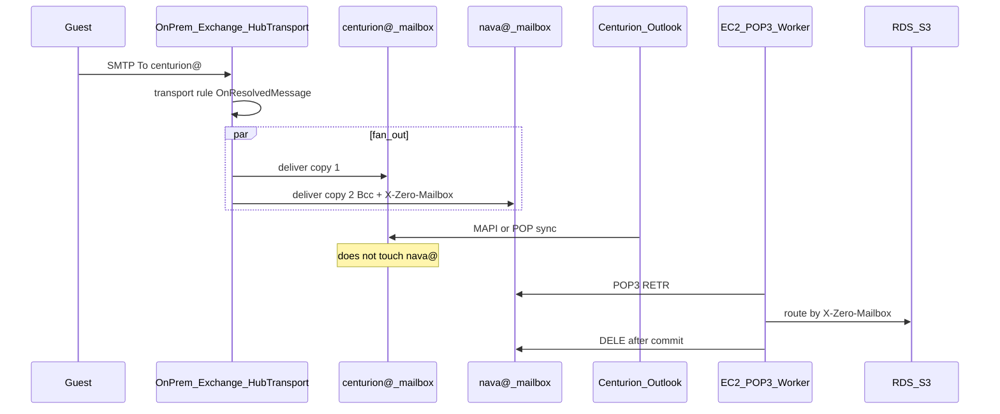

# EC2 Pilot — Mail Ingest IT Brief (Cole / CTO)

**Date:** 2026-07-02 (rev 2 — on-prem Exchange audit)  
**Audience:** Cole (CEO), CTO, hotel IT  
**Pilot mailbox:** `centurion@legacyhotel.com`  
**App ingest mailbox:** `nava@legacyhotel.com`  
**Mail server assumption:** **On-premises Exchange** (2010–2019). Our codebase also allows generic POP3/SMTP — see §12 if not Exchange.  
**Status:** Researched (RFC + Exchange **Server** docs + codebase). Real mail not connected yet.

---

## TL;DR (30 sec)

| # | Fact |
|---|------|
| 1 | We **POP3 from EC2 → `nava@` only**. Never workstations. Never `centurion@`. |
| 2 | IT sets **transport rules** on Hub Transport → Bcc + stamp `X-Zero-Mailbox`. |
| 3 | **Bcc = separate server mailbox at receive time.** Centurion POP/delete does **not** steal `nava@` copy. **YES.** |
| 4 | Bcc copy keeps real **From / To / Cc** → we store → UI can show (mapper gap — see Pilot gaps). |
| 5 | `X-Zero-Mailbox` = **which app inbox bucket**. Not a replacement for From/To. |
| 6 | **Centurion mailbox = their archive.** `nava@` = pipe we drain. RDS/S3 = our archive. |
| 7 | **App → Centurion Sent Items:** **NOT automatic.** IT must enable — **cmdlet depends on Exchange version** (§3). |
| 8 | **Workstation → app:** needs **Rule C** (outbound Bcc). Not live-tested yet. |
| 9 | **Threading in app:** naive today — replies may split until code fix. |

---

## §1 — Assumptions audit (researched)

| Assumption | Verdict | Notes |
|------------|---------|-------|
| Bcc → independent `nava@` copy before any client fetch | **YES** | RFC 5321; Exchange `BlindCopyTo` in transit |
| Centurion client delete removes `nava@` copy | **NO** | RFC 1939 — one maildrop per POP3 session |
| Route pilot by `To:` alone | **Mostly** inbound, one inbox | Breaks outbound + multi-mailbox |
| App Send As → Centurion Sent Items automatic | **NO (default)** | Copy goes to **service account** unless IT enables (§3) |
| `Set-Mailbox -MessageCopyForSentAsEnabled` on Exchange 2010 | **NO** | **2010 uses different cmdlet** — see §3 |
| Transport rules on outbound from Centurion | **YES** | `-From centurion@` (no `-SentBy` predicate) |
| `-SenderAddressLocation HeaderOrEnvelope` on 2010 | **N/A** | **2013 CU1+**; 2010 matches sender in **headers only** (OK for Send As) |
| Hotel clients use POP3 delete vs Cached Exchange | **Unknown** | Does **not** affect `nava@` Bcc path |
| Server is on-prem Exchange | **Assumed for this doc** | Project also says vendor may be unknown |
| Threading in our code = Outlook-quality | **NO** | Ingest thread root = own Message-ID |
| Frontend From/To from production API | **Partial** | Mapper incomplete |
| Real ingest live | **NO** | Fixtures; VPN/POP3 deferred |

---

## §2 — On-prem Exchange version matrix (IT must confirm version once)

**Ask IT:** `Get-ExchangeServer | Select AdminDisplayName, ServerVersion`

| Feature | Exch **2010** SP2 UR4+ | Exch **2013** CU9+ | Exch **2016 / 2019** |
|---------|------------------------|-------------------|----------------------|
| Transport rules: `BlindCopyTo`, `SetHeader`, `RemoveHeader` | **YES** (Hub Transport) | **YES** | **YES** |
| `-From`, `-SentTo`, `-FromScope` | **YES** | **YES** | **YES** |
| `-SenderAddressLocation HeaderOrEnvelope` | **NO** (headers only) | **YES** | **YES** |
| **Send As → Centurion Sent Items (server)** | `Set-MailboxSentItemsConfiguration` | `Set-Mailbox -MessageCopyForSentAsEnabled` | Same as 2013 |
| Exchange Management Console UI for rules | **YES** | EAC (2013+) | EAC |

**On-prem docs (not M365):**

- [Set-MailboxSentItemsConfiguration — Exchange 2010 only](https://learn.microsoft.com/en-us/powershell/module/exchangepowershell/set-mailboxsentitemsconfiguration?view=exchange-ps)
- [Set-Mailbox — MessageCopyForSentAsEnabled (2013+)](https://learn.microsoft.com/en-us/powershell/module/exchangepowershell/set-mailbox?view=exchange-ps)
- [Sent items by Exchange version (troubleshoot)](https://learn.microsoft.com/en-us/troubleshoot/outlook/email-management/email-remains-in-the-outbox-when-you-use-the-deleg)
- [Exchange 2010 transport rule actions](https://learn.microsoft.com/en-us/previous-versions/office/exchange-server-2010/aa998315(v=exchg.141))
- [Exchange 2016/2019 transport rule actions](https://learn.microsoft.com/en-us/exchange/policy-and-compliance/mail-flow-rules/actions?view=exchserver-2019)

---

## §3 — Send As → Centurion Sent Items (version-specific — **still applies on-prem**)

**Concept applies on-prem.** Only the **cmdlet** differs from M365 articles.

**Default behavior (all versions):** SMTP AUTH as `nava-app` → sent item saved in **`nava-app` Sent Items**, not Centurion's — unless configured.

### Exchange 2010 (on-prem)

```powershell
Set-MailboxSentItemsConfiguration -Identity "centurion@legacyhotel.com" `
  -SendAsItemsCopiedTo SenderAndFrom
```

- Cmdlet: **2010 only** (removed in 2013+)
- `SenderAndFrom` = copy in **both** service account + Centurion Sent Items
- Min: Exchange 2010 SP2 UR4+ (often documented as SP3)
- **Do not** use `Set-Mailbox -MessageCopyForSentAsEnabled` on 2010 — **not supported**

### Exchange 2013 CU9+ / 2016 / 2019 (on-prem)

```powershell
Set-Mailbox centurion@legacyhotel.com -MessageCopyForSentAsEnabled $true
```

- Introduced 2013 CU9 for on-prem ([troubleshoot doc](https://learn.microsoft.com/en-us/troubleshoot/outlook/email-management/email-remains-in-the-outbox-when-you-use-the-deleg))
- Optional: `-MessageCopyForSendOnBehalfEnabled $true` if using Send on Behalf

### If NOT Exchange (generic POP3/SMTP only)

- **No** `Set-Mailbox*` — server won't file sent mail into Centurion mailbox
- Options: Rule C Bcc to `nava@` (we ingest), or app stores outbound in RDS only
- Centurion workstation **won't** see app sends unless IT adds separate mechanism

---

## §4 — Q1: How do we ingest the right emails?

### Flow (corrected)

Bcc at **server receive** — two **independent** mailboxes.



### Bcc verdict

**YES — `nava@` gets its own server copy at receive time.**

| Question | Answer | Source |
|----------|--------|--------|
| Before Centurion client checks mail? | **YES** | Per-recipient SMTP delivery |
| Centurion delete kills `nava@`? | **NO** | RFC 1939 |
| Exchange `BlindCopyTo`? | **YES** | 2010+ Hub Transport |
| Generic SMTP server? | **YES** | RFC 5321 |

**Only failure modes:**

| Bad config | Result |
|------------|--------|
| `nava@` alias = same spool as `centurion@` | Race — one copy |
| Catch-all multidrop POP | Bcc invisible |
| Redirect not Bcc | Centurion may lose mail |
| We POP `centurion@` | **Never** |

### 5-minute proof test

1. External → `centurion@`
2. **Before** Centurion opens mail → `nava@` copy **exists** (OWA/POP3)
3. Centurion downloads → `nava@` **still there**
4. We ingest `nava@` → Centurion **unchanged**

### Our routing (code)

| Step | Check | Fail |
|------|-------|------|
| 1 | `X-Zero-Mailbox` present? | quarantine |
| 2 | Matches `centurion@legacyhotel.com`? | quarantine |
| 3 | POP3 UIDL seen? | skip |
| 4 | Else | store + From/To/Cc |

Code: `apps/server-pilot/src/mail/ingest/` · Fixture: `tests/fixtures/centurion-stamped.eml`

### Headers on Bcc copy

| Header | Stored as |
|--------|-----------|
| `From:` | `fromAddress` |
| `To:` | `toAddresses` |
| `Cc:` / `Bcc:` | preserved |
| `X-Zero-Mailbox:` | `ownerHeaderValue` |

### Why `X-Zero-Mailbox`?

| Scenario | `To` enough? |
|----------|-------------|
| Pilot inbound only | Mostly |
| Multi-mailbox on `nava@` | **No** |
| Centurion sends outbound | **No** (`To` = guest) |

---

## §5 — Q2: Right copies on their server

### Three accounts

| Account | Role | Who uses | After ingest |
|---------|------|----------|--------------|
| `centurion@` | Staff mailbox | Outlook | **Untouched** |
| `nava@` | App sink | EC2 POP3 | **Drained** |
| `nava-app@` | SMTP service | EC2 SMTP | N/A |

### Inbound

- [ ] Rule B: `-SentTo centurion@` → Bcc `nava@` + `X-Zero-Mailbox`
- [ ] Nobody POPs `nava@` from workstations
- [ ] `nava@` not internet-facing

### Outbound — app → guest

- [ ] Send As: `nava-app` → Centurion
- [ ] SMTP: auth `nava-app`, `From: centurion@`
- [ ] **Sent Items copy** — version-specific (§3)
- [ ] We write `direction=outbound` in RDS

### Outbound — workstation → app

- [ ] **Rule C:** `-From centurion@` → Bcc `nava@` + stamp
- [ ] 2013+: add `-SenderAddressLocation HeaderOrEnvelope` if rule misses Send As mail
- [ ] 2010: header-only sender match is **default** — usually fine for Send As

### Audit if they leave us

| Path | On Exchange? |
|------|-------------|
| Inbound Centurion | **Yes** |
| Outlook sends | **Yes** |
| App sends | **Only if** §3 enabled + guest got mail |
| `nava@` | **No** — we delete |

---

## §6 — Transport rules (on-prem checklist)

### Rule A — strip external forged marker

```powershell
New-TransportRule `
  -Name "Zero - Strip External Mailbox Marker" `
  -FromScope NotInOrganization `
  -RemoveHeader "X-Zero-Mailbox"
```

Supported Exchange 2010+ ([2010 actions](https://learn.microsoft.com/en-us/previous-versions/office/exchange-server-2010/aa998315(v=exchg.141))).

### Rule B — inbound

**Shell (2010+):**

```powershell
New-TransportRule `
  -Name "Zero - Copy Inbound Centurion to Nava" `
  -SentTo "centurion@legacyhotel.com" `
  -SetHeaderName "X-Zero-Mailbox" `
  -SetHeaderValue "centurion@legacyhotel.com" `
  -BlindCopyTo "nava@legacyhotel.com"
```

**Exchange 2010 UI:** Exchange Management Console → Organization Configuration → Hub Transport → Transport Rules → *set header* + *Bcc* ([our v3 plan](docs/superpowers/plans/2026-06-30-ec2-production-per-user-mailbox-plan-v3.md)).

### Rule C — outbound (bidirectional pilot)

```powershell
New-TransportRule `
  -Name "Zero - Copy Outbound Centurion to Nava" `
  -From "centurion@legacyhotel.com" `
  -SetHeaderName "X-Zero-Mailbox" `
  -SetHeaderValue "centurion@legacyhotel.com" `
  -BlindCopyTo "nava@legacyhotel.com"
```

**2013 CU1+ only** — append:

```powershell
  -SenderAddressLocation HeaderOrEnvelope
```

---

## §7 — Internal-only scope (hypothetical)

**We don't filter in app** — IT rule scope only.

| Policy | Rule sketch |
|--------|-------------|
| External inbound only | `-SentTo centurion@` AND `-FromScope NotInOrganization` |
| All Centurion mail (recommended) | `-SentTo centurion@` OR `-From centurion@` |

---

## §8 — Workstation ↔ App ↔ Threads

| Event | Centurion client | App DB | Same thread? |
|-------|------------------|--------|--------------|
| Guest → Centurion | ✓ Inbox | ✓ Bcc ingest | ⚠️ |
| Outlook reply | ✓ Sent | ✗ w/o Rule C | ✗ |
| App reply | ✓ if §3 | ✓ `mail.send` | ⚠️ |
| Drafts | Outlook | `mailDraft` | Separate |

**Code gap:** `store.ts` — thread root = message's own Message-ID, not `In-Reply-To` walk.  
**Also missing:** Message-ID dedup if Rule C + app send overlap.

---

## §9 — IT Q&A

| They ask | Answer |
|----------|--------|
| Touch Centurion mailbox? | **No** from us. Only drain `nava@`. |
| Bcc before workstation? | **YES** — separate mailboxes. 5-min test §4. |
| Centurion password? | **No.** `nava@` + `nava-app` only. |
| M365 cmdlet docs? | Same **behavior** on-prem; **2010 uses different cmdlet** (§3). |
| Which Exchange version? | We support **2010–2019** with version matrix §2. |
| VPN? | **Yes** — split tunnel for AWS preferred. |
| `nava@` fills up? | Worker down → backlog; 7-day server wipe backstop. |
| External → `nava@`? | **Block** + strip forged header. |
| Journaling? | **No** — use transport rules. |
| App down? | Centurion fine; `nava@` queues. |
| Why not POP Centurion? | Race + wrong ops model. |
| Non-Exchange server? | Bcc still works at SMTP layer; no `Set-Mailbox*` (§12). |

---

## §10 — IT setup checklist

### Mailboxes

- [ ] `nava@` — separate mailbox, own POP3
- [ ] `nava-app@` — service account
- [ ] Send As on Centurion for `nava-app`
- [ ] Sent Items copy per §3 (pick 2010 vs 2013+ cmdlet)

### Credentials for us

- [ ] POP3 + SMTP host/port/TLS + passwords
- [ ] VPN for EC2

### Acceptance tests

- [ ] External → Centurion: client inbox + `nava@` before client opens + app ingest
- [ ] Outlook reply → app (Rule C)
- [ ] App reply → guest + Centurion Sent Items (§3)
- [ ] Internet → `nava@` blocked
- [ ] Frontdesk user can't see Centurion in app

---

## §11 — Pilot gaps (honest)

| Gap | Owner |
|-----|-------|
| VPN/POP3/SMTP not live | IT + ops |
| Exchange version unconfirmed | IT — run `Get-ExchangeServer` |
| Sent Items cmdlet version-specific | IT — §3 |
| Rule C not agreed | Product |
| Thread stitching | Engineering |
| HTML sanitizer stub | Engineering |
| `X-Zero-Mailbox` first-header wins | Engineering + IT Rule A |
| Frontend mapper | Engineering |
| Message-ID dedup | Engineering |

---

## §12 — If NOT Exchange (vendor unknown fallback)

Our project says vendor **may not be Exchange**. If generic POP3/SMTP:

| Topic | What changes |
|-------|--------------|
| Bcc to `nava@` | Still **YES** at SMTP layer if server supports per-recipient delivery |
| Transport rules | **No** — use server config (Postfix, MDaemon, etc.) or manual Bcc at gateway |
| `X-Zero-Mailbox` stamp | IT must configure equivalent header injection on mail server |
| Send As Sent Items | **No server-side** — Rule C Bcc or RDS-only |
| `Set-Mailbox*` | **N/A** |

**Still works for ingest** if IT can Bcc + stamp header by any means.

---

## §13 — Open decisions (Cole)

1. Inbound-only (Rule B) vs bidirectional (B + C)?
2. `X-Zero-Mailbox` vs `nava-centurion@` only?
3. Internal-only filter — push back unless compliance needs it?

---

## §14 — Bottom line

| Question | Answer |
|----------|--------|
| Bcc ingest work? | **YES** — if `nava@` is real mailbox + Bcc not Redirect |
| On-prem Exchange Sent Items fix? | **YES applies** — use §3 version-specific cmdlet, **not** M365-only link |
| Exchange 2010? | **Supported** — `Set-MailboxSentItemsConfiguration`, EMC transport rules |
| Not ready? | Bidirectional sync, threading, live connection, mapper, sanitizer |

---

## References

**RFC:** [5321 delivery](https://www.rfc-editor.org/rfc/rfc5321.html#section-3.2.1) · [1939 POP3](https://www.rfc-editor.org/rfc/rfc1939.html)

**Exchange Server (on-prem):**

- [2010 transport actions](https://learn.microsoft.com/en-us/previous-versions/office/exchange-server-2010/aa998315(v=exchg.141))
- [2016/2019 transport actions](https://learn.microsoft.com/en-us/exchange/policy-and-compliance/mail-flow-rules/actions?view=exchserver-2019)
- [2016/2019 conditions](https://learn.microsoft.com/en-us/exchange/policy-and-compliance/mail-flow-rules/conditions-and-exceptions?view=exchserver-2019)
- [Set-MailboxSentItemsConfiguration (2010)](https://learn.microsoft.com/en-us/powershell/module/exchangepowershell/set-mailboxsentitemsconfiguration?view=exchange-ps)
- [Set-Mailbox MessageCopyForSentAsEnabled (2013+)](https://learn.microsoft.com/en-us/powershell/module/exchangepowershell/set-mailbox?view=exchange-ps)
- [Sent items by version](https://learn.microsoft.com/en-us/troubleshoot/outlook/email-management/email-remains-in-the-outbox-when-you-use-the-deleg)

**Project:** `docs/superpowers/plans/2026-06-30-ec2-production-per-user-mailbox-plan-v3.md` · `apps/server-pilot/src/mail/ingest/`
